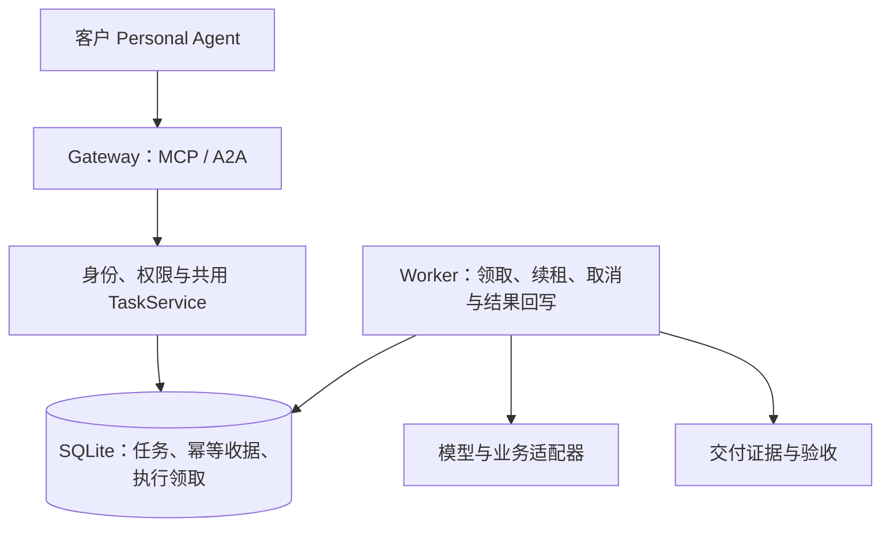

# EIGOS · 艾戈斯

Consider It Done. — The Execution Network for AI Agents.

EIGOS 的执行网络原型采用 **一个仓库、Gateway 与 Worker 两个独立进程、共用任务核心**。Gateway 负责接入，Worker 负责模型与业务执行。目录、启动与故障行为见 [Gateway／Worker 架构](docs/gateway-worker.md)。

协议接入：**远程 MCP 与 A2A 共用认证、任务库和业务逻辑**。两个入口不需要依次经过，客户根据自身能力选一个即可。

## 已实现

- MCP `2026-07-28` 无状态 HTTP 入口；官方 SDK 同时提供 `2025-11-25` 等旧版的无状态兼容路径。
- A2A `1.0` JSON-RPC：公开 Agent Card、提交消息、查询／列举任务、补问后续接、取消。
- 共用 SQLite 持久任务、消息和交付物；任务在服务重启后保留。
- 以受信任的 `issuer + tenant_id + sub` 隔离任务；权限来自验证后的令牌。
- OAuth 资源服务器接入：保护资源发现、401 challenge、JWKS 签名校验、issuer／audience／有效期／scope 检查。
- 本地开发使用自动生成的随机 Bearer 令牌，仅允许绑定 loopback。
- 提交／回复的幂等记录，避免重试产生重复任务；相同 request ID 配不同输入会被拒绝。
- 官方 MCP 和 A2A 客户端的跨协议集成测试、GitHub Actions CI。

当前有两项明确分开的能力：

- **`brief.prepare`**：固定流程整理任务说明，`execution: not_started`，不执行说明中的业务。
- **`agent.execute`（需显式启用）**：通过本地已登录的 Codex 运行真实模型。模型读取目标和完整任务历史，自主提出必要问题，收到答复后生成完整 Markdown 文档／计划。它不具备外部研究、预订、发送或付款工具；生成文档是本阶段实际交付的服务。

本体驱动的业务动作与验收器仍待实现，不能把模型返回 completed 当成任意业务已经可靠履约。方向见 [本体与执行边界](docs/ontology-execution-direction.md)。

2026-10-15 已完成一次 **Grok Bot → A2A → EIGOS 真实执行 Agent** 的提问、回复和交付，未使用 MCP 桥接。见 [真实联调证据](docs/evidence/grok-a2a-2026-10-15/README.md)及[最终交付物](docs/evidence/grok-a2a-2026-10-15/deliverable.md)。这是通过 Grok Bot 已有的电脑执行能力发出 A2A 请求，不是对其原生 A2A 连接器的声明。

## 美团跑腿只读查询

可选的 `meituan.paotui.read` 已接入共用 MCP/A2A 任务入口，支持本人授权状态、地址簿、POI 地址搜索和费用预览。仅允许本地单用户开发模式；没有下单或支付入口。配置与实际验证见 [跑腿接入说明](docs/meituan-paotui-integration.md)。

另有待启用的 `meituan.paotui.order`：保存预览、匹配用户确认、持久化防重并提供支付链接。当前真实下单开关明确关闭；完整流程仅通过测试替身验证，见 [跑腿订单流程](docs/meituan-paotui-orders.md)。

## 本地运行

要求 Node.js **22.13+**，建议 Node 22 LTS；该版本的内置 SQLite 可能显示实验性提示。

```sh
npm ci
npm run setup:dev
npm run dev
```

`dev` 同时启动独立的 Gateway 和 Worker；也可在两个终端分别运行 `npm run dev:gateway`、`npm run dev:worker`。两者使用同一个本机 `DATABASE_PATH` 文件。

`setup:dev` 创建权限为 `0600` 的 `.env`，不覆盖已有文件，也不会打印密钥。`.env` 和 `data/` 不进入 Git。

| 入口 | 地址 |
| --- | --- |
| 健康检查 | `http://127.0.0.1:3000/health` |
| MCP | `http://127.0.0.1:3000/mcp` |
| A2A Agent Card | `http://127.0.0.1:3000/.well-known/agent-card.json` |
| A2A JSON-RPC | `http://127.0.0.1:3000/a2a` |

在另一个终端运行：

```sh
npm run example
```

示例用 MCP 创建任务，用 A2A 回答问题，再用 MCP 读回同一份交付物。它从 `.env` 读取令牌，不输出令牌。

远程云端 Bot 无法访问你电脑的 `127.0.0.1`。连接此类客户端需要另行部署 HTTPS 服务，配置真实身份提供方，并验证该客户端的协议版本和认证方式。

### 启用真实执行 Agent

本机安装 Codex CLI 并完成 `codex login` 后，在私有 `.env` 中加入 `EIGOS_EXECUTOR=codex`。可以用 `EIGOS_CODEX_BIN` 指定可执行文件。Gateway 和 Worker 都应用配置并重启后，能力目录和 Agent Card 才会公布 `agent.execute`。

通过 A2A 发纯文本新任务时，启用了模型便默认交给执行 Agent；结构化请求显式填写 `service: agent.execute`。MCP 的 `submit_task` 同样需要显式填写这个 service。执行中返回 working，补问返回 input-required，交付物是 Markdown。完整接法见 [接入指南](docs/integration.md#6-真实执行-agent)。

## 两种入口

可选的 **`life.request` 生活服务需求转交**支持购物、酒店、机票、跑腿、外送及家政等原始目标登记。PA 可按意图发现服务，不必每次点名 EIGOS。该入口只返回持久任务与未执行回执，提供方执行尚未接入；不会搜索商品／房票、创建订单或付款。开启、Grok 常驻连接及验收见 [生活需求转交](docs/life-request-intake.md)。



MCP 提供六个工具：`list_services`、`submit_task`、`get_task`、`list_tasks`、`reply_to_task`、`cancel_task`。补问采用普通工具结果与后续回复，因此不要求客户端支持 MRTR 或 Tasks 扩展。本版本不宣称实现这些扩展。

A2A 使用官方 SDK 实现 `SendMessage`、`GetTask`、`ListTasks`、`CancelTask`。Agent Card 如实声明不支持流式响应、推送通知及扩展卡；相应方法返回协议错误。

## OAuth 与会员登录

此仓库实现 **OAuth 资源服务器和会员中心**。会员通过可配置 OIDC 身份提供方登录，在 `/members` 填写基础资料并明确同意开通后，已获 OAuth 授权的个人助手才能调用服务。MCP、A2A 和任务业务授权 API 共用会员状态检查；停用会员或助手连接会立即阻止新调用。

生产接入时，将 `.env.example` 复制为 `.env`，配置自己的 OIDC/OAuth 身份提供方。身份账号注册、OAuth 授权、客户端注册和令牌签发／刷新由该提供方负责；EIGOS 保存会员资料、开通状态和本地连接停用记录。会员登录使用 Authorization Code + PKCE、state、nonce 和签名验证，不保存上游访问／刷新令牌。默认自助开通，也可配置人工审核。配置、接入顺序与管理方式见 [会员资料库与 OAuth](docs/membership.md)。套餐、订阅计费和支付授权尚未实现。

选用 Auth0 托管身份服务，保留通用 OIDC 接口和 EIGOS 自己的会员库。真实会员登录、授权及 Agent 调用已在私有 HTTPS 环境验证。现在支持由客户 Agent 发起安装实例登记、会员申请、等待邀请及 Token 自动轮换续期，MCP／A2A 共用资格与停用检查。接入方法见 [Agent 自助登记](docs/agent-onboarding.md)，提供方配置见 [Auth0 接入方案](docs/auth0-integration.md)。

令牌必须满足：

- `typ: at+jwt`；签名算法为 RS256、ES256 或 EdDSA。
- `iss`、`aud` 与配置精确匹配；`aud` 是整个 EIGOS 网关的资源标识，两种入口共用。
- 包含 `sub`、已配置的租户 claim（默认 `tenant_id`）、`client_id`、`scope`、`iat`、`exp`，有效期不超过 15 分钟。
- `services:read` 查看能力；`tasks:read` 读取与列举任务；`tasks:write` 提交、回复和取消自己的任务。

没有身份提供方配置时，默认 JWT 模式会拒绝启动。未配置会员网页登录应用时，会员中心明确显示登录尚未开放；JWT 服务继续拒绝尚未开通的会员。本地开发令牌仍仅用于 loopback，不属于会员 OAuth 联调。

完整的请求格式、身份提供方配置和部署说明见 [接入指南](docs/integration.md)。

## 验证

```sh
npm run check
npm test
npm run build
```

测试覆盖真实 loopback HTTP 请求、官方 SDK 互操作、跨入口任务续接、跨组织／跨用户隔离、权限不足、伪造／过期／错误用途令牌、幂等冲突、取消、重启持久化和来源检查。测试使用本地签发的测试访问令牌，**不代表第三方会员 OAuth 登录、Grok Bot／MUSE 兼容性或生产部署已验证**。

## 当前运行边界

- Gateway 与 Worker 共用同一台机器上的持久 SQLite 文件。支持同机多 Worker 原子领取，当前不支持跨机器数据库副本或网络文件系统部署。
- 模型执行器只在 Worker 内运行，通过有超时的本地 Codex 子进程调用模型；同一数据库最多同时领取两个任务，每个文档任务最多六次模型调用。尚无实际商业执行连接器、Payment、Webhook 推送或自动收费。
- Gateway 重启不影响排队和正在执行的任务。Worker 中断后，已领取任务在租约过期检查时标记 failed，不自动重放；未领取任务保留。取消由 Worker 检测并中止调用，迟到结果不能覆盖取消状态。
- 自包含 JWT 的撤销存在令牌有效期窗口；需要即时撤销时，增加身份提供方 introspection 或服务端撤销记录后再上线该能力。
- Docker 镜像包含两个入口，默认启动 Gateway；Worker 可独立启动。Codex CLI 和登录凭据需在 Worker 环境单独准备。

## 项目资料

- [品牌说明与 Logo 评审方向](docs/brand-brief.md)：EIGOS 为优先候选，商业使用与商标状态待核查。
- [协议研究](docs/agent-protocol-research-2026-10-14.md)：MCP、A2A、ACP 与支付协议的职责边界。
- [项目协作规则](AGENTS.md)。

## CSV 数据质量审计模拟试点

新增可选服务 `data.quality.audit.simulated`：预置合成 CSV → 报价确认 → 模拟付款 → 报告交付 → 独立固定预期验收 → 补交或模拟退款。默认关闭，仅允许非生产 loopback；没有支付宝网络客户端或真钱模式。

运行 `npm run demo:csv-pilot` 会生成三条本地证据链到 `output/csv-audit-pilot/`：正常交付、错误报告补交成功、持续错误后模拟退款。脚本不加载 `.env`，不调用外部服务。要通过 MCP/A2A 使用，显式设置 `EIGOS_CSV_PILOT=true`，配置与调用见 [CSV 试点说明](docs/csv-audit-pilot.md)。

CSV 试点现支持专用目录内的真实 UTF-8 CSV 文件（固定四个必需列、可有额外列），以 `fileName` 提交并独立复算验收。`npm run demo:csv-agent -- output/csv-file-new --generated-file` 可让真实 Agent 使用一份新生成的磁盘 CSV 演示正常交付、错误补交和模拟退款；详情见运行说明。

## Ontology/OAG CSV 委托

可选 `eigos.delegate` 支持 A2A 自然语言委托：真实协调模型依据版本化 CSV 本体判断范围、补问文件名；程序检查文件并生成绑定计划；经独立授权接口确认后执行现有 CSV 审计，独立验收通过才交付。付款仍为本地模拟。配置、状态与 Grok 可复用接入见 [CSV 本体闭环](docs/csv-ontology-delegation.md)。

2026-10-15 Grok Bot 已通过保存的接入技能完成两次独立 CSV 委托，首次补问、后续复用、计划授权、执行和独立验收均通过；原始证据见 [Grok OAG 联调](docs/evidence/grok-oag-2026-10-15/README.md)。

## 可注册能力路由

`eigos.delegate` 已通过通用注册表选择 CSV 审计或 `brief.prepare`，不再将所有委托绑定到 CSV。模型选择候选，能力包校验输入并负责执行和验收；任务说明完成仍明确为 `execution: not_started`。接口、扩展方法和真实选路验证见 [可注册能力](docs/registered-capabilities.md)。
