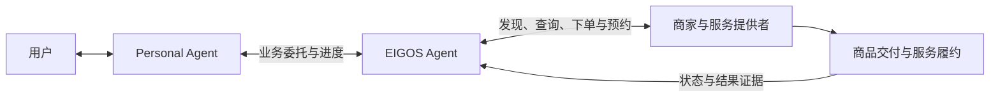

# EIGOS · 艾戈斯

**Consider It Done.** — The Execution Network for AI Agents.

EIGOS 正在构建一个 **Agentic Network**，让 AI Agent 能够连接现实世界的商家与服务，将用户需求推进为订单、预约和实际交付。

用户向自己的 Personal Agent（PA，个人 Agent）表达需求，PA 将需要执行的业务委托给 EIGOS。我们的 Agent 理解目标、寻找合适的服务、确认条件，在授权范围内推进下单与预约，并跟踪后续结果。

我们希望建立一个让个人 Agent、商家和服务提供者协作的网络，使“帮我办这件事”成为可以交接、执行和核验的业务委托。

## 这个网络连接谁

| 参与者 | 在网络中的角色 |
| --- | --- |
| 用户与 Personal Agent | 表达目标、提供必要的偏好与约束、作出业务授权，并接收进度和结果 |
| EIGOS Agent | 承接受委托的业务，发现服务、比较方案、协调执行，并核验结果 |
| 商家与服务提供者 | 提供商品、报价、预约和订单接口，完成其系统中的交易与实际履约 |

PA 保有与用户的关系和整体目标。EIGOS 专注于交给它的那段业务；商家和服务提供者继续使用自己的业务系统。网络通过已有 API、MCP 和其他适合的连接方式接入这些能力。

## 一次委托如何完成

以“帮我购买一件商品，在预算内送到指定地址”为例，EIGOS 要实现的流程是：

1. **理解需求**：明确商品、规格、预算、目的地和交付时间；缺少的信息通过 PA 补充。
2. **连接服务**：查询可接入的商家，取得商品、价格、可供数量与配送条件。
3. **形成方案**：根据用户约束比较选择，核对完整费用、服务规则和可执行条件。
4. **确认授权**：将需要授权的具体订单、金额和条款交给用户或有相应权限的 PA。
5. **推进交易**：在授权范围内下单，并按服务接入方式衔接付款与履约。
6. **跟踪结果**：读取原订单和服务状态，核验是否达到交付目标；遇到异常时继续查证或进入售后处理。

这也是我们希望延伸到预约、出行和生活服务的协作方式。下图表示网络的目标流程：

## 为什么建设这个网络

完成一件业务，需要把分散的信息与动作连起来：商品是否符合要求、报价包含哪些费用、用户允许执行什么、订单进行到哪一步，以及最终是否交付。

EIGOS 希望为这些环节建立持续的业务上下文和共同的判断规则。个人 Agent 可以交出明确目标；商家和服务提供者可以把已有能力接入 Agent 使用的执行流程。每一次委托都应有清楚的范围、执行进度和完成依据。

## 核心设计

- **由 Agent 根据目标选择动作**：读取可用服务和来源事实，形成方案，并根据执行反馈继续决策。
- **用 Ontology 表达业务**：把商品、报价、订单、预约、授权和履约结果组织成有关系的业务对象，为决策和核验提供共同语义。
- **将授权落实到具体操作**：执行前核对动作、对象、金额和有效范围，付款通过相应的 PA／用户支付工具与服务商流程衔接。
- **保留可恢复的任务与结果记录**：持续跟踪原业务操作，处理补充信息、中断和未知结果，并依据服务商记录判断完成情况。

技术上，项目采用 TypeScript／Node.js，使用 Ontology + LLM 组织业务执行，通过 MCP 和 A2A 接收 Agent 委托。独立 Gateway／Worker 与共享任务核心负责接入、持久执行和状态恢复。

## 当前进展

项目处于开发原型阶段，已实现 Agent 委托入口、本体驱动的规划与动作循环、授权校验、任务恢复和结果核验机制。

真实来源接入目前覆盖受限的美团地点、地址与运费查询，以及 Shopify 公开商品查询。下单、付款衔接、交付跟踪和售后流程正在本地测试商家与合成数据环境中验证；真实交易与履约仍待接入。上面的购买流程描述建设目标，具体可用能力以接入文档为准。

## 进一步了解与参与开发

- [Agent 接入指南](docs/integration.md)：通过 MCP／A2A 发现能力、提交委托和接收结果。
- [PA、EIGOS 与服务提供者的分工](docs/agent-mcp-ontology-responsibilities-2026-10-22.md)：委托边界、连接复用与业务责任。
- [本体设计](docs/ontology-spec-v0.2-2026-10-18.md)：业务对象、关系、规则与执行模型。
- [开发与运行](docs/gateway-worker.md)：环境准备、启动方式和 Gateway／Worker 架构。
- [能力实现与验证范围](docs/registered-capabilities.md)：各项接入的具体状态及验证记录。

EIGOS（艾戈斯）为项目当前候选品牌，商标可用性尚待核查；详见[品牌说明](docs/brand-brief.md)。
