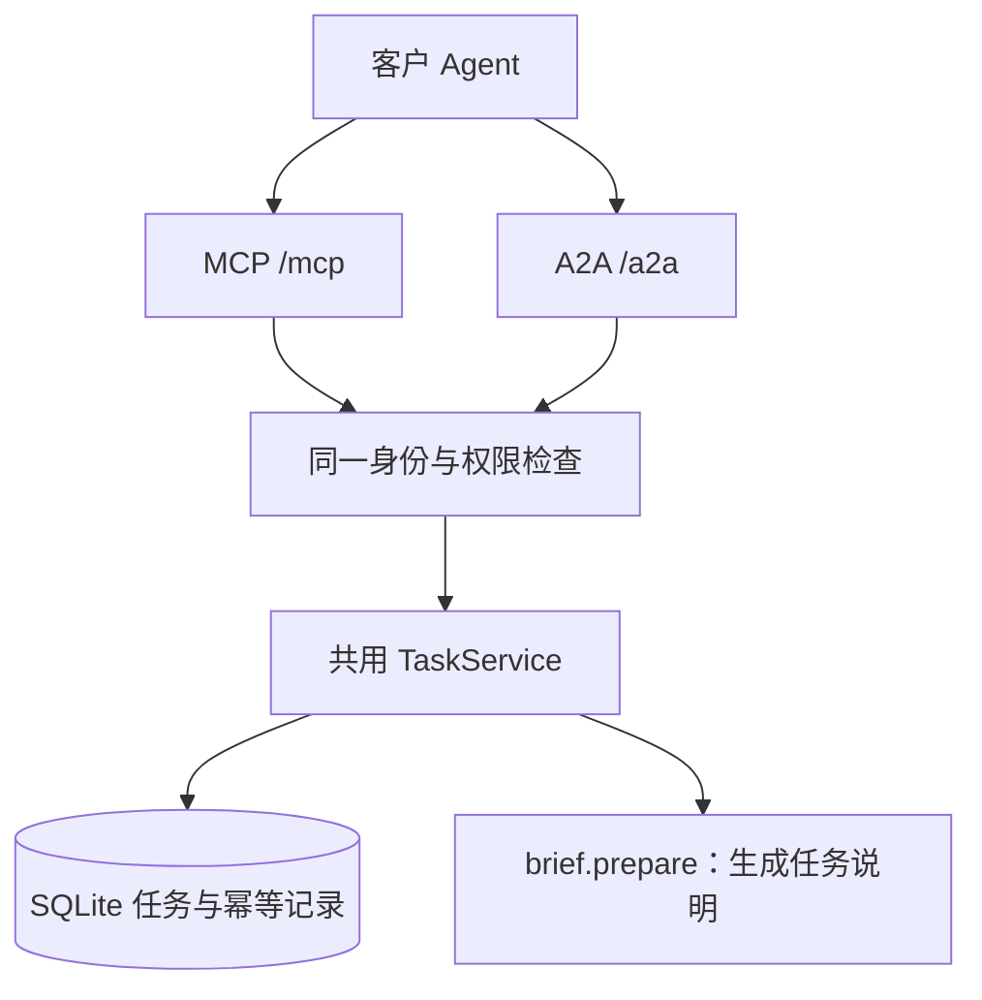

# EIGOS · 艾戈斯

Consider It Done. — The Execution Network for AI Agents.

EIGOS 的协议接入原型：**远程 MCP 与 A2A 共用认证、任务库和业务逻辑**。两个入口不需要依次经过，客户根据自身能力选一个即可。

## 已实现

- MCP `2026-07-28` 无状态 HTTP 入口；官方 SDK 同时提供 `2025-11-25` 等旧版的无状态兼容路径。
- A2A `1.0` JSON-RPC：公开 Agent Card、提交消息、查询／列举任务、补问后续接、取消。
- 共用 SQLite 持久任务、消息和交付物；任务在服务重启后保留。
- 以受信任的 `issuer + tenant_id + sub` 隔离任务；权限来自验证后的令牌。
- OAuth 资源服务器接入：保护资源发现、401 challenge、JWKS 签名校验、issuer／audience／有效期／scope 检查。
- 本地开发使用自动生成的随机 Bearer 令牌，仅允许绑定 loopback。
- 提交／回复的幂等记录，避免重试产生重复任务；相同 request ID 配不同输入会被拒绝。
- 官方 MCP 和 A2A 客户端的跨协议集成测试、GitHub Actions CI。

**当前实际能力只有 `brief.prepare`：收集目标与交付要求，生成结构化任务说明。** 它会补问缺失的交付要求，但不会研究市场、预订、发消息或付款。交付物的 `execution: not_started` 明确保留这一边界。这里验证的是接入闭环，不是通用 Agent 已经能完成任意业务。

## 本地运行

要求 Node.js **22.13+**，建议 Node 22 LTS；该版本的内置 SQLite 可能显示实验性提示。

```sh
npm ci
npm run setup:dev
npm run dev
```

`setup:dev` 创建权限为 `0600` 的 `.env`，不覆盖已有文件，也不会打印密钥。`.env` 和 `data/` 不进入 Git。

| 入口 | 地址 |
| --- | --- |
| 健康检查 | `http://127.0.0.1:3000/health` |
| MCP | `http://127.0.0.1:3000/mcp` |
| A2A Agent Card | `http://127.0.0.1:3000/.well-known/agent-card.json` |
| A2A JSON-RPC | `http://127.0.0.1:3000/a2a` |

在另一个终端运行：

```sh
npm run example
```

示例用 MCP 创建任务，用 A2A 回答问题，再用 MCP 读回同一份交付物。它从 `.env` 读取令牌，不输出令牌。

远程云端 Bot 无法访问你电脑的 `127.0.0.1`。连接此类客户端需要另行部署 HTTPS 服务，配置真实身份提供方，并验证该客户端的协议版本和认证方式。

## 两种入口



MCP 提供六个工具：`list_services`、`submit_task`、`get_task`、`list_tasks`、`reply_to_task`、`cancel_task`。补问采用普通工具结果与后续回复，因此不要求客户端支持 MRTR 或 Tasks 扩展。本版本不宣称实现这些扩展。

A2A 使用官方 SDK 实现 `SendMessage`、`GetTask`、`ListTasks`、`CancelTask`。Agent Card 如实声明不支持流式响应、推送通知及扩展卡；相应方法返回协议错误。

## OAuth 与会员登录

此仓库实现 **OAuth 资源服务器**，可以验证身份提供方签发的访问令牌。它不签发登录令牌，也尚未提供会员注册页面、套餐管理、订阅计费或支付授权。

生产接入时，将 `.env.example` 复制为 `.env`，配置自己的 OIDC/OAuth 身份提供方。账号注册、登录、同意授权、客户端注册、刷新令牌由该提供方负责；EIGOS 只接受符合约定的访问令牌。

令牌必须满足：

- `typ: at+jwt`；签名算法为 RS256、ES256 或 EdDSA。
- `iss`、`aud` 与配置精确匹配；`aud` 是整个 EIGOS 网关的资源标识，两种入口共用。
- 包含 `sub`、`tenant_id`、`client_id`、`scope`、`iat`、`exp`，有效期不超过 15 分钟。
- `services:read` 查看能力；`tasks:read` 读取与列举任务；`tasks:write` 提交、回复和取消自己的任务。

没有身份提供方配置时，默认 JWT 模式会拒绝启动。本地开发模式不会发布虚构的 OAuth 登录端点。

完整的请求格式、身份提供方配置和部署说明见 [接入指南](docs/integration.md)。

## 验证

```sh
npm run check
npm test
npm run build
```

测试覆盖真实 loopback HTTP 请求、官方 SDK 互操作、跨入口任务续接、跨组织／跨用户隔离、权限不足、伪造／过期／错误用途令牌、幂等冲突、取消、重启持久化和来源检查。测试使用本地签发的测试访问令牌，**不代表第三方会员 OAuth 登录、Grok Bot／MUSE 兼容性或生产部署已验证**。

## 当前运行边界

- MCP 协议入口无状态，业务任务持久化；当前存储面向单实例、本地持久磁盘。多副本／无持久盘部署需要共享数据库与相应运行时，不能直接复制 SQLite 文件启动多个实例。
- 暂无后台 LLM worker、实际商业执行连接器、Payment 适配器、Webhook 推送或自动收费。
- 自包含 JWT 的撤销存在令牌有效期窗口；需要即时撤销时，增加身份提供方 introspection 或服务端撤销记录后再上线该能力。
- Dockerfile 是部署准备文件；本次未开通云资源或发布公网服务。

## 项目资料

- [品牌说明与 Logo 评审方向](docs/brand-brief.md)：EIGOS 为优先候选，商业使用与商标状态待核查。
- [协议研究](docs/agent-protocol-research-2026-10-14.md)：MCP、A2A、ACP 与支付协议的职责边界。
- [项目协作规则](AGENTS.md)。
