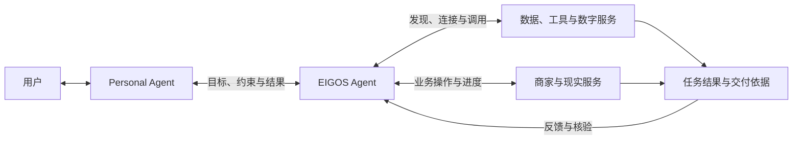

# EIGOS · 艾戈斯

**Consider It Done.** — The Execution Network for AI Agents.

EIGOS 正在构建一个 **Agentic Network**：通过我们的 Agent 连接各类服务，让用户与其 Agent 能够把目标交给网络，由 EIGOS 协调所需能力、推进执行并核验结果。

用户向自己的 Personal Agent（PA，个人 Agent）表达需求，PA 将明确的任务委托给 EIGOS。EIGOS Agent 理解目标、发现并连接适合的服务，根据任务进展选择下一步动作，直到取得结果或明确需要补充信息、人工处理。

这个网络面向信息查询、数据处理、业务操作和现实服务等任务。购物、预约、出行是它的应用场景；网络的核心是让不同服务能够被 Agent 发现、连接和协同使用，完成受委托的任务。

## 这个网络连接谁

| 参与者 | 在网络中的角色 |
| --- | --- |
| 用户与 Personal Agent | 表达目标、提供必要的偏好与约束、作出业务授权，并接收进度和结果 |
| EIGOS Agent | 承接任务，理解目标、发现服务、组织行动、协调执行，并核验结果 |
| 各类服务提供者 | 提供数据、工具、数字服务或现实业务能力，执行各自负责的操作并返回结果 |

PA 保有与用户的关系和整体目标。EIGOS 负责受委托任务中的服务连接、执行协调和结果核验；服务提供者负责各自系统中的操作与交付。网络通过已有 API、MCP 和其他适合的连接方式复用这些能力。

## 一次委托如何完成

EIGOS 要建立一套围绕任务目标持续推进的协作流程：

1. **理解目标**：明确要完成什么、有哪些约束，以及怎样判断完成；缺少的信息通过 PA 补充。
2. **发现与连接服务**：查找任务需要的能力，确认可访问的来源、服务条件与权限。
3. **组织行动**：结合来源事实和任务规则形成方案，确定动作顺序与依赖关系。
4. **按权限执行**：在已有授权范围内调用服务；需要额外业务许可时，交给用户或有相应权限的 PA 确认。
5. **根据反馈推进**：读取每一步结果，决定继续、调整方案、等待外部进度或请求人工处理。
6. **核验并交付**：按原目标检查结果，将完成情况、交付物和必要依据返回 PA。

一次任务可以通过单个服务完成，也可以需要多个服务协作。下图表示网络的目标协作方式：

## 应用方向

- **信息与数据任务**：连接数据来源、查询和处理工具，完成检索、比较、分析或文档交付。
- **业务与生活服务**：连接服务平台，推进购买、预约、出行等具体业务，并跟踪后续结果。
- **多步骤协作任务**：围绕同一个目标组织多个服务，传递必要上下文，处理依赖和中断，核对最终完成情况。

这些方向共用任务理解、服务连接、授权、执行与结果核验机制。各场景的实际支持范围取决于已接入并验证的服务。

## 为什么建设这个网络

完成一个任务，需要把分散的能力与动作连起来：哪些服务能满足目标、输入和结果如何衔接、当前允许执行什么、过程进行到哪一步，以及最终是否达到要求。

EIGOS 希望为这些环节建立持续的任务上下文和共同的判断规则。个人 Agent 可以委托明确目标；服务提供者可以将已有能力接入网络。网络建设的价值，要通过可完成的任务、可用的服务和可靠的执行结果来验证。

## 核心设计

- **由 Agent 根据目标选择动作**：读取可用服务和来源事实，形成方案，并根据执行反馈继续决策。
- **用 Ontology 表达业务**：把任务、服务、条件、动作和结果，以及具体领域中的业务对象组织起来，为决策和核验提供共同语义。
- **将授权落实到具体操作**：执行前核对动作、对象、访问范围和有效期；涉及金额或其他业务条件时，按相应服务规则核对许可。
- **保留可恢复的任务与结果记录**：持续跟踪原业务操作，处理补充信息、中断和未知结果，并依据服务商记录判断完成情况。

技术上，项目采用 TypeScript／Node.js，使用 Ontology + LLM 组织业务执行，通过 MCP 和 A2A 接收 Agent 委托。独立 Gateway／Worker 与共享任务核心负责接入、持久执行和状态恢复。

## 当前进展

项目处于开发原型阶段，已实现 Agent 委托入口、本体驱动的规划与动作循环、授权校验、任务恢复和结果核验机制。

现有实现包含文档草稿生成、本地 CSV 模拟审计，以及受限的美团地点／地址／运费和 Shopify 公开商品查询。跨服务业务流程、交易与履约相关机制在本地测试服务和合成数据环境中验证，真实交易与履约仍待接入。以上网络流程和应用方向描述建设目标，具体可用能力与配置要求见接入文档。

## 进一步了解与参与开发

- [文档导航](docs/README.md)：当前接入与开发文档、设计资料和历史验证归档。
- [Agent 接入指南](docs/integration.md)：通过 MCP／A2A 发现能力、提交委托和接收结果。
- [PA、EIGOS 与服务提供者的分工](docs/agent-mcp-ontology-responsibilities-2026-10-22.md)：委托边界、连接复用与业务责任。
- [本体设计](docs/ontology-spec-v0.2-2026-10-18.md)：业务对象、关系、规则与执行模型。
- [开发与运行](docs/gateway-worker.md)：环境准备、启动方式和 Gateway／Worker 架构。
- [能力实现与验证范围](docs/registered-capabilities.md)：各项接入的具体状态及验证记录。

EIGOS（艾戈斯）为项目当前候选品牌，商标可用性尚待核查；详见[品牌说明](docs/brand-brief.md)。
