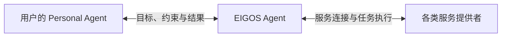

# EIGOS · 艾戈斯

**Consider It Done.** — The Execution Network for AI Agents.

EIGOS 正在构建一个 **Agentic Network**：通过我们的 Agent 连接各类服务，协调所需能力，完成用户与其 Agent 委托的任务。

用户通过自己的 Personal Agent（PA，个人 Agent）表达目标，EIGOS Agent 负责发现和连接适合的服务、组织行动、推进执行，并核验最终结果。服务提供者负责各自系统中的操作与交付。

## 网络如何协作

我们要建立的网络围绕三个重点展开：

- **服务连接**：让数据、工具、数字服务和现实业务能力能够被 Agent 发现并使用。
- **任务执行**：围绕明确目标，在授权范围内组织一个或多个服务协作，根据反馈持续推进。
- **任务完成**：跟踪执行进度，核对交付结果，向用户的 Agent 返回完成情况与依据；遇到异常时明确反馈。

信息查询、数据处理、购物、预约和出行都是应用场景。EIGOS 的建设主线是把分散的服务连接成能够协作完成任务的网络。

## 项目进展与文档

项目目前处于开发原型阶段。具体能力、接入方式、实现设计和验证范围见：

- [文档导航](docs/README.md)
- [Agent 接入指南](docs/integration.md)
- [能力实现与验证范围](docs/architecture/capabilities.md)
- [共享本体与 MCP](packages/ontology/README.md)
- [单次模型决策的只读执行与测速](docs/guides/single-read-execution.md)
- [仓库结构与维护](docs/architecture/repository.md)

EIGOS（艾戈斯）为当前候选品牌，详见[品牌说明](docs/brand-brief.md)。
