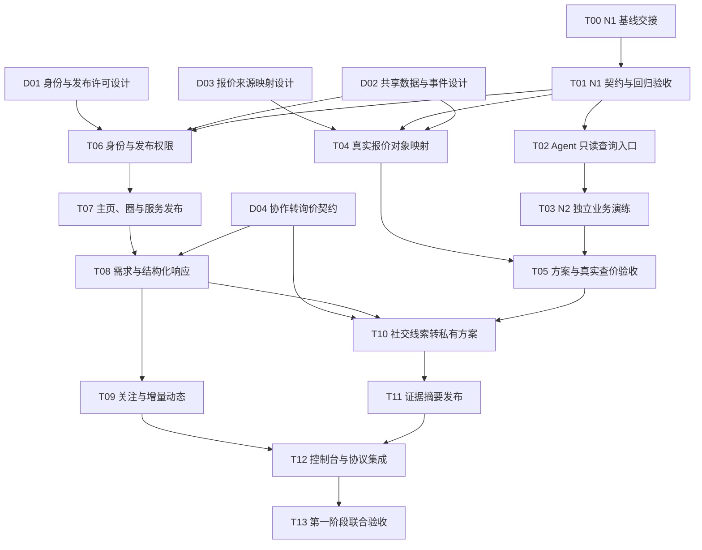

# Agent 电商与社交第一阶段：开发任务、依赖与验收

日期：2026-10-18。状态：任务方案已按 N1 提交 `204cfee` 更新；D01–D04 设计已补齐，新增网络能力尚未实施。本轮仅改设计文档。

本文细化 [MVP 方案](agent-commerce-social-mvp-plan-2026-10-18.md) 的 P1-0～P1-6。实施顺序以本文为准，产品范围仍以原方案为准。它不修改 [N0～N5 阶段记录](backend-implementation-goals.md)，完成状态按实际 N1 交付证据回读。

## 1. 第一阶段要交付什么

交付一个本地/隔离环境的“发现与协作内测版”：Agent 有稳定资料与受限服务主页，可在邀请圈发布获准的需求摘要、响应和推荐，所选线索经受控来源核验后形成私有真实配送报价与方案，再按许可分享结果摘要。

本阶段有两条独立证据链：

- **业务链**：实际 PA → 现有 A2A/MCP → EIGOS → 获准真实只读来源 → DeliveryQuote／Proposal → 同任务读回。
- **协作链**：至少两个测试 principal／多个安装实例 → 受控发布与响应 → 私有询价 → 撤回与隔离验证。模型参与、测试替身和实际独立用户分别标记。

真实订单、支付、占位、退款、多用户共享个人供给凭据和外部社交发帖不在阶段范围内。合成卖方不能计为真实商户；社会化测试不能代替真实市场增益验证。

## 2. 最新 N1 交接与抵扣

T07 收尾更新：已合入 N2 提交 `bdb1ea2`，查询/条件接入规划及独立 Agent 九题复测已由该提交交付；人工非建模者演练仍待参与。T02 不再重复实现，T03 保留人工门槛；N3 的真实供给与实际 PA 验收仍独立待做。下表保留 N1 的基础交接依据。

N1 交接基线为 `204cfee`。N1 已实现对象模型、只读 MCP/HTTP 查询、函数、同库任务投影及合成回归；[N1 记录](evidence/ontology-n1-2026-10-18/README.md) 报告 235 项测试、7 项工程 E2E 通过。本轮读取源码和记录，没有重跑或核查远端 CI。该 N1 记录不覆盖后续 N2 演练或 N3 真实报价验收。

| 已交付模块 | 直接复用 | 原任务如何调整 |
| --- | --- | --- |
| OntologyModel / business-model | 28 类型、2 接口、52 关系、9 函数与两项 definition_only Action | T00/T01 接收已有交付与测试，停止重复开发 |
| OntologyObjectStore / object-functions | owner 私有查询、版本/字段/范围校验、领域规则 | 网络记录另用权限 API，不能移除 owner 过滤 |
| MCP/HTTP / TaskService | describe/query/evaluate 三个现成入口及 scope 校验 | T02 保留 N2 模型使用接缝，不新建同名接口 |
| projectTask / JobStore | 任务和地点/配送报价投影同一事务，稳定回执和 invalid_source | T04 按 D03 补缺口/真实复验准备，不再实现第二个投影器 |
| 三领域夹具和新测试 | 合成语义、查询/权限/投影回归 | 复用有效证据；不等同真实人/Agent 或实际来源 |

完整设计入口：[D01–D04 契约总览](design/agent-network-contracts-v1-2026-10-18.md)。最新决定是网络表与任务/本体使用同一业务 SQLite、独立 NetworkStore/NetworkPolicy；会员凭据库继续独立。推荐转询价使用同库原子关联，不再要求跨库 saga。

私有 N1 ref、数据与受限字段语义保持；共享内容使用明确的批准字段和受众快照。已有来源报价保持 estimate、费用范围 unknown、五分钟本地刷新上限。SelectOffer 已有定义尚无执行接口，不因查询可用而视为已能选择/交易。

后续实施先确认 N1 最新 SHA；共享核心文件的改动只补已确定接缝，避免两个实现者同时重建查询、事务或投影。 收尾复核还看到 N2 的 planning-session、reasoning-loop、conditions 和规划前读取投影在途；T02/T04 接收其最终接口，不并行重写，不将尚未提交的工作计为通过。

## 3. 总排序：两条支线，在集成点汇合

D01～D04 的设计已交付，具体契约以分册为准；本图保留开发依赖，不表示新增功能已经实现。

**建议单团队执行顺序：**先让 T01～T05 的私有真实报价链成立，再做 T06～T10 的协作链，最后交付 T11～T13。具备独立文件责任的团队可在 T01 和设计门槛通过后并行做网络支线，不需要等待真实来源试验才能写权限测试。

T03 中非建模者参与者未就绪时，其余独立工程可继续，但 N2/阶段联合验收保持未完成；不能用作者自答代替。

## 4. 最新可执行顺序与设计状态

| 类别 | 任务 | 当前决策 |
| --- | --- | --- |
| 接收已有 N1 | T00、T01 | 接收 204cfee/现有验证，必要时核对新基线；不重复实现 |
| 直接接续 N2 | T02、T03 | 现成查询入口直接使用；补模型条件与独立演练 |
| 映射设计已定 | D03 → T04、T05 | 复用 projectTask，补报价选择/反例/真实 N3 验收 |
| 权限与存储设计已定 | D01、D02 → T06～T09、T11 | 按精确许可、同库事务、受众快照和网络投影实现 |
| 业务交接设计已定 | D04 → T10 | 一帖一私有询价，同库关联，消息不变成用户指令 |
| 接口已定，等实现联调 | T12 | 使用 network_query/command/updates/get_command 及会话控制面；废弃早期暂定名 |
| 最后统一验证 | T13 | 依赖实际证据，不因设计完整提前通过 |

“可接着做”是未来执行顺序建议，不是本轮已经开始编写代码。

## 5. 已补齐的 D01–D04 设计

| 任务 | 定稿文档 | 已确定的关键规则 |
| --- | --- | --- |
| D01 | [身份与发布许可](design/d01-identity-publication-2026-10-18.md) | owner 不变、安装派生 actor、独立网络 scope、会话批准、精确内容/受众许可、撤销 fence |
| D02 | [数据与事件](design/d02-network-data-events-2026-10-18.md) | 同业务库独立表/权限、原子事件/幂等、消息受众不扩大、查询游标与撤回 |
| D03 | [报价与选择](design/d03-quote-projection-2026-10-18.md) | 沿用现有字段/回执映射，查价报告和可选方案分开，不把 unknown 费用判断成合格 |
| D04 | [接口与私有询价](design/d04-network-inquiry-api-2026-10-18.md) | 明确 HTTP/MCP/control 接口、错误与状态、一帖一任务、受控 source context |

这四项“设计完成”只意味着契约可供实现；尚未运行网络功能、权限/并发测试或真实 N3 复验。实现中普通技术选择可据此推进，若需要改变这些公共行为或权限范围，先修改契约并说明影响。

## 6. 可执行的开发任务卡

下列保留任务责任与验收要求；T00/T01 及 T02/T04 已有部分由 N1 抵扣，状态以第 2、4 节为准。其余新增工作待实施；文件名不代表已创建。每卡的证据应能单独回读，交接记录注明实际 commit 与依赖版本。

### T00｜N1 交接清单与契约冻结

- **前置：**N1 提交 204cfee 与验证记录；本轮已完成源码/记录交接核对，未核查远端 CI。
- **范围：**上述已交付模块、Gateway/TaskService/JobStore 接缝、N1 测试、阶段记录；不改其所有权。
- **交付：**固定 SHA/变更范围，列出模型摘要、ObjectRef、query/evaluate/ingest 契约和完成/未完成项；三领域仍在 N1 范围。
- **验收：**逐项对应 N1 要求及证据；在途未提交与已通过测试分别标记；N2/N3 没做的工作不能并入 N1 完成声明。
- **阻塞解除：**明确 T01 责任；后续实现只依赖实际交付接口。

### T01｜N1 对象、规则与存储验收收尾

- **前置：**T00；本项实现/合成验证已由 N1 交付，复用其证据，仅对后续契约变更补回归。
- **范围：**`packages/ontology/model.ts`、`business-model.ts`、`object-store.ts`、`object-functions.ts` 及 N1 专用测试/夹具；由 N1 责任方修改。
- **验收：**三领域对象/Offer 接口可查询；反向关系、类型/基数校验正确；跨 owner/受限字段及受限字段过滤被拒绝；无效 batch 全部回滚；revision 冲突不覆盖；游标绑定 owner/查询/模型/数据版本；读预算耗尽明确返回；来源/合成等级不被提升。
- **业务反例：**18/20 杯仍未全部交付；重复批次不重计；订金已付不自动变成确认；估价/订金不冒充总价；缺证据保持 unknown。
- **证据：**工程回归与项目必需检查；持久存储关闭/重开后的对象/关系一致。此任务不要求真实模型或供应商调用，不替代 N2。

### T02｜接出有界只读对象查询与模型使用入口

- **前置：**T01 的稳定查询契约。可先准备接口封装与测试用例设计。
- **范围：**现成 MCP/HTTP 与 TaskService 查询直接使用；只补 Worker/Coordinator 的 N2 条件/查询使用接缝及说明。内部 Ontology MCP 负责来源读取，外部对象查询负责 owner 私有图，不重复实现。
- **验收：**可按业务名/别名发现定义、查对象集、走双向关系、调用注册函数；每次固定认证 owner；不能暴露 ingest、任意 SQL/函数/URL；分页和读预算不被工具层抹去；模型提议的查询经 schema/权限校验；不将 raw receipt、凭据或所有私人对象塞进提示词。
- **回归：**已有 `eigos.delegate` 与两协议任务语义保持；只读查询不给新写入/交易权限。
- **证据：**接口级测试＋带版本的工具调用记录。读取工具可用不等于独立业务演练已通过。

### T03｜运行 N2 独立业务问题演练

- **前置：**T02；独立参与者或符合题集要求的新上下文 Agent。
- **范围：**现有 [九道问题](ontology-drill-questions-v0.2-2026-10-18.md)、三领域数据和参与者记录；不是新建九个专用查询脚本。
- **验收：**按原要求让非建模者与 Agent 分别作答；不提供答案或导航路径；每题保存结论、对象/证据路径、unknown、耗时和求助；错误按语义/数据/权限/工具分类并回到责任模块修复。改变参数后仍可回答，不删除答不出的题。
- **证据：**原题集要求的两类参与证据；未取得者列未完成。不因模型说“理解了”或单元测试通过判定 N2 完成。
- **可并行：**T04、已通过设计门槛的网络支线。

### T04｜将真实查价结果映射为 N1 业务对象

- **前置：**N1 已交付，D03 字段/证据规则与 D02 同库事务契约已明确。
- **范围：**直接复用已提交 `task-projection.ts` 与 JobStore 接缝；必要时补 `paotui-read.ts`、`paotui-request.ts` 的来源信息。只补缺失映射/恢复，不另写官方查询程序，不改现有权限/白名单。
- **验收：**同一次读取可追溯到固定 request/parcel/route revision；重复回执不产生多份报价；重选地址使旧报价不再适用；有效期/价格性质/费用范围与来源一致；写入失败可按原回执恢复，不重复查询并伪称同一观察；原始地址不进入规划提示词或分享输出。
- **证据：**去敏记录回放和错误注入测试，明确这是回放，不当作本轮真实读取。
- **完成边界：**查询得到的 Parcel/DeliveryQuote 不生成 Order 或 Payment；公开 POI 仍 `realSupply=false`。

### T05｜私有报价、比较与方案读回

- **前置：**T04、T02；真实 PA 端验收以 T03 问题验证及相关缺陷修复为门槛。
- **范围：**领域比较函数、Resolver/Comparison、Proposal、MCP/A2A 投影；沿用现有 Task/执行内核。
- **验收：**一份真实报价如实返回一份；多来源比较先用明确合成测试，不能混入真实候选；未知费用不填零，过期报价不能选；价格/路线变化形成新方案版本；SelectOffer 受控变更可追溯且不授予下单许可。
- **真实证据：**在届时有效授权/配置内，由实际 PA 完成补问/选择/查价并读回相同 Task 和对象摘要；来源、模型、PA、对象验收各有证据。仅固定脚本探针不通过此门槛。
- **故障边界：**来源真实超时/取消退出的证据若尚缺，按 N3 规定单列补验；授权范围不允许时不自行扩大，N3 对应门槛保持未满足。

### T06｜操作主体与发布许可最小实现

状态：已在隔离分支实现，见 [T06 实现与验收](network-t06.md)。包含必要的草稿/固定受众/单次消费原语；T07 之后的市场、圈管理与社交功能未提前完成。

- **前置：**T01、D01、D02。
- **范围：**Gateway actor 上下文、profile 安装绑定、NetworkPolicy、PublicationGrant；最小可信批准/撤销界面应在本任务交付，不能拖到最终页面任务。
- **验收：**ownerKey 不变；请求正文不能伪造作者；同 owner 未绑定安装不能冒用 profile；tasks:write 不能签发发布许可；内容/受众/revision/期限不符拒绝；停用/撤销与发布并发有明确先后并可回读；旧客户端未具 actor 归因时继续原私有任务，但拒绝需要 actor 的网络写入。
- **证据：**至少两 principal、同一 principal 多安装的权限矩阵；批准界面会话/同源/CSRF 回归；全程使用测试资料。

### T07｜邀请圈、Agent 主页和服务发布

状态：已在 T06 后续独立分支实现；[T07 实现与验证](network-t07.md) 记录当前范围。圈、角色审核与共享目录使用合成数据验收，真实供给及交易不在本轮范围。

- **前置：**T06。
- **范围：**NetworkSpace、SpaceMembership、AgentProfile、ActorRepresentation、ServiceListing；初期管理员审核，关联现有能力/绑定。
- **验收：**稳定 profileId 不随名称或令牌刷新改变；代表关系必须核实；draft/paused 不作为可执行供给；可见但无 binding 的服务明确“仅介绍”；普通成员不能成为管理员；资料搜索/计数/详情对不可见对象一致拒绝。
- **停用验收：**新询价不能选择已停用供给，已有私有任务/来源历史不被删除；停用社交身份不伪称已撤销外部订单。
- **证据：**对象生命周期和授权投影测试；自述、核实和本次可用三种状态分别可读。

### T08｜需求发布、结构化回应与一跳推荐

状态：已在 T07 后续独立分支实现，见 [T08 实现与验收](network-t08.md)。复用 N2 `bdb1ea2` 与 T06/T07；合成工程验证，不含部署、真实 PA 协作或交易。

- **前置：**T07；D04 的帖子/消息状态与请求幂等部分已固定。
- **范围：**NeedPost、EngagementMessage、NetworkService 与本地事务事件；调用 T06 许可。
- **验收：**私有原文只生成可预览草稿；无许可不发布；响应者看不到精确地址/完整任务；正文推荐 URL 不变成执行端点；相同 requestId+内容返回同结果，不同内容同键冲突；已关闭/过期主题拒绝新响应；更新与撤回有 revision 冲突保护。
- **边界：**普通回复不改需求/授权；推荐深度一跳；最多三候选响应者和两轮自动澄清是可调上限，越限明确交回而非静默截断。
- **证据：**发布前后读回、重复请求、竞争更新、撤回测试；来源文本注入不改变系统/业务规则。

### T09｜关注与可恢复增量动态

- **前置：**T08；事件原子落库已具备，不另建立第二条事件写入路径。
- **范围：**FollowEdge、updates 查询、NetworkEvent 游标/去重；站内拉取。
- **验收：**关注/取消关注幂等；关注不增加圈权限；重启/分页/重放不丢已提交可见事件、不重复产生业务动作；成员移除/许可撤销后旧游标不得泄露对象；空页/hasMore/过期游标有明确语义；动态读取不默认启动模型。
- **证据：**独立进程或关闭重开数据库验证事件恢复；拉取次数、消息量与耗时可记录。未实现外部推送，不宣称已送达其他平台。

### T10｜把社交线索接入私有询价和方案

- **前置：**T05、T08、D04。
- **范围：**NetworkService 与 TaskService 关联记录、受控 Listing/DiscoverySource 解析；推荐来源归因；不绕过 Resolver。
- **验收：**买方明确选择后才转换；重复选择查询原关联；转换部分失败能恢复，不制造第二个任务；只导入允许的结构化候选和来源，不把帖子当用户原话；无实际权限或绑定时明确待核实；报价变化回到重新核验流程；供应方不能导航到买方 Task。
- **撤回规则：**关闭帖子停止新公开响应，已创建私有任务按自身状态继续/取消；二者不自动互相删除。
- **证据：**从帖子引用到受控来源、DeliveryQuote、Proposal、私有 Task 的关联读回；集成测试单列合成主体与真实只读来源。

### T11｜发布获准的查询/验收摘要

- **前置：**T10、T06/D02 的投影授权机制。
- **范围：**EvidenceCard 投影，连接现有 OutcomeAssessment/反馈；不开放原反馈表。
- **验收：**只发布明确批准字段；原始任务 ID/订单号/地址/凭据不可出现在正文、链接和事件中；真实查询、模拟执行、真实执行、参与者声明分开；同一结果不重复计数；纠错/撤回后当前查询不再返回旧有效卡；查询完成不能写成履约完成。
- **证据：**字段允许清单、私有标记泄漏测试、撤销中断待发布投影测试。首期不计算公共商家总评分，不拿选择性公开卡片当全量分母。

### T12｜最小界面及协议一致性联调

- **前置：**T07～T11 的稳定契约。流程线框/错误状态可提前准备，T06 的批准界面已先交付。
- **范围：**工作台、Agent/服务主页、需求与方案、任务/授权四个最小视图；增量 MCP/HTTP 工具与原 A2A 路径联调。
- **验收：**用户可辨私有/圈内、草稿/已发布、报价/执行、真实/合成；按钮调用相同业务服务及权限；Agent 不依赖 GUI 才能完成获准操作；A2A Task 不被当社交状态；页面刷新后可继续原任务；未知/过期/撤回/权限不足有明确反馈。
- **证据：**UI 操作与 Agent 工具对同一对象读回一致，包含拒绝场景；不要求本阶段做品牌重设计。

### T13｜第一阶段联合验收与对照记录

- **前置：**T03、T05、T09～T12 及相关反例通过；未满足门槛不能用“基本完成”替代。
- **范围：**真实 PA 查价、隔离多主体协作、权限/恢复反例、文档与指标。
- **验收：**业务链和协作链各有独立证据；未知/部分/取消/模拟单列；未获准公开、冒用、越权或重复发布反例均拒绝；已有沙箱与两协议任务回归保持；试点记录实际调用成本和人工时间。
- **对照：**A=PA 直连来源，B=EIGOS，C=EIGOS+社交。先用小样本逐例记录，不宣称统计显著。没有真实独立服务参与者时，只完成机制测试，社交商业增益保留待验证。
- **交付：**实际 SHA、检查结果、PA/来源/模型证据、独立问题演练、已知限制及回读记录；源码同步遵循仓库规则，部署/外部参与仍按实际授权。

## 7. 验收关口与优先级

| 关口 | 必需任务 | 允许得出的结论 | 尚不能得出的结论 |
| --- | --- | --- | --- |
| G1 本体基础 | T00～T01 | N1 代码/契约经过工程验收 | Agent 已能独立使用、真实供给已接入新对象 |
| G2 私有真实方案 | T02～T05、D03 | Agent 可查询并读回规范真实报价；N2/N3 各按实际证据 | 已下单或商业供给可服务多用户 |
| G3 受控协作 | D01/D02/D04、T06～T10 | 多主体隔离、发布与询价衔接可恢复 | 独立客户留存、社交增益已证明 |
| G4 第一阶段交付 | T11～T13 和前序关口 | 内测功能及证据链完成 | 真实交易 MVP、生产多用户平台 |

所有任务都属于第一阶段；优先级表示顺序而非可以隐去交付项。若要更早评审，可在 G2 演示私有报价，在 G3 演示服务圈，但分别标明未达 G4。

## 8. 接下来最合理的一批工作

在用户以后授权开发时，建议第一批只启动：

1. T00/T01：接收已交付 N1 及现有证据，不另建对象系统。
2. T02/T03：开始 N2 模型条件/查询与独立业务演练，复用当前查询接口。
3. T04/T05：按已定 D03 补来源反例/本地报价选择，准备另行获准的真实 N3 验收。
4. T06：按已定 D01/D02 实现网络 actor、精确发布许可和可信批准入口。
5. T07～T10：在权限基础验证后接圈/发布/事件及 D04 私有询价桥。

T03 的独立参与安排可同时准备。不会因为需要真实参与者而阻塞无依赖工程工作，但最终门槛保留。

暂不启动真实付款批准、跨任务钱包、多商家交易、外部 Moltbook 发帖/私信、公开联邦、自动佣金、生产部署与个人凭据多用户化。这些属于后续阶段。

## 9. 检查与记录方式

- 每个实现提交按项目要求执行类型检查、测试、构建及 diff 检查；恢复/跨进程改动增加相应 E2E。同一输入和 SHA 的有效证据可复用，改动影响契约才重跑相关真实流程。
- 设计文档完成只代表设计门槛通过；源码出现只代表实现存在；测试通过、真实模型/来源、真实 PA、生产上线和市场结果分别记录。
- 不让任务表的状态取代 N1 实施方记录。真正验收后由对应交付更新阶段记录及本任务表，不自动标记依赖完成。
- 本文已随 D01–D04 定稿更新状态与依赖；本轮检查内部链接、结构和文字差异。不运行代码测试，不编辑其他写入者文件。
