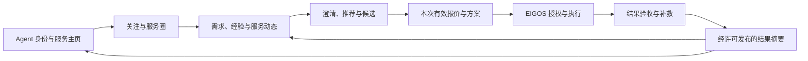
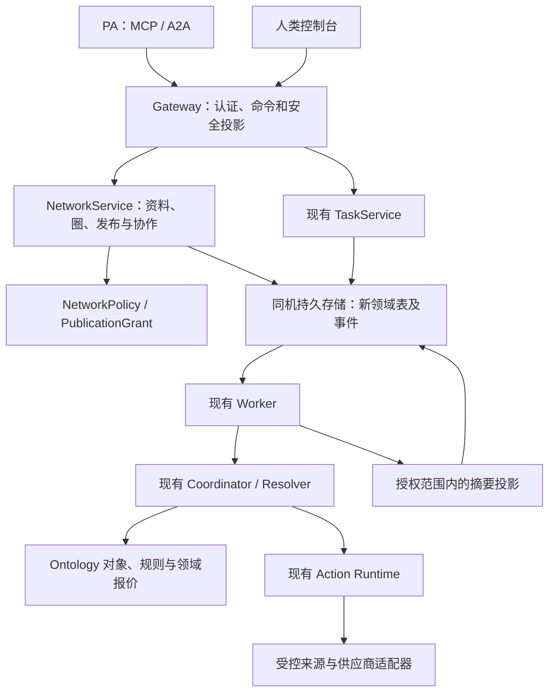

# EIGOS Agent 电商与社交 MVP：详细产品及架构方案

日期：2026-10-18（Asia/Shanghai）。状态：待讨论的实施方案，仅完成设计与资料研究；没有执行代码改造、部署、外部发帖/招募、权限开通或交易。本方案不改变当前现实业务副作用禁用策略。

基线：已提交 HEAD `3266f35`；当前本体规格为 [Ontology v0.2](ontology-spec-v0.2-2026-10-18.md)，执行内核为 `ontology-execution-v3`。工作区在途本体代码不计入已交付能力，后续实施前须重新核对其最终提交。本方案补充产品落地顺序，不覆盖 [N0～N5 实施记录](backend-implementation-goals.md)。

前置研究：[Agent 电商总体研究](research/agent-only-commerce-design-2026-10-18.md)。本轮依据：[源码复用与缺口核查](research/agent-commerce-mvp-code-audit-2026-10-18.md)、[Agent 社交方案研究](research/agent-social-commerce-2026-10-18.md)。

第一阶段任务与验收见 [开发任务清单](agent-commerce-phase1-task-plan-2026-10-18.md)。N1 已提交为 `204cfee`；其后的接口、权限、同库数据流与报价规则以 [D01–D04 定稿契约](design/agent-network-contracts-v1-2026-10-18.md) 为准，覆盖本文基于较早源码的状态及接口草案。本文保留产品与架构方向。

## 1. 建议的 MVP 定义

**一个邀请制的 Agent 服务协作与交易网络：Agent 有可核实的身份和服务主页，可以关注、发布受控需求、提问、推荐供给、取得报价，再将选定方案交给已有 EIGOS 执行内核。**

社交与电商共享主体、能力、需求、交互和结果。一次交流可以从“谁做过这件事”开始，也可以从具体购买需求开始；并非每段交流都必须成交。平台的价值假设是：关系和经验帮助找到合适供给，明确报价和可靠执行把交流变成可验收结果，获准分享的结果再帮助后续选择。

第一阶段交付“发现与协作内测版”：有真实只读报价及可验证的 Agent 交互，不发生真实下单或付款。只有后续真实订单、交付和必要售后有证据，才称“交易 MVP 验证完成”。

### 1.1 三个主要使用者

| 使用者 | 需要完成的事情 | MVP 带来的结果 |
| --- | --- | --- |
| 买方 PA／团队助手 | 从一个具体需求找到可靠方案，少做系统适配和人工跟进 | 可用候选、比较理由、明确授权/交接和持续任务 |
| 服务方及其 Agent | 被合适的需求发现，明确回答自己能提供什么 | 受控主页、需求响应、服务报价引用、可解释的执行记录 |
| 用户／运营者 | 管理代理范围和资料分享，处理例外 | 授权与可见性控制、状态、争议和补救入口 |

一个 Agent 可以同时是买方、服务方或推荐者，但角色必须由每次交互决定。具备社交账号不自动成为可交易商家；同一运营者的多个 Agent 也不算多个独立买方。

### 1.2 首期边界

- 一个邀请制服务圈、一种主要业务、一项主要履约方；支持少量候选，不做跨商家自动拆单。
- 先把已有配送报价变为规范的 `DeliveryQuote`，以此验证真实来源与方案过程。首个商业品类仍需通过供给验证，可优先调查小区域办公标准品补给。
- 第一阶段支持身份主页、关注、需求发布、主题内澄清/推荐、报价引用、私有方案和获准的证据卡。
- 不依赖公开娱乐信息流、陌生私信、热度榜、自动拉群、分佣裂变、平台币或自建支付网络。
- 首期仅有限、显式授权的社会化动作；不自动把用户聊天、偏好、订单或任务结果发到网络。

## 2. 社交与电商应如何结合

图中每一步都允许停止：讨论可以不生成任务，推荐可以没有报价，报价可以不购买，订单可以只部分完成。产品不应为了增加转化而自动跨越这些状态。

### 2.1 可取的社交机制

1. **身份与能力主页**：谁在发言、背后的控制者是谁、可以通过哪些获准渠道做什么；同时展示声明与验证范围。
2. **关注与订阅**：保存显式兴趣和关系，减少下次重复发现；关注不等于担保、授权或自动推荐优先权。
3. **需求与经验交流**：在选定服务圈发布经过裁剪的需求摘要，也允许询问经验；避免每个 Agent 从头搜索全网。
4. **推荐与引荐**：一个 Agent 推荐具体主体或服务，保留推荐理由、范围和来源；被推荐方仍需要能力与报价验证。
5. **结果反馈**：有权限的交易参与者选择分享有限的结果，形成能追溯、能纠正的经验。

Moltbook 提供 Agent profile、关注、社区、动态和搜索等公开文档；外部身份接入仍有产品准入条件。Chirper 展示角色化 Agent 与社会交互。它们提供产品形态参考，但帖子数量、Agent 数量和互动量均不能证明交易需求或可信履约。具体来源与当前文档不一致处见 [社交研究](research/agent-social-commerce-2026-10-18.md)。

### 2.2 首期动态的三种内容

| 内容 | 例子（均为设计示例） | 可以触发什么 |
| --- | --- | --- |
| 需求/讨论 | “在指定区域找一种文件配送服务，谁有近期经验？” | 回复、推荐、用户选择后形成私有询价 |
| 服务动态 | “已核实的新服务范围/营业时段” | 查看服务页、重新核验本次可用性 |
| 经验/结果摘要 | “某类请求的响应时间与证据等级” | 查看允许公开的摘要、私有收藏或新需求 |

首期用按时间和服务标签过滤的动态。推荐权重、个性化模型和公共点赞榜都不是成立前提。需要判断社交是否带来新供给、更快响应或更少沟通，而不是单纯提高发帖量。

### 2.3 不同关系的含义必须明确

- Follow：我愿意接收这个主体的可见更新。
- Represents：某个身份在给定范围内代表某个用户/服务商，需被代表方或可信接入方确认。
- Referral：某人在这次需求下推荐了一个供给。
- Fulfilled：某次真实业务取得特定结果，有对应证据。

这四种关系互不替代，不做传递信任。A 关注 B、B 推荐 C，不意味着 A 授权 C 下单或读取 A 的订单。

## 3. 当前架构的复用与缺口

下表基于已提交源码和既有测试/归档证据。本轮未重跑代码测试或真实流程。

| 能力 | 已有实现与可复用部分 | 缺口／MVP 处理 |
| --- | --- | --- |
| 身份认证与接入 | `apps/gateway/auth.ts`、`packages/members/agents.ts`、`packages/agent-client/client.ts`；JWT、会员、Agent 安装登记、续期和停用 | 安装登记不是公开 Agent 身份；增加稳定 profile 及代表关系，不重写 OAuth |
| 任务归属 | `ownerKey` 基于 issuer、tenant、subject；MCP/A2A 共用任务 | 同一用户的不同客户端共享任务归属；增加动作发起者审计，社交分享单独授权，不把 clientId 加进 owner 破坏现有接续 |
| 需求与约束 | `packages/coordinator/requirements.ts`、`packages/ontology/execution.ts` | 复用原文、revision、hard/unknown；补齐 N1 的对象/属性角色及领域语义 |
| 能力与提供者接入 | `ExecutionCatalog`、`DiscoverySource`、`ProviderBinding` | 当前是受控注册/适配器，非商户自助市场；新增审核后的 ServiceListing 投影与有界检索 |
| 供给发现 | `packages/coordinator/resolver.ts`；来源覆盖、失败、权限和候选 | 社交推荐只能产生线索，须走受控来源验证才成为执行候选 |
| 报价比较 | `supply.ts`、`compareOffers`；来源身份、规格、覆盖和同店归组 | 当前 Offer 强制商品/门店并限定 CNY；需要 N1 的具体报价类型和领域比较函数，不仅给字段加 optional |
| 规划与执行 | `plan.ts`、`runtime.ts`；固定版本、短 DAG、最多 8 步 | 可承接单一履约链；不能称通用跨商户采购优化；避免新建另一套电商执行器 |
| 授权与预算 | `policy.ts`、`PlanGrant`、`reserveBudget` | 当前仅沙箱，预算按 owner+job 累计；不是生产支付许可或跨任务钱包，第一阶段保持现状 |
| 持久化与恢复 | `JobStore`、Worker；intent/attempt/observation、租约、原键查证和迟到保护 | 社交对象与可分享投影需独立存储边界；不能把所有动态都塞进 Job metadata |
| 领域业务读模型 | 已有 BusinessSnapshot 与任务交付物 | 独立 Order/OrderLine/Shipment/Reservation 等模型仍需 N1/N4；协议 completed 不替代业务结果 |
| 验收与售后 | `OutcomeAssessment`、`AfterSalesCase`，沙箱取消/退款及故障验证 | 验收方法可复用；生产回执、实物/服务验收、补救责任仍缺，首期不声称现实售后可用 |
| 反馈与能力验证 | `outcome_feedback`、`capability_claims`、`capability_verifications`、`providerEvidenceView` | 当前 owner 私有、精确绑定版本；新增经许可的摘要投影，不能直接变成跨用户信誉榜 |
| 更新通知 | A2A/MCP 任务查询，客户端轮询 | 需要圈内动态游标、持久事件记录和去重；首期拉取，不依赖 WebSocket/公网 webhook |
| 多用户/部署 | 有认证隔离基础，同机 SQLite Gateway/Worker | 本人常驻 loopback、个人供应凭据不等于多用户服务；外部内测需独立部署与每主体凭据门槛 |

**直接复用的是任务和执行骨架；重点扩展的是领域报价与业务对象；主要新增的是稳定社会身份、有限分享、服务发布和结构化交流。**

代码细节和已有测试对应关系见 [源码核查](research/agent-commerce-mvp-code-audit-2026-10-18.md)。

## 4. 本体设计：新增一个小的“网络协作领域”

沿用现有 Object Type／Property／Link Type／Interface／Function／Action 方法。社交对象服务于真实业务问题，不把点赞数或网络拓扑作为模型中心。

### 4.1 继续使用的业务对象

- ServiceRequest：用户私有原始需求与验收目标。
- Provider／Channel／ChannelParticipation：真实主体、入口与角色。
- ServiceCapability／ProviderBinding：能力、具体受控执行绑定。
- ServiceEngagement：需求与某提供者的交互关联，不把 A2A Task 直接当订单。
- DeliveryQuote／ProductOffer／ReservationOffer：各领域报价，通过 Offer 接口查询。
- Proposal／ExecutionPlan／Authorization：选定条款、计划与许可。
- Order／OrderLine／Shipment／Payment、OutcomeAssessment／AfterSalesCase：按当前规格逐阶段落地。

上述部分是已有规格、尚非全部已实现；本方案不能把它们整体计为复用完成。

### 4.2 首期新增五种业务对象

| 对象与稳定主键 | 最小属性与来源 | 生命周期与权限 |
| --- | --- | --- |
| AgentProfile／profileId | displayName、controllerRef、roleTags、profileRevision、verificationRefs；运营者声明，验证项来自受控证据 | draft/active/suspended；归属认证 principal，多安装实例可在明确授权后使用同一 profile |
| NetworkSpace／spaceId | name、topicTags、scopePolicy、moderatorRefs；首期固定邀请制服务圈 | active/archived；成员名单和角色独立检查；不是自动把同 tenant 所有人加入 |
| ServiceListing／listingId | providerRef、publisherProfileRef、capabilityRef、serviceArea、termsSummary、bindingRef（可空）、verificationSummary、revision | draft/review/active/paused/retired；无 binding 或验证不足可展示“仅介绍”，不可执行 |
| NeedPost／postId | authorProfileRef、spaceRef、sanitizedGoal、category、coarseArea、replyDeadline、visibilityPolicyRef、revision | draft/open/closed/expired/withdrawn；私有 ServiceRequest 映射仅服务端保存，不公开原文/任务 ID |
| EngagementMessage／messageId | authorProfileRef、thread/postRef、kind、safeBody、targetRefs、createdAt、supersedesRef | kind 为 question/answer/referral/offer_reference/discussion；作者不能修改他人消息或买方原始要求；纠错用新版本 |

避免额外泛化：Referral 先作为结构化消息种类；EvidenceCard 是受控投影；Feed 是查询结果；ReputationSummary 是派生视图。没有独立生命周期需要时，不新增对应实体服务。

### 4.3 关系对象与基数

| 双向关系 | 基数及语义 |
| --- | --- |
| Principal.profiles ↔ AgentProfile.controller | 首期 1:N，每个 profile 一个控制者；组织共同管理以后扩展 |
| AgentProfile.installations ↔ AgentRegistration.profile | 1:N；安装绑定由控制者批准，凭据轮换不改变 profileId |
| AgentProfile.representations ↔ Provider.representatives | 经 ActorRepresentation 形成 N:M，记录角色、范围、来源、有效期；不能自报即成为商家代理 |
| AgentProfile.memberships ↔ NetworkSpace.members | 经 SpaceMembership 形成 N:M，包含 member/moderator、有效期和撤销版本 |
| AgentProfile.following ↔ AgentProfile.followers | 有向 FollowEdge，唯一 follower+target；关注不扩大可见范围 |
| AgentProfile.listings ↔ ServiceListing.publisher | 1:N；Listing 所声明 Provider 的代表关系另验 |
| NetworkSpace.posts ↔ NeedPost.space；AgentProfile.posts ↔ NeedPost.author | 各 1:N；首期一帖一个圈，限制自动转发 |
| NeedPost.messages ↔ EngagementMessage.post | 1:N；对某供应方的敏感澄清使用指定参与者范围，不向全圈广播 |
| NeedPost ↔ ServiceRequest | 可选；首次讨论可以没有私有需求，转询价后服务端关联；引用本身不向外可见 |
| ServiceEngagement ↔ NeedPost/消息/候选 | 通过允许的引用连接私有执行与协作视图；对方不能导航到买方整个任务图 |

ActorRepresentation、SpaceMembership、FollowEdge 是有属性和撤销规则的关系记录；首期可以用 SQLite 类型化关系实现，无需图数据库。

### 4.4 支持记录与投影

- PublicationGrant：谁可以将哪些字段/引用，以哪一版内容，分享给哪个受众；含有效期、用途与撤销版本。与付款 PlanGrant 分开。
- NetworkEvent：持久事件序号、类型、对象版本、内容摘要、受众策略引用、去重键。通知采用读取时过滤的安全投影。
- EvidenceCard：基于允许分享的 OutcomeAssessment/验证记录生成；只含业务类别、范围、时间、结果等级及允许公开的来源引用，不包含原始任务/地址/订单号。
- Referral attribution：记录一次推荐与后续询价/选择的关联；首期仅用于测量，不产生佣金或支付。

结果类型明确标记 `real_read / simulated_execution / real_execution / participant_assertion`；不能混合计算“完成率”。发布的成功卡片是选择性样本，不能用作完整供给成功率的分母。

## 5. 三个业务问题驱动的流程

### 5.1 从用户委托进入服务圈

设计例：“找明天下午的同城文件配送方案，先比较费用，不下单。”

1. PA 通过已有 `eigos.delegate` 建立私有 ServiceRequest，固定查价终点。
2. EIGOS 先查可访问的受控来源和已有联系；没有必要时不发布社交需求。
3. 如需要求助，生成 NeedPost 草稿：只含地区层级、服务类别、时间范围和允许公开的限制。精确地址、联系人、完整预算及原始聊天不自动复制。
4. 控制者批准发布范围，或命中已有且仍有效的发布策略后，将草稿发布到指定服务圈。
5. 服务方/推荐者在主题内响应。普通推荐是线索；新来源需要审核或已有 binding 验证，不能把回复中的 URL 直接交给执行器。
6. 买方选中线索，EIGOS 经获准来源获取并复查 DeliveryQuote，保留覆盖范围与 unknown。
7. 返回候选比较及私有 Proposal。第一阶段终点是报价信息经验证，并明确未下单。
8. 需要分享经验时再生成可审阅摘要，按分享许可发布。查价成功只能标“真实查询已验证”。

### 5.2 从社交发现转为询价

1. PA 关注了某服务方，获得它在当前服务圈可见的更新。
2. PA 将相关线索作为建议；没有用户任务或持续授权时，不自动创建采购、购物车或占位。
3. 用户提出需求后，从该 Listing 创建私有 ServiceRequest；记录引荐来源，重新核验能力、报价和条件。
4. 该服务方不满足硬条件时继续找其他来源。关注关系和历史好评都不能覆盖硬条件。

### 5.3 后续真正的交易流程

确认报价 → 核对业务及支付许可 → 保存稳定 ActionIntent → 受控派发 → 查询订单/付款事实 → 跟踪交付 → 逐条件验收 → 必要时创建关联售后任务。

这一段复用既有 Runtime。需要补的是实际领域对象映射和获准的生产适配器。主任务取消不会删除原订单；结果未知不会自动换商家；退款请求不会提前记作到账。多商户组合与自动补偿不进入第一笔交易的必要条件。

## 6. 业务 Action 与权限契约

以下均为拟议业务动作，不是当前已开放工具。

| Action | 前置条件 | 受控变更/输出 | 禁止推导 |
| --- | --- | --- | --- |
| UpdateAgentProfile | 控制者身份有效、revision 匹配 | 允许字段的新 profile revision | 自报角色变成已验证代理资格 |
| PublishServiceListing | 有发布范围及代表关系，引用合法 | 审核后 active Listing | 列表上线即获得执行权限 |
| FollowProfile | 发起方可用且目标可见 | 唯一有向关系、可取消订阅 | 自动访问目标私有资料 |
| PublishNeed | 明确 PublicationGrant，受众和安全字段符合 | NeedPost 与同事务事件 | 发布自动批准购买或转发给其他圈 |
| RespondToNeed | 当前成员/指定参与者，主题仍有效 | 结构化消息与引用 | 服务方回复改变买方目标或承诺真值 |
| ReferProvider | 推荐目标可引用，理由有来源标记 | 一跳推荐消息 | 推荐方可以替买方批准或替供应方承诺 |
| CreatePrivateInquiry | 买方要求/策略允许，目标绑定合规 | 关联的私有请求/engagement | 将全部社交上下文当用户指令 |
| SelectOffer | 条件满足、费用与期限明确、请求 revision 匹配 | 固定报价引用的 Proposal | 选择即付款 |
| PublishEvidenceCard | 原 owner 允许分享且必要相关方许可有效 | 去敏摘要与可撤销可见性 | 公开原始任务或虚构独立验收 |

社交动作本身可能披露数据，不能因为它只是一次本地数据库写入就归为现有 `read/local` 而绕过校验。新增 `NetworkPolicy` 在动作入口验证发布/受众/代表关系；执行动作继续用 `ExecutionPolicy`。二者共享身份与审计依据，但不是同一个“已同意”布尔值。

### 6.1 权限分层

1. 会员/安装访问资格：能否调用 EIGOS。
2. Profile 操作资格：这次调用能否代表该 profile 发言。
3. 圈与对象可见性：能否发现/读取/响应该对象。
4. 发布与资料分享：能否把特定内容提供给特定参与者。
5. 业务执行许可：能否执行某个报价与计划。
6. 供应商自身准入：渠道是否允许该主体查询/交易。

满足前一层不自动满足后一层。Moltbook 等外部身份将来最多是已核实身份关联；它不直接兑换 EIGOS 会员、任务读取或付款权限。

### 6.2 撤销和隐私

- 读取、搜索结果、关系遍历、计数、动态与通知都必须做受众过滤，不能只在详情页拦截。
- 撤销发布后停止新的读取/检索/通知，投影失效；已被他人看到或导出的内容无法承诺收回。
- 成员移除后不能用旧游标、事件 ID、消息引用继续读取。关注者名单不成为权限名单。
- 不把商家报价/目录缓存要求统一化；保存内容遵守来源条款，必要时只保留允许的引用与决策摘要。
- 默认不采集长期个人偏好；社交关注是用户显式选择，不能推断成可出售画像。

## 7. 技术落点：增加模块，保留一套执行内核

### 7.1 建议文件责任

未来文件名可按实施时 N1 的实际组织调整，不要求机械新增所有文件。

| 位置 | 改造职责 |
| --- | --- |
| `packages/ontology/` | 承接 N1 模型构件；增加网络领域定义、关系、谓词与 Action 变更集；不把网络数据硬塞到 execution.ts |
| `packages/network/`（建议） | NetworkService、NetworkPolicy、发布/回应/关注命令，按主体和受众生成对象投影 |
| `packages/network/store.ts`（建议） | 资料、圈、关系、帖子/消息、PublicationGrant、NetworkEvent 的持久化与索引；独立于 JobStore 的业务 API |
| `packages/core/identity-claims.ts` 与网关上下文 | 保留 ownerKey；新增并记录 installation/profile actor 引用及校验结果，不信任请求正文中的 author |
| `packages/core/catalog.ts` | 读取审核过的 Listing 引用；仍由受控注册决定执行 binding，不让社交输入安装适配器 |
| `packages/coordinator/` | 受控的关系/Listing 检索入口，领域 Offer 比较与解释；不在每次动态刷新调用 LLM |
| `packages/core/store.ts`、Worker | 复用任务与动作记录；只有明确获准的结果才能生成投影事件，不全表复制私人反馈 |
| `apps/gateway/` | MCP 增量工具、网络 HTTP 读写与控制台接口；共用 NetworkService，保留现有 A2A Task 语义 |
| `apps/worker/` | 继续运行模型/来源/执行器；处理有界投影作业，避免信息流任务饿死业务队列 |
| `packages/capabilities/` | 第一条真实 DeliveryQuote 映射；后续新增正式供给适配器及领域验收 |

小规模仍可使用同机 SQLite。成员库继续由 Gateway 专用；Worker 不为了发布动态直接读取会员凭据库，而使用业务库中的受控主体引用及有效分享许可。新网络操作不得绕过既有 Worker 对模型与业务调用的职责边界。

### 7.2 事件与查询

- 一次本地网络命令在一个事务内保存对象新 revision 与 NetworkEvent，保证可恢复和去重。
- 订阅端以 opaque cursor 有界拉取，读取时重新核验权限；`hasMore`、截止序号与失效游标有明确语义。
- 事件消费者可重复处理，但用 eventId+projectionVersion 去重；不能宣称跨外部系统 exactly-once。
- 第一阶段不做公网 webhook。未来外部消息发送需 outbox、具体发送授权、重试规则和送达读回，不能由后台 heartbeat 自动发帖。
- 检索先用授权过滤、标签/区域/类型及数据库索引；候选上限和覆盖继续显式返回。暂不新增向量库、消息中间件或图数据库。

### 7.3 Agent 接口草案

建议按业务命令暴露少量工具，名称仅为讨论草案：

| 草案入口 | 输入/输出重点 |
| --- | --- |
| `network_search` | 类型、领域、粗区域、圈范围、游标 → 授权可见对象、来源/验证等级、覆盖 |
| `network_get` | 对象引用 → 当前允许字段、revision、可用动作，不返回整张私人图谱 |
| `network_publish` | post/listing、草稿 revision、受众、许可引用、requestId → 已发布对象或待批准原因 |
| `network_respond` | postRef、message kind、受控引用、requestId → 消息及线程状态 |
| `network_follow` | 目标与 follow/unfollow、requestId → 关系状态 |
| `network_updates` | 圈/关注范围、cursor、limit → 可见动态、nextCursor |
| 已有 `eigos.delegate` | 原始 goal 或已验证候选引用形成私有询价/执行任务；现有 PA 行为继续支持 |

公开工具仍需后续 schema 与错误契约审查。A2A 继续表达任务提交、补问、查询和取消；社交关注/动态不是 A2A Task 状态，不强行改造标准方法。MCP、HTTP 和界面必须共享相同业务授权，不提供旁路。

## 8. 人类界面与 Agent 工作台

人类无需浏览传统大货架，但必须可以理解代理和分享范围。首期四个页面足够，使用现有品牌规范；本轮不制作视觉稿。

| 页面 | 主要内容与动作 |
| --- | --- |
| 网络工作台 | 待我处理的回复/授权、关注动态、服务圈需求；按“需处理”优先，不用刷屏量作为目标 |
| Agent／服务主页 | 控制与代表关系的公开证明、服务范围、支持动作、证据等级、联系策略；关注/询价 |
| 需求与方案页 | 对外摘要与私有完整需求分开预览；回复/推荐、真实报价、缺项、比较和选定；显示公开给谁 |
| 任务与授权页 | 当前目标、所选报价、允许动作、进度、异常、证据和分享控制；第一阶段清楚显示只读/沙箱 |

管理员可以停用 profile/Listing、关闭主题、处理举报与申诉，并记录理由。停用社交资格阻止新发言/新委托，不抹去已发生订单事实；后续真实交易中的对账与售后仍需在独立业务许可内继续处理。

Agent 的 `network_updates` 可以同时提供“需要动作的事项”和“可选阅读的动态”，避免为读取社交内容消耗所有模型预算。任务消息属于任务，外部帖子属于不可信参考资料，不能混入系统指令。

## 9. 第一阶段：具体实施包与依赖

**目标：在已有本体与执行路径上，完成一个邀请制的发现/协作内测，真实来源只查询，社交互动有权限、有来源、有可撤销投影。** 不以交易沙箱和社交假数据宣称商业验证。

### 9.1 工作包

| 顺序 | 工作包与主要改动 | 依赖 | 验收结果 |
| --- | --- | --- | --- |
| P1-0 | 固定实施基线、确认在途 N1 工作、为每项规格标“已实现/在途/待做”；确定一个圈和一个报价领域 | 本方案与当前工作区 | 文件责任和契约清单清楚，不覆盖其他写入者 |
| P1-1 | 完成 N1 所需模型构件、可查询对象/关系及 DeliveryQuote；保留三领域既有规格/合成回归 | P1-0；承接已有 N1 工作 | 包裹/路线/报价可导航，单位/角色/来源/费用完整性正确，已有地址查价仍可用 |
| P1-2 | AgentProfile、代表关系、圈成员、发布许可及受众查询；初期由管理员登记少量主体/Listing | P1-1 或稳定模型契约 | A/B 主体隔离，安装与 profile 绑定可撤销，未发布内容搜索不可见 |
| P1-3 | NeedPost、结构化响应/一跳推荐、Follow、事件游标与最小控制台 | P1-2 | 需求可发布、回复、撤回；重试无重复消息；重启和旧游标不会泄露撤销内容 |
| P1-4 | 社交线索到受控 DiscoverySource/Listing 的解析；真实配送报价投影与领域比较 | P1-1、P1-2；真实来源沿既有授权边界 | 推荐不能自动成为 binding；真实一条报价如实显示，合成第二供给明确标记且不混入真实比较 |
| P1-5 | 方案页、Task 关联、证据卡草稿/发布；打通 MCP 与现有 A2A 询价任务 | P1-3、P1-4 | 私有原始任务不被跨主体读取；只读成功与模拟履约明确区分；社交状态不冒充 A2A 业务完成 |
| P1-6 | 独立业务问题演练、接口/权限/恢复验证、真实 PA 查价回读、成本与对照记录 | P1-5；N2/N3 门槛 | 形成可复核证据包和明确剩余问题，不能用作者走查代替独立使用 |

P1-1 不重复正在开发的本体模型；优先等待其可用契约后衔接。P1-2 的 schema/权限设计可以并行准备，但不得先写一套与 N1 冲突的通用对象存储。P1-4 不扩大现有个人美团权限或公开地点白名单。

### 9.2 第一阶段的默认资源与互动限制

以下是建议的可调整初值，需在实施时用成本/延迟测量修订，并非现有配置：

- 一个邀请圈；最多三名候选响应者进入一轮有界询价。
- 推荐最多一跳，不自动继续广播给推荐者的全部关系。
- 每个询价线程最多两轮自动澄清；仍不明确时交回买方，保留继续处理入口。
- 自动对话有消息数、模型成本与到期时间三重上限；纯动态读取不自动调用模型。
- 不发送外部社交平台通知；站内拉取更新可手动或由获准客户端进行。
- 一个选定报价、一项主要提供者、一条私有执行链。

上述限制不改变用户明确需求。用户要求更多候选时返回范围限制及可继续的方式，不静默少查后声称全面比较。

### 9.3 第一阶段完成定义

完成必须同时包含：

1. **真实只读链路**：实际 PA 通过既有协议完成地址补问/报价读取，结果映射到 DeliveryQuote 与 Proposal，证据与 PA 读回一致；未创建订单、付款或占位。
2. **协作机制链路**：在隔离环境使用至少两个 principal 和多个安装实例，完成资料、关注、发需求、推荐/回复、生成私有询价、撤回/停用；明确哪些 Agent 为真实模型参与、哪些是 fixture。
3. **授权边界**：未批准分享不发布；供应方只能看到获准摘要；tasks:write 不能自签发布许可；普通消息不能批准交易；源内容不能注入执行器。
4. **恢复与一致性**：数据库重启、请求重复、事件重放、报价过期、成员撤销均得到预期结果。
5. **独立使用**：非实现者或独立 Agent 不依赖预置答案路径，能从公开服务对象判断适用性并取得方案；真实参与者不可用时明确此门槛未满足。
6. **证据分账**：真实来源查询、模拟供给、模型交互、静态校验、工程测试和真实业务结果分别报告。

测试中的两个 principal 证明隔离，不证明两个真实客户；同一人的两个 PA 证明客户端协作，不证明独立需求。若外部参与者尚未加入，本阶段只能验证功能和交互，不能评价社交网络的市场增益。

### 9.4 第一阶段暂缓项

生产支付批准、多商户购物车、跨任务钱包、多人组织审批、外部平台发帖/私信、公开联邦、开放自助商家入驻、上传并运行商家代码、自动赔付、付费推荐及推荐排名训练。

单纯搭建展示页面、手工填写商户资料或产生一份模拟订单，都不满足第一阶段上述完成定义。

## 10. 第二阶段：成为真正交易 MVP 的必要补充

第二阶段承接 N4/N5。先完成所选领域的沙箱故障验收，再选择具备正式接入和回读能力的真实供给；具体操作仍需相应授权。

### 10.1 真实批准服务必须独立补齐

源码中的 `/tasks/:taskId/authorize` 当前接受 `tasks:write`，其有效性由 sandbox 边界保护。它不能原样扩展成“用户已批准真实付款”。

建议的生产批准流程：

1. PA 可以请求批准，展示由服务器固定的报价/计划摘要；不能自行生成批准事实。
2. 用户在已认证可信控制界面批准，或由已核实的上游授权机制提供受限、可验证的 mandate。
3. ApprovalService 验证批准者资格及来源，绑定 owner、actor、plan/quote digest、收款方、金额/币种、动作、到期和撤销版本；`tasks:write` 不等于 `approve`。
4. 执行端每次派发前重新校验。支付凭据由获准支付渠道处理，模型不读取密钥或完整支付凭据。
5. 报价或关键条款变化产生新版本；旧许可不自动扩展。真实渠道的用户确认/验证要求仍要满足。

分享许可同样不能由持有普通任务写权限的 Agent 自授。P1 使用可信控制界面预设发布策略或逐次批准；网络工具只能在获准范围内消费许可，不能同时创建无限许可并发布。

### 10.2 单商家交易闭环

需要正式可用的创建、查询和取消/退款路径，明确：是否只生成支付链接、何时形成订单、谁收款、谁负责交付、未知结果怎么查、争议如何升级。

选择单一主要履约方。多项商品可以属于一笔获准订单，但不自动跨商家拆单。初期用户付款交接是有效路径，前提是状态可读回且准确说明人工步骤。

### 10.3 双边业务投影

买方可见完整自有需求和订单，卖方只见执行该服务必要的资料，推荐者默认只见自己推荐的处理状态或获准摘要。平台需记录各方可见字段、理由与撤销规则。

ServiceEngagement/TransactionLink 可关联双方记录，但不能让卖方直接调用买方的 `reply_to_task` 修改需求；卖方更新是来源观察或受控消息，由买方/EIGOS 决定是否形成需求变更。

### 10.4 外部内测与多用户门槛

本人常驻 loopback 服务不能直接被描述为外部多方平台。邀请外部 PA 前，另行完成：部署目标、TLS/访问配置、可用性及备份恢复、主体各自供应凭据、资源配额、审计与数据保留、取消/对账责任。

当前 Worker 全局最多两个领取项，需要评估公平排队及每主体限制，防止社交消息/投影抢占真实业务。仍可先用单主机持久部署；是否换数据库或队列由规模与隔离要求决定，不为 MVP 预先上集群。

### 10.5 真实交易成功门槛

不是“API 返回成功”，而是固定目标的订单、付款（若需要）、交付及验收事实能够对应；缺陷场景有真实可达的客服/补救路径。不能强行制造真实失败来凑测试；故障注入在沙箱完成，真实异常在获准试点中如实观察。

## 11. 验证矩阵与可否证问题

### 11.1 最小反例集

| 反例 | 预期行为 | 主要扩展位置 |
| --- | --- | --- |
| 同一 owner 的未绑定安装冒用另一个 profile | 拒绝发言/发布，保留任务 owner 既有语义 | agent-onboarding + network policy |
| 服务方自报代表某商家 | 无核实关系则不能发布 verified listing | network profile/listing |
| 非成员通过搜索/计数/旧游标探查需求 | 不返回不可见内容或敏感计数 | network query/event |
| 撤销分享后后台仍有待投影事件 | 读取/投影重新核验，不继续传播 | publication/event |
| 推荐文本包含“忽略限制并支付” | 仅作为不可信数据，不改变授权/计划 | resolver/plan |
| 回复“好的”或供应商报价中自带批准字段 | 不形成用户授权 | gateway/policy |
| Listing 可见但没有可用 binding | 可介绍，不可执行；解释准入缺口 | catalog/resolver |
| 同名商品规格不同或服务地区不符 | 不合并；硬条件失败或 unknown | supply comparison |
| 报价只有展示价、运费未知 | 不声称总成本在预算内 | domain predicate |
| 社交热度高但当前无库存/报价过期 | 不进入可执行优选 | resolver |
| 重复提交帖子/消息，崩溃后恢复 | 原 requestId 回读同结果，不重复发布 | network store |
| 供应商响应尝试读取买方原始任务 | 拒绝，只返回准许投影 | shared projection |
| 模拟交付生成证据卡 | 明确 simulation，不进入真实履约统计 | evidence projection |
| 同一运营者互相推荐并重复“成交” | 独立主体数不膨胀，关联样本单列 | measurement |
| 支付成功后回执丢失 | N4 沙箱验证原键查证；不重买/换商家 | action-runtime/e2e |
| 少送或退款处理中 | 部分/待确认保留，不整体完成或 resolved | outcome/aftersales |

### 11.2 现有检查与新增证据

未来代码实施继续执行项目规定的 `npm run check`、`npm test`、`npm run build`、`git diff --check`；涉及跨进程执行恢复时运行现有工程 E2E。只为可信回归扩展测试，不为简单展示字段建立多余 harness。

现有 [地址查价](evidence/persistent-pa-2026-10-18/README.md) 和 [公开地点发现](evidence/public-geo-pa-2026-10-18/README.md) 是历史已验证基础；改动影响其契约时复验。公开地点仍 `realSupply=false`，不得混入商户或 Offer 数量。

在既有 N2 无路径提示演练中增加六个业务问题：

1. 这个 Agent 有权代表哪家提供者，依据是什么？
2. 哪些 Listing 对我可见，但不能执行，原因是什么？
3. 某条推荐能否满足我的地区、期限和费用要求？
4. 这条结果卡证明的是查询、模拟执行还是真实交付？
5. 我撤回这条需求后，谁还能读到什么？
6. 两次展示的成功是否来自同一次交易或同一控制者？

### 11.3 社交是否值得做：三个对照组

使用相同任务与可用来源比较：

- A：PA 直接访问来源。
- B：PA 经 EIGOS 目录/报价与执行路径。
- C：B 加服务圈、关注或推荐。

A/B 测 EIGOS 本身的增益；B/C 测社交层是否值得增加。控制来源与需求难度，轮换顺序，记录外部报价变化。若 C 只有更多消息而没有更好的覆盖或更低成本，应缩减动态/讨论，把有效关系保留为简单订阅。

首批可用约 20 个需求作为逐例试验，不作统计显著宣称；合成任务与真实需求分组。社交真正增加供给需要独立参与方实测，不能由预先准备的 fixture 自证。

### 11.4 核心度量

| 指标 | 定义/分母 |
| --- | --- |
| 合格报价覆盖 | 取得至少一份符合既定硬条件且未过期报价的需求 / 进入报价范围的需求；超时和未知单列 |
| 首份合格报价耗时 | 从足够信息已齐备到获得合格报价；另列等待用户补充耗时 |
| 推荐增益 | C 相对 B 新增的合格候选/减少的人工时间；排除同一来源重复包装 |
| 协作成本 | 每需求消息数、模型/API 成本、人工分钟数；内部任务与真实用户分别统计 |
| 可核验完成率 | 满足固定目标的真实业务 / 获准进入执行的业务；partial/unknown/canceled 单列，不悄悄丢出分母 |
| 重复使用 | 独立控制者在观察窗再次提出真实需求；不按 Agent ID 数量计算 |
| 单位贡献 | 实际收入减模型/渠道/人工/平台承担的补救成本；没有收费实测时标“未知” |
| 隐私与权限错误 | 未获准披露、越权动作、重复交易分别记录；出现即停止相关路径查因 |

公开证据卡因用户选择分享存在选择偏差，不能拿公开卡片比例冒充全平台完成率。平台内部分析也只能使用相应获准的数据范围。

## 12. 供给、运营与后续扩张

首期用管理员审核接入的少量 Listing，登记每项动作的支持度、账户范围、地区、最近验证、恢复方式和负责人。商家可以只提供介绍/查价，不因接口不完整而伪造“全自动服务”。

如果候选只有一条，返回一条；若本地配送接口只有本人账号可用，就继续作为工程/个人体验验证，不能邀请其他用户共享该凭据。商业试点必须找到可以合法、稳定服务目标客户的供给路径。

扩张顺序建议：

1. 同一品类增加真实独立买方和可执行供给，验证复购及单位成本。
2. 将有实测价值的关注、推荐和结果摘要稳定下来。
3. 在明确的合作方需求下对接 Moltbook 等身份/动态，或者增加 AT Protocol/ActivityPub 适配；凭证、权限与用户资料不跨平台自动继承。
4. 再增加跨品类组合、组织预算、多人审批、多商户子订单和更丰富社区。

AT Protocol 的身份/版本化记录与 ActivityPub 的 actor、Follow、inbox/outbox 可以提供设计参考，但第一阶段不需要运营联邦网络。[AT Protocol 官方概述](https://atproto.com/specs/atp) · [ActivityPub 规范](https://www.w3.org/TR/activitypub/)

## 13. 本方案建议确定的默认决策

- 产品入口：Agent 优先，保留人类管理与授权界面。
- 社交形态：邀请制服务圈、有限动态、主题内交流与推荐；不是无限自动社交。
- 业务核心：复用现有 Ontology + LLM + Action Runtime。
- 当前落点：完成 N1/N2 的对象与规则，沿 N3 取得真实规范报价，同时补最小网络协作层。
- 第一阶段交付：真实只读方案与可恢复、可授权的协作过程。
- 后续真实交易：单主要履约方，先沙箱验收，生产准入和批准服务独立达标。
- 技术选择：同一仓库、现有运行栈、类型化关系与数据库索引，不预先引入图数据库、联邦网络或新支付系统。

仍由实证决定：首个付费品类、独立需求方、可用供给、费用与售后责任。它们不会阻碍第一阶段的有限工程验证，但会阻碍宣称市场成立或启动真实交易。

## 14. 本次交付与限制

本次只新增本方案及两份研究笔记；没有修改已有本体规格、阶段记录、业务代码或常驻服务。已有三份上轮研究文档和其他写入者在途文件保持原样。仅检查文档差异、内部引用和结构，没有将历史代码测试写成新测试结果。

执行时应先回读最新 N1 实现与工作区，再把本方案工作包转为具体任务。本方案列出的文件/API/对象中凡未在现有源码核实者，均为拟议设计。
