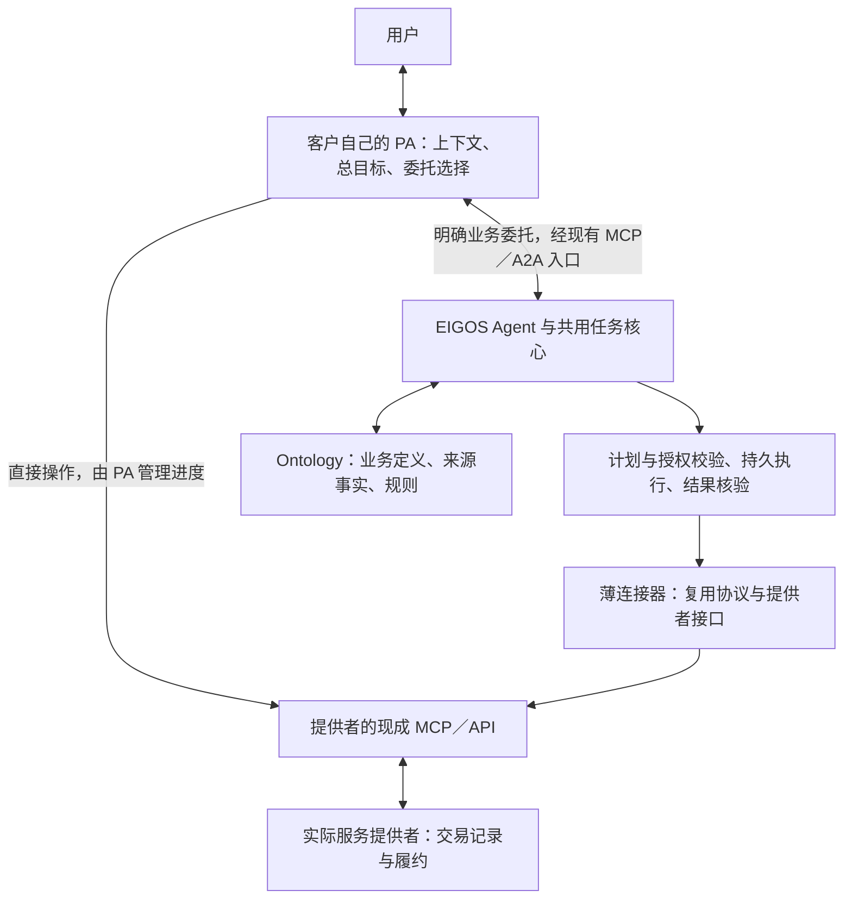

# EIGOS、Personal Agent、现成 MCP 与 Ontology 的分工

2026-10-22。本文明确产品与架构分工，作为后续接入和重构的判断依据；本次只交付文档，不新增公共接口、改变运行行为或启用真实业务操作。现行入口、权限和运行限制仍以 [接入指南](integration.md) 与 [后端说明](registered-capabilities.md) 为准。

## 1. 产品边界

Personal Agent（PA）保有用户关系、个人上下文和总目标；它可以直接使用现成工具，也可以把明确的一段业务目标委托给 EIGOS。EIGOS 负责所接委托的服务发现、业务决策、受控执行、进度恢复和结果核验。服务提供者负责其系统中的交易与实际履约。

Ontology 是 EIGOS 内部的业务定义、对象关系、来源映射和判断规则，供模型与执行程序共同使用；它不是与 EIGOS 并列的执行平台。API／MCP 是访问提供者能力的渠道。接通渠道让业务动作有机会执行，不自动证明当前账号可用、动作获准或结果完成。

EIGOS 的价值假设是：客户更少维护业务集成，受委托任务在约束检查、状态恢复和结果核验上表现更好。这个假设需要对照验证。接口数量、本体类型数量或增加一层模型，都不足以证明价值；客户已有系统可以实现相同功能。

## 2. 责任与复用表

| 工作 | 主要责任方 | EIGOS 应做的部分 | 直接复用与边界 |
| --- | --- | --- | --- |
| 对话入口、长期记忆、个人偏好 | 用户自己的 PA | 接收本任务获准使用的必要上下文，标明来源与有效范围 | 复用客户 PA；不再建一套个人助手和全量记忆库 |
| 总目标拆分与委托选择 | PA | 说明当前可接目标、输入、终点和验证范围 | PA 决定直连或委托；不要求全部调用经过 EIGOS |
| 受委托业务的规划与选择 | EIGOS Agent | 在委托范围内取得事实、补问、选择动作与方案 | 复用模型与现有协调器；不与 PA 同时重新安排同一段业务 |
| 工具发现、协议传输、连接维护 | 现成协议与实现 | 接入合适客户端，限定可访问的来源和动作 | 优先官方／成熟 SDK、MCP、A2A、API；不另造通用协议 |
| 平台内部订单、库存、司机调度等 | 服务提供者 | 读取允许的接口及回执，保留原业务身份 | 复用提供者系统；不复制其交易、库存、调度或履约后台 |
| 跨渠道业务含义与验收 | EIGOS Ontology＋确定性校验 | 明确对象、金额／时间／状态、硬条件、业务终点与可接受证据 | 复用行业标准及供应方已有结构；维护必要差异和映射 |
| 账号连接和资源访问 | 账号所有者与提供者授权系统 | 校验绑定身份、访问范围和本次可用性；私下保管必要凭据引用 | 复用提供者授权机制；PA 的连接状态不等于 EIGOS 有访问权 |
| 用户对业务动作的许可 | 用户或有明确权限的代理 | 核对具体计划、动作、对象、金额／币种、收款方、期限与撤销状态 | 复用有效许可时核对语义和权限；不能只接受聊天中的“已同意” |
| 持久任务、防重、恢复与结果核验 | EIGOS 运行核心 | 保存业务意图、尝试、来源证据和逐条件结果；未知时查原操作 | 复用现有任务库、租约、取消保护和执行账本；不为每个领域重建调度器 |
| 钱包、收单与清算 | PA／用户持有的支付工具和服务商 | 按已实现的交接方式返回准确付款请求，独立回读业务结果 | 复用既有支付体系；现有预约路径只在隔离测试环境验证 |
| 售后沟通与处理 | PA、EIGOS、提供者分段负责 | PA 表达用户诉求；EIGOS 在获准范围跟踪原单处理及证据；提供者执行实际退款等 | 有相应接口和授权才执行；受理回执不等于已解决 |

“主要责任”表示一个环节的决策与状态归属。PA 仍检查用户偏好，EIGOS 仍检查执行许可，提供者仍执行自身访问控制；这些不同边界上的校验是必要的，不应当为了减少代码而取消。

## 3. 两条使用路径，以及何时选择

图中直连与委托是针对同一业务操作的两种选择；不是让两端同时发起操作。源回执通过连接器返回 EIGOS，并按映射写入本任务对象；图省略这条返回线以便阅读。钱包交接是明确的子步骤交接，详见第 5 节。

| 任务情况 | 建议路径 | 判断依据 |
| --- | --- | --- |
| PA 已连接所需服务，客户现有流程能满足目标与恢复要求 | PA 直接调用 | EIGOS 没有明确增益时，避免额外映射、时延和成本；不单按步骤多少判断 |
| PA 缺少某项服务接入，EIGOS 有经过相应验证的绑定 | 委托 EIGOS | 增益来自可用服务与免维护，而非再次包装一个协议 |
| 客户需要可维护的领域规则、持续状态跟踪、故障恢复或结果核验，而现有 PA 不提供 | 委托 EIGOS | 验证这些能力是否实际改善结果；单一平台也可能需要 |
| 客户已有相同执行与验收能力，只缺某个数据源 | 优先复用客户流程和数据源 | 不为了使用 EIGOS 再增加一个规划 Agent；可复用组件的产品形式另行评估 |
| MCP 只安装在客户本机，EIGOS 无访问授权或网络路径 | 保持 PA 直连，或另行解决受控接入 | 当前没有任意回调客户本机工具的公共能力；不假定能转移连接或令牌 |

多平台只是可能产生价值的条件，不是必须使用 EIGOS 的条件。简单查价也可以委托，但应有服务覆盖、统一结果或维护成本方面的明确理由。

## 4. Ontology 与接口怎样衔接

### 4.1 一套领域语义，多种提供者映射

沿用 [本体规格](ontology-spec-v0.2-2026-10-18.md) 的共用核心、领域本体、提供者映射分层。打车领域复用现有 `RideRequest`、`RideOption`、`RideTrip`，不同平台分别维护身份、字段、费用、状态和证据映射。不能把不同平台名称相似的车型、估价和取消规则直接认定等价。

| 接入内容 | 如何进入现有模型 | 必须核对的区别 |
| --- | --- | --- |
| 实际支持的调用与前置条件 | 能力声明、动作定义及 `ProviderBinding`／受控程序配置 | 目录声明、账号可访问、本次可执行、某动作已验证分别记录 |
| 某次报价 | 对应本次需求的候选／报价观察 | 估价还是完整报价、币种与单位、费用范围、有效期 |
| 外部订单／行程 | 保留来源命名空间及原 ID 的业务对象 | 接单、开始、到达、取消各自含义；同名状态不直接合并 |
| 原始响应与后续查询 | 有来源、时间与作用范围的证据和事实 | 证据不足、过期或冲突保持未知；格式正确不等于业务含义正确 |
| 用户要求的终点 | 逐项成功条件与结果核验 | “查到价格”“建立订单”“实际送达”各用自己的完成条件 |

映射不是把 13 个工具各改一个名字。每个受控调用的效果、输入、输出、前置条件、恢复方式和完成证据都需要核对；只接本次需要的动作即可。一项业务动作也可能包含多个平台请求，必须声明全部副作用、保留原操作身份并在写入前检查许可。

### 4.2 客户或提供者已有业务模型时

先复用其订单、报价、支付等原始身份和契约，对 EIGOS 确实需要的字段建立有版本的映射。原平台仍是其交易记录的来源；EIGOS 保存获准使用的来源引用、必要快照与自己的条件评估，不同步复制对方整个数据库。

客户已有 Ontology 时，映射交接所需的最小语义，保留客户约束及来源。无法证明等价的字段、金额范围或状态保留差异；不要求客户把全量模型迁移进来，也不把模型生成的映射直接发布为受信规则。

### 4.3 现成 MCP 的真实边界

MCP 服务背后可以实现复杂业务工作流，并非只能提供底层 API。官方规范已支持工具发现、结构化结果、输出 Schema，并要求或建议相应的访问控制、结果校验、审计与用户确认。因此，“支持 MCP”既不表示没有业务语义，也不表示已经具备本项目的业务验收能力。需要逐服务检查实际契约。[MCP 官方工具规范](https://modelcontextprotocol.io/specification/2025-06-18/server/tools)

如果提供者已经交付符合目标的完整服务，EIGOS 可以复用该服务，补足必要的来源核对和总体条件验收。无须把供应方内部的每个步骤重新展开成自己的模型调用。

## 5. PA 与 EIGOS 如何交接，避免两个 Agent 重做一件事

### 5.1 目标、事实、候选、许可分别处理

交接在业务上至少需要：原始目标与交付终点、硬条件与偏好、已确认的上下文及来源、已有候选及其来源与时效、有效授权范围，以及现有任务／业务操作引用。字段如何发送以现有接口为准；这份清单不是新公开 Schema。

PA 已明确的地址、预算、车型或选择，应由 EIGOS 复用并检查相应事实，而非再次要求用户从头回答。重新补问需要可说明的原因，例如缺失、歧义、冲突、过期，或目标变化。选择尚无可靠来源时，可以保留为用户偏好或指定对象，不能把它升级成已核实报价。

当前 `eigos.delegate` 仍由 EIGOS 解释需求并规划；本文没有新增“PA 上传计划后直接执行”的入口。减少重复的第一步是准确传递已确认条件、在同一任务续接、避免扩大委托范围，而不是绕过当前校验。

### 5.2 委托范围内有一个进度归属

委托后，PA 跟踪 EIGOS 原任务并处理用户沟通，EIGOS 负责受委托范围内的动作选择与状态恢复。PA 不同时在滴滴等来源创建另一笔等价订单，也不在等待超时后用新的请求标识重建未知操作。

PA 可以把较大目标中的一段交给 EIGOS。例如 PA 管理整体出行安排，EIGOS 只查询指定路线的可用报价；EIGOS 不据此接管酒店或机票。当前是否支持某项组合目标，以注册能力和验证范围为准，不把总体架构当成已实现的通用跨领域编排。

供应方网络超时或远端结果不明时，先用原业务键／已验证原引用查证。取消 EIGOS 任务只停止后续派发，不证明原订单或付款已取消。无法查证时报告未知并保留恢复依据，不能换平台重做来掩盖未知结果。

### 5.3 授权由现有体系表达，校验各有职责

商家允许 EIGOS 接入、用户允许连接个人账号、用户允许本次业务动作是三件事。业务许可足够明确且仍有效时，应复用其权限依据并避免重复询问；无法验证其主体、范围或准确条款时，不能猜测有效。

EIGOS 对许可的程序校验不等于再次让用户确认。计划、金额、收款方、范围或有效期变化时，应按现有授权契约重新核对；当前准确计划许可发生变化时可能需要重新授权。提供者依法或按平台要求进行的登录、支付验证仍由其负责，不能承诺所有操作都只确认一次。

### 5.4 支付是一项可明确交回 PA 的子步骤

现有预约付款设计已说明这种分工：EIGOS 准备原预约并返回绑定条款的付款请求；PA 使用自己的钱包，或用户使用提供者结账页；EIGOS 再独立读取原付款和预约。通知“已支付”不等于付款证据。

复用这一交接思想，不为 EIGOS 新建钱包、收单或清算系统。当前该路径的服务商、钱包与网页结账都是隔离测试实现；真实来源仍未接通。具体双路线、固定操作键与未知时不得自动换路的要求见 [PA 预约付款流程](pa-booking-payment-flow.md)。本文不将它推广为已经支持任意 PA 工具回调。

## 6. 我们投入什么，停止重复做什么

| 决策 | 具体范围 | 交付判断 |
| --- | --- | --- |
| 继续建设 | 领域对象与规则、提供者映射与验证、必要的服务发现、准确授权校验、共用持久执行与结果核验 | 能以真实来源或明确标记的故障场景证明约束和恢复行为 |
| 直接复用 | 客户 PA、官方协议 SDK、现成 MCP／API、平台业务系统、既有支付工具、已验证的行业数据契约 | 满足访问、业务含义和目标要求后复用；不为增加自有代码而再封装 |
| 保持轻量 | 连接器只负责受控通信与回执；业务程序负责映射和校验；模型在受委托范围内选择动作 | 避免连接器暗中搜索、选方案或下单；不引入第二个隐藏规划器 |
| 不作为接入前提 | 通用 MCP 市场、全新个人助手、全量个人记忆、复制商户后台、按平台复制领域本体 | 只有出现独立需求与证据时才另行评估；本次不扩展这些产品 |
| 暂不实现 | 任意调用客户本机 MCP、导入任意 PA 计划执行、通用跨领域自动交易、现实付款与退款 | 各自需要独立契约、实现、授权与验证；不是本文承诺 |

不为了“只调用一次模型”而删除必要的事实更新、授权检查或验收循环；也不为了显示 Agent 能力而为确定性字段转换再调用模型。模型轮数、调用成本和耗时应与结果质量一起衡量。

## 7. 当前实现落点与后续顺序

### 7.1 复用当前骨架

| 现有位置 | 继续承担的责任 |
| --- | --- |
| `apps/gateway`、[接入指南](integration.md) | MCP／A2A 入口、身份、任务读写；Gateway 不启动业务执行器 |
| `apps/worker`、`packages/core` | 共用任务领取、模型决策、派发、恢复、取消／租约保护与验收 |
| `packages/ontology` | 定义、对象及关系、来源事实、领域函数和条件核验 |
| `packages/core/catalog.ts`、`packages/core/agent-program.ts` | 能力／绑定与业务程序契约；不另造平行注册表和执行循环 |
| `packages/capabilities` | 具体来源接入、映射、动作与验收；复用共用运行机制 |
| `packages/capabilities/shopify/connector.ts` | 已有薄连接器示例，每次调用对应一个来源操作；不代表所有提供者已具备同样实现 |

商家登记、映射管理和验证发布若继续建设，应服务这些既有契约。先确定最小接入材料和可验证动作，再考虑 SDK／CLI／工作台；不把完整平台当成首家来源接入的必要条件。

### 7.2 当前证据能证明什么

- [Shopify 实际 PA 验收](evidence/shopify-pa-2026-10-19/README.md)：本机真实 PA、模型与匿名生产商品读取，已验证本体读取、动作选择、观察写回和结果读回；没有真实购买。
- [本体运行语义修复](evidence/ontology-runtime-2026-10-19/README.md)：商品名曾被规格覆盖，运行时接受仍被独立语义核验识别为失败；映射需要业务反例，不能只验 Schema。
- [交易与履约沙箱验收](evidence/commerce-agent-pa-2026-10-20/README.md)：真实模型与 PA 在合成商家、订单、付款和物流上完成流程；不证明现实履约或优于客户直连。
- [六类服务](service-domains-2026-10-18.md)：含打车本体与沙箱规则，真实来源缺口仍需逐项接入。本次没有使用截图中的凭据、连接滴滴或执行其操作。

### 7.3 建议的下一轮实施，不属于本次代码交付

1. 选一个已有来源与明确终点，列出客户直连已能完成什么、EIGOS 要改善什么；接入清单按动作记录身份、权限、时效、回执和恢复能力。
2. 对照现有业务定义补最小映射，复用客户端与任务核心，首先验证只读路径；需要新语义才改领域本体。
3. 使用相同目标、相近来源时点和同样约束，对照 PA 直连与 EIGOS 委托。故障注入只在隔离来源／回放中进行，明确标记合成证据；不为比较重复产生现实订单。
4. 比较逐条件正确率、错误成功报告、重复副作用、恢复结果、人工介入、用户重复回答次数、耗时与成本。pending、unknown 和失败保留在样本分母；无法可靠观测的项目标为未知。实施前按场景约定可接受标准，不能只挑成功样本。
5. 只为已证明增益的路径扩大接入；若仅多一层转发且质量、覆盖或维护成本没有改善，就保留直连。真实写入和公开部署仍需分别授权与验证。

## 8. 相关依据

- [领域术语](../CONTEXT.md)：需求、方案、授权、观察、事实、结果与提供者绑定的统一含义。
- [Ontology 规格](ontology-spec-v0.2-2026-10-18.md)：领域定义与提供者映射的分层。
- [Gateway／Worker 说明](gateway-worker.md)：持久任务、恢复、取消与迟到结果边界。
- [MCP 官方工具规范](https://modelcontextprotocol.io/specification/2025-06-18/server/tools)：工具与结构化结果契约、访问控制及客户端校验职责；本文引用此版本讨论边界，不声明它是最新版本。
