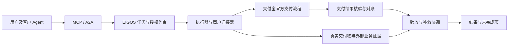

# 支付宝 Agent Pay：覆盖边界、EIGOS 接入与机会判断

研究日期：2026-10-15（Asia/Shanghai）。性质：公开官方文档与本地源码研究，不是账户资格、生产接口或真实交易验证。未安装支付 Skill、未签约、未发起支付、未部署。

## 1. 结论

支付宝的范围比单独的 `alipay.trade.agent.pay` 更广：Agent Pay 连接订单与用户支付，Machine Pay 增加按量账单、验凭证与商户履约回执，ACT 进一步描述委托授权、交易确认、可信存证及争议处理。不能再用“支付宝只管付款，完全不管履约”概括。[S1–S10]

EIGOS 仍有可探索的空间：把具体任务变成可检查的交付要求，接入实际执行系统，取得外部结果证据，判断完全/部分/失败/证据不足，处理重试、补交、退款申请与人工升级。这个机会来自具体业务实现与运营能力，而非支付接口或存证事件名称的缺失；商业需求与付费意愿尚未验证。

推荐先做单一数字服务的 PC 端购买—交付—验收闭环。EIGOS 自己出售按次服务时，再评估 Machine Pay 卖方接入。移动端 Agent Pay 因企业定向邀测、APP 宿主和无沙箱限制，当前不宜作为首个验证路径。[S2,S4,S5,S6]

## 2. 研究覆盖范围与证据等级

完整阅读 Agent Pay 当前索引列出的四篇文档：移动端接入、支付成功通知、商户接入移动/PC 智能体、签名接口。补充阅读产品总览、办公/移动/终端产品页，Machine Pay 接入及两项 API、FAQ，官方 PC 示例 README 与 Skill，以及 ACT 相关域。这里的“完整”指当前公开 Agent Pay 目录，不表示获得全部邀测材料或审核后开放接口。

| 证据 | 本次能确认 | 不能据此确认 |
| --- | --- | --- |
| 产品页 | 厂商对产品模式和开放条件的描述 | EIGOS 账户已获准使用 |
| 接入指南/API | 公开链路、字段、通知及错误语义 | 所有能力在当前账户可调用 |
| 官方示例源码/Skill | 推荐集成方式及演示行为 | 生产可靠性、真实付款或交付成功 |
| ACT 规范 | 领域边界和协议语义 | 支付宝产品已逐项实现或对外开放 |
| EIGOS 源码 | 当前实现和扩展位置 | 生产部署与外部客户端兼容 |

已发现资料缺口：移动接入准备页只显示“邀测文档，仅供受邀用户使用”；终端耳机技术文档已失效；商户文档指向的 Demo `SKILL/README.md` 返回 404，但 `SKILL/SKILL.md` 可读。不能用产品页填补这些实现细节。[S12,S13]

## 3. 支付宝覆盖到哪一步

| 环节 | 公开证据 | 对 EIGOS 的意义 |
| --- | --- | --- |
| 需求、选品与供应商选择 | Agent Pay 总览明确不负责选品和供应商决策；ACT 规定目录最低信息与意图传递 | 可以做任务约束匹配与供应商执行能力评估 |
| 下单 | 移动商户预下单；PC 商户 Skill 调用网站支付 | 需要商户真实订单接口，支付接入不会凭空生成供给 |
| 用户授权 | 产品页有逐笔确认与预先委托；ACT 有 ISR/IAC | 产品宣传、规范和实际开放接口须分开看 |
| 付款 | 移动签名串唤起 SDK；PC 支付 Skill 接管 | 可复用付款流程，不应自建资金账户替代 |
| 支付证据 | 通知、查单；Machine Pay 服务端验凭证 | 是支付层证据，不能直接关闭业务任务 |
| 交付 | 商户交付；PC Demo 支付后调用结果接口；Machine Pay 返回资源 | 已存在交付流程，不能把“支付后取结果”说成独有能力 |
| 履约回执 | Machine Pay `fulfillment.confirm` | 已有商户上报机制，需保留上报者和证据等级 |
| 存证与争议 | ACT 定义履约事件、链下记录/链上锚定及争议流程 | 不宜重复提出通用信任协议作为主要差异 |
| 业务验收和补救 | 未在所读 API 中发现跨任意任务的客观验收器和通用补救执行器；ACT 排除商户业务系统及通用编排 | 可做具体服务验收和失败恢复，但不能宣称整个支付宝生态没有相关产品 |

来源：[S1–S10]。最后一行是限定于已读材料的研究判断，不是对支付宝全部内部能力的断言。

### 3.1 移动 Agent Pay

流程：用户提出需求 → 商家调用 `alipay.trade.order.prepay` → 返回 `prepay_id` → 智能体平台服务端通过 `alipay.trade.agent.pay`/`sdkExecute` 生成 `orderStr` → APP SDK 唤起支付宝 → 支付结果通知。[S2,S3]

约束：商户先签约 APP 支付；平台先签约智能体代理支付。接入支持自研或第三方应用代调用，后者涉及 `app_auth_token`。当前指南限定 APP 支付，不支持沙箱；其他收单产品需咨询行业运营经理。移动产品页标注企业级应用定向邀请试运营；`agent_id` 在接口中可选，但取得该 ID 需联系 BD 申请 KYA。不能把字段可选解释为无需商户/平台准入。[S2,S3,S4,S5]

产品页描述金额、频次、期限约束下的预先委托，但所读签名 API 的业务字段只有 `prepay_id`、`agent_id`、`cashier_scene`，不足以实现完整委托生命周期。不能根据响应示例出现 `agreement_no` 等字段，就自行推导未列入请求参数表的签约或扣款接口。[S3,S5]

### 3.2 PC / 办公 Agent Pay

公开商户链路是：商家下单 Skill → `alipay.trade.page.pay`（GET 方式取得收银台数据）→ `alipay-bot trigger-payment-signal` 得到短链 → `alipay-bot submit-payment`/支付宝支付处理 Skill → 用户支付 → 商户查单、返回业务结果。[S4,S12]

官方 Node.js 示例已经提供查询、退款、退款查询、关单和通知入口；其 Skill 明确要求支付后从本次订单的结果接口取回内容，不能让模型编造替代结果。示例也提醒补充生产持久化与幂等。因此应借鉴流程，不应原样当作生产支付服务。[S12]

这是对 EIGOS 最现实的初始购买路径，但存在宿主依赖：远程 MCP/A2A 网关不等于具备本地 CLI、支付宝 Skill 和人机确认界面。必须确定实际客户端如何加载这些能力、把支付结果绑定回 EIGOS 任务。官网列出的其他 Agent Benchmark 不能证明 Codex/ChatGPT/Grok 与 EIGOS 的兼容性。[S4,S11；本地 README]

### 3.3 Machine Pay：对数字服务尤其相关

属于相邻产品，不能混称移动 `agent.pay` 接口。公开流程如下：[S6]

1. 无有效凭证时，资源服务返回 HTTP 402 和 `Payment-Needed` 账单。
2. 账单绑定金额、币种、资源、订单、商户、服务、有效期与商户签名。
3. 用户授权支付后，买方带 `Payment-Proof` 再请求。
4. 商户调用 `alipay.aipay.agent.payment.verify`，检查 `active`、金额、订单、资源匹配，防止重复履约。
5. 返回资源后，商户异步调用 `alipay.aipay.agent.fulfillment.confirm`。

验凭证 API 不只是检查字符串：错误码覆盖买家、Agent、商户、交易号不匹配，凭证失效与交易未支付等。履约确认 API 的业务入参只有 `trade_no`，还有卖方身份和交易状态校验。它表明商户提交了该交易的履约确认，不能单凭这一响应推断报告内容正确、服务达到 SLA 或用户已验收。[S7,S8]

`service_id` 需要通过开通服务工具提交资料并审核生效。文档中的“A2A”命名本身不是 A2A 1.0 JSON-RPC 兼容性证据；402 也不自动意味着兼容其他 402 支付方案或现有 MCP 客户端。[S6,S7,S14]

### 3.4 ACT：必须纳入竞争边界

ACT 已定义意图结构化、授权凭证及生命周期；商业域描述目录、上下文、支付能力协商和交易确认；支付域包含即时、定向及自主委托支付；可信存证覆盖履约事件与争议流程。因而“授权+记录+支付”的泛化描述与其有明显重叠。[S9,S10,S15,S16]

但协议明确把商户业务系统与通用多智能体编排留给实现方。存证能支持记录一致性和来源核验，并不自动证明服务内容满足用户要求。EIGOS 可借鉴其关联标识与语义，先做具体服务验证，不应在没有互操作验证、签名/身份约定和接入证据时宣称 ACT 兼容或已经上链。[S9,S10,S16]

## 4. 文档冲突与接入前待确认问题

| 问题 | 已读证据 | 实施处理 |
| --- | --- | --- |
| 移动回调有两种形态 | 签名 API 展示 `trade_status_sync`；专用通知页是 `alipay.aipay.agentpay.renderinfo.notify`、`biz_content` 和 From 蚂蚁消息 | 按开通产品与消息方法分流解析；不能假设同一 schema |
| `notify_url` 必填程度 | API 写可选；通知文档要求必须配置；指南说不配不推送 | EIGOS 要异步闭环就必须配置并验证可达性 |
| 回调订单字段 | renderinfo 使用 `out_shake_no`，普通通知有 `trade_no`/`out_trade_no` | 确认标识映射和可靠查单方式，不能直接互换 |
| 透传字段 | 通知指南建议 `passback_params`，但 agent.pay 参数表未列出其业务入参 | 确认在哪一层/接口设置并验证回传，不凭空加字段 |
| 金额单位 | Machine Pay 字段表写最小货币单位，示例却使用 `0.01 CNY`；verify 写 Price/CNY | 用获确认的产品契约确定元/分转换；不可凭猜测收费 |
| `client_session` | verify API 标可选，但错误码有为空错误，指南按买方凭证传入 | 正常保留并转交，确认不同模式实际要求 |
| 凭证失效/重复读取 | 指南拒绝无效凭证并提示支付，API 又提示可能已经使用 | 先查本地同笔订单和交付记录，恢复交付；不可一见 402 就再次扣款 |
| 委托支付开放范围 | 产品页与 ACT 描述完整委托，移动签名 API 未给全套接口 | 向支付宝确认账户资格、凭证签发/撤销、额度扣减及回执 |
| 退款与结算 | PC 示例有普通退款接口；Agent/Machine 的结算规则未在已读文档完整说明 | 区分退款申请、退款结果和任务取消；确认权限、时效和部分退款 |
| 沙箱 | 移动 Agent Pay 明确无沙箱；其他产品说明不能覆盖它 | 按具体产品确认测试环境，不将本地模拟当支付联调 |

依据：[S2,S3,S6,S7,S8,S12,S17]。这些是需要解歧义的契约问题，不代表接口实际故障。

## 5. EIGOS 可以怎么接入

现有原型仍只有 `brief.prepare`，没有实际执行器、支付适配器、后台队列或支付 Webhook。现有认证、租户隔离、任务持久化与跨协议续接可以复用，不能直接把说明任务的 `completed` 用作业务交付完成。[本地 README](../README.md)、[接入指南](integration.md)、[源码扩展分析](alipay-eigos-integration-notes-2026-10-15.md)。

### 路径 A：EIGOS 作为购买与执行协调方

选择一个已接支付宝、提供下单和订单结果 API 的数字服务。EIGOS 保存用户任务、约束与报价；付款通过客户端支付宝官方支付流程完成。EIGOS 用有权限获得的商户订单/支付结果证据续接任务，取回交付物并验收。买方不能冒用商户凭证调用卖方专用 `payment.verify` 或 `fulfillment.confirm`。

适合验证“付费步骤是否真正帮助用户完成目标”。首个实例可以是固定规格的数据报告：明确定义对象、时间范围、必需字段、来源与输出格式。真实商户尚待选定，此为试点建议，不是已有供应商合作。

### 路径 B：EIGOS 作为服务卖方

提供一项真实执行且可验收的服务，可采用 PC 网站支付，或按资源计费的 Machine Pay。后者由 EIGOS 作为商户返回账单、验凭证、交付并上报履约。复杂长任务不应简单“付款后返回 job ID 就算交付”；需明确出售的是提交资格还是最终成果，并确认支付宝对异步服务的契约支持。

先在独立业务资源路由实现产品支付语义，保持 MCP/A2A 入口原有发现/认证/任务行为。不要在整个 `/mcp` 或 `/a2a` 前机械加 402 中间件：客户端可能无法解析支付挑战，初始化与查询也不应意外收费。需要明确 capability 和端到端客户端适配测试。

### 路径 C：EIGOS 作为移动 Agent 平台

只有在明确移动 APP 宿主、企业资质和邀测资格后，才推进平台签约、KYA、预下单/签名/客户端 SDK 与通知联调。当前网关自身不能完成这一路径的用户端支付交互。

### 建议的内部边界（设计建议，尚未实现）

至少独立保存任务、报价/订单、支付尝试、交付和验收记录；每条记录继承受信身份，关联任务 ID、商户订单号及支付交易号。付款成功不能直接令验收成功，任务取消也不能直接标记退款成功。

新增 payment adapter 只处理服务端固定契约与结果，不接受模型自由传入私钥、收款人、任意 URL 或任意 API 方法。购买授权应绑定具体报价、商户、金额、币种、期限与任务；现有 `tasks:write` 仅代表可写任务，不代表付款许可。

移动 From 通知按表单解析、保持验签原值、检查消息类型；可靠落库后才返回 `success`。使用独立通知 inbox 与交易级幂等，支付状态未知时先查单；后台 worker 用租约/重试恢复交付，保留同一业务动作标识。已有同步 SQLite 幂等记录不能保证外部支付 exactly-once。

## 6. 值得做的空间与不值得重复的部分

以下为产品假设，不是已验证市场需求。

| 方向 | 具体用户价值 | 与既有能力的差异 | 优先级 |
| --- | --- | --- | --- |
| 可执行的验收标准 | 在付款前说清楚什么算交付合格 | 把业务要求落实为可运行检查，不只是订单描述 | 高 |
| 外部证据与实际结果核验 | 避免收到回执却没拿到可用成果 | 区分商户声明、数据来源、客户系统读回和内容验证 | 高 |
| 付款后失败恢复 | 钱已付而结果丢失时能恢复、补交或提出退款申请 | 跨支付与业务连接器的恢复流程 | 高 |
| 多步骤任务完成度 | 多个供应商只完成一部分时给出准确状态和下一步 | 任务级汇总而非单笔交易成功 | 中，先单供应商 |
| 供应商履约质量数据 | 按实测成功率、时效和质量选择服务 | 与 ACT 信用概念重叠，价值依赖真实数据与业务深度 | 后续 |
| 通用钱包/支付短链/商户回执 | 现有支付生态已有相应能力 | 单纯再封装的壁垒较低 | 不作为核心 |
| 新通用信任协议或上链存证 | ACT 已覆盖这一方向 | 容易先做协议而缺少真实履约 | 暂缓 |

可检验的商业假设：企业或 Agent 平台是否愿意为减少“已付款但没完成”的人工处理付费？应记录无需人工介入的完成率、误报完成率、恢复耗时、重复收费次数、验收成本与交付争议率。没有这些结果，协议互通和支付演示都不能证明 EIGOS 的业务价值。

## 7. 推荐试点与验收门槛

1. **先锁定一个可验收服务。** 明确业务交付、订单状态查询、交付物取得方式及供应商授权；本地可先用可控服务验证失败路径。
2. **完成业务恢复再接真钱。** 验证迟到通知、重复通知、支付结果未知、交付超时、部分输出、进程重启及相同订单取回；模拟结果仅证明本地实现。
3. **选定一条支付路线。** PC 购买试点走现有商家+官方支付 Skill；卖方按量服务走 Machine Pay，先确认资质/service_id/金额单位和测试环境。
4. **受控真实联调。** 另行取得实际交易授权后，用固定商户、固定商品和限额验证支付、交付、验收、查单及需要时退款；付款由官方确认流程完成。
5. **通过后才扩展服务网络。** 至少能展示一例成功、一例付费后交付失败的恢复，以及一例证据不足时拒绝误报完成。

成功定义：同一用户任务关联到唯一业务订单和支付证据，真实交付物满足预先确认的验收规则，重试不重复收费/重复执行；不满足时保留明确的部分、失败或证据不足状态，并说明补救结果。

本次交付仅研究与方案；没有修改运行代码，因此未运行构建/测试。公开文档不能消除账户资格、客户端适配、回调 schema、委托 API 和实际结算规则的不确定性。

## 来源索引

- S1 [产品与能力概览](https://aipay.alipay.com/docs/overview.md)
- S2 [移动智能体接入](https://aipay.alipay.com/docs/agent-pay/mobile-agent-pay.md)
- S3 [agent.pay API](https://aipay.alipay.com/docs/agent-pay/api-list/agent-pay.md)
- S4 [商户接入移动及 PC Agent](https://aipay.alipay.com/docs/agent-pay/skillpay.md)
- S5 [移动产品与准入条件](https://aipay.alipay.com/products/mobile-agent-pay.md)
- S6 [Machine Pay 接入全流程](https://aipay.alipay.com/docs/ai-receive/MACHINE_PAY.md)
- S7 [支付凭证验证 API](https://aipay.alipay.com/docs/ai-receive/api-list/alipay-aipay-agent-payment-verify.md)
- S8 [履约确认 API](https://aipay.alipay.com/docs/ai-receive/api-list/alipay-aipay-agent-fulfillment-confirm.md)
- S9 [ACT 商业交互域](https://www.act-protocol.com/documentation/commerce)
- S10 [ACT 可信存证](https://www.act-protocol.com/documentation/trust/attestation)
- S11 [办公智能体产品及 Benchmark](https://aipay.alipay.com/products/office-agent-pay.md)
- S12 [支付宝官方 PC Demo](https://github.com/alipay/ai/tree/main/code_example/page-pay-demo-with-agentpay)、[商户 Skill](https://github.com/alipay/ai/blob/main/code_example/page-pay-demo-with-agentpay/SKILL/SKILL.md)
- S13 [移动接入准备，访问时为邀测限制](https://opendocs.alipay.com/pre-open/0h6n92?referPath=0h6n93_67a31294)、[失效的终端技术文档](https://aipay.alipay.com/docs/agent-pay/iot/earphone-intro.md)
- S14 [Machine Pay FAQ/service_id](https://ideservice.alipay.com/cms/site/0j7uos)
- S15 [ACT 委托授权域](https://www.act-protocol.com/documentation/delegation)
- S16 [ACT 支付服务域](https://www.act-protocol.com/documentation/payment)
- S17 [移动支付异步通知](https://aipay.alipay.com/docs/agent-pay/payment-notify.md)
- [Agent Pay 官方目录，标注更新于 2026-10-13](https://aipay.alipay.com/docs/agent-pay/llms.txt)
- [产品总目录](https://aipay.alipay.com/llms.txt)、[终端产品页](https://aipay.alipay.com/products/device-agent-pay.md)
