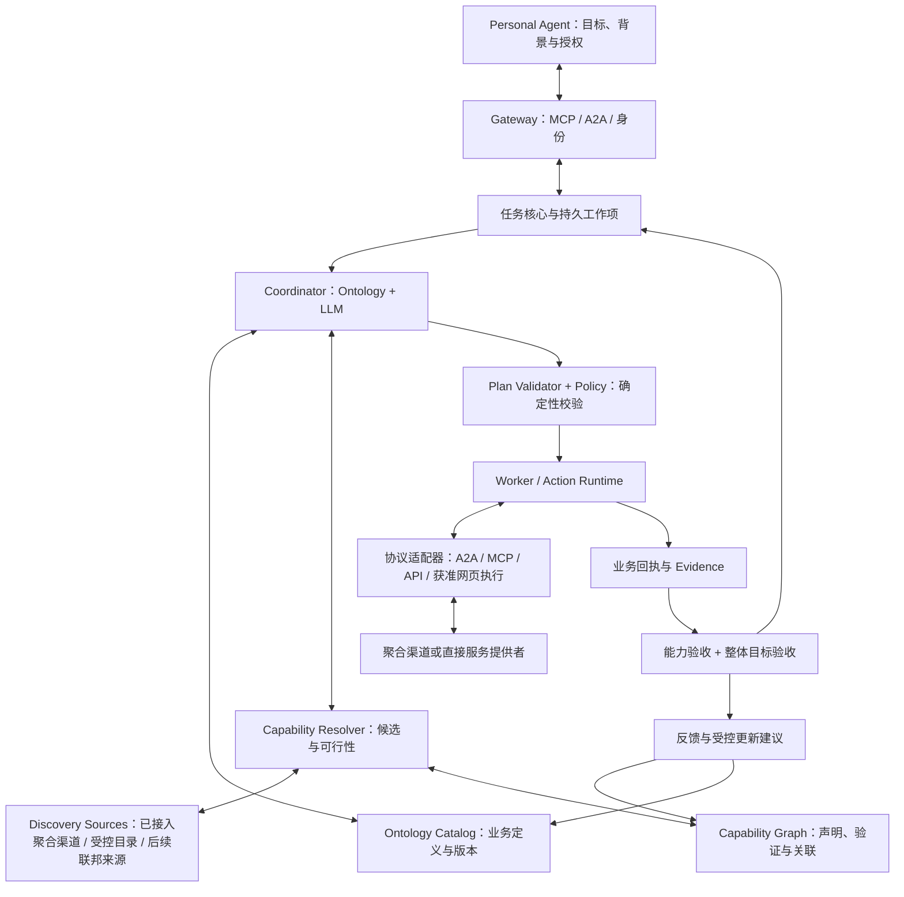

# EIGOS — Ontology-Grounded Agentic Execution Network

Architecture Design v0.2 · 2026-10-17 · **设计方案，不是本轮实现或上线声明**。

实施更新：用户随后明确要求后端全部采用新架构，不做旧执行架构兼容；前端 Agent 接入可保留。当前实施与证据以 [后端阶段目标](backend-implementation-goals.md) 和 [后端说明](registered-capabilities.md) 为准。下文是原设计基线，其中旧计划迁移建议已被这项要求取代，不能据此自动恢复旧业务执行。

2026-10-18 规格细化：[Ontology 规格](ontology-spec-v0.2-2026-10-18.md) 在本 v0.2 基线上明确共用核心、领域本体、提供者映射、事实与动作语义；[三个场景走查](ontology-scenarios-v0.2-2026-10-18.md) 验证配送查价、商品送达、餐厅预订。后续新增实现按该规格和阶段目标推进；以下设计历史保留。文档版本 v0.2 与运行内核分别编号；当前六类扩展代码为 ontology-execution-v6／eigos.business@4，详见[完整设计核对](ontology-design-completion-v0.2-2026-10-18.md)。

同日方法修订：按用户要求核对 Palantir 官方建模指南，补充[具体对象、属性、接口、双向关系及来源目录](ontology-model-catalog-v0.2-2026-10-18.md)。作者结构走查、独立 Agent 和人工业务问题演练分别验收；后续 N2 独立 Agent 已完成，人工演练单列待进行。执行日志、来源查询与本体决策 Action 不再混为同一类建模构件。

输入：用户提供的《EIGHT — Architecture Design v0.1》，以及本项目已明确的供给策略、三阶段产品路线与现有实现。本文件将 v0.1 细化为四个模块的数据契约、协作流程和验收条件。正文沿用 [品牌说明](brand-brief.md) 的 EIGOS；EIGHT 是输入材料中的名称，不构成本次品牌变更。

## 1. 保留的产品基线

**Personal Agent 提出用户目标；EIGOS 结合 Ontology 与 LLM，发现和选择适合的服务，组织执行、交付及持续售后，并核验实际结果。**

- 产品路线：衣食住行服务接入 → 旅行、餐厅预订等复杂场景与个人信任网络 → 基于长期理解主动建议或在已有授权内执行。
- 供给路线：先接聚合渠道，复用其服务池和业务接口；逐步推广终端商户／服务提供者直接接入，两类渠道并存。
- Ontology + LLM 共同构成决策体系。本体承载业务语义和约束，模型理解目标并提出选择；程序校验和实际业务结果决定能否执行、是否完成。
- 用户／PA 保有个人上下文。EIGOS 只接收获准用于本任务的信息；长期偏好保存与跨任务学习有独立范围。
- 付款沿用现有体系。退款、取消、补交等是需要实际执行和读回的业务动作，不因模型给出建议或商户受理就完成。
- 本轮交付详细设计与 deck 对齐；不接入新发现网络，不运行交易。当前项目仍禁止真实下单和付款。下面的动作名、类型与表结构均为拟议内部契约。

## 2. 与当前仓库的关系

源码核对基线：`1936c73`；本轮不修改应用源码。历史实测与本次新设计须分开。

| 当前代码／文件 | 已有边界 | 本设计扩展 |
| --- | --- | --- |
| `apps/gateway`、`apps/worker`、`packages/core/store.ts` | 协议／身份与后台执行分离，任务持久领取、租约及迟到写回保护 | 外部动作意图、异步观察、恢复和独立业务事实 |
| `packages/core/capabilities.ts` | CapabilityDefinition 带单个 providerId；注册表以能力 id 为键 | 稳定 ServiceCapability 与多个 ProviderBinding 分开 |
| `packages/coordinator/coordinator.ts` | 在已注册能力中补问、选择或拒绝；能力包 prepare/start 同步 | 有界发现、多候选解析、实时可行性校验和版本化计划 |
| `packages/core/delegation.ts` | 单能力计划、摘要、授权及验收记录 | 多步骤输入输出引用、动作意图、聚合结果与售后关联 |
| CSV 能力包／独立验收器 | 已有受限领域执行与模拟补交／退款 | 继续作回归夹具，不将其虚构为生活服务或真钱交易 |
| `life.request` | 生活需求登记，返回 waiting_provider／not_started | 只有提供方正式接入和计划获准后才进入执行；原登记不得自动追溯执行 |
| [共用业务对象](shared-business-objects-coffee-restaurant.md)、[多渠道比较](multi-channel-discovery-and-comparison.md) | ServiceRequest、Channel、Merchant、Offer、Proposal 与实际回执的分工 | 本文件复用这些术语，不另造一套“每平台本体” |

**关键迁移限制**：现有 `RegisteredCapability.start` 位于领取校验后的数据库事务内，适合本地同步行为；不得在这里 await 外部 Agent、API 或浏览器。外部 I/O 必须移到持久动作工作项的事务之外。

## 3. 架构与模块接口



此图表达依赖，不是一趟不可返回的串行流水线。补问、刷新可用性、追加证据、售后和重规划均回到同一需求上下文。

| 模块 | 输入 | 输出 | 有权写入 | 无权决定 |
| --- | --- | --- | --- | --- |
| Ontology Catalog | 领域、版本、允许读取的事实引用 | 对象／动作／约束／验收定义 | 经审核发布的定义版本 | 库存、付款或履约事实 |
| Reasoning Coordinator | 目标、相关本体、候选与观察 | 结构化补问、候选选择、计划／重规划提议 | 决策摘要、模型运行收据、提议 | 授权、业务成功、可信能力发布 |
| Capability Resolver | 任务约束、可用渠道、查询范围 | 候选、排除理由、未知项、范围与时间 | 来源记录、准许保留的查询引用 | 替用户批准交易；把相似度当硬条件满足 |
| Action Runtime | 固定计划、策略许可、工作项 | 实际尝试、远端引用、回执、等待状态 | 本地动作日志与已观察业务事实 | 猜测端点、扩大预算、结果未知时换路重买 |
| Outcome Verification | 验收标准版本、回执与交付物 | satisfied / unsatisfied / unknown / needs_human | 带依据的结果核验 | 把所有证据来源当同等可信 |

## 4. Ontology Schema：语义、事实和来源

### 4.1 复用实体，不把每个字段都建成对象

| 领域 | 核心对象 | 重要字段／关系 |
| --- | --- | --- |
| Task | ServiceRequest、Requirement、SuccessCriterion | 原始目标、revision、交付终点、硬约束／软偏好、缺项、来源、用户归属 |
| Capability | ServiceCapability、CapabilityClaim、CapabilityVerification、ProviderBinding | 业务结果、版本、适用范围、输入输出契约、动作支持、验证强度 |
| Supply | Provider、Channel、Merchant、CandidateOption、Offer、Comparison、Proposal | 聚合入口／销售／履约角色；报价来源、商户、规格、费用与条款；方案版本 |
| Execution | ActionType、ExecutionPlan、ActionIntent、ExecutionAttempt、ServiceEngagement | 业务动作、技术绑定、依赖、远端任务映射、授权和未知副作用 |
| Outcome | Order、Reservation、Payment、Fulfillment、AfterSalesCase、Evidence、OutcomeAssessment | 交易／预订／付款／交付各自状态；售后关联原单；逐条件核验 |

Budget、Money、Location、Deadline 初期为带类型的属性；只有需要独立身份与生命周期时才提升为实体。本体可用类型定义、JSON Schema 和关系记录实现，不要求立即增加图数据库、RDF 或新服务。

### 4.2 关键区别

- **业务需求 ≠ 协议任务**：一个 ServiceRequest 可有多个本地／远端任务及订单。A2A taskId 不是用户目标的唯一业务标识。
- **聚合渠道 ≠ 最终商户 ≠ 履约方**：一方可具有多个角色，但必须分别记录。不能从聚合平台注册名猜测终端身份。
- **ActionType ≠ Adapter**：`PlaceOrder` 定义订单动作的业务含义；某渠道的 API、MCP 或 A2A 实现是绑定。同协议不保证同输入输出语义。
- **能力声明、验证、本次可用性是独立记录**：验证必须带动作、适用范围、时间与证据。通过只读探测不等于验证了付款或退款。
- **学习数据 ≠ 本体结构变更**：观察记录可以追加，可信定义与能力发布必须经过验证和审核。

### 4.3 关系与访问边界

`ServiceRequest → Requirement → SuccessCriterion`；`Channel → exposes → ProviderBinding`；`Merchant → sells → Offer`；`ProviderBinding → implements → ActionType`；`Proposal → uses → Offer`；`Authorization → permits → Plan/Action`；`ActionIntent → has → ExecutionAttempt`；`Attempt → observes → Order/Reservation`；`AfterSalesCase → concerns → Order`；`Evidence → supports → BusinessFact`；`OutcomeAssessment → evaluates → SuccessCriterion`。

`can_fulfill` 是针对任务条件的候选关系或评估结果，不能是永久真值。一次区域内履约成功，不代表所有地区、数量、时间都成立。图谱跨用户共享的仅是允许发布的能力与聚合证据；个人偏好和订单记录按用户隔离。

### 4.4 拟议契约切片

以下是设计中的 TypeScript 形状，用来确定职责；不是已经新增的可导入模块。

```ts
type Ref = { id: string; version: string };
type Money = { minor: string; currency: string }; // 十进制整数文本，拒绝浮点/负交易额

type SourcedFact<T> = {
  value: T;
  source: 'user' | 'pa' | 'provider' | 'observation' | 'inference';
  evidenceRefs: string[];
  observedAt: string;
  expiresAt?: string;
  useScope: string[];
};

interface Requirement {
  id: string;
  predicateRef: Ref; // 受信任、可解析的谓词，不执行模型生成代码
  operator: 'eq' | 'in' | 'lte' | 'gte' | 'before' | 'covers';
  expected: unknown; // predicate schema 必须验证
  strength: 'hard' | 'preference';
  provenance: SourcedFact<unknown>;
}

interface CapabilityClaim {
  id: string;
  capabilityRef: Ref;
  publisherId: string;
  sourceRef: string;
  sourceRevision: string;
  bindingId?: string;
  observedAt: string;
}
interface CapabilityVerification {
  claimId: string;
  sourceRevision: string;
  actionTypeRefs: Ref[];
  scope: Record<string, unknown>;
  level: 'schema' | 'read_only_probe' | 'simulated' | 'live_operation' | 'live_fulfillment';
  result: 'passed' | 'failed' | 'inconclusive';
  evidenceRefs: string[];
  verifiedAt: string;
  expiresAt?: string;
}
interface AvailabilityObservation {
  requestId: string;
  requestRevision: number;
  bindingId: string;
  actionTypeRef: Ref;
  status: 'available' | 'unavailable' | 'unknown' | 'needs_input' | 'needs_authorization';
  constraintChecks: { requirementId: string; result: 'pass' | 'fail' | 'unknown'; evidenceRefs: string[] }[];
  quoteRef?: string;
  observedAt: string;
  expiresAt: string;
}
```

所有跨租户对象都附任务所有者，来源由受信边界填充，不能相信模型自报 owner。时间存明确时区／UTC，并保存用户原表述；“明天 9 点”相对于收到需求时的时区解析，重试不重新解释成后一天。金额带币种与计价单位；币种不一致、总费用未知不能伪造总价比较。

历史记录保留来源版本；目录禁止缓存时只保留获准引用和必要决策记录，展示／执行前再查。不能以“学习图谱”绕过渠道的数据使用条件。

## 5. LLM Reasoning Workflow

### 5.1 每轮模型看到什么

1. 当前用户目标、明确交付边界及任务 revision。
2. 当前相关领域的 OntologyBundle，而非整个网络目录。
3. 获准共享的用户／PA 事实，明确事实、推断、缺项和冲突。
4. Resolver 提供的有限候选、证据摘要、未知条件和真实发现范围。
5. 已完成与未知动作的事实摘要，以及允许提议的 ActionType。

外部 Card、商品描述和返回文本均作为不可信数据；不能改变执行规则、引入任意端点或修改授权。模型可提议读／写业务动作，但不直接连接数据库、不持有支付凭据，也不直接决定订单状态。

### 5.2 决策输出

```ts
type ReasoningDecision =
  | { kind: 'clarify'; requestRevision: number; missingRequirementIds: string[]; question: string }
  | { kind: 'discover'; requestRevision: number; query: DiscoveryQuery }
  | { kind: 'revalidate'; requestRevision: number; candidateIds: string[] }
  | { kind: 'propose_plan'; requestRevision: number; proposalId: string; draft: PlanDraft }
  | { kind: 'replan'; requestRevision: number; previousPlanRef: Ref; reasonEvidenceRefs: string[]; draft: PlanDraft }
  | { kind: 'no_feasible_plan'; requestRevision: number; scopeRef: string; blockers: string[] };
```

枚举按实施阶段逐步开放，不在一个 PR 中实现全部。所有引用必须可解析且属于任务授权范围；过期 revision 直接拒绝。模型的 decision 不含 `authorized=true` 或 `businessCompleted=true`。记录简短选择理由、输入版本、模型版本和运行收据，不要求保存隐藏推理链。

### 5.3 决策循环与终止

- 先明确完成目标，再做相关领域 grounding；不因出现“咖啡”就调用一个名称相似的工具。
- 缺少搜索必需条件才补问；完整地址、支付信息等在真正需要时按授权传递。
- Discovery 是找候选，Resolution 是把声明对齐业务契约，Feasibility 是检查本次是否能做。
- 程序先过滤硬约束失败项；模型在其余候选中解释取舍。不能擅自放松预算、截止时间或明确饮食限制。
- 需求或报价改变时建立新计划版本并核验已有授权是否仍覆盖，不要求每次都重新确认，也不默认旧授权永远有效。
- 模型轮次、发现范围、重规划次数和任务总时限由运行配置限定；到上限返回缺口／待处理，不无限循环或降级成写一份说明冒充业务完成。
- 只凭外部 A2A `COMPLETED` 不能结束本地需求；整体 OutcomeAssessment 满足相应 SuccessCriteria 后才报告业务完成。

## 6. Capability Resolution 与发现接口

### 6.1 最小模块契约

```ts
interface DiscoveryQuery {
  requestId: string;
  capabilityRefs: Ref[];
  requirements: Requirement[];
  allowedSourceIds: string[];
  maxResults: number;
  deadlineAt: string;
}
interface DiscoverySource {
  search(query: DiscoveryQuery, context: AccessContext, signal: AbortSignal): Promise<DiscoveryBatch>;
}
interface CapabilityResolver {
  resolve(batch: DiscoveryBatch, context: AccessContext): Promise<ResolutionBatch>;
  checkFeasibility(candidateId: string, requestRevision: number,
    context: AccessContext, signal: AbortSignal): Promise<AvailabilityObservation>;
}
```

`AccessContext` 由认证／策略层建立，含真实用户归属、允许查询的渠道、数据范围和凭据引用；模型不能构造它。`DiscoveryBatch` 逐来源返回 `returned / no_results / timeout / requires_access / unsupported_query / error`，同时记录覆盖范围、候选来源和可保留字段。超时不是无供给，来源未接通不是全世界不支持。

`ResolutionBatch` 保留：Claim、映射的 CapabilityRef/ActionTypeRef、Channel/Merchant/履约方引用、BindingRef、输入输出兼容性、VerificationRef、缺失事实与排除理由。无法识别最终商户时保持未知；聚合路径可在身份和授权条件满足后继续询问，不能捏造终端身份。

### 6.2 执行绑定

```ts
interface ProviderBinding {
  id: string;
  version: string;
  capabilityRef: Ref;
  channelId: string;
  merchantId?: string;
  fulfillerId?: string;
  adapterId: string; // 受控注册的技术实现
  protocol: 'local' | 'mcp' | 'a2a' | 'http' | 'browser';
  endpointRef: string; // 来自受审配置，不是模型任意 URL
  credentialRef?: string;
  actionMappings: { actionTypeRef: Ref; inputMapRef: Ref; outputMapRef: Ref }[];
  verificationRefs: string[];
  recovery: {
    idempotency: 'none' | 'provider_key' | 'provider_reference';
    lookup: boolean;
    cancel: boolean;
    compensationActionRefs: Ref[];
  };
}
```

同一个 ServiceCapability 允许多个 binding。多个渠道返回同一家商户时，保留各 Offer 的不同费用和售后条件，归组展示但不合并报价；没有证据不能宣称是两个独立供应商。名词相似不证明产品同款或支持同一业务动作。

### 6.3 外部发现网络作为可替换来源

2026-10-17 对项目一手资料作定位核验：

| 候选 | 公开定位 | 本项目处理 |
| --- | --- | --- |
| [ARD](https://github.com/ards-project/ard-spec/blob/main/spec/ard.md) | Agentic Resource Discovery，v0.91 标为 Proposal；描述资源、发现与搜索 | 记录原生条目、来源与版本，转换成候选声明；不作为调用权限或业务能力认证 |
| [AGNTCY Directory](https://dir.agntcy.org/) | Agent／资源目录、结构化描述和联邦发现 | 可选 DiscoverySource；身份／所有权验证与服务结果验证分别记录 |
| [AGNTCY Records](https://dir.agntcy.org/latest/dir/dir-component-records-validation/) | OASF 记录与内容标识，名称本身不证明所有者 | 不能因为目录可查或签名有效就晋升为可靠履约供应方 |
| [NANDA Registry](https://nandamit.media.mit.edu/) | 提供 Agents、Resources、Tools 的注册查询入口 | 仅列为后续候选；未审核具体版本契约、鉴权或与其他目录的互通 |

没有在原型中安装、配置或连接这些系统。也不要求同时使用三者；第一阶段可以仅用已经正式接入的聚合渠道与受控本地注册表。外部目录出现新资源，不自动执行其代码、启用凭据或将用户资料发给它。

### 6.4 匹配与实时可行性

对候选逐项检查：结果类型／动作契约兼容 → 业务区域和资格 → 数量／规格／产能／时间 → 费用与条款 → 本次用户身份和权限 → 证据及恢复能力。

实时可用性是 `(requestRevision, bindingVersion, actionType, observationTime)` 下的判断。可用窗口到期、报价变化或用户改要求后必须重新查询。准备报价成功不能保证执行时仍有库存；运行时须处理最终失败和部分成功。

## 7. ExecutionPlan、Policy 与 Action Runtime

### 7.1 分开计划与实际尝试

```ts
interface PlanStep {
  id: string;
  actionTypeRef: Ref;
  bindingRef: Ref;
  inputRefs: { source: 'task' | 'proposal' | 'accepted_step_output'; id: string; path: string }[];
  dependsOn: string[];
  preconditionRefs: string[];
  authorizationRequirementIds: string[];
  expectedOutputSchemaRef: Ref;
  verifierRef: Ref;
  effectClass: 'read' | 'reserve' | 'order' | 'payment' | 'change' | 'cancel' | 'refund';
  recoveryPolicyRef: Ref;
}
interface ExecutionPlan {
  id: string;
  version: string;
  requestId: string;
  requestRevision: number;
  ontologyRefs: Ref[];
  proposalRef: Ref;
  acceptanceSpecRef: Ref;
  steps: PlanStep[];
  digest: string;
}
interface ActionIntent {
  id: string;
  owner: string;
  planRef: Ref;
  stepId: string;
  businessOperationKey: string;
  inputDigest: string;
  bindingRef: Ref;
  grantRefs: string[];
  state: 'ready' | 'dispatching' | 'awaiting_remote' | 'effect_unknown' |
    'effect_confirmed' | 'rejected' | 'canceled_before_dispatch';
}
interface ExecutionAttempt {
  id: string;
  intentId: string;
  requestKey: string;
  startedAt: string;
  externalTaskRef?: string;
  externalOrderRef?: string;
  observation: 'not_dispatched' | 'pending' | 'unknown' | 'confirmed' | 'rejected';
  evidenceRefs: string[];
}
```

- `businessOperationKey` 表达一个业务操作，不因 HTTP 重试、Worker 重启或无副作用的重规划就换键。变更操作必须与原操作显式关联，不能通过新计划版本绕过未知下单。
- 计划有向依赖必须无环，引用及输入输出类型相容；首版只支持一项业务操作及短串行步骤。读候选可有界并行，多个有副作用订单不默认并行。
- 摘要使用明确定义、版本化的规范序列化和 SHA-256；不能依赖任意 JSON 属性顺序。计划、报价和授权摘要绑定，credential 原文不进入摘要对象或提示词。
- `effect_confirmed` 只说明该动作已发生，后续仍需验收。有订单号不等于交付完成；有退款申请号不等于钱已退回。

### 7.2 策略许可

`PolicyEngine.evaluate(plan/step, grants, currentFacts) → allow(permit) | needs_authorization(request) | deny(reasons)`。

Permit 绑定 owner、planDigest、stepId、bindingVersion、业务对象、允许动作、数据范围、金额／币种／收款方、有效期及授权撤销版本；执行前再次检查。付款预算、服务费与工具成本分别核算。并发步骤预留累计额度，不能各自都看到“还有500元”而重复消耗；未知支出保留预算占用直到查清。没有付款接口权限时，先生成待付款单或付款交接也必须符合当前用户授权；本设计本轮不发起真实操作。

发现／查询授权不涵盖下单或退款；供应商报价变化只在原授权确实覆盖时继续。模型返回“用户同意”不是批准记录。

### 7.3 异步 Adapter 契约

```ts
interface ActionAdapter {
  preflight(ctx: AdapterContext, input: unknown): Promise<PreflightResult>;
  dispatch(ctx: AdapterContext, intent: ActionIntent): Promise<DispatchResult>;
  observe(ctx: AdapterContext, remoteRef: string): Promise<ObservationResult>;
  reconcile(ctx: AdapterContext, operationKey: string): Promise<ReconciliationResult>;
}
```

返回结果至少区别 `requires_input / requires_authorization / pending / confirmed / rejected / unknown`，包含来源回执和远端引用；不只返回 boolean。`reconcile` 可明确返回“不支持查询”，不能用伪实现默认未执行。取消／退款是有独立 ActionType、授权、幂等和观察流程的动作，不是假定每个 adapter 都能即时回滚。

A2A 绑定持久保存远端 taskId/contextId/messageId；补问按同一远端任务续接。MCP/API 使用其真实操作句柄；浏览器适配保存可核验页面／订单引用，并承认它通常不提供服务端幂等保证。所有远端协议结果先转成类型化观察，再更新业务事实。

### 7.4 写前意图、网络调用与恢复

1. 同事务验证当前计划、授权和任务状态，创建唯一 ActionIntent、预算预留与 ready 工作项。
2. Worker 原子领取，建立带 token／expiry／revision 的 dispatch 许可，落盘 `dispatching`。
3. 在事务外调用已注册 adapter，按上游契约传稳定防重键。
4. 回执先按 intent/外部事件标识追加到证据日志，再由当前有效领取者应用业务状态；重复回执去重，不能按到达顺序覆盖较新事实。
5. 运行验收器，保存 Assessment，再触发后续步骤或整体判定。
6. 若外部成功、本地来不及保存就崩溃，恢复进入 `effect_unknown`；用原操作键／远端标识查证。不能自动重下单、换供应商或释放全部预算。

现有任务领取 fence 保护本地写回，**不能撤回已经发出的网络请求，也不能独自保证外部 exactly-once**。租约丢失后停止新 dispatch；在途回执由专门观察日志接收，不让旧 Worker 覆盖新计划，但也不丢弃已付款等事实。取消与派发的竞态按已落盘派发事实处理：尚未派发可取消，在途则查证再办理业务取消。

## 8. 业务状态、验收与售后

| 维度 | 示例状态 | 判定依据 |
| --- | --- | --- |
| 需求 | received / clarifying / planning / awaiting_authorization / executing / needs_review / accepted / unmet / canceled | EIGOS 的整体进展；现有 A2A 状态仍通过映射输出，不能把新名直接宣称标准枚举 |
| 订单／预订 | requested / pending / confirmed / canceled / unknown | 供应商记录；pending 不写 confirmed |
| 付款 | not_started / pending / unknown / paid / failed | 支付侧可信回调或查询，不由 LLM 改写 |
| 履约 | pending / partial / delivered / failed / disputed | 真实业务证据及接收方确认 |
| 售后 | requested / submitted / needs_material / processing / rejected / resolved / unknown | 商户与支付侧结果分别关联；已受理不等于已退款 |
| 验收 | satisfied / unsatisfied / unknown / needs_human | 对照固定版本 SuccessCriteria 逐项判定 |

整体完成需要所有必须条件满足；未知不是 false，也不是 true。来源签名只证明来源与完整性，不自动证明现实质量。主观质量由任务约定的人或评估方法处理，记录证据强度。

售后可在原订单交付后新建关联任务；不重开已经终结的 A2A Task，也不抹去原付款／交付历史。退款成功可以完成“退款服务需求”，但不会把原失败购买改写成成功履约。多订单任务允许记录部分成功；整体失败后的取消、退款或补偿单独执行，费用／权限重新核验。

## 9. Capability Graph 与 Learning Loop

图谱先作为已有对象／关系的查询视图，不复制供应商全量商品库，也不要求立即引入图数据库。数据分三层：

1. **定义层**：能力、对象、ActionType、schema 与版本；发布后不可原地覆盖旧版本。
2. **声明／验证层**：提供者声明、绑定、测试与实测范围，保留来源修订与有效期。
3. **观察层**：允许留存的本次可用性、结果、异常、耗时及补救；个人数据与可共享汇总分开。

结果可以支持排序，但每个统计都带任务类型、区域、时期、样本数和分母；成功率不能隐藏 unknown、取消或尚未结束任务。只查询过的提供者有选择偏差，不能由少量成功外推全网络信誉。

LLM 提议变更：`Discover → Extract → Map → Validate → Approve → Publish`。变更包含来源、旧新版本、影响面、测试与回滚入口；下线/撤销立即阻止新执行。历史计划固定原版本；若原绑定不可用则等待或生成新方案，不静默替换。

用户第三阶段的“主动服务”读取获准偏好／反馈并形成新提议。预测属于推断，不能直接变成偏好事实、付款授权或真实业务完成。

## 10. 20 杯咖啡：不虚构供应商的设计演练

示例目标：“明天上午 9 点前，准备 20 杯不同口味的咖啡送到公司，预算 500 元。”这是设计用例，不是本轮下单指令。

1. **解析**：保留20杯、截止时间、目的地引用和预算；明确日期/时区、“不同口味”的分配要求、预算是否含配送等未知项。PA 已有获准资料就复用。
2. **发现**：先查询已正式接通的聚合渠道，取得带终端商户／报价来源的候选。外部注册表仅可补充候选入口，不证明能卖咖啡。
3. **解析与可行性**：映射到饮品采购与配送动作，核实20杯产能、规格、总费用、区域和时效。两个渠道的同一门店不算两个独立商户。
4. **选择**：先排除硬条件失败者，保留未知待查；在当前已查范围内解释选择。只有一项可行就如实给出，不为达到“至少两个”而虚构候选。
5. **计划**：优先单商户路径。多商户组合只有在任务允许且总费用、时间及补偿策略明确时提出；不默认拆单。
6. **执行门槛**：重新核验报价、方案和已有授权。当前项目真实下单/付款禁令仍有效，本轮只能出方案或使用明确标注的测试环境。
7. **未来获准后的验证终点**：创建待付款单仅完成相应操作；若目标是送达，还需检查数量、规格、时间和实际送达证据。
8. **异常与售后**：一家已下单、另一家结果未知时先查原尝试；不能直接换第三家凑单。缺杯、迟到或退款需求进入关联售后，直到结果可核对或明确需人工处理。

## 11. 数据存储与模块落位建议

保持现有单仓库与 Gateway/Worker 两进程；以下是逐步增加的契约，不是一次性要求建所有表或新增服务。

| 逻辑记录 | 最小唯一性／版本要求 | 建议归属 |
| --- | --- | --- |
| 定义与 binding | capabilityId+version；bindingId+version | `packages/ontology` 及能力注册层 |
| claims / verifications | sourceId+sourceRevision；验证记录关联动作范围 | 拟新增 resolver/discovery 模块 |
| request / proposal / plan | owner+requestId；不可变计划版本与摘要 | `packages/core` |
| action intents / attempts | owner+businessOperationKey 唯一；attempt 不替代 intent | `packages/core` 存储、Worker 运行 |
| remote observations | providerId+eventId 或稳定响应摘要，关联 intent | Adapter → 观察日志 |
| assessments / aftersales | criterion版本与 evidenceRefs；售后关联原订单 | 能力验收器与核心记录 |

Gateway 只做认证、输入验证、授权提交与读回；不启动发现长任务或模型。Coordinator 执行位置保持在 Worker，外部 discovery 与 adapter 运行也由 Worker 发起。聚合渠道和终端直连都转为同一业务契约，终端直连不是另一套用户入口。

## 12. 实施切片与可否证验收

| 切片 | 最小产物 | 必须通过的反例 |
| --- | --- | --- |
| A · 定义与提供者分离 | ServiceCapability / ProviderBinding / Verification 契约；历史 CSV/brief 计划只读留存规则 | 同一能力两个提供者可登记；禁用提供者不能被执行；旧任务不能被换供应方 |
| B · Resolver 与报价 | 一个受控发现来源、两个真实候选的只读映射、可行性与覆盖记录 | 同名非同款、同门店重复渠道、报价过期、费用未知、渠道超时、未授权均不误选 |
| C · Reasoning 与计划 | 明确目标、补问、候选选择、类型化短计划及校验器 | 模型虚构动作、修改硬条件、读别人的对象、伪造授权、旧 revision 均拒绝 |
| D · 异步动作运行时 | 意图日志、稳定键、事务外调用、查询恢复和迟到事实归档 | 外部成功后崩溃不重下单；租约丢失不新派发；取消后迟到回执不丢但不覆盖任务 |
| E · 整体核验与售后 | 一项服务的正常/失败/补救记录，逐项验收 | 订单号不证明送达、退款受理不证明到账、部分成功不整体完成 |
| F · 受控反馈 | 来源、范围、样本和版本化变更提议 | 伪完成不能进入正面履约统计，低证据能力不能自动发布，个人数据不跨用户泄露 |

“两个候选”是发现和比较模块的测试覆盖要求；生产在供给不足时必须如实报告，不把候选数作为捏造信息的理由。真实外部操作测试要等待项目的实际业务授权边界改变，本设计本身不授予权限。

代码实施后遵循项目检查、提交范围审查、同步及对应 SHA 的 CI 验证；本轮只做设计与演示材料，没有部署或交易。

## 13. 尚待外部条件和产品选择

- 首个聚合提供方的正式接口、业务范围、费用、数据使用条件和订单/售后读回契约。
- 哪一项衣食住行服务先作为真实闭环；“20杯咖啡”仅为设计演练。
- 以服务费、渠道收益或组合方式收费的具体商业约定；现阶段没有定价和分账承诺。
- 个人信任网络的数据保留、可解释性和撤销机制；不提前把所有用户历史集中入库。
- 外部目录选择与协议版本冻结；可先不接任何联邦目录。

这些不阻止四个模块的契约设计，但会影响真实连接器和商业执行的具体实现。
