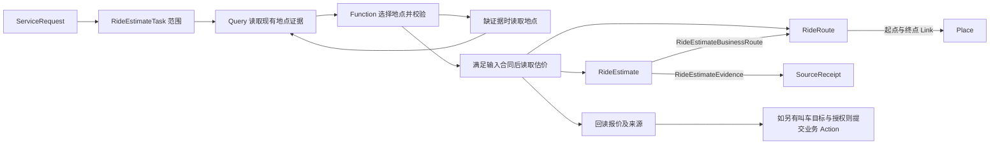

# 模型执行与本体读取

Worker 负责持久任务和执行循环，模型负责基于已读事实选择动作、补问或提出完成依据。Gateway 不启动模型。

默认 Codex 执行器使用任务专属的原生 Ontology MCP。端点只绑定 loopback、当前 owner、任务 revision 和有效领取；随机会话凭据只进入该模型进程。模型通过实际工具调用读取本体，并用 `submit_decision` 提交决策和读取回执。提交决策不执行业务效果。

兼容的结构化模型执行器可以使用宿主转发的相同本体读取接口，并复用隔离的临时模型会话。传输方式由执行器明确声明，失败不会悄悄改走另一种方式。两条路径使用同一 `OntologyPlanningSession`、同一注册库和同一任务发布版本。

复用只节省会话和重复数据传输。每次新决策仍重新读取当前事实，记录本轮回执、模型运行和来源调用。旧提示词、导航和历史观察不能代替当前证据。可选的首轮读取优化只绑定模型明确选择的独立只读动作；实际范围初始化与校验继续发生在派发之前。

读取次数、字节、模型响应和任务执行预算分别限制。超时、取消、错误线程、旧 revision 或失效领取不能产生有效结果。模型用量、供应商调用耗时和整体任务耗时分别记录；合成协议测试不代表生产延迟。

结构化决策可使用本体声明的只读依赖和条件验收；固定单消息范围可显式引用完整原文，由宿主逐字还原并核对原始／解码摘要，普通多轮语义核查保持完整。报价已包含选定路线时，后续上下文可优先读取报价和订单，原地点观察仍可查询，派发验证不因此省略。详见[任务闭环](task-closure.md)。

## Query、Function 与 Action 的接力

Query 按有权读取的对象引用、字段与 Link 取得事实。Function 消费这些事实进行可复用计算，例如选定唯一地点、判断报价有效性或按规则比较候选。业务 Action 定义有约束的业务变更，包括参数、提交条件、效果、权限和结果验收。实现 Action 的后端可以复用 Function，但由 Action 的提交门控制业务效果。

目前 ActionDefinition 还承载 effect=read 的外部来源读取。SearchDidiPlaces 与 EstimateDidiRide 调用已绑定的 MCP，只取得地点或估价。管理界面与能力发现应显示声明的效果及参数来源；是否允许提交叫车继续依据独立的业务 Action 与当前委托判断。

以滴滴估价为例，先根据当前请求和已发布版本定位只读能力，再按引用读地点证据，调用 selectDidiPlace、rideEstimateStatus 检查唯一性、来源及有效性。缺少地点证据时执行对应的地点读取；两端证据满足条件后调用一次估价。将本次来源返回投影为路线、报价、回执与对应 Link，再按这些引用回读。

| 执行步骤 | 现有参数 | 参数绑定数量 |
|---|---|---:|
| 搜索起点 | scope、role、keywords | 3 |
| 搜索终点 | scope、role、keywords | 3 |
| 获取估价 | scope、originObservation、originPlaceId、destinationObservation、destinationPlaceId | 5 |

这 11 条 ExecutionInput 是三次调用的绑定快照。地点本身属于 Place，路线属于 RideRoute，报价属于 RideEstimate，来源属于 SourceReceipt。keywords 与 role 属于参数值，observation 属于带来源的对象引用。后续值类型合同可把两端的 observation 与 selectedPlaceId 各收拢为一个端点绑定结构；这一表示变化需要随发布版本迁移既有参数路径和验证器。

## 增量执行图投影

执行账本在事务内驱动投影。投影把请求、计划、状态、参数绑定和已验收观察分成可独立比较的片段。每个片段保存输入摘要，只有输入变化时才进入对应对象与关系的核对和写入。参数、动作定义与封存计划的输入不随进度重复构建。权威信息仍来自任务和执行账本。

内部检查点与图写入共用数据库事务。对象和关系表上的变更时钟记录实际修改，包括另一连接的写入。发生模型或来源图变化、检查点缺失时，重新核对相关投影；回滚同时撤回检查点和变更时钟。发布引用进入检查点身份。当前权限、撤销、来源时效与派发前的封存计划校验继续在各自入口执行。

修改片段的输入含义、输出规则或依赖范围时，同时更新 projection-delta 的实现版本，使旧检查点重新核对。检查点只保存摘要，不能用于查询业务结果或授予权限。
