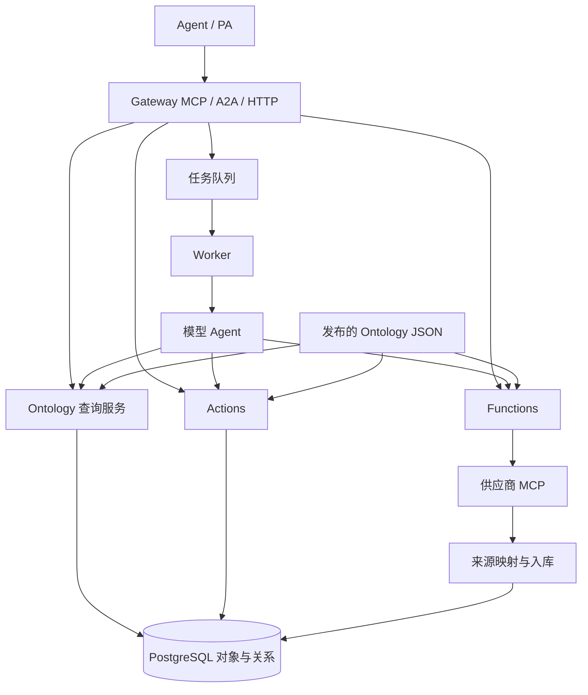
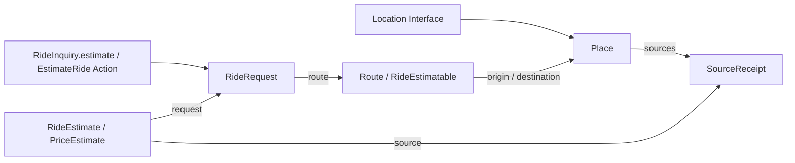

# Ontology 架构

语义层描述领域中的对象、属性、接口、关系、可调用逻辑与业务操作。运行层保存对象，执行查询、来源接入、Functions 和 Actions。两层通过发布的 JSON 定义连接。设计依据是 Palantir 官方的领域建模、复用、扩展和组合原则。[Building principles](https://www.palantir.com/docs/foundry/ontology/ontology-best-practices)

## 五类 Schema

| 类型 | 定义内容 | 当前运行入口 |
| --- | --- | --- |
| Object Type | API 名称、说明、主键、标题属性、属性和 Interface 实现 | `Ontology.object`、`Objects.read`、来源映射 |
| Property | 业务含义、值结构、必需性 | JSON Schema 校验及 Interface 属性投影 |
| Interface | 属性、关系约束、Action 参数约束及具体类型的映射 | 对象集查询、关系导航、`resolveAction` |
| Link Type | 两侧对象、两侧名称、基数 | PostgreSQL 关系表及 `Objects.follow` |
| Action Type | 参数、对象参数类型、提交条件、对象与关系编辑规则 | `Actions.apply` 的单次事务 |

Interface 通过实现映射引用具体 Object Type 的属性、关系与 Action 参数。查询由本体查询服务执行，Function 可以组合查询和计算。Action 表达用户或 Agent 提交的变更。[Interface 实现](https://www.palantir.com/docs/foundry/interfaces/implement-interface)、[Action 参数约束](https://www.palantir.com/docs/foundry/interfaces/interface-action-type-constraints)

关系带有日期、角色或状态等业务信息时，用独立对象保存这些信息，并通过 Link 连接两端。当前来源时间和证据类型保存在 `SourceReceipt` 对象中。[Object-backed links](https://www.palantir.com/docs/foundry/object-link-types/create-link-type)

## 模块边界



| 模块 | 职责 |
| --- | --- |
| `packages/ontology/schema.ts` | 声明定义的数据结构 |
| `packages/ontology/model.ts` | 解析定义、属性映射、Link 导航、Action 参数映射 |
| `packages/ontology/definitions/ride.json` | 滴滴领域的发布定义及来源字段映射 |
| `packages/runtime/metadata.ts` | 发布定义并按任务引用解析 |
| `packages/runtime/objects.ts` | Owner 范围内的对象集查询、关系查询与存储 |
| `packages/runtime/ingestion.ts` | 将来源行按发布映射写入对象 |
| `packages/runtime/functions.ts` | 参数与返回值校验、函数和来源绑定 |
| `packages/runtime/actions.ts` | 提交条件、编辑规则、幂等事务与操作记录 |
| `packages/runtime/tasks.ts` | 任务状态、领取租约、取消与来源调用记录 |
| `packages/runtime/agent.ts` | 从任务发布版本提供发现与工具调用，返回模型选择的 Function 结果 |
| `packages/runtime/harness.ts` | 独立模型会话与任务专用 Ontology MCP，不保存第二份任务 |
| `packages/runtime/sources.ts` | 执行发布的数据源 Function，把服务端持有的回值交给来源投影 |
| `packages/capabilities/didi/` | 滴滴响应解析、领域 Function 与来源投影 |
| `apps/gateway/`、`apps/worker/` | 协议认证与执行进程 |

这些职责对应 Foundry 的 Metadata、Object databases、Object Set Service、Actions、Object Data Funnel 和 Functions。这里采用单个 PostgreSQL 存储服务，定义解析与来源连接器通过进程内模块实现。[官方运行架构](https://www.palantir.com/docs/foundry/object-backend/overview)

## 滴滴业务链



模型接收用户原文与任务发布版本的 Interface、Link、Function、Action 和 data source 目录。Agent 理解需求并选择业务能力，确定性的业务步骤由该能力绑定的 Function 和 Action 执行。运行调度器不包含滴滴步骤或地点名称。[Palantir Agent 工具](https://www.palantir.com/docs/foundry/agent-sdk/customize-agent)

`RideRequest` 实现 `RideInquiry` Interface，其 `estimate` 能力映射到 `EstimateRide` Action。参数是城市、起终点场所名及可选车型。创建能力通过实现类型解析，无需编造一个尚不存在的对象引用。这对应官方 Ticket Interface 将创建能力映射到具体创建 Action 的模式。[Interface Action](https://www.palantir.com/docs/foundry/interfaces/interface-action-type-constraints)

`EstimateRide` 使用 `prepareRideInquiry` edit Function。函数完成以下确定性工作：

1. 并行读取 `DidiPlaces`，来源投影按发布映射写入地点事实及来源 Link。
2. `resolveRideLocations` 通过 `Location.name` 和各自的来源 Link 查询完整名称匹配。唯一匹配直接使用；入口、商铺等不同名称不会造成歧义。同名或没有匹配时返回真实候选及 ObjectRef。用户明确选择后复核其属于对应来源结果，并刷新来源读取。
3. `estimateLocations` 用来源坐标取得真实价格。外部请求全部发生在业务编辑事务之外。
4. Action 在一次事务内创建路线、询价请求、报价及关联 Links。Function 通过 Action 的编辑上下文提交，直接求值 edit Function 会被拒绝。失败的业务编辑整体回滚；已接收的来源事实保持独立。

这些是 Function-backed Action 的实现职责。通用 Action 运行层负责参数、提交条件、事务及幂等记录，没有新增工作流规则语言。[Function-backed Actions](https://www.palantir.com/docs/foundry/action-types/function-actions-overview)

Agent 可在一次 `complete_with_action` 调用中选择 Interface Action 与结果 Function，并指定把 Action 返回的对象引用绑定到哪个函数参数。运行层执行 Action 后调用 `readRideEstimates`，后者按 `PriceEstimate` 和 source Links 检查当前来源、有效期和报价，再直接返回真实结果。验收在读取时重新执行，重复 Action 不会使旧的验收标志跳过检查。Agent 不需要在来源读取、对象创建或验收之间继续往返。

普通 Function 仅获得对象读取接口；edit Function 的写入上下文由 Action 提供。来源价格由连接器和字段映射生成，模型不能提供入库价格。取消或租约失效阻止后续提交。

对象集查询示例。

```json
{
  "query": {
    "type": "PriceEstimate",
    "from": {"object": {"type": "RideRequest", "id": "REQUEST_ID"}, "link": "estimates"}
  }
}
```

请求、任务调度和技术调用分别保存在专用运行表。地点和路线具有业务身份，费用估计是一次来源观察，来源凭据保存在运行配置中。标准化过程保留供应商坐标系声明及价格范围。[结构指导](https://www.palantir.com/docs/foundry/ontology/ontology-structural-guidance)

## 执行与数据访问

Gateway 校验 JWT 的签名、issuer、audience、有效期和 scopes。对象、关系、任务及 Action 记录都按当前 owner 查询。来源绑定限定 owner，并在调用与入库时检查是否仍有效。

Action 的对象和关系编辑与操作记录共用事务。相同 requestId 的重复请求返回原结果，参数冲突会被拒绝。数据库约束执行关系基数，失败事务回滚编辑。Provider 请求在数据库事务外进行，返回结果通过来源映射提交。[Action 语义](https://www.palantir.com/docs/foundry/action-types/overview)

Worker 使用 PostgreSQL 通知唤醒，行锁领取单个任务，并在执行期间续租。取消或租约失效使后续提交失败。已完成的来源调用可以在原任务内复用，结果未知的原调用会保留失败状态。

## 当前支持范围

对象查询支持类型或 Interface、等值筛选、字段选择和游标。关系支持双向导航与一对多基数。Action 支持声明式对象与关系编辑，以及 Function-backed Action 的原子提交。Function 具有独立参数与返回契约，已接入外部来源读取和对象计算。

第一条实现的领域用例是滴滴估价。模型解释自然语言并使用发布的业务能力，PA 也可提供结构化参数。通用调度器的跨定义行为有工程回归，真实业务验收范围仍是本次滴滴路线。完整 Foundry 产品的界面、其他业务领域的真实验收、属性 reducer、媒体类型、跨组织共享和通用删除规则尚未在本版实现。

验收使用实际业务问题从入口走到结果，并记录耗时、路径和歧义。合成回归保持可重复，真实 MCP 验收另存私有记录。[官方验证方法](https://www.palantir.com/docs/foundry/ontology/ontology-design-validation)


## 发布与投影

`PublishedOntology` 属于运行层，包含语义定义、发布引用、数据投影标识和实现绑定。语义定义类只解释 Schema。定义摘要可保持相同，而不同实现或数据投影产生不同发布引用。所有对象和关系查询按发布引用对应的投影执行。

候选投影在现有 PostgreSQL 表中准备，验证数据类型、主键、Link 端点与基数，以及 Function 参数/返回契约和来源处理器绑定。源数据保持对当前用户可见。激活时检查准备基线、数据指纹与实现摘要，短事务切换活动指针；业务写事务使用相容的共享锁保护当前发布，供应商请求不占用该锁。旧任务结束后再切换，旧投影不接受写入。该方式对应 live/replacement pipeline 的职责，未增加数据库或复制 Foundry 的分布式服务。[Funnel 发布机制](https://www.palantir.com/docs/foundry/object-indexing/funnel-batch-pipelines/)

## 权限边界

OAuth scopes 控制协议入口。当前身份对应的资源授权控制本体操作。定义管理、实例数据、属性和 Action 执行相互独立；Function 和来源也需要对应授权。Worker 使用任务原始身份与资源授权，不因某个能力被发布而生成更多权限。[Ontology permissions](https://www.palantir.com/docs/foundry/object-permissioning/ontology-permissions/)

对象查询保持 owner 行隔离。属性策略在对象读取、Interface 映射和筛选中一致返回 null；知道隐藏值不能通过筛选反推出它。缺少关联目标的读取权限时，关系查询明确拒绝，不能被业务函数解释为“不存在”。定义管理员可查看 Schema，但不会因此读到对象或执行 Action。[对象和属性策略](https://www.palantir.com/docs/foundry/object-permissioning/object-security-policies/)

Action 检查自身应用权限，以及实际访问的对象、关系和来源。源读取权限与对象可见性独立，授予原始来源读取意味着允许读取该来源的原始数据。只读对象接口不能取得编辑上下文；所有业务编辑仍通过 Action 提交。[Action 权限](https://www.palantir.com/docs/foundry/action-types/permissions/)

权限在一次执行上下文中读取并复用，源调用、函数返回及提交前重新检查；没有逐对象开启授权事务。任务结果记录读取依赖，当前授权不再满足时整个缓存结果被隐藏。授权表由数据库管理角色维护，常驻运行角色仅有读取权限。对象内容策略支持标量相等、身份匹配、组成员关系及 all/any 组合，属性策略复用相同表达式。标记数组控制读取及 Action 输出传播。对象数据保持 owner 分区，组和项目授权管理资源定义与分区内可见性。


## Scenario 与 PA 日历

`packages/runtime/scenarios.ts` 管理 owner 隔离的方案生命周期和原子合并，`scenario-store.ts` 将对象／关系差量叠加到当前发布数据上。Query、Function 和 Action 共用 `scenarioId` 上下文；不建立第二个本体发布或任务实例。版本发布候选投影仍只服务发布迁移。

`packages/runtime/pa.ts` 在原任务中记录带响应契约的信息请求，只有原 owner 的 PA 可以回传并继续该任务。`packages/capabilities/scheduling/` 绑定 Calendar 数据校验、候选时间搜索和排程 Actions。日历汇总数据由 PA 提供，Agent 不能把猜测的空闲时间写成来源事实。

活动和资源是业务对象，Worker 租约和 PA 请求记录留在运行层。Functions 在 Scenario 中读取拟议状态；合并 Action 在同一事务中重检权限、版本、关系和业务约束。真实日历写入尚未接入。协议及边界见 [Scenario 与 PA 日历排程](../guides/scenarios-scheduling.md)。


## 完整运行服务

Ontology 分支与项目归属提供定义提案、三方 rebase、精确候选审阅和原子合并。候选数据可增量追赶，投影身份保留，数据变更使原审阅失效。来源基线、用户编辑状态和冲突策略纳入发布指纹。

Object Set Service 支持集合组合、多跳导航、分组聚合，以及静态和动态集合保存。来源事务经过独立 Indexer 按 offset 应用。用户编辑和来源值按类型策略合成，编辑历史与物化数据提供授权后的下游读取。Functions 可选择独立版本，Actions 可声明经过事务 outbox 的具名副作用。

Gateway 的只读查询池可连接已有只读副本，通过身份与 WAL 追赶检查保持当前读取。部署可分别扩展 Gateway、任务 Worker 和 Indexer。参数、表授权、边界及运行命令见 [Ontology 运行服务](../guides/ontology-services.md)。
