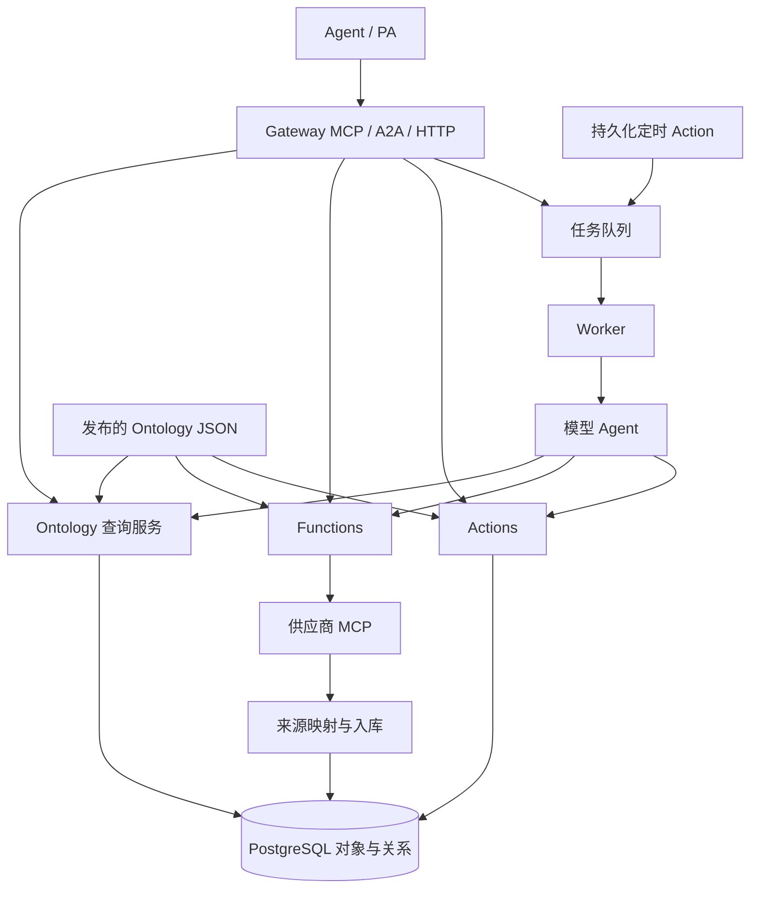
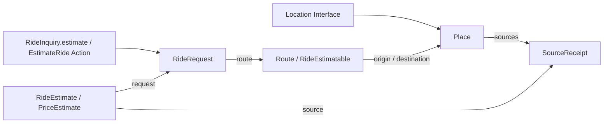

# Ontology 架构

语义层描述领域中的对象、属性、接口、关系、可调用逻辑与业务操作。运行层保存对象，执行查询、来源接入、Functions 和 Actions。两层通过发布的 JSON 定义连接。设计依据是 Palantir 官方的领域建模、复用、扩展和组合原则。[Building principles](https://www.palantir.com/docs/foundry/ontology/ontology-best-practices)

## 核心资源

| 类型 | 定义内容 | 当前运行入口 |
| --- | --- | --- |
| Object Type | API 名称、说明、主键、标题属性、属性和 Interface 实现 | `Ontology.object`、`Objects.read`、来源映射 |
| Property | 业务含义、值结构、必需性 | JSON Schema 校验及 Interface 属性投影 |
| Interface | 属性、关系约束、Action 参数约束及具体类型的映射 | 对象集查询、关系导航、`resolveAction` |
| Link Type | 两侧对象、两侧名称、基数 | PostgreSQL 关系表及 `Objects.follow` |
| Action Type | 参数、对象参数类型、提交条件、对象与关系编辑规则 | `Actions.apply` 的单次事务 |
| Function | 参数、返回值、依赖及可选版本 | 已发布实现绑定与 `Functions.invoke` |
| Shared Property / Value Type / Struct | 具名共享属性、固定版本的值约束、字段结构 | 定义编译、来源及 Action 输入校验 |
| Type Group / Metadata | 资源分组、生命周期、显示格式与提示 | 定义发现与对象视图 |

Interface 通过实现映射引用具体 Object Type 的属性、关系与 Action 参数。查询由本体查询服务执行，Function 可以组合查询和计算。Action 表达用户或 Agent 提交的变更。[Interface 实现](https://www.palantir.com/docs/foundry/interfaces/implement-interface)、[Action 参数约束](https://www.palantir.com/docs/foundry/interfaces/interface-action-type-constraints)

每个实现类型可以把 Interface Action 映射到只接受本类型对象的 Action。约束中如果只有一个参数能放入实现对象本身，这个参数按实现类型检查；其他对象参数须接受全部实现。执行时仍逐个核对对象引用的类型。商户 agent 与连接器共用的契约见 [网络契约草案](network-contract.md)。

`packages/ontology/invocation.ts` 定义已有 Function、具体 Action 与 Interface Action 的共用调用契约。Agent、HTTP/MCP 和 SDK 使用相同参数形状；协议入口仅补充本体、任务或请求身份。Interface 能力由现有 `Actions.resolve` 按发布映射解析，随后仍由 `Actions.apply` 检查具体操作的权限、提交条件、版本和幂等记录。Interface 本身不执行操作，契约解析不增加模型规划回合。[官方接口动作语义](https://www.palantir.com/docs/foundry/interfaces/interface-action-type-constraints)

单项能力能完成目标时，直接执行 Function 或 Action 并读取结果；Task 的等待与恢复不要求创建 SchedulePlan、Scenario 或 Workflow。跨服务依赖由 Agent 或已发布逻辑协调，时间与资源取舍使用排程，拟议编辑的比较或审阅才使用 Scenario。Scenario 复用同一调用契约与业务逻辑；过程状态及历史由现有业务对象和编辑记录提供给后续 Machinery 视图，不建立第二个操作入口。[Action 跨应用复用](https://www.palantir.com/docs/foundry/action-types/overview)、[Scenario 执行上下文](https://www.palantir.com/docs/foundry/ontology/overview-ontology-scenario)

关系带有日期、角色或状态等业务信息时，用独立对象保存这些信息，并通过 Link 连接两端。来源时间和证据类型保存在 `SourceReceipt` 及实现 `ServiceSearchResult` 的供应商结果对象中。[Object-backed links](https://www.palantir.com/docs/foundry/object-link-types/create-link-type)

## 对象生命周期原则

新增或变更业务对象的写入路径时，随 Ontology 发布版本审阅身份映射、字段裁决、状态转换和下游触发规则。身份映射归到 Object Type 的主键。来源映射和 Action 绑定的实现应用业务裁决，过程日志和自动化使用已提交的变化。各入口按同一组业务约束验收，现有支持范围见下文。

1. **对象身份。** 对同一个业务实体，各入口使用足以核验身份的证据绑定同一个稳定对象 ID。外部 ID 应按来源及需要的账户范围解释，并保留可审计的绑定。发布定义允许单来源直接映射时可以沿用来源主键。证据不足或存在冲突时，保留来源观察并等待核实后再合并。[Object Type 主键](https://www.palantir.com/docs/foundry/object-link-types/create-object-type)
2. **来源裁决。** 关键字段声明允许的来源和证据。按 Foundry 多来源对象的映射方式，除共同主键外，每个由来源填充的字段映射到一个正式来源输出。多方回报涉及同一字段时，在来源投影前裁决，或由已发布的 Function-backed Action 在提交前裁决。先核验来源资格和证据，再对合格输入应用业务优先级或时间规则。提交权限单独检查。酒店订单的取消状态由可核验的供应商证据确认。PA 提交的用户意图和回报保留为独立记录，转交的回执按其可验证出处判断。[多来源对象](https://www.palantir.com/docs/foundry/object-permissioning/multi-datasource-objects) · [编辑冲突策略](https://www.palantir.com/docs/foundry/object-edits/how-edits-applied) · [Function-backed Actions](https://www.palantir.com/docs/foundry/action-types/function-actions-overview)
3. **Schema 治理。** 评估对象身份、字段裁决、状态含义及下游触发条件的变更对现有 PA、应用和自动化的影响。会破坏消费者契约的发布须记录受影响范围、兼容窗口或迁移方案，并在切换前验证。分支和管理 CLI 对此类发布执行同一要求。保留任务版本锁定、候选投影校验和原子切换，向后兼容的改动可走轻量审核。[分支与资源保护](https://www.palantir.com/docs/foundry/ontologies/branching-ontology) · [Schema 迁移](https://www.palantir.com/docs/foundry/object-edits/schema-migrations)
4. **状态与时间。** 按 Machinery 模型，业务对象保存当前状态，关联的 ProcessLog 记录已提交的前后状态及转换时间。对需要历史验收的关键状态，EIGOS 扩展记录业务生效时间、来源观察时间和系统记录时间。生效时间缺失时保留未知。查询应能区分指定时点 EIGOS 当时知道的状态，以及根据当前证据判断该时点成立的状态。迟到的旧观察保留在证据历史中，经核验的更正可修订历史判断并保留获知时间。当前状态仍按已发布的证据及转换规则更新。[Machinery 日志对象](https://www.palantir.com/docs/foundry/machinery/connect-data) · [EIGOS 过程日志](../guides/process-history.md#日志来源与因果)
5. **变化传播。** 在发布定义与自动化规则中声明消费哪些已提交的对象和关系变化，以及什么条件触发处理。状态转换复用现有 Indexer 和 ProcessLog。沿用 Automate 的至少一次执行语义，按稳定变化标识保证业务效果幂等。按持久游标恢复、重放及处理结果未知的外部副作用是 EIGOS 的验收要求。外部副作用复用 Action 的幂等提交与原操作读回。收到回执或观察后，仅当产生符合规则的正式变化才触发处理。[Automate 对象集条件](https://www.palantir.com/docs/foundry/automate/condition-objects) · [执行保证](https://www.palantir.com/docs/foundry/automate/effect-settings#execution-guarantees) · [EIGOS 过程规则](../guides/automation.md#过程规则)

飞猪酒店订单可作为隔离验收用例。下单回执、供应商回读和 PA 回报引用同一个订单，供应商证据确认取消并保留各时间，迟到的旧确认回报进入历史且当前状态保持已取消。重复投递并从持久游标恢复后，下游对同一次取消只产生一次业务效果。按同一发布版本验收身份绑定、状态回看和实际消费结果。工程验收使用 `synthetic` 数据，生产消费和供应商履约分别验收。

## 模块边界



| 模块 | 职责 |
| --- | --- |
| `packages/ontology/schema.ts` | 声明定义的数据结构 |
| `packages/ontology/model.ts` | 解析定义、属性映射、Link 导航、Action 参数映射 |
| `packages/ontology/definitions/ride.json` | 滴滴领域的发布定义及来源字段映射 |
| `packages/ontology/services.ts`、`travel.ts` | 服务 Interface、活动报名、出行对象与 Action 契约，组合成同一发布定义 |
| `packages/ontology/network-contract.ts` | 网络契约草案 `EigosNetwork`：`Commitment` 与 `TableReservation` Interface，单独发布，业务定义尚未导入 |
| `packages/runtime/metadata.ts` | 发布定义并按任务引用解析 |
| `packages/runtime/objects.ts` | Owner 范围内的对象集查询、关系查询与存储 |
| `packages/runtime/ingestion.ts` | 将来源行按发布映射写入对象 |
| `packages/runtime/functions.ts` | 参数与返回值校验、函数和来源绑定 |
| `packages/runtime/actions.ts` | 提交条件、编辑规则、幂等事务与操作记录 |
| `packages/runtime/tasks.ts` | 任务状态、领取租约、取消与来源调用记录 |
| `packages/runtime/scheduled-actions.ts` | 到时按当前兼容契约启动 Action，保存周期性检查与 PA 续接 |
| `packages/runtime/external-operations.ts` | 外部变更的发出标记、回执与未知结果恢复边界 |
| `packages/runtime/agent.ts` | 从任务发布版本提供发现与工具调用，返回模型选择的 Function 结果 |
| `packages/runtime/harness.ts` | 独立模型会话与任务专用 Ontology MCP，不保存第二份任务 |
| `packages/runtime/sources.ts` | 执行发布的数据源 Function，把服务端持有的回值交给来源投影 |
| `packages/capabilities/didi/` | 滴滴响应解析、领域 Function 与来源投影 |
| `apps/gateway/`、`apps/worker/` | 协议认证与执行进程 |

这些职责对应 Foundry 的 Metadata、Object databases、Object Set Service、Actions、Object Data Funnel 和 Functions。这里采用单个 PostgreSQL 存储服务，定义解析与来源连接器通过进程内模块实现。[官方运行架构](https://www.palantir.com/docs/foundry/object-backend/overview)

## 滴滴业务链



模型接收用户原文和任务发布版本中与目标相关的 Ontology 定义。发布的 `agentProfiles` 声明可预加载的资源与操作指引，读取时应用当前资源权限和模型出口策略。触发词覆盖常见的中文口语说法，例如“叫个车”“有空吗”“住哪里”。业务资源描述为英文，未命中触发词的中文请求通过 `describe_ontology` 继续发现能力。复合或未匹配的目标可用 `describe_ontology` 浏览简明目录并按 API 名称读取完整定义。Agent 选择业务能力，确定性步骤由对应的 Function 和 Action 执行。标记为沙箱的能力仅在显式启用的本地开发 Worker 中对 Agent 开放。[Palantir Agent 工具](https://www.palantir.com/docs/foundry/agent-sdk/customize-agent)

`RideRequest` 实现 `RideInquiry` Interface，其 `estimate` 能力映射到 `EstimateRide` Action。参数是城市、起终点场所名及可选车型。创建能力通过实现类型解析，无需编造一个尚不存在的对象引用。这对应官方 Ticket Interface 将创建能力映射到具体创建 Action 的模式。[Interface Action](https://www.palantir.com/docs/foundry/interfaces/interface-action-type-constraints)

`EstimateRide` 使用 `prepareRideInquiry` edit Function。函数完成以下确定性工作：

1. 并行读取 `DidiPlaces`，来源投影按发布映射写入地点事实及来源 Link。
2. `resolveRideLocations` 沿各自的来源 Link 读取候选，按规范化的 `Location.name` 匹配。规范化仅处理 Unicode 形式、空白和间隔点等显示差异，保留门牌号和不同地名。唯一匹配直接使用；同名或没有匹配时返回真实候选及 ObjectRef。
3. `estimateLocations` 用来源坐标取得真实价格。外部请求全部发生在业务编辑事务之外。
4. Action 在一次事务内创建路线、询价请求、报价及关联 Links。Function 通过 Action 的编辑上下文提交，直接求值 edit Function 会被拒绝。失败的业务编辑整体回滚；已接收的来源事实保持独立。

这些是 Function-backed Action 的实现职责。通用 Action 运行层负责参数、提交条件、事务及幂等记录；Workflow 可以串联已发布 Action，复用相同契约和权限检查。[Function-backed Actions](https://www.palantir.com/docs/foundry/action-types/function-actions-overview)

Agent 可在一次 `complete_with_action` 调用中选择 Interface Action 与结果 Function，并指定把 Action 返回的对象引用绑定到哪个函数参数。运行层执行 Action 后调用 `readRideEstimates`，后者按 `PriceEstimate` 和 source Links 检查当前来源、有效期和报价，再直接返回真实结果。验收在读取时重新执行，重复 Action 不会使旧的验收标志跳过检查。Agent 不需要在来源读取、对象创建或验收之间继续往返。

外部 MCP 也发布 `complete_with_action`。调用者提供 `requestId`、Interface Action 和结果 Function 的参数绑定。Gateway 和 Worker 共用 Action Engine，Gateway 按调用者身份检查 Ontology 读写权限，并在输出前复核数据权限。使用相同请求 ID 重试时复用已提交的 Action，重新读取并核验结果。需要补充信息的请求可通过下述 Worker 任务流程处理。这里沿用 [Interface Action](https://www.palantir.com/docs/foundry/interfaces/interface-action-type-constraints)、[Function-backed Action](https://www.palantir.com/docs/foundry/action-types/function-actions-overview) 和 [Ontology MCP 授权](https://www.palantir.com/docs/foundry/ontology-mcp/authentication-and-authorization) 的约束。组合响应由 EIGOS MCP 提供，Action 提交和结果读取各自保留原有权限及事务边界。

如果 Action 在准备阶段返回地点候选，Action Engine 保存已选 Action、参数、结果 Function 和来源回执，绑定原任务、发布版本和请求 ID。Machinery 通过 `ActionConfirmation.state` 及 `stateLogs` 显示等待、确认、完成或终止。确认由原任务入口接受，只接受对应侧候选内的 ObjectRef。Worker 唤醒原执行后直接进入 Action Engine，沿用原请求 ID、租约、权限检查和提交事务。仍属当前来源绑定且新鲜的地点回执可以复用；变旧或变化的那一侧重新读取。唯一匹配的询价直接完成，无需确认过程对象。

裸地名匹配保留当前地点回执中的精确名称和全名仅补齐常见楼宇后缀的候选（`大厦`、`大楼`），不把含该名称的商铺、楼号、停车场或入口算作相同建筑。这样同名地点不会挤掉正式楼宇名。多个候选或只有一个由简称推得的候选时展示正式名称和地址，用户选择后沿原 Action 询价。沿用 [Action 提交条件](https://www.palantir.com/docs/foundry/action-types/submission-criteria) 与现有任务续接；筛选仅使用当次来源候选。

如果正确地点不在原候选里，原任务调用者可用 `amend_task_place`（HTTP `POST /tasks/:id/place-amendment`）提交 `{side,address,name?,keep?}`。有多个候选的一端若保持不变，用 `keep` 指定当前候选中的 ObjectRef。Action Engine 把地址作为原调用的续接输入，验证现有授权和供应商回执，仅重新查被修正或回执过期的地点。地址和可选楼名必须能唯一对应本次来源结果，才继续询价。仍有歧义时保持原请求 ID 并再次等待确认。这里沿用 [Action 提交条件](https://www.palantir.com/docs/foundry/action-types/submission-criteria) 和 Machinery 的状态模型，未增加新执行器。

需要补城市或有地标线索时，Worker 可从同一 `RideRequest` 发现 `RideInquiryWithPlaceClues.estimate`。它复用现有准备、执行和报价核验，保留原 `RideInquiry` 的必填参数契约供旧客户端与历史 Workflow 使用。缺城市时在任何供应商调用前持久化原 Action；调用者通过 `supply_task_input`（HTTP `POST /tasks/:id/input`）只填充请求的城市。不接受用这条入口更改已完整的请求。

地标可在首次调用时作为独立参数提供，也可用 `amend_task_place` 给原任务补 `landmark`。Action 从同一绑定获取地标与地点的回执，当地标唯一、地点名称匹配或是明确简称、同城市且位于地标 800 米范围内时筛出推荐地点。依靠地标解析的简称即使只剩一个候选，也返回正式名称和地址，收到当前候选的明确选择后才询价。当候选商铺的名字带有同一门牌下已独立返回的场馆全名时，简称匹配保留场馆。不会在多个合格场馆中按距离强选，也不会写入历史别名。既有权限、原任务身份、Machinery 状态和报价来源核验继续适用。[状态和 Action 的对应关系](https://www.palantir.com/docs/foundry/machinery/core-concepts)

有候选时，调用者将完整名称和地址展示给用户，再用 `select_task_places` 写回其选择。PA 只有在用户已明确过该地址时才代选；不确定就向用户确认。查询成功但没有合格候选时返回 `place-address-required`，用 `amend_task_place` 补地址；供应商读取失败时返回 `retry-source`，可通过 `supply_task_input` 重试原调用。两类状态均由当前调用方处理，此询价 Action 不会自动触发 PA。

高德命名地点无法精确解析时，当前 Worker 用原 Task 的 `location.resolve` 接收 PA 校准的地点。早期版本留下纯文字澄清时，任务所有者可沿用 `amend_task_place` 或 `POST /tasks/:id/place-amendment` 提交 `{source:"Amap",side,placeId,requestId,expectedUpdatedAt}`，其中 `expectedUpdatedAt` 来自该 Task 的最新读回。恢复已取消的旧澄清需用户明确授权并提交 `restoreCanceled:true`。服务通过已发布的 `readMapPlace` 核验 POI，要求任务仍停在对应澄清且没有已执行的业务变更，再用原 Task ID 接续当前发布。原提交、既有 PA 回执和跨版本追踪保留。过期的有效日历回执会在原 Task 发起新的忙闲核对。地点更正与后续 Scenario 审批分别校验。[查询 Function](https://www.palantir.com/docs/foundry/functions/query-functions) · [Action 提交条件](https://www.palantir.com/docs/foundry/action-types/submission-criteria)

Machinery 使用已发布对象的枚举状态和原有编辑历史；Action Engine 负责执行和继续原调用。对应 Palantir 的 [状态、Action 和过程日志](https://www.palantir.com/docs/foundry/machinery/core-concepts) 与 [Function 支持的 Action](https://www.palantir.com/docs/foundry/action-types/function-actions-overview)。EIGOS 复用现有任务和发布数据存储保存恢复参数，未增加第二套 Workflow 执行器。

普通 Function 仅获得对象读取接口；edit Function 的写入上下文由 Action 提供。来源价格由连接器和字段映射生成，模型不能提供入库价格。取消或租约失效阻止后续提交。

对象集查询示例。

```json
{
  "query": {
    "type": "PriceEstimate",
    "from": {"object": {"type": "RideRequest", "id": "REQUEST_ID"}, "link": "estimates"}
  }
}
```

请求、任务调度和技术调用分别保存在专用运行表。地点和路线具有业务身份，费用估计是一次来源观察，来源凭据保存在运行配置中。标准化过程保留供应商坐标系声明及价格范围。[结构指导](https://www.palantir.com/docs/foundry/ontology/ontology-structural-guidance)

## 网页订位试点

`readDiningWebAvailability` 接收餐厅、城市、当地日期和人数。从指定餐厅官网跟随订位链接，核对 SevenRooms 页面上的门店、日期和人数，从页面主结果区提取可选时段。连接配置只保存官网起点。浏览器使用独立会话，只向官网和订位页面发出读取请求。

配置通过 `EIGOS_DINING_WEB_CONNECTION_FILE` 加载，由执行进程读取权限为 `0600` 的独立 JSON 文件。文件字段为 `owner`、`restaurant`、`city`、`timeZone` 和 `officialPage`。运行网页能力与订位回归测试需要 Google Chrome。隔离测试可额外配置 `sandboxOrigin`，值为带显式端口的 `http://127.0.0.1` 商家测试服务。

`PrepareDiningTestReservation`、`SubmitDiningTestReservation` 和 `RefreshDiningTestReservation` 通过 Action 记录同一 `DiningReservation`。测试商家收到提交前，`ExternalOperations` 先保存操作标识。回执丢失时，按该标识查商家原单，核对请求条件和商家单号后写回。结果暂时不可见或不匹配时，保留 `unknown`，后续操作继续查询同一标识。网页提交受限于已配置的本机测试商家，回执标为 `synthetic`。 [Palantir Function-backed Actions](https://www.palantir.com/docs/foundry/action-types/function-actions-overview) · [外部写回](https://www.palantir.com/docs/foundry/action-types/webhooks) · [Machinery 状态](https://www.palantir.com/docs/foundry/machinery/core-concepts)

`DiningReservation` 还没有实现网络契约的 `TableReservation`。还差的四处见 [网络契约草案](network-contract.md#订位试点的差距)。

### 微信小程序订位

`readDiningMiniProgramAvailability` 按门店、当地日期和人数请求原 PA。PA 在已登录的 Android 微信小程序中识别配置的查询控件，核对页面上的小程序名称、分店、日期和人数后返回可选时间。页面明确显示无空位时才返回空列表。设备和微信会话留在 PA，EIGOS 收到结构化的 `pa_reported` 结果。 [Android UI Automator](https://developer.android.com/training/testing/other-components/ui-automator)

服务端 `EIGOS_DINING_MINIPROGRAM_CONNECTION_FILE` 指向权限为 `0600` 的 JSON，字段为 `owner`、`restaurant`、`city`、`branch`、`miniProgram`。`miniProgram` 包含 `name`、`publisher` 和 `timeZone`。在原 PA 主机设置 `EIGOS_PA_URL`、`EIGOS_PA_TOKEN` 和 `EIGOS_DINING_MINIPROGRAM_PA_FILE` 后，对等待的任务运行 `node --import tsx scripts/dining-miniprogram-pa.ts TASK_ID`。PA 配置的 `android` 包含 `adb` 绝对路径、`serial`、`androidUser`、相同的 `miniProgram`，以及现场核对的 `screen` 选择器（`identity`、`branch`、`date`、`guests`、`slots`、可选 `noSlots`）。可选的 `readSteps` 用 `from`、`tap`、`to` 限定每次查询页面切换。

如果 Android 无法返回可用的控件信息，Mac 上的 PA 可以用 `swiftc scripts/dining-miniprogram-vision.swift -o /absolute/private/dining-miniprogram-vision` 构建屏幕读取程序。将 `android.screen` 配置换成 `android.vision`，指定 `executable`、`programLabel`、`branchPrefix` 和 `bookingLabel`。在真机打开已选择城市、日期及人数的订座结果页。PA 核对前台小程序、查询摘要及该门店的「立即预订」标记，只返回页面可见的时段。截图在本机内存中处理。

`PrepareDiningMiniProgramTestReservation` 创建同一个 `DiningReservation` 类型。测试须额外匹配服务端的 `testId` 和 PA 配置的 `sandbox.id`，PA 只向 `sandbox.origin` 指定的本机隔离商家提交。Action 把外部操作标识与待处理的 PA 请求一起保存。PA 在提交前使用 `sandbox.privateDirectory` 保存一次派发记录，重启后继续原请求的结果查询。订单状态由独立查询回执确认。套件 10 用模拟的 Android 屏幕和本机商家验证这些路径。 [Palantir Action 提交条件](https://www.palantir.com/docs/foundry/action-types/submission-criteria) · [外部写回](https://www.palantir.com/docs/foundry/action-types/webhooks)

## 执行与数据访问

Gateway 校验 JWT 的签名、issuer、audience、有效期和 scopes。对象、关系、任务及 Action 记录都按当前 owner 查询。来源绑定限定 owner，并在调用与入库时检查是否仍有效。

Action 的对象和关系编辑与操作记录共用事务。相同 requestId 的重复请求返回原结果，参数冲突会被拒绝。数据库约束执行关系基数，失败事务回滚编辑。Provider 请求在数据库事务外进行，返回结果通过来源映射提交。[Action 语义](https://www.palantir.com/docs/foundry/action-types/overview)

Worker 使用 PostgreSQL 通知唤醒，行锁领取单个任务，并在执行期间续租。取消或租约失效使后续提交失败。已完成的来源调用可以在原任务内复用，结果未知的原调用会保留失败状态。

## 当前支持范围

对象查询支持类型或继承的 Interface、嵌套属性、文本与范围条件、组合筛选、排序和游标。派生属性可沿 Link 计算，并参与筛选及聚合；关系支持双向导航与基数约束。Action 支持声明式创建、修订检查编辑、Struct 字段编辑、删除、解除关系和受限范围的 Scenario 合并，以及 Function-backed Action 的原子提交。Function 具有独立参数与返回契约，已接入外部来源读取和对象计算。

可复用类型、固定版本共享导入、定义迁移、实例复制、实体归一、查询与 Scenario 使用相同发布身份和权限入口。滴滴估价和 PA 日历支持的内部排程使用这些资源；本地进程验收验证完整调用链，使用明确标注的合成供应商与日历数据。新增能力的工程验收不等于已经进入生产业务。逐项覆盖和边界见 [模型验证](../guides/ontology-model-validation.md)。

当前实现保留 owner 数据分区。共享对象集或 Scenario 元数据不自动分享底层业务实例。跨本体实例迁移执行显式映射的原子复制，保留来源；资源包不携带 Function 可执行代码。语义检索使用有界的精确余弦计算，物理只读副本及额外业务供应商需要部署方配置。可选浏览器应用不等同于 Foundry 全套产品。

服务选项、活动报名和定时出行使用相同运行层；真实查询、工程回归和供应商履约分开验收。定时链路的 synthetic 结果不证明真实报名或接驾。

验收使用实际业务问题从入口走到结果，并记录耗时、路径和歧义。合成回归保持可重复，真实 MCP 验收另存私有记录。[官方验证方法](https://www.palantir.com/docs/foundry/ontology/ontology-design-validation)


## 发布与投影

`PublishedOntology` 属于运行层，包含语义定义、发布引用、数据投影标识和实现绑定。语义定义类只解释 Schema。定义摘要可保持相同，而不同实现或数据投影产生不同发布引用。所有对象和关系查询按发布引用对应的投影执行。

候选投影在现有 PostgreSQL 表中准备，验证数据类型、主键、Link 端点与基数，以及 Function 参数/返回契约和来源处理器绑定。源数据保持对当前用户可见。激活时检查准备基线、数据指纹与实现摘要，短事务切换活动指针；业务写事务使用相容的共享锁保护当前发布，供应商请求不占用该锁。旧任务结束后再切换，旧投影不接受写入。该方式对应 live/replacement pipeline 的职责，未增加数据库或复制 Foundry 的分布式服务。[Funnel 发布机制](https://www.palantir.com/docs/foundry/object-indexing/funnel-batch-pipelines/)

## 权限边界

OAuth scopes 控制协议入口。当前身份对应的资源授权控制本体操作。定义管理、实例数据、属性和 Action 执行相互独立；Function 和来源也需要对应授权。Worker 使用任务原始身份与资源授权，不因某个能力被发布而生成更多权限。[Ontology permissions](https://www.palantir.com/docs/foundry/object-permissioning/ontology-permissions/)

对象查询保持 owner 行隔离。属性策略在对象读取、Interface 映射和筛选中一致返回 null；知道隐藏值不能通过筛选反推出它。缺少关联目标的读取权限时，关系查询明确拒绝，不能被业务函数解释为“不存在”。定义管理员可查看 Schema，但不会因此读到对象或执行 Action。[对象和属性策略](https://www.palantir.com/docs/foundry/object-permissioning/object-security-policies/)

多租户配置可为原始业务表启用 PostgreSQL 行级安全，事务继承经过认证或领取的 owner。Action 和编辑历史记录执行者身份，授权继续由本体检查。部署角色与验证方式见 [Ontology 运行服务](../guides/ontology-services.md)。

模型接收权限使用发布定义和受信任部署配置。Harness 在初始上下文及工具结果交给目标模型前检查密级和隔离标签。业务读取、检索排序及模型返回使用当前权限。模型身份和授权结果记录在执行追踪中。[Palantir 模型数据访问控制](https://www.palantir.com/docs/foundry/aip/control-llm-data-access-with-markings)

Action 检查自身应用权限，以及实际访问的对象、关系和来源。源读取权限与对象可见性独立，授予原始来源读取意味着允许读取该来源的原始数据。只读对象接口不能取得编辑上下文；所有业务编辑仍通过 Action 提交。[Action 权限](https://www.palantir.com/docs/foundry/action-types/permissions/)

权限在一次执行上下文中读取并复用，源调用、函数返回及提交前重新检查；没有逐对象开启授权事务。任务结果记录读取依赖，当前授权不再满足时整个缓存结果被隐藏。授权表由数据库管理角色维护，常驻运行角色仅有读取权限。对象内容策略支持标量相等、身份匹配、组成员关系及 all/any 组合，属性策略复用相同表达式。标记数组控制读取及 Action 输出传播。对象数据保持 owner 分区，组和项目授权管理资源定义与分区内可见性。


## Scenario 与 PA 日历

`packages/runtime/scenarios.ts` 管理 owner 隔离的方案生命周期、跨账号审阅和原子合并，`scenario-store.ts` 将对象／关系差量叠加到当前发布数据上。Query、Function 和 Action 共用 `scenarioId` 上下文。显式 rebase 保留独立变更并更新审阅修订号。跨账号审阅以当前授权后的差量和修订为单位。 [Scenario 生命周期](../guides/scenario-lifecycle.md)

`packages/runtime/pa.ts` 在原任务中记录带响应契约的信息请求，只有原 owner 的 PA 可以回传并继续该任务。`packages/capabilities/scheduling/` 绑定 Calendar 数据校验、候选时间搜索、联合排程建议和排程 Actions。日历汇总数据由 PA 提供，Agent 不能把猜测的空闲时间写成来源事实。

活动和资源是业务对象，Worker 租约和 PA 请求记录留在运行层。Functions 在 Scenario 中读取拟议状态；合并 Action 在同一事务中重检权限、版本、关系和业务约束。真实日历写入尚未接入。协议及边界见 [Scenario 与 PA 日历排程](../guides/scenarios-scheduling.md)。

## 决策闭环

对需要审阅和事后检验的业务决策，在批准时保存当时的判断，在验证窗口结束后用实际证据回顾，并在下次同类决策的审阅前呈现已确认的经验。决策记录用业务 Object Type 表达，通过 Link 关联原业务对象、证据和结果，沿用现有 Ontology、Action 和权限。执行追踪继续回答执行了什么，Agent 评估测量模型行为，决策记录保存决策者确认的理由、假设和复盘。普通查询和单项操作继续直接调用能力。[Action Log](https://www.palantir.com/docs/foundry/action-types/action-log/index.html) · [Submission Criteria](https://www.palantir.com/docs/foundry/action-types/submission-criteria) · [Ontology Scenario](https://www.palantir.com/docs/foundry/ontology/overview-ontology-scenario)

以酒店行程 Scenario 的接驳时段选择做第一个隔离验收。沿用已有方案比较、Workbench 审阅和 PA 回执。验收使用 `synthetic` 的日历、路线和到达观察。后续观察沿原对象并受原授权及期限约束。[方案比较](../guides/scenario-evaluation.md) · [Workflow 认知提案](../guides/automation.md#workflow-认知提案) · [持续关注](../guides/continuous-observation.md)

1. **批准时记录。** 在指定的 Scenario 审阅中确认选择、未选方案及原因、关键假设、预期指标和验证窗口。助手可以起草，审阅人确认。保存发布、方案修订、证据引用和审阅者，理由与该修订的审批一起提交。方案变更需要重新确认。例子中选择较晚的接驳时段，假设车程为 25 分钟，预计行程开始前至少 15 分钟抵达。备选是提前出发，放弃原因是较长的等候时间。
2. **到期核对。** 在原行程上接收来自独立合成来源的出发和到达观察。用原定开始时间减去观察到的到达时间计算余量，例子中实际为 5 分钟。将原预期、实际值和来源回执关联到同一决策。缺少观察时保持待验证，审批结果或重算路线只作为各自类型的证据。
3. **确认教训。** 授权审阅人核对原假设与实测证据，明确各假设得到支持、被推翻或证据不足。例子中依据独立的出发与到达观察计算实际车程为 35 分钟。记录适用条件，例如相同区域和时段的接驳应重新估算并留出更长余量。保留审批时的原判断，复盘另写结果。
4. **下次审阅前呈现。** 在另一个日期创建同类行程 Scenario。按决策类型、业务约束和当前数据权限筛选历史案例，在审批前展示原取舍、预期、实测值和已确认教训。审阅人判断条件是否适用，当前方案仍用新证据和原提交条件验证。[Action 执行因果](../guides/execution-trace.md)

验收从正常审阅入口走两次。第一次应能沿决策读回准确的方案修订、批准人、原预期、独立观察和复盘。第二次在没有人手动指定历史记录 ID 时应在审阅前看到那条经验。验证无独立观察时保持待验证，旧审阅无法覆盖新修订，当前无权读取的案例无法出现在建议里。该原则描述试点要交付的能力，工程回归与真实业务效果分别验收。

当前试点在显式启用沙箱的本机开发环境中使用已有 `SchedulePlan`、一个合成 RollingGo 酒店选项与一个拟议接驳时段。Workbench 受邀审阅随原审批提交理由，现有 `approve_scenario_review` 可携带同样的 `decision` 参数。审批事务保存 `HotelTransferDecision` 并关联原计划和酒店选项。已授权生产者走 `submit_index` 提交 `SyntheticHotelTransferObservations`，`ReviewHotelTransferOutcome` 将独立时间回执、实测余量和确认的教训写回。验证窗口截至接驳时段结束后一小时，试点以合成来源时间推进。下一次审阅按同一审阅者、酒店身份和当地出发小时筛选更早日期的案例，并复核当前权限与回执修订。运行 `npm test -- --suite=38` 验证两日期与撤权路径。

## 服务组合和时间触发

`LumaEvent`、`RollingGoHotelOffer`、`ShopifyProductOffer` 通过 `ServiceOffering` 共享来源与有效期，通过 `AttendableEvent`、`HotelOffer`、`ProductOffer` 保留报名、住宿日期、商家变体等业务语义。Interface 不使用供应商品牌命名，具体实现和来源绑定明确供应商。后续携程、飞猪的酒店实现可共用 `HotelOffer`，机票需独立的航班业务契约；Uber、Grab 也需自己的出行来源和执行实现，不能把滴滴的参数或币种直接当作通用规则。

`EventTrip` 连接活动、已确认的参与者报名、驾驶时长、计划及资源占用。当前执行实现连接 Luma 与滴滴。出发时间、预算和身份检查属于领域 Functions，Worker 不包含 Luma 或滴滴的业务步骤。

`scheduled_actions` 把时间条件转成已发布的 Action。尚未启动的未来计划记录契约而不锁住旧运行版本；到时复核契约和当前资源授权，再生成有原任务关联的执行任务。正在执行的任务继续遵守发布锁定、租约和 PA 续接规则。这个职责对应 Palantir 在 Dynamic Scheduling 之外提供的时间/数据条件与自动 Action 效果。[Automate](https://www.palantir.com/docs/foundry/automate/overview)

数据库事务保证本体编辑的原子性，不能回滚已经发生的供应商变更。`external_operations` 因此先持久化原操作，再发请求，保存供应商回执；结果未知时禁止自动重发。独立订单查询使用原订单身份，创建订单不被升级成到达或履约成功。账号、业务授权、执行配置和最终供应商结果分别校验，见 [服务接口与定时出行](../guides/service-planning.md)。


### 供应商订单的状态与后续执行

酒店预订的 `state` 与机票订单的 `issuanceState` 是业务对象的可枚举属性。Machinery 从同一属性的正式编辑历史投影 ProcessLog。滴滴跟单则沿原订单的 `watches` 关系读取 `DidiRideWatch`。参考图列出预期路径；实际状态由原订单的供应商详情和可验证回执更新。历史订单缺少出票证据时，下一次有效回查才填入出票状态。[Machinery 过程与日志](https://www.palantir.com/docs/foundry/machinery/core-concepts) · [输入状态、输出状态与自动化](https://www.palantir.com/docs/foundry/machinery/draw-a-graph)

用户发起的取消和付款仍由 PA 确认原订单与金额。连接器在派发记录的事务内登记有截止时间的原单回查，由 Worker 执行已发布的刷新 Action。平台通过原任务身份和授权持续工作，Agent 可从对象和过程日志读取进度。用户配置的状态规则也可直接绑定单个 Action；需要多步执行时再引用已保存的 Workflow。规则、排程和直接请求最终都通过原 Action 执行入口。[Automate 条件与效果](https://www.palantir.com/docs/foundry/automate/overview) · [执行与验收边界](../guides/service-planning.md#订单后台观察)

## 完整运行服务

Ontology 分支与项目归属提供定义提案、三方 rebase、精确候选审阅和原子合并。候选数据可增量追赶，投影身份保留，数据变更使原审阅失效。来源基线、用户编辑状态和冲突策略纳入发布指纹。

Object Set Service 支持集合组合、多跳导航、分组聚合，以及静态和动态集合保存。来源事务经过独立 Indexer 按 offset 应用。用户编辑和来源值按类型策略合成，编辑历史与物化数据提供授权后的下游读取。Functions 可选择独立版本，Actions 可声明经过事务 outbox 的具名副作用。

PDF 和 SOP 的已提取文本按不可变文档版本与切片入库，随排程 Link 与对象字段权限查询。切片保留版本引用与提取文本中的准确范围，原件提供页码或段落信息时一并保留。对象集的可下推查询复用 PostgreSQL 的权限过滤。 [文档版本](../guides/document-versions.md) · [对象集](../guides/object-sets.md)

Machinery 过程日志以普通 Object Type 实现共同 `ProcessLog` Interface，通过已发布 Link 关联原业务对象。正式日志投影复用编辑历史；外部观察记录独立归档，用于分析；Action、请求、原任务与来源观察时间在原事务中关联。Scenario 拟议修改不进入正式历史，排程确认沿原合并 Action 记录内部状态。Agent 通过既有 Ontology MCP 发现和查询这些对象，简单任务保持直接执行。定义、权限、升级和验收边界见 [过程日志](../guides/process-history.md)。同一投影也提供 [Machinery 流程挖掘和瓶颈分析](../guides/machinery.md)，参考流程随发布定义审阅，Workbench 和 MCP 按当前权限读取分析结果。

过程规则按正式历史游标拾取状态跃迁，沿用 Workflow 队列和 Action 权限处理即时事件与停留超时。自动化可先在 Scenario 中预演。流程筛选结果可转成评估集，选定的候选按当前证据复跑后进入 Scenario 审阅。[排程、预演与评估送审](../guides/operational-scenarios.md)Agent 评估通过相同 MCP 路径执行固定业务用例，按实际工具调用、状态和差量评分。 [自动化](../guides/automation.md) · [Agent 评估](../guides/agent-evaluations.md)

执行追踪使用原任务和 Action 身份关联来源证据、模型授权、方案审阅、编辑历史、outbox 和实际供应商回执。读取追踪时复核权限，业务结果以各原始记录为准。 [EIGOS 执行追踪](../guides/execution-trace.md) · [Palantir 执行追踪](https://www.palantir.com/docs/foundry/aip-observability/trace-view)

Gateway 的只读查询池可连接已有只读副本，通过身份与 WAL 追赶检查保持当前读取。部署可分别扩展 Gateway、任务 Worker 和 Indexer。参数、表授权、边界及运行命令见 [Ontology 运行服务](../guides/ontology-services.md)。

## 跨阶段持续关注

关注绑定原对象、发起身份、授权期限和有序阶段。阶段以已发布 ProcessLog 的状态为条件，选择等待业务事件或调度一个标记为 observation/readback 的 Action。需要交接到另一个业务对象时，阶段声明已发布的 Link、目标过程与终止状态。业务事实仍在原对象、来源证据和编辑历史中；observation_interests 保存授权、阶段游标和关联排程。Indexer 从数据库恢复进度，Worker 沿原 Action 通道提交观察。Machinery 读回已授权的关注和中断原因。[Palantir 过程和关联对象](https://www.palantir.com/docs/foundry/machinery/core-concepts) · [基于时间与对象的自动化](https://www.palantir.com/docs/foundry/automate/overview) · [使用与验收](../guides/continuous-observation.md)
