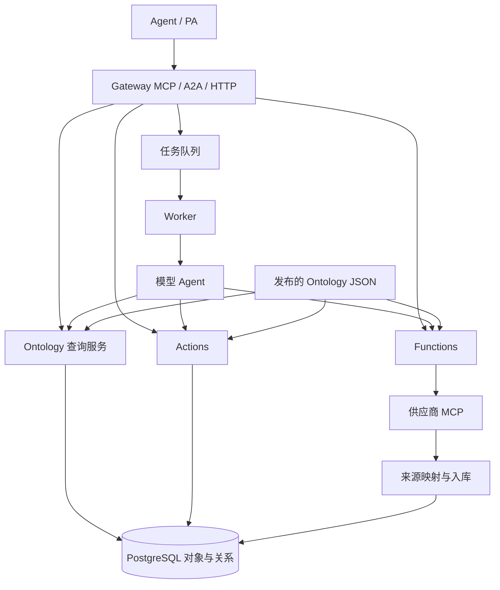
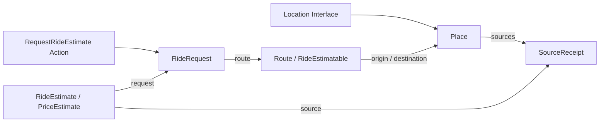

# Ontology 架构

语义层描述领域中的对象、属性、接口、关系、可调用逻辑与业务操作。运行层保存对象，执行查询、来源接入、Functions 和 Actions。两层通过发布的 JSON 定义连接。设计依据是 Palantir 官方的领域建模、复用、扩展和组合原则。[Building principles](https://www.palantir.com/docs/foundry/ontology/ontology-best-practices)

## 五类 Schema

| 类型 | 定义内容 | 当前运行入口 |
| --- | --- | --- |
| Object Type | API 名称、说明、主键、标题属性、属性和 Interface 实现 | `Ontology.object`、`Objects.read`、来源映射 |
| Property | 业务含义、值结构、必需性 | JSON Schema 校验及 Interface 属性投影 |
| Interface | 属性、关系约束、Action 参数约束及具体类型的映射 | 对象集查询、关系导航、`resolveAction` |
| Link Type | 两侧对象、两侧名称、基数 | PostgreSQL 关系表及 `Objects.follow` |
| Action Type | 参数、对象参数类型、提交条件、对象与关系编辑规则 | `Actions.apply` 的单次事务 |

Interface 通过实现映射引用具体 Object Type 的属性、关系与 Action 参数。查询由本体查询服务执行，Function 可以组合查询和计算。Action 表达用户或 Agent 提交的变更。[Interface 实现](https://www.palantir.com/docs/foundry/interfaces/implement-interface)、[Action 参数约束](https://www.palantir.com/docs/foundry/interfaces/interface-action-type-constraints)

关系带有日期、角色或状态等业务信息时，用独立对象保存这些信息，并通过 Link 连接两端。当前来源时间和证据类型保存在 `SourceReceipt` 对象中。[Object-backed links](https://www.palantir.com/docs/foundry/object-link-types/create-link-type)

## 模块边界



| 模块 | 职责 |
| --- | --- |
| `packages/ontology/schema.ts` | 声明定义的数据结构 |
| `packages/ontology/model.ts` | 解析定义、属性映射、Link 导航、Action 参数映射 |
| `packages/ontology/definitions/ride.json` | 滴滴领域的发布定义及来源字段映射 |
| `packages/runtime/metadata.ts` | 发布定义并按任务引用解析 |
| `packages/runtime/objects.ts` | Owner 范围内的对象集查询、关系查询与存储 |
| `packages/runtime/ingestion.ts` | 将来源行按发布映射写入对象 |
| `packages/runtime/functions.ts` | 参数与返回值校验、函数和来源绑定 |
| `packages/runtime/actions.ts` | 提交条件、编辑规则、幂等事务与操作记录 |
| `packages/runtime/tasks.ts` | 任务状态、领取租约、取消与来源调用记录 |
| `packages/runtime/agent.ts` | 从任务发布版本提供发现与工具调用，返回模型选择的 Function 结果 |
| `packages/runtime/harness.ts` | 独立模型会话与任务专用 Ontology MCP，不保存第二份任务 |
| `packages/runtime/sources.ts` | 执行发布的数据源 Function，把服务端持有的回值交给来源投影 |
| `packages/capabilities/didi/` | 滴滴响应解析、领域 Function 与来源投影 |
| `apps/gateway/`、`apps/worker/` | 协议认证与执行进程 |

这些职责对应 Foundry 的 Metadata、Object databases、Object Set Service、Actions、Object Data Funnel 和 Functions。这里采用单个 PostgreSQL 存储服务，定义解析与来源连接器通过进程内模块实现。[官方运行架构](https://www.palantir.com/docs/foundry/object-backend/overview)

## 滴滴业务链



模型接收用户原文与任务发布版本的 Interface、Link、Function、Action 和 data source 目录。运行层不指定调用顺序，也不解析路线或选择地点。模型可查阅完整定义，并通过独立查询批次并行取得数据。[Palantir Agent 工具](https://www.palantir.com/docs/foundry/agent-sdk/customize-agent)、[Ontology MCP 工具说明](https://www.palantir.com/docs/foundry/ontology-mcp/mcp-tools-and-agent-configuration)

当前业务能力如下；这些是可供模型组合的操作。

- `DidiPlaces` 数据源运行 `searchPlaces`，按发布的字段映射批量写入 Place 与来源 Link。模型通过 `Location` 查询属性并选择地点，歧义时暂停原任务。
- `CreateRideRoute` Action 把所选地点连接为路线。`RideEstimatable.requestEstimate` 映射到 `RequestRideEstimate`，按提交条件创建询价请求。
- `DidiEstimates` 数据源运行 `estimateRoute`，沿请求和路线的 Links 取得坐标，调用真实 `taxi_estimate`，映射报价与来源对象。
- `readRideEstimates` Function 查询请求关联的 `PriceEstimate`，检查来源与时效，返回路线、价格与验收结果。

`refresh_sources` 负责来源读取和入库，模型不能提供入库价格。普通 Function 求值不写入对象，业务编辑由 Action 执行。`complete_with_function` 重新执行模型选择的结果 Function，把服务端返回值直接交回原任务，省去一次模型改写报价的往返。没有在调度器中写死结果 Function 名称。工具失败可以由模型根据回值纠正，取消或租约失效仍阻止后续提交。

对象集查询示例。

```json
{
  "query": {
    "type": "PriceEstimate",
    "from": {"object": {"type": "RideRequest", "id": "REQUEST_ID"}, "link": "estimates"}
  }
}
```

请求、任务调度和技术调用分别保存在专用运行表。地点和路线具有业务身份，费用估计是一次来源观察，来源凭据保存在运行配置中。标准化过程保留供应商坐标系声明及价格范围。[结构指导](https://www.palantir.com/docs/foundry/ontology/ontology-structural-guidance)

## 执行与数据访问

Gateway 校验 JWT 的签名、issuer、audience、有效期和 scopes。对象、关系、任务及 Action 记录都按当前 owner 查询。来源绑定限定 owner，并在调用与入库时检查是否仍有效。

Action 的对象和关系编辑与操作记录共用事务。相同 requestId 的重复请求返回原结果，参数冲突会被拒绝。数据库约束执行关系基数，失败事务回滚编辑。Provider 请求在数据库事务外进行，返回结果通过来源映射提交。[Action 语义](https://www.palantir.com/docs/foundry/action-types/overview)

Worker 使用 PostgreSQL 通知唤醒，行锁领取单个任务，并在执行期间续租。取消或租约失效使后续提交失败。已完成的来源调用可以在原任务内复用，结果未知的原调用会保留失败状态。

## 当前支持范围

对象查询支持类型或 Interface、等值筛选、字段选择和游标。关系支持双向导航与一对多基数。Action 支持创建对象、按 revision 编辑对象和添加关系。Function 具有独立参数与返回契约，已接入外部来源读取和对象计算。

第一条实现的领域用例是滴滴估价。模型解释自然语言并使用发布的业务能力，PA 也可提供结构化参数。通用调度器的跨定义行为有工程回归，真实业务验收范围仍是本次滴滴路线。完整 Foundry 产品的界面、其他业务领域的真实验收、属性 reducer、媒体类型、跨组织共享和通用删除规则尚未在本版实现。

验收使用实际业务问题从入口走到结果，并记录耗时、路径和歧义。合成回归保持可重复，真实 MCP 验收另存私有记录。[官方验证方法](https://www.palantir.com/docs/foundry/ontology/ontology-design-validation)
