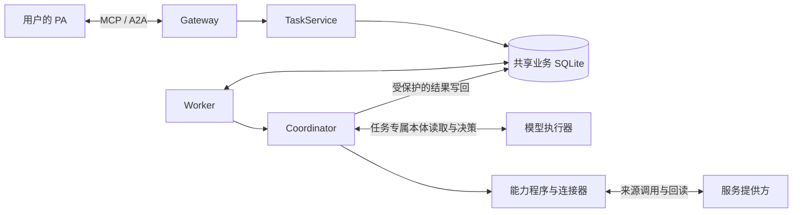

# 仓库结构与维护

本仓库实现 EIGOS 的 TypeScript／Node.js 任务运行时：PA 通过 MCP 或 A2A 提交目标，Gateway 接收并保存任务，Worker 依据同一任务的本体版本、事实和授权组织执行，核验结果后供 PA 回读。项目定位见[首页](../../README.md)，各业务能力的配置与验收范围见[能力目录](capabilities.md)。

## 从哪里开始读

1. [Agent 接入](../integration.md)：了解协议入口、任务接口、身份和授权。
2. 本页的运行结构与源码入口：把一次任务对应到具体模块。
3. [开发与运行](../gateway-worker.md)：按 Node.js 要求启动本地进程，配置共享存储并运行验证。
4. [共享本体](../../packages/ontology/README.md)、[模型执行](model-execution.md)和[任务闭环](task-closure.md)：理解版本固定、决策读取、动作执行与独立验收。

业务术语查[领域模型](domain.md)；具体服务的接入约束从[服务接入导航](../README.md#服务接入)进入。`pitch/` 是产品演示页面，源码、当前指南和运行实例共同决定可用范围。

## 运行结构

Gateway 处理协议、认证、任务交互、会员与管理入口；Worker 处理持久领取、模型、供应商调用、恢复和验收。二者通过同一个业务数据库协作，Gateway 不启动模型。会员登录会话使用独立会员库，Worker 不读取会员登录会话。

共享业务库同时保存任务、授权、执行账本及本体注册库。新任务固定 `ontologyId / releaseId / digest`；Gateway、Worker 和 Ontology MCP 按该任务的准确发布解释对象与动作。发布新定义不会改写在途任务的语义。存储与进程配置详见[开发与运行](../gateway-worker.md)。

## 一次任务经过哪些代码

1. **接收目标**：[MCP 入口](../../apps/gateway/mcp.ts)或[A2A 入口](../../apps/gateway/a2a.ts)将用户身份与请求交给同一个 [TaskService](../../packages/core/tasks.ts)。任务接口处理提交、补充、改版、授权、取消和回读。
2. **保存与领取**：[JobStore](../../packages/core/store.ts)保存任务及其本体发布引用；[Worker](../../apps/worker/worker.ts)持久领取工作并续租。领取、检查点和提交绑定 owner、任务 revision 与领取令牌，阻止失效执行覆盖当前状态。
3. **读取与决策**：[Coordinator](../../packages/coordinator/coordinator.ts)推进目标理解、动作选择和执行循环；[本体规划会话](../../packages/coordinator/planning-session.ts)限定本次模型可读的任务、版本和对象。模型提交决策及读取依据，宿主核验后再推进。
4. **执行动作**：[能力装配](../../packages/capabilities/catalog.ts)按配置注册业务程序和来源；[能力目录合同](../../packages/core/catalog.ts)统一发现与执行接口。业务程序解释动作，连接器调用准确来源；存在定义或配置不代表当前账号已有业务许可。
5. **核验与返回**：业务程序按约定回读原操作并核验结果，Coordinator 与 JobStore 保存被接纳的结果。PA 从原任务取得状态和制品。补充信息、技术恢复、取消及未知操作查证沿用原任务和账本；创建订单、付款与履约分别需要证据。

任务说明的完成只代表说明制品已生成。一个组件完成也不能替代整个多服务目标；详细合同见[任务闭环](task-closure.md)。

## 目录与关键入口

| 位置 | 职责与关键入口 |
| --- | --- |
| `apps/gateway/` | MCP、A2A、认证、会员、本体管理及网络入口；[app.ts](../../apps/gateway/app.ts)装配 HTTP 应用 |
| `apps/worker/` | 持久领取、模型调用、执行、恢复和独立验收；[runtime.ts](../../apps/worker/runtime.ts)装配执行侧，[worker.ts](../../apps/worker/worker.ts)管理领取与租约 |
| `apps/provider-mcp/` | 美团供应商协议适配；不另建业务本体 |
| `apps/participant-browser/` | 免费报名的本机浏览器操作队列 |
| `apps/source-account-observer/` | 本人来源账号状态的观察入口 |
| `apps/*-sandbox/` | 独立的合成服务提供方 |
| `packages/core/` | 任务、授权、账本、存储和来源身份；主要入口为 [tasks.ts](../../packages/core/tasks.ts)、[store.ts](../../packages/core/store.ts)与[配置](../../packages/core/config.ts) |
| `packages/coordinator/` | 基于同一任务本体的规划、模型决策和多服务执行；[coordinator.ts](../../packages/coordinator/coordinator.ts)连接运行阶段 |
| `packages/ontology/` | 本体定义、注册库、编译、对象与关系、函数及版本兼容；编辑来源与发布流程见[模块说明](../../packages/ontology/README.md) |
| `packages/ontology/definitions/` | 唯一可编辑的供应商 MCP 绑定数据；运行中的定义和发布由共享注册库管理 |
| `packages/ontology/pipeline/` | 服务接入合同、验证记录、受限映射与事实更新；复用共享本体发布和业务存储，见[Pipeline 指南](../guides/ontology-pipeline.md) |
| `packages/capabilities/` | 业务程序、供应商连接器和验收器；[catalog.ts](../../packages/capabilities/catalog.ts)按配置装配 |
| `packages/security/` | Foundation 权限、任务上下文、来源资格与原操作恢复；入口约束见[本体权限指南](../guides/ontology-security.md) |
| `packages/members/`、`packages/network/` | 会员、Agent 安装、来源连接和有可见性约束的目录、询价及协作 |
| `packages/agent-client/`、`integrations/` | PA 客户端、身份集成和外部 Agent 适配 |
| `packages/deployment/`、`scripts/` | 构建、配置、依赖和部署工具；运行命令在 [package.json](../../package.json)维护 |
| `tests/`、`examples/` | 自动回归、合成夹具和可复用调用示例；`tests/e2e/`覆盖独立进程接线 |
| `docs/`、`pitch/` | 当前指南与产品演示页面 |

## 按改动目标定位

| 目标 | 应一起检查的边界 |
| --- | --- |
| 修改 Agent 接入或任务行为 | MCP、A2A、TaskService 与任务摘要；两种协议共用身份、权限和任务状态 |
| 新增服务或调整业务动作 | 本体定义／发布、能力程序、连接器、验收器及相应来源许可；从[能力目录](capabilities.md)和供应商指南确认范围 |
| 调整模型或多服务编排 | Coordinator、本体规划会话、读取回执、累计预算和整个目标的验收；不能以单个组件成功替代父目标 |
| 调整执行、存储或恢复 | JobStore、Worker、Foundation 权限与原操作账本；同时检查取消、改版、续租、迟到结果和未知外部效果 |
| 调整会员或协作网络 | 会员身份、来源归属、内容可见性及具体业务授权；目录可见或账号已连接不自动授予执行许可 |

## 文件归属

源码、依赖锁、合成测试夹具、当前指南和可复用演示纳入 Git。内部计划、阶段记录、真实账号联调证据、截图及原始命令输出留在本地归档。凭据、配置、数据库、缓存和构建产物进入忽略目录。

整理已有文件时，先复制并核对哈希，再移出跟踪，同时更新实际引用。测试确实依赖的输入提取到夹具中；运行时版本兼容所需的本体历史快照继续保留。移出当前文件列表不等于改写 Git 历史。

`dist/` 是生成物；`packages/ontology/history/` 是只读兼容快照。供应商绑定编辑 `packages/ontology/definitions/`，业务定义通过共享注册库的草稿、发布和激活流程维护。历史指纹不为通过测试而重写。

## 分支与交付检查

`main` 是集成主线。专题开发使用短期 `codex/` 分支；完成验证后合入主线。清理分支前检查其提交已完整进入保留分支、当前远端 SHA 未变化，并保存恢复记录。其他工作区的在途改动保留。

代码改动按[项目规则](../../AGENTS.md)完成类型检查、测试、构建和差异检查；具体命令见[开发与运行](../gateway-worker.md#验证)。仅文档改动检查实际差异、源码对应关系和链接，沿用仍有效的代码验证。

开发同步按项目规则与本次用户授权确定交付端点。整合代码、部署版本和真实业务结果分别验收。自动测试及沙箱验证说明其覆盖的工程行为；真实交易与履约以对应业务证据为准。
