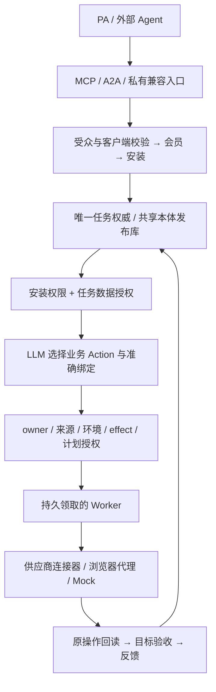

# 统一运行与路由

EIGOS 使用一个正式运行权威。OAuth 接入方式、公开或私有地址、供应商环境都不决定另建一套本体。已发布的共享业务库保存定义、任务、对象、关系、授权和执行账本；Gateway、Worker 与 Ontology MCP 读取相同 authority ID 和准确任务 release。

入口只适配协议和认证。每个入口登记准确 HTTPS origin、OAuth audience、签名租户声明名称与客户端集合；只根据实际 Host 选择校验器，不信任转发头来改变受众，也不回退到另一入口的身份声明。私有兼容入口仍使用原受众与安装，浏览器管理统一跳转主入口。两个入口查询同一任务 ID 时，执行同一权限检查。

会员准入与能力授权分开。邀请或登录成功只确认身份，不能自动获得私有来源。原生 MCP 客户端也有明确安装身份；先检查已有会员连接，再绑定验证过的短期令牌。新的安装不自动取得业务 grant，撤销的安装不会被新令牌复活。

Action 表达业务意图，连接器选择 MCP／API 等运输方式。运行目录可以包含多个来源；模型只能发现和组合本安装获准的 Action 与输出类型。执行时再次检查同一 owner、来源绑定、具体程序版本、环境、effect 与任务计划。相同供应商账号的旧配置只有在 owner、凭据路径、凭据指纹和环境一致时才能汇合；该汇合不会放宽任一安装权限。

`authority.json` 是操作员维护的非秘密部署身份，包含数据库绝对路径、规范入口与允许入口。数据库存储其摘要和变更历史。进程启动不自动接纳缺失或不匹配的描述；领取、续租和提交受相同摘要约束，变更后迟到结果不得落库。主实例只监听 loopback，由受管前端提供 HTTPS。

并发授权写入先取得写事务，避免读快照在写入前失效。Worker 启动时等待 Gateway 的授权发布就绪；同步校验的持续进展也会续租，但必须先验证原租约和当前权限仍有效。权限与任务元数据缓存只在一次同步读取中复用，业务或权限数据写入、其他连接提交、授权到期或读取结束即失效，不能跨模型轮次或来源调用沿用。同一连接追加只读审计记录不会清除本次读取的缓存；触发器产生的额外写入仍会使缓存失效，审计记录照常持久化。

查询先按已声明的对象类型或精确对象 ID 限定权限检查的候选集合，再完整校验候选对象及其依赖。字段筛选、结果计数和分页仍在可见性检查之后进行，整个任务的绑定数量上限保持不变。

其他连接的心跳或审计提交仍会清除读取缓存。单个只读绑定可以最多重新核验两次，且重新取得的完整权限与依赖证明必须相同；同一连接的业务写入、权限变化、依赖变化、到期和持续冲突仍拒绝返回。该复核不会重新执行查询调用者、模型、供应商动作或任务提交。

历史 release 是同一注册库中的不可变版本，不是并行可变本体。合并时保留原任务引用，以内容一致的别名解决不同数据库曾分配的 release ID。只读兼容映射必须证明目标解析不会改变原事实，且不改变任务的执行 pin。缺少输出来源证明的历史数据留在受限归档中。

内容寻址的 `RegisteredCapability` 可被新任务复用。只有当前任务确实链接该说明、当前发布版与原写入版的属性和写策略兼容时，权限层才接受原记录；不会改写旧指纹，也不把这个例外用于供应商事实或会员资产。模型运行还必须匹配执行器声明的准确授权通道，部署预检检查该通道是否有效。

开发数据库和合成测试可以隔离存在；其结果不冒充正式任务、授权或真实履约。尚未接入 foundation 权限的供应商写操作继续作为隔离开发能力，不能通过再开一个正式实例绕过权限路径。
