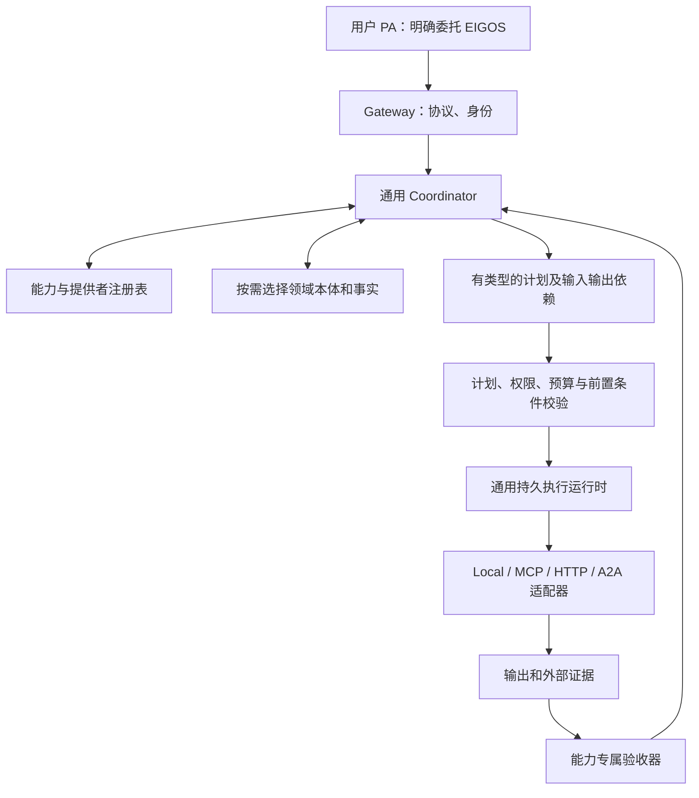

# 从 CSV 闭环扩展到多能力发现、执行与验收

2026-10-15。状态：代码审查结论与后续设计；本轮未改业务实现。

## 1. 当前判断：CSV 闭环已经验证，通用发现与编排尚未实现

| 耦合位置 | 当前事实 | 后果 |
| --- | --- | --- |
| `packages/coordinator/csv.ts` | 提示词只提供 CSV_ONTOLOGY；输出只有 ask_user／propose_csv_audit／unsupported | 没有在不同业务能力中选择 |
| `packages/ontology/csv-audit.ts` | 固定 local-csv-auditor；计划字段包含 fileName、checks | 通用委托类型和 CSV 领域定义混在一起 |
| `CsvCoordinator.run` | 固定检查项和动作列表，再直接创建 PilotCommands | 模型没有生成跨能力执行计划；动作列表主要用于绑定和校验，实际流程由 pilot 驱动 |
| `apps/worker/runtime.ts`／`worker.ts` | 直接创建 CsvCoordinator，按 service 分支，独立 tick pilot | 加能力需要修改 Worker，而不是只注册适配器 |
| `packages/core/tasks.ts` | 直接导入 CSV_ONTOLOGY，授权只接受 confirm_simulated_payment | 通用任务生命周期承担了具体领域流程 |
| `packages/core/store.ts` | 领取条件直接区分是否存在 pilot | 调度存储也依赖业务结构 |
| `packages/core/services.ts` | 静态说明目录 | 是对外描述，不是提供者注册、健康检查或真实可用性的证明 |
| `packages/core/config.ts` | 协调器开启要求 CSV pilot 和目录 | 配置也绑定单领域 |

已实现且应保留：身份隔离、任务持久化、领取／租约、幂等、状态返回、真实模型补问、输入和计划摘要绑定、独立验收、模拟失败恢复以及 Grok 实测证据。

## 2. 目标边界

保持一个仓库和 Gateway／Worker 分进程。目标是新增已知契约的服务时，只增加领域包、提供者适配器和注册配置，不再修改共享路由和授权分支。新增一种全新的执行语义仍可能需要扩展运行时契约，不能承诺所有能力只靠改 JSON 即可接入。

## 3. 必须分开的五种契约

### Capability：能完成什么结果

记录稳定业务语义、版本、输入／输出类型、适用条件、禁止范围、所需事实、可能副作用和验收契约。例如 `data.quality.audit`，而不是某个供应商名字或付款实现。

领域本体负责解释对象、关系、动作和约束；例如审计报告关联输入快照，订单关联报价。不要把所有领域的详细描述放进每次模型提示词。先选候选领域，再提供相关定义和授权范围内的事实。将“计划版本”和“执行时更新的事实”分别记录。

### ProviderBinding：谁实际提供这项能力

记录 providerId、capabilityId、实现版本、协议／适配器、地址、认证引用、输入输出转换、地域／租户限制、价格或报价方式、验收器绑定，以及验证范围和时间。

一个能力可以有多个提供者，一个提供者可以提供多个能力。CSV 本地程序只是其中一个绑定。外部 Card 是提供者声明，需要通过适配器映射到 EIGOS 的业务契约；不能仅凭标签相似就认定输出语义一致。

### Availability：这次任务现在能否使用

按任务及主体检查：能力是否启用、提供者是否响应、账户权限、必要输入、配额、时限、报价有效性和副作用范围。结论区分可运行、缺信息、需授权、暂不可用、未验证或不支持。

Card 中列有 skill 与当前可用性不是一回事。“本注册表没有可用提供者”也不等于全世界没有服务。系统应准确说明发现范围和信息缺口。

### ExecutionPlan：准备怎样完成

通用结构应包含任务目标／验收版本，以及 steps。每步记录 capabilityId、providerId、版本、动作、输入引用、依赖步骤、前置条件、授权需求、输出类型、防重键、验收器和恢复策略。

模型提出计划；程序检查能力确实存在、依赖无环、输入类型兼容、数据来源可访问、权限及预算满足。模型不能生成不存在的工具、身份或批准记录。

首版先支持单能力和短串行依赖。明确存在并发需求时才增加并行，不先建复杂通用工作流平台。

### Acceptance：如何证明交付符合要求

每项能力绑定验收方法，不建立一个对所有业务都返回 true 的通用 verifier。不同层次分别检查：

- 格式：输出类型、必需字段、文件完整性。
- 来源与绑定：输入版本、订单／任务引用、摘要、证据来源和时间。
- 业务：约定结果是否发生，质量及限制是否满足。

CSV 可独立重算；预约需要核对供应商预订记录和用户条件；文本生成的部分内容质量可能需要模型复核或人工确认，必须注明证据强度。供应商返回 A2A COMPLETED 是其声明，不能直接成为 EIGOS 的业务验收结论。

## 4. 能力发现：先受控注册，再按任务选择

新增外部 Agent 的建议流程：

1. 管理员登记可信地址和认证引用；抓取 Card，保存来源／版本／核验时间。支持后续刷新和禁用。
2. 将对方技能映射成已有能力契约，或新增领域定义；补齐协议外的业务输入 schema、状态和验收要求。Card 本身不必携带这些完整 schema。
3. 以受控请求验证请求／结果格式、权限、任务恢复和失败路径。把测试替身、只读探测与真实履约验证分别记录。
4. 经验证、启用后进入候选注册表；候选并不自动获得用户数据和执行授权。
5. 接到用户目标后，按结果类型与约束检索候选，执行本次可用性检查，再让模型在有依据的候选中提出计划。

需授权的候选不必直接丢弃，但不能当作可立即执行。应向用户说明可接入条件。发现服务超时的结论为未知或暂不可用，不能据此断言永久不支持。

早期用一个受控注册表和明确契约匹配即可。后续可接外部目录作为候选来源，也可增加语义检索辅助召回；硬性条件仍由程序检查，不由向量相似度决定。

## 5. 执行和验收如何衔接

统一适配器接口至少要表达：预检、发起、查询／恢复、取消能力、输出和证据。不要假设每个服务都能取消、回滚或用相同幂等键自动防重；这些能力需逐个声明并验证。

外部 A2A 提供者需要持久保存远端 contextId／taskId／messageId 与本地步骤的映射。请求结果未知时，先恢复原任务；不能默认新建一个远端任务。远端需要补问／授权时，协调器把缺口带回用户 PA，同时保持本地任务的阶段和远端关联。

只有已验收的前序输出，才能进入依赖该输出的下一步；如果业务允许使用未验收数据，计划必须显式表达其条件及风险。上游输出到下游输入的转换也要有声明的类型与来源绑定。

最后还要做整体目标验收：每一步各自成功，不一定代表用户的整体目标已经达成。例如“审计后发邮件”不能只完成审计就将整个任务标记完成。

失败处理按步骤的实际副作用决定：安全重试、查证、换提供者、补交、补偿或人工处理。换提供者也可能改变费用和数据去向，必须落在已有授权范围内。

## 6. 授权不能继续绑定 CSV 模拟付款

共用任务核心只处理授权需求及其状态，不导入 PilotCommands。具体能力产生有类型的授权请求：动作、目标对象、预算、数据范围、有效期、计划／报价版本。授权接口校验需求与批准记录相匹配后，唤醒待执行步骤。

CSV 的 confirm_simulated_payment 留在 CSV 适配器内，作为一种特定领域的授权流程。其他业务不应为了复用核心而被迫创建模拟付款／退款账本。

## 7. Card 与注册表的关系

对外 Card 由注册表中已发布的能力生成经过审核的摘要，不直接转发所有供应商 Card。用户 PA 看到的是 EIGOS 承诺的服务边界，内部供应商选择和工具细节可以隐藏。

Grok 的保存内容继续是地址、认证引用和通用委托流程。添加新领域时，服务端 Card 与契约应更新；如果出现客户端不认识的新授权流程或必需扩展，需要明确协商，不能声称客户端永远不必更新。

## 8. 建议的迁移顺序与验证

1. 抽出通用 Delegation、Capability、ProviderBinding、PlanStep、Evidence、Acceptance 契约。fileName／checks 留在 CSV 的输入和计划扩展中。
2. 将 CSV 本体、模拟授权、执行、独立验收和补交／退款封装成一个领域包；保持现有任务行为及数据可读。
3. 建立注册表，把当前 CSV 和现有 `brief.prepare` 注册为两个不同能力。明确 brief.prepare 只交付任务说明，不执行其中的业务。
4. 将固定 CSV assessor 改成对候选能力及相关本体做判断的 Coordinator；将 Worker 改成按注册处理器执行工作项，移除 core/store 中以 pilot 是否存在作调度判断的业务分支。
5. 用同一个 eigos.delegate 入口验证选路：CSV 目标进入 CSV 包，任务说明目标进入 brief 包，无匹配能力时明确拒绝或说明未知；不得回退到“写个文档算完成”。
6. 加入一个真实外部 A2A provider 绑定，验证发现、任务关联、补问、授权、恢复查询和本地验收。最后再扩展多步骤组合。

扩展成功的核心验收标准：在既有执行语义内新增第三项能力时，只增加领域包、适配器和注册配置；不改 Gateway、通用 Coordinator、Worker、任务授权分支或数据库领取条件。还需证明禁用／失效提供者不会被执行，语义相似但输入／输出不兼容的能力不会被错误拼接，供应商伪完成不能绕过验收。

## 9. 本轮结论

当前代码完成了 CSV 单领域的有约束闭环。下一步的工作是抽取真正共用的能力发现和执行契约，再用第二种已有能力证明抽象成立；仅增加 Card 条目、换提示词或把 CSV_ONTOLOGY 改成数组都不够。

本设计不授权新增公网部署、外部供应商账户、真实交易或新的数据库产品；也没有将当前 Grok 成功案例外推为多能力编排已经可用。

## 实施进展

2026-10-15 已完成通用注册表与协调器，CSV／brief 两种能力接入，以及三路真实模型验证；最新边界和接口见 [实现说明](registered-capabilities.md)。外部 A2A 提供者及多步骤组合仍待实现。
