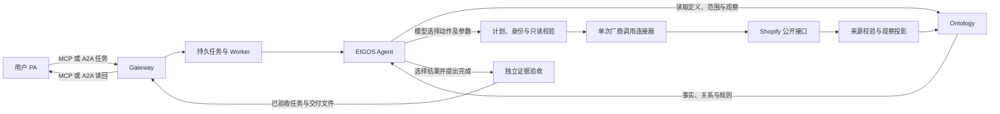

# 商品查询改为 EIGOS Agent 选择和组合动作

2026-10-23 更新：当前代码契约为 v15，工具映射、参数和依赖改由 [`shopify-catalog.json`](../ontology/shopify-catalog.json) 独立维护，模型使用通用规划提示。当前维护与执行边界见 [MCP 统一说明](mcp-ontology-unification.md)。下文 v8 与 2026-10-19 的次数／部署／PA 记录保留为历史证据，不代表本轮部署或重新查询。

当前契约为 `ontology-execution-v8`、`eigos.business@7`、`commerce.catalog.query@2`。Shopify 商品查询已使用通用 Agent 执行循环：模型读取本体后选择动作和参数，受控连接器执行一次接口调用，结果写回本体，再由模型决定后续动作或完成。原来自动搜索三款、选择首个变体、逐个详情及固定复查的 `ShopifyCatalogAdapter`／`AnonymousShopifyCatalogReader` 已从实现中删除。

这次迁移覆盖 Shopify 商品查询路径。其他已有能力仍使用各自的候选准备及已绑定动作契约，不能据此声称所有服务已完成同样的迁移。此前 [v7／商品查询 @1 的验收](shopify-pa-worker-2026-10-19.md) 保留为历史记录；它证明旧查询链路可往返，不证明当时已由 Agent 自主组合动作。

## 职责与执行顺序

`Coordinator` 的请求解释只确定配置商家和美国目录市场，创建 `CatalogTask`，不触发 Shopify HTTP。`AgentRuntime` 处理版本化模型决策、依赖关系、持久动作账本及任务状态，不包含 Shopify 工作流。业务语义、输入范围和结果验收由 `CatalogAgentProgram` 与本体模块实现。

`AnonymousShopifyConnector.invoke` 每次只发起一个厂商接口操作。它不选择商品、不隐式发现端点、不安排详情查询、不重查价格，也不宣告完成。

| Ontology 动作 | 单次厂商操作 | 必要前提 |
| --- | --- | --- |
| `SearchPublicCatalog` | Global Catalog `search_catalog` | 当前任务范围、配置商家、模型选择的关键词和 limit |
| `InspectCatalogVariant` | Global Catalog `get_product` | 模型已读取的本任务观察、明确选择的变体 |
| `DiscoverMerchantCatalog` | 商家 `/.well-known/ucp` | 当前任务范围内的配置商家 |
| `ReadMerchantVariants` | 商家 `lookup_catalog` | 有来源且未过期的端点；变体来自本任务观察或请求者明确提供的 ID |

模型可以省略搜索、详情或店铺查询，只要所选证据支持请求目标。一次计划可以包含独立动作和有依赖的动作；`inputRefs` 只把前一步实际产生的对象引用填入后一步指定字段。没有厂商生成的预设 recipe。店铺查询使用已验证的发现对象恢复客户端状态，不额外产生隐藏的 discovery 请求。

搜索 limit 由模型在 1～10 间选择。返回内容中的配置商家变体全部保留，最多 40 个；超界返回缩小查询的反馈，不静默取前三款或每款第一个变体。模型随后选择需要继续读取或交付的变体。

## 本体、模型决策与证据

- `CatalogTask` 保存本任务的商家、市场、绑定摘要和可用只读动作。
- `CatalogObservation` 保存一次动作产生的商品事实；`CatalogEndpoint` 保存一次来源验证后的商家端点。二者均绑定原任务、版本、模型调用、计划、动作、尝试和 HTTP 回执。
- 观察关联 `SourceReceipt`；存在显示价格的商品同时映射到 `ProductOffer`／`ProductVariant`。价格为 `display_price`、费用范围为 `partial`，不能用于证明完整订单总价。
- `catalogObservationStatus` 检查来源、当前任务范围、关系、完整性摘要和五分钟本地有效窗口。工具返回成功与业务事实 `known` 分别记录。
- 实际模型最终 JSON 的 `decisionDigest` 与执行计划的完整 `modelDecision` 绑定。落盘计划和恢复执行时均检查所执行步骤与模型选择一致。
- 结束任务也需要一次模型完成决策。模型须读取并评估所选观察，列出观察引用与变体 ID；程序按原始观察生成事实文件并核对硬性要求。模型解释不替代价格或身份来源。
- 较晚观察与拟交付价格、SKU 或可售标记矛盾时，旧事实不能被接受。反馈回到 Agent，由它选择当前观察、再查或说明无法完成。

执行模型只读本任务、其直接关系和程序绑定的范围／观察对象，不能搜索同一账户的无关对象。每轮最多 4 个动作，全任务最多 8 轮动作计划、16 个动作和 32 次模型调用；补问回复保留已用预算，并遵守配置的任务等待时限。相同输入连续三次失败会停止该路径并要求调整条件。库存数量、配送承诺、目录覆盖完整性和商家合作信任继续为未知或未验证。

## 持久执行与只读边界

MCP／A2A 的提交、查询、回复和取消接口不变。新动作沿用 `ActionIntent`、`ExecutionAttempt` 和 `Observation`，在接口调用前持久化动作与尝试。接口返回后的观察接受、本体投影和 Agent 状态更新在同一事务内检查原领取令牌、租约、任务版本与状态。

取消或租约失效后收到的回包只留作未应用的审计记录，不能覆盖任务或产生成功观察。崩溃中断的读取进入 `effect_unknown`；恢复 Worker 不重放原调用，下一次模型决策可以明确提出新的只读动作。任务回复会形成新请求版本与新范围，旧观察和计划保留为历史。

生产连接器只有上述四种匿名读取。没有购物车、结账、订单、付款绑定，也没有授权金额或付款许可；商品名称或网页提示不能增加动作范围。商家名单、身份、canonical `myshopify.com` 主机、美国市场、本机本人和 loopback 限制仍由受信任配置固定。原始来源响应保存在私有目录，公开交付只包含经检查的观察及证据摘要。

历史 v7 任务不自动迁移、领取或重新执行。v8 仍使用原有 PA profile、客户端、认证和任务库；原有任务记录保留。

## 验证状态

代码验证：334 项测试及 7 项进程端到端测试通过。覆盖模型自选关键词与 limit、选择非首个变体、已知 ID 跳过搜索、可选详情、价格变化后改选、商品名和变体标签保留、模型决策摘要、任务数据隔离、等待时限、跨任务引用、未注册写动作、缺少来源评估、取消、租约失效、重启后继续及旧价格矛盾。

本机服务已更新到 v8。2026-10-19 已完成[真实后端 Ontology 核验](evidence/ontology-runtime-2026-10-19/README.md)：诊断客户端发起后，真实模型通过 8 次本体读取／计算，选择商家发现及指定变体读取，完成 2 次匿名厂商调用，再读取观察并提出完成。独立回读与反向测试通过。首轮还发现规格标签覆盖商品名的问题；修复映射后，全新请求重新核验通过，原记录保留。

用户解锁 Mac 后，2026-10-19 18:29（Asia/Shanghai）完成了[用户 PA 的真实完整往返](evidence/agent-catalog-pa-2026-10-19/README.md)。既有 Monk PA 提交 FLOW／EASE 比较目标，EIGOS Agent 经 14 次真实模型调用、21 次本体读取／计算，选择 3 轮计划、7 个只读动作，再通过 Gateway 返回给 PA。PA 实际读回并报告结果，独立 MCP／数据库／原始来源核对通过。该记录与先前的后端诊断分别记账。

独立验收程序 `examples/verify-pa-agent-catalog-e2e.ts` 只读 PA 回执、MCP 任务、数据库和已存来源响应，不提交任务、不运行模型、不访问 Shopify。它将核对模型决策与真实动作的一致性、动作前置模型回执、HTTP 请求／响应摘要、来源商品事实、完成时的 known 评估、两种协议与数据库中的交付内容、历史任务及连接未变，以及运行构建与冻结源码一致。
