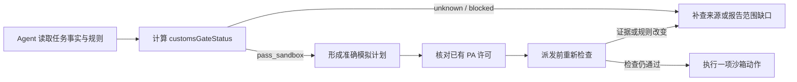

# 海关参考资料与执行关卡

此扩展将监管资料与执行约束接入 `commerce.journey.sandbox@2`。代码契约为 `ontology-execution-v10`、业务模型为 `eigos.business@9`。它提供可追溯的参考资料、明确的能力范围和不能被 PA 授权覆盖的执行检查；当前执行证据全部是合成数据，不能据此认定任何真实货物可以进口。

## 资料与可执行策略

`RegulatoryReference` 保存发布主体、官方网址、文献版本、生效日期（已核实时）、正文抓取时间、正文 SHA-256、主题与简要说明。首批登记四份已读取正文的官方资料：

| 资料 | 登记版本及用途 |
| --- | --- |
| [中华人民共和国海关法](https://www.caea.gov.cn/n6760401/n6760402/c6827751/content.html) | 2021-04-29 修正文本；海关监管、申报、物品与货物适用范围 |
| [海关总署公告2024年第176号](https://www.mofcom.gov.cn/zcfb/zgdwjjmywg/art/2025/art_4adf716bf28542fdbffe5510b30d8ed9.html) | 2024-11-29 公布，2024-12-01 生效；修改、废止关系提醒 |
| [中华人民共和国烟草专卖法](https://www.samr.gov.cn/zw/zfxxgk/fdzdgknr/bgt/art/2023/art_5e70a89ddb7d4c20a8315e0124f468a5.html) | 2015-04-24 修正文本；受管制商品识别 |
| [中华人民共和国烟草专卖法实施条例](https://www.samr.gov.cn/zw/zfxxgk/fdzdgknr/bgt/art/2023/art_4882f33442244df5bd570219964612b7.html) | 2023-07-20 修订文本；资格与专门监管范围 |

抓取时间只证明该时刻取得此版本正文，不保证未来仍是最新规则，也不是法律审核或个案批准。官方资料统一标记 `reference_only`；不将文献存在、HTTP 200 或某条摘要转换成“允许进口”。海关 FAQ 页直接抓取只返回页面框架，未被当作已取得正文的登记依据。

`CustomsRuleSet` 保存已审核代码中的执行策略、适用范围和资料集合摘要。资料、规则集的对象 ID 包含内容摘要；更新资料会形成新对象和新策略摘要，不改写旧版本。相同版本重复绑定另一个任务不会改写共享资料。程序配置摘要绑定策略摘要，旧计划及许可不会自动覆盖新策略。

当前策略只支持已登记的咖啡合成测试分类；烟草类判为本平台执行范围之外，其他未登记分类保留未知。这个平台限制不是对个人行为合法性的概括判断，也没有建立烟草采购、转运或报价能力。

## 强制执行点

| 动作 | 模型必须先计算的对象 |
| --- | --- |
| `QuoteCommerceLandedCost` | 准确的 `CustomsAssessment` |
| `PrepareCommerceCheckout` | 准确的 `LandedCostQuote` |
| `SubmitCommerceOrder` | 准确的 `CommerceCheckout` |

每次决策中，Agent 先通过当前 `ServiceRequest.customsRuleSets`、`ServiceRequest.regulatoryReferences` 读取策略与资料，再计算 `customsGateStatus`。所有读操作沿用现有任务归属与权限，不放开所有者级查询。模型看到的规则对象、计算输出摘要和实际计划固定在同一组读取回执中。

运行时在动作验证、许可校验和实际派发前重新核对。没有读取回执、拿错输入、输入已变、策略版本已变，均不能继续。PA 仍只批准一个准确动作计划；批准不改变关卡结论。

关卡检查包括：

- 当前任务、所有者、来源签名、配置及固定依赖是否一致。
- 商品分类、原产地、商品件数、发货国、目的国、地址与选定路线是否对应。
- 清关适用时间是否在当前有效窗口内，是否为未来时间，规则版本是否在当前合成策略内登记。
- 必需条款是否完整、唯一且满足；空清单不视为通过。
- 进口状态、责任角色及已有来源条件是否已确认，是否存在限制或矛盾。
- 当前策略、资料集合及内容摘要是否仍与已审核版本一致。

`pass_sandbox` 表示允许继续该模拟阶段；`blocked` 与 `unknown` 均阻止执行。结果始终带 `legalApproval=false`。普通沙箱购物车可在尚未选择地址时独立准备，但创建／更新草稿同样检查商品是否在支持范围；取消和已经发生操作的独立查证不以重新取得购买许可为前提。

## 退出与交付

实际读取并计算得到空商家目录后，可以报告当前注册来源没有覆盖，而不要求 PA 补充系统本应查询的事实。空目录必须对应原查询；另一个查询的空结果不能证明本次请求不可完成。这个结论仍只针对已注册来源，不代表全球无供应或法律禁止。

交付物增加 `customsPolicy`，包括策略摘要、采用的规则对象、模型计算时间与回执摘要、官方参考网址及版本，并注明合成覆盖和无真实法律批准。已经提交订单后的只读核对保留原合同与原执行依据，不把后来的策略更改改写成历史行为。

## 验证范围

针对性测试覆盖正常国内／跨境流程、实际模型读取回执要求、缺条款／重复条款、未知规则版本、过期／未来适用时间、准确 PA 许可之后资料变更、受管制分类拦截，以及空目录和错误查询范围。

MCP 测试通过真实认证 HTTP 入口读取规则、参考资料和关卡计算；现有 A2A／Python 客户端的准确许可与交付读回保持可用。这些工程测试使用明确标记的模型替身和合成来源，不等同于新的真人 PA 验收。

本关卡当前绑定 `commerce.journey.sandbox@2`。旧 UCP 协议夹具及其他能力不自动获得这套语义；旧 `checkoutReadiness` 仍只描述协议就绪。真实海关裁定、官方更新订阅、经营主体资格查验、多国家完整规则库、税费正式核定及跨服务商运输网络均未接入。真实业务执行继续保持关闭。

资料更新应重新取得正文并核对文献版本、效力和适用范围，审查差异后发布新的规则／资料摘要，完成回归与部署读回。不得自动把网页改动或模型解读发布为可执行许可规则。
