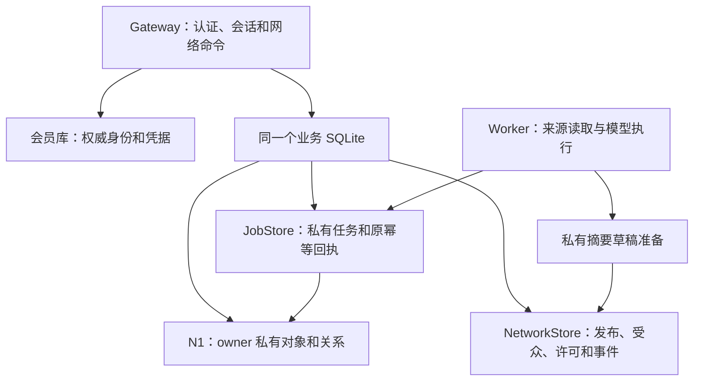

# D02：网络记录、共享投影、事务与事件

日期：2026-10-18。契约 `eigos.network.v1`，待实现；依赖 [D01](d01-identity-publication-2026-10-18.md)，基线见 [总览](agent-network-contracts-v1-2026-10-18.md)。

T09 已在原事件表上实现有界增量拉取、持久游标和权限重置；实际字段、迁移与密钥存储见 [T09 说明](../network-t09.md)。本分册其余尚未实现的询价/结果摘要契约保持设计状态。

## 1. 存储拓扑定案

N1 已用同一个 SQLite 连接保存 Job 与 ontology_objects/links，savepoint 保证任务与投影原子提交。第一阶段沿用这一能力：新增网络表位于同一个业务 DATABASE_PATH，通过独立 NetworkStore/NetworkService 访问。会员库仍独立，Worker 不读其凭据。

NetworkStore 不能通过“公共 owner”调用私有 OntologyObjectStore，也不能接受用户传入任意 owner。network object ref 为 `{kind,id}`，N1 object ref 为 `{type,id}`；转换只通过受控映射，不能同字符串即视作同一对象。

复用 N1 定义编译器的类型/属性/关系表达，网络领域定义单独版本为 eigos.network@1；不修改 eigos.business@1 的既有定义摘要。跨域关系只是私有映射表，不加入可遍历的公共本体关系。

## 2. 最小表和唯一性

下列为逻辑表契约，可按实现复用迁移工具；不是本轮已创建的表。

| 记录 | 必要字段/唯一约束 | 读者 |
| --- | --- | --- |
| network_profiles | profileId、controllerOwner、status、revision、privateDraftRef | 控制者；他人只读批准的 publication |
| network_profile_bindings | profileId、installationId、allowedCommands、revision、status；active 对唯一 | 控制者/内部 policy |
| network_representations | profileId、providerIdentityRef、role、scope、verificationRef、expiresAt、revision、status | 核实摘要可发布；证明原件仅审核范围 |
| network_spaces / memberships | spaceId/owner、role、status、revision；唯一(spaceId,memberOwner) | 圈策略允许的成员视图 |
| network_listings | listingId、providerRef、publisherProfileId、capabilityRef、approvedBindingLocator、status、revision | 私有源记录；外部只读 publication |
| network_drafts | draftId、kind、owner、profileId、body、schemaVersion、revision、sourcePrivateRefs、status | owner/获准 binding，永不通过 feed 返回 |
| network_publications | publicationId、logicalObjectId、kind、approvedBody、grantId、audienceSetId、contentDigest、revision、state、visibleUntil | 每次经 policy 过滤；每逻辑对象最多一条 current |
| network_audience_sets | setId、spaceId、recipientOwner 集合、digest、createdAt；批准后不可变 | 仅批准 UI/服务器；外部不暴露 ownerKey |
| network_grants / approval_requests | D01 字段；grant.usedPublicationId 唯一消耗 | 控制者/内部 policy |
| network_follows | followerProfileId、targetProfileId、createdAt；唯一二元组 | follower 控制者私有；首期不发布粉丝名单/数量 |
| network_events | seq、eventId、kind、objectRef、objectRevision、policyRef、committedAt | 内部日志；客户端仅安全事件视图 |
| network_commands | actorKey、operation、requestId、fingerprint、resultRefs、committedAt；唯一前三者 | 调用者/内部审计，不存可直接重放的公开正文 |
| network_inquiries | buyerOwner、postId、taskId、selectionDigest、sourceLocator、state；唯一(buyerOwner,postId) | 买方/内部；他人无 Task ID |
| network_auth_fences | owner/client/installation target、reason、epoch、state | 内部，D01 跨库停用机制 |
| network_seen_refs | viewerOwner、publicationId、lastSeenRevision、expiresAt | 内部；仅用于撤回最小通知，首期最长 7 天 |

原任务的 requests、action_intents 等表继续由 JobStore 管理。network_commands 是网络命令回执，不能替代任务提交的既有幂等。绑定 locator 来自运营审核/受控配置，不允许 Listing 作者提交可执行 URL。

## 3. 内容 schema 与字段允许清单

所有正文 strict schema，拒绝未知字段。网络 UUID 由服务器创建；引用不能当访问凭据。下表是可分享字段的最大集合，具体发布仍受 D01 精确许可约束。

| kind | 可分享 body | 不自动复制的内容 |
| --- | --- | --- |
| profile | displayName≤80、summary≤500、roleTags≤8、verifiedRepresentationSummary | memberId、ownerKey、邮箱、token、完整安装列表 |
| listing | title≤120、description≤1000、capabilityRef、coarseArea、supportedOperationLabels、verificationLevel、contactMode | adapter URL/配置、凭据、私人实时价、来源私有引用 |
| need | title≤120、safeGoal≤2000、category、coarseArea、timeWindow、quantity（可选）、replyDeadline | 私有 goal 全文、精确地址、联系人、用户档案、完整预算；预算首期仅私有 |
| message | postId、responseToPostRevision、parentMessageId?、kind(question/answer/discussion/referral/offer_reference)、safeText≤2000、listingRef?、offerPublicationRef? | 私有 taskId、对方本体 objectRef、原始供应商凭据/接口 |
| evidence_card | capabilityRef、period、outcomeKind、evidenceLevel、safeSummary≤500、issuerProfileRef | 原始回执、订单/任务号、金额/路线、完整个人评价与提示词 |

coarseArea 为登记的城市/区级代码，不接受经纬度或门牌。timeWindow 使用明确时区，发布细度由许可确认；部分字段可进一步省略。offer_reference 只能引用已经获准共享的报价卡或 Listing；N1 私有 DeliveryQuote 引用不可直接发给他人。

自由文本不具备“天然脱敏”保证：系统只能确保不自动复制隐藏字段，提供敏感标记检查并要求精确内容审阅；不能声称任意自然语言自动审查绝不漏出隐私。自动生成默认采用字段模板，涉及私人原文的推断摘要不能未经批准发布。

## 4. 读取与共享判定

每次读取按顺序：网络准入 → 自身资格/fence → 对象存在及 schema → publication current/active/未过期 → issuer owner/profile 未被停用 → grant 未撤回 → audience snapshot 包含 viewerOwner → viewer 当前是 active space member → moderation 未隐藏。任何失败对未知对象统一 NOT_FOUND，不返回是否存在、作者、数量等额外信息。

控制者可通过独立的私有管理查询看到自有草稿/被撤回版本；管理员只能依据其已授权审核职责访问，不获得私有任务图。

搜索、排序、关系、计数、批量接口、动态都调用同一个 projection policy。先限制可见对象，再做筛选/排序；首期不返回跨受众总数。结果中不包含 ownerKey、privateRef、recipientSet 原始成员或 adapter locator。

引用不扩大权限。对象标题不因来自 N1 就可公开，尤其 ServiceRequest.title 可能包含原始需求，DeliveryRoute 包含地址。网络服务只读取经过批准 schema 的内容，不能使用 N1 的“所有非 restricted 字段”作为发布默认。

message 读取还验证父帖的批准版本与受众；不能通过私信式子集回复扩散给原帖之外的人。父帖旧版本被替换后的回复仅保留内部审计，不成为新版本下的有效供应承诺；需要重新响应当前版本。计数与引用不会暴露这些不可见旧内容。

## 5. 本地事务与原子性

一次同步网络命令使用一个业务事务：检查当前 policy/expectedRevision → 写对象或 publication → 消耗 grant（若需）→ 写 event → 写 network_commands → commit。任何 schema、权限、唯一键、revision 或数据库错误整体回滚。

所有语义写入经同一 service。HTTP/MCP/控制台不能直接写表。draft 编辑也使用 expectedRevision；发布替换创建新 publication 并原子标旧 publication superseded。公开历史只返回当前获准视图，不把 superseded 正文作为 feed 历史。

网络、JobStore、OntologyObjectStore 必须由同一业务连接/事务协调器创建。现有 JobStore.once 使用 BEGIN IMMEDIATE，不能在外部事务里直接调用而造成嵌套 BEGIN。实施时只提取/复用内部提交逻辑，提供带受控 transaction context 的路径；普通 submit/once 的既有行为和幂等指纹保持。N1 ingest/save 的 savepoint 保留。事务中不得 await、访问来源或运行模型。

跨会员库操作只适用 D01 fence 顺序，不用本节同库原子性作保证。网络模式暂不支持第二个独立网络数据库或跨机器写库；不提前建设 saga/outbox 去补本不存在的边界。

## 6. 幂等与重试

命令键：`actorKey + operation + requestId`；actorKey 由 owner+installation+profile 或 owner+controller-session-channel 派生，不使用原始会话 token，以免换会话失去幂等。指纹含 schemaVersion、动作、主体选择、body、expectedRevision、grantRef；排除传输时间/traceId，不排除业务字段。

内容与指纹摘要统一复用现有 core/delegation 的 canonical/digest 规则，对 schema 校验后的 JSON 计算；不另定义前端字符串拼接哈希，也不对未知对象字段计算“批准摘要”。

- 同键同指纹：先检查调用者当前身份和对象可见性，再返回原 resultRefs 和当前安全视图，replayed=true，不重做动作。
- 同键异指纹：409 IDEMPOTENCY_CONFLICT。
- 相同 grant 被另一个新键使用：GRANT_CONSUMED，不复制 publication。
- 失败且未提交：不占用成功回执；修正业务输入使用新 requestId，网络超时先查询原命令回执或用原键重试。
- 回执存在但内容已撤回：返回原 ref + unavailable/retracted，不返回缓存正文。

首期命令去重元数据不自动淘汰，不设置会导致旧 requestId 重放成新动作的 TTL。业务正文留存到 visibleUntil 后默认不可读；私有审计按明确项目留存策略管理。原始敏感 payload 不进入 event/command 表。

## 7. 动态游标与撤回

network_updates 是站内拉取；一个请求 limit≤20、检查行≤200、响应≤64KiB。空页仍可有 continuation；单次拉取不自动运行模型。cursor 与 N1 私有查询 cursor 分离，不互用。

不透明且有服务端完整性校验的 cursor 固定 viewerOwner 摘要、过滤条件、schemaVersion、visibilityEpoch、highWaterSeq、lastScannedSeq、issuedAt/expiry（15min）。key 来自私有运行配置，轮换后旧 cursor 返回 CURSOR_STALE，不尝试猜读。

首次捕获 highWaterSeq；分页只扫到该值。扫描完成返回 checkpoint，下一次增量从该序号之后开始。隐藏事件也推进内部 lastScanned，但 seq/隐藏数量不公开。权限/受众变更递增 visibilityEpoch，旧 cursor 返回 CURSOR_STALE 和 resetRequired=true；客户端清理该范围缓存并重新读取。

事件是当前可用状态的通知，不是向客户端复制完整审计日志。若 event.objectRevision 已被新版本替代，旧正文不重放；新版本通过自己的事件返回。服务器内部仍保留事件记录以便恢复。客户端按 eventId 去重，不根据通知自动发起购买。

若客户端曾取得某 publication，network_seen_refs 可支持 `{ref,state:unavailable}` 最小撤回通知；不提供旧正文/原因/新对象引用，也不给从未看过对象的人透露存在性。Cache-Control:no-store 保留，但不承诺能删除用户已导出的副本。

首期不发送外部 webhook/邮件/社交平台私信；因此没有待发送外部消息队列。Worker 仅生成私有草稿，不自动消费 public grant。

## 8. 状态与恢复矩阵

| 中断位置 | 恢复行为 |
| --- | --- |
| grant 消耗前后事务未 commit | 整体回滚，原键可重试，无 publication/event 残留 |
| commit 成功、HTTP 响应丢失 | 原回执查得引用，按当前权限读回，不重复发布 |
| Task 保存过程中本体冲突 | N1 已有事务回滚；网络转询价同事务也回滚，不出现孤立链接 |
| 无效供应来源 | 沿 N1 invalid_source 语义；不制造部分报价或共享成功卡 |
| Worker 草稿完成后崩溃 | 稳定草稿来源键去重；仍等待批准，不自动公开 |
| publication 过期但事件尚未读取 | 读时过滤，事件不能复活正文 |
| 撤销成员/许可后重放旧查询 | 重新判权/游标失效；不回放授权前的缓存响应 |

## 9. 验收用例

D02-A：对象/事件/幂等/许可同事务故障注入，无半条发布。
D02-B：不同主体通过详情、搜索、空页、计数、游标及关系引用均不能枚举私人内容。
D02-C：重复命令在撤回后只返回不可用引用。
D02-D：owner 私有 N1 图不出现其他主体的网络关系；网络 ref 不能被用来读 task。
D02-E：新成员不读旧发布；移除成员的旧 cursor 无效；后续恢复成员也不恢复已撤销 grant。
D02-F：同库 Task＋网络链接发生任一步错误均回滚，重启后原键最多对应一任务。

以上为设计验收要求，尚未执行。
