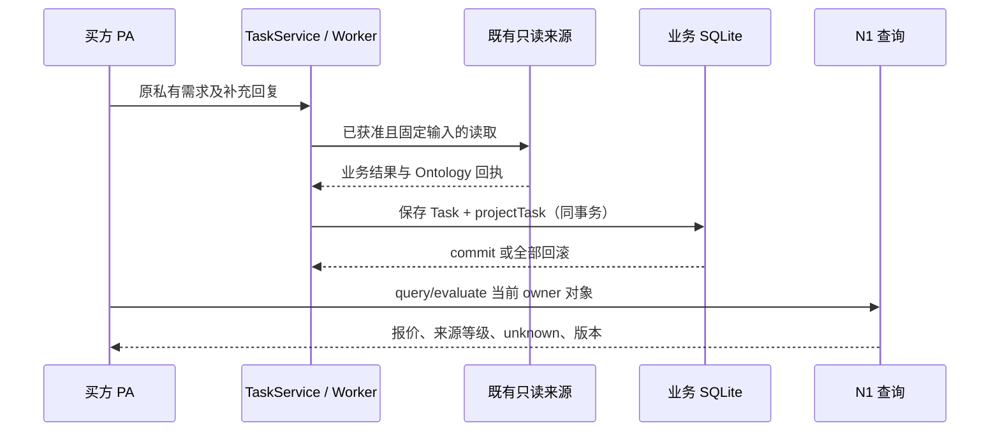

# D03：真实配送报价、N1 投影与方案选择

日期：2026-10-18。基于已提交 `204cfee`。当前实现依据：[N1](../ontology-n1.md)、[projectTask](../../packages/ontology/task-projection.ts)、[Ontology MCP 回执](../../packages/capabilities/paotui-mcp-server.ts)。新增要求为设计，未实现或进行真实复验。

## 1. 复用边界与事实来源

继续使用现有 Worker → 内部 stdio Ontology MCP → 官方只读程序、原任务补问/选择与回执。`projectTask` 是当前任务到 N1 对象的唯一来源投影器，已经由 JobStore.save 在同一业务事务中调用。

不要另建报价库、来源查询脚本或第二个投影 worker。源响应/受控回执记录观察；任务保存固定决策；N1 维护可查询业务对象；Proposal 记录选择快照。不能让社交卡、模型输出或 ProductOfferSnapshot 反过来成为配送价格事实源。

N2 在途的 projectReadResult 正把同一映射提取为“规划前已核验读取”和“任务完成投影”共用函数。后续接收其最终实现，不能为了得到规划对象而先假写 Task completed，也不能保留两份字段映射。规划前入口以受控读取上下文、当前 request revision 和输入/结果回执证明为门槛，不要求任务已完成；完成投影仍走现有 Task 保存事务。下文已实现描述固定于 204cfee，N2 入口尚未计为已验收。

N1 现有对象查询在读取时不调用供应商。报价过期后 evaluate 返回准确状态，需要明确的新读取才能获得新报价，不能通过重新读取数据库延长 expiresAt。

## 2. 已有映射逐字段契约

| N1 对象/字段 | 当前来源与规则 | 缺失/不一致行为 |
| --- | --- | --- |
| ServiceRequest.requestId/revision/originalGoal | 当前 eigos.delegate Task 与 delegation.request；owner 来自存储边界 | 历史后端不自动投影；原文不从外部帖子生成 |
| ServiceRequest.progress/projectionState | 任务状态；request_only/typed_result/invalid_source | 任务 completed 不等于新投影有效，分别显示 |
| Parcel.id | `parcel-<receipt.id>` | 稳定回执身份，不用商品名作 ID |
| Parcel.declaredWeight | 固定 plan 输入中的 weightKg，类型/精度须通过 N1 schema | 缺失不从报价倒填用户申报值 |
| Parcel.contentsCategory/declaredContents | 验证后的回执业务结果 goods.category/name | 不推导物品价值、真实测量重量 |
| DeliveryRoute.id | `route-<receipt.id>`；sender/recipient 为本次私有路线快照 | 不复制联系人或原始地址簿 ID；不对外发布路线 |
| DeliveryRoute.selectedAt | receipt.observedAt；选定路线关系指向该观察 | 这是本次读取时间，不是用户原始选择时间保证 |
| DeliveryQuote.quoteId | receipt.id，与 SourceReceipt.id 相同字符串但类型不同 | 按 ObjectRef(type,id) 区分，不混为一个对象 |
| quotedWeight/serviceLevel | 验证结果 goods.weightKg、service ordinary/express | 与请求/路线版本不符则适用性 fail/unknown |
| priceKind | estimate | 不提升为 firm_quote |
| pricingTerms.total | `_previewTotal` 十进制字符串，精确转整数 minor，CNY | 超过两位金额精度/非法字符串拒绝；不做浮点四舍五入猜值 |
| pricingCompleteness / scope / components | unknown / unknown / [] | 不把缺失运费、附加费填零；不把空 components 理解为无额外费用 |
| observedAt / expiresAt / validityBasis | receipt.observedAt / 加 300000ms / local_refresh_limit | 五分钟是现有本地刷新策略，不是供应商承诺；原观察不能续期 |
| requestRevision/parcelRevision/routeRevision | 当前固定请求与本次映射对象的准确版本 | 版本变化使旧报价不适用 |
| Provider / Channel | 当前 `meituan-paotui`、`meituan` 的内部来源映射与只读接入描述 | 不据此宣称已识别骑手、终端门店、收款方或商家代表关系 |
| SourceReceipt | 本地受控 MCP 回执，保留 sourceEventId、scope、等级、属性和出向关系摘要 | 摘要是完整性/关联证明，不等于供应商数字签名或法律承诺 |

当前投影没有读取/规范化可作承诺的 ETA 字段，故不填 deliveryCommitment。外部数据即便有 ETA，也须在明确来源映射后单独保存为 estimate，不能作为送达承诺。

## 3. 回执信任链

沿用 N1 已有检查：当前 backend/service、任务 completed、回执 schema、plan/request revision、capability 一致、prepare 与 result inputDigest/evidenceKind 一致、resultDigest、tool 和 sourceCalls、只读标记。geo.search 与 delivery.quote 分开。

以上 task completed 条件仅适用于 N1 的完成投影入口。N2 规划前入口必须独立校验来源读取由当前 Worker/请求发起、输入经来源 schema 验证且与 receipt.inputDigest 相同、request revision 仍有效；不能接受任意模型/网络消息提供的 receipt。两个入口最终复用同一属性/关系/证据映射。

SourceReceipt 同时固定规范化属性与出向业务关系摘要。修改重量、报价归属、所选路线或业务关系后，旧证据不能继续证明新事实。fixture 映射为 synthetic，真实受控只读来源映射为 live_readonly；社交输入永远不能通过提交 evidenceKind/provider source 字段进入该路径。

准备回执、执行回执与对象摘要不一致 → invalid_source，不生成局部报价。数据库 revision/定义冲突 → 整个任务保存回滚，沿原任务/原观察恢复；无效业务映射与数据库冲突要分别报告。

## 4. 身份、防重与历史

- 同一 receipt、相同输入/来源/结果重复保存，复用原对象和关系，不能增加报价或 revision。
- 新读取产生新 receipt、新 DeliveryQuote 及新的路线/包裹快照；旧报价保留为历史，选定关系指向当前快照。
- 同 receipt.id 携带不同业务摘要不得悄悄覆盖：视为冲突来源，保留原事实并记录拒绝；这是后续接入验收必须明确覆盖的规则，不能仅靠 UUID 概率。
- 初始本体对象不是新的执行授权；用户变更需求后依原任务补问/固定要求处理，不能仅修改对象字段改变正在执行的计划。
- 不批量扫描本人历史任务回填；如未来需要回填应单独设计。当前 task save 触发的同版本投影保持。

源码中已有多数路径，T04 只补缺失校验/测试，不重新实现其余映射。

## 5. 查询结果与“可选方案”的区分

| 用户目标 | 可以完成的条件 | 输出 |
| --- | --- | --- |
| 查询当前估价 | 同一路线/重量/服务，有受控只读回执，估价性质明确 | quote_report；允许费用完整性 unknown，同时解释不能代表最终总价 |
| 判断最终总价是否不超预算 | 完整费用范围、适当价格性质、有效期、币种与硬条件均有证据 | withinBudget 的 pass/fail；条件不足为 unknown |
| 确认可下单并送达 | 本阶段无真实动作和足够履约事实 | 不支持；不因查价完成给出 executable=true |

`offerFreshness=true` 仅证明落在当前登记窗口且证据兼容；不是库存或履约可用性。`withinBudget` 不能因为报价金额看起来低于上限就忽略 pricingCompleteness=unknown。

当前真实配送读回仅能完成第一行。UI/API 使用 `resultKind=quote_report`，`businessExecution=not_started`，`budgetAssessment=unknown`（适用时）。不能伪造候选比价；只有一份真实报价就报告一份。多来源语义测试使用独立的 synthetic 数据集合，不进入真实比较。

## 6. Proposal / SelectOffer 的最小增量

N1 的 SelectOffer 目前只登记定义，没有执行接口。新增本地选择由受控 SelectOfferService 实现，复用定义中的提交条件，不创建外部订单。不能让网络服务直接 ingest 一个“已批准” Proposal。

选择分两种输出：

1. 报价报告允许用户标记“已查看”，仅保存私有 inquiry 状态，不把 unknown 硬条件变成可执行 Proposal。
2. 用户的当前目标/前置硬条件均通过时，可建立 Proposal：使用既有 requestRevision、selectedAt、termsVersion、decisionReason 及 selectedOffer/request 关系。完成含义仅是方案选择。

为固定准确版本，增加私有 `proposal_selection_snapshots` 支持记录，与 Proposal 同一事务：proposalId、owner、requestRevision、offerRef、offerRevision、offerDefinitionDigest、sourceReceiptRefs、quoteTermsSnapshot、route/parcelRef+revision、validUntil、selectionDigest、selectedByActor、createdAt。quoteTermsSnapshot 只包含允许留存的费用/服务/数量/期限；原始凭据与联系人不进入。`Proposal.termsVersion=selectionDigest`，不改变既有类型字段或静默漂移 eigos.business@1。

这是一份不可变决策记录，不是第二份当前价格表。再次选择生成新 Proposal 和 snapshot，更新 request.selectedProposal，历史保留。每次后续使用必须核对当前需求版本、Offer 版本/摘要/关系、有效期及条件；不匹配返回 QUOTE_STALE/REQUIREMENTS_CHANGED，不自动转用另一报价。现有计划仍由 Coordinator/Plan 校验，不从 snapshot 直接发业务动作。

N2 在途 PlanningSnapshot/ObjectSnapshot 已包含规划读取、对象 revision/属性/关系摘要以及 proposal_only 动作提议。后续选择记录复用这些摘要及验证函数，并引用 planningSnapshotDigest；只补“买方何时选定哪些条款”的业务事实。模型的 DecisionActionProposal 不能直接升级为用户已选择的 Proposal。若 N2 最终交付已有等价持久选择记录，就直接复用该记录，不再创建 proposal_selection_snapshots 表。

首期不开放任意 Action execute。新增私有选择命令仅允许 quote/informational 目标，真实 order/payment 仍被现有 policy 拒绝；完整领域 Action 是 N4 任务。

## 7. 数据流与恢复

投影冲突后不另调用来源来伪装重放同一观察；按原任务/已保存观察的恢复能力处理。当前 read 原语若尚不能在进程硬崩溃后持久保留尚未落库的返回值，必须报告原任务失败/未知并由获准新读取产生新回执，不能宣称“无损恢复原观察”。设计不会把 N1 数据库原子性扩大成外部调用的 exactly-once。

## 8. N3 验收清单

D03-A：同 receipt 重放零增量；同 receipt 不同摘要明确冲突。
D03-B：一公斤/一千克换算、普通/快送、旧地址、旧 request revision 逐项核对。
D03-C：五分钟过期后查询不自动刷新；合成第二报价不能混入真实结果。
D03-D：费用覆盖未知时，查价报告成功与预算判断 unknown 同时成立。
D03-E：真实 PA 的 Task、报价对象、来源回执、模型收据及最后读回可关联；没有订单/付款。
D03-F：invalid_source 不产生部分对象；数据库冲突整体回滚；来源真实超时/取消退出证据按 N3 条件单列。
D03-G：选择快照固定版本，报价或要求变化使旧选择失效；“已查看”不生成交易许可。

N1 已有工程测试可复用；未覆盖的新断言补到 ontology-projection/scenarios/query-gateway 等最近测试。真实来源与 PA 复验是后续获准活动，本轮不运行。
