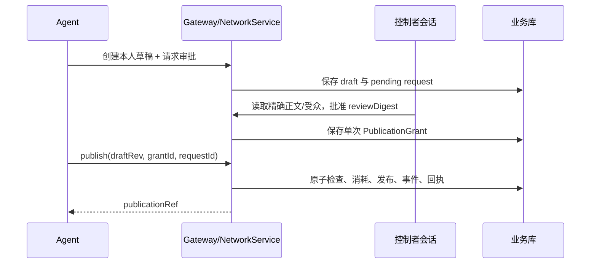
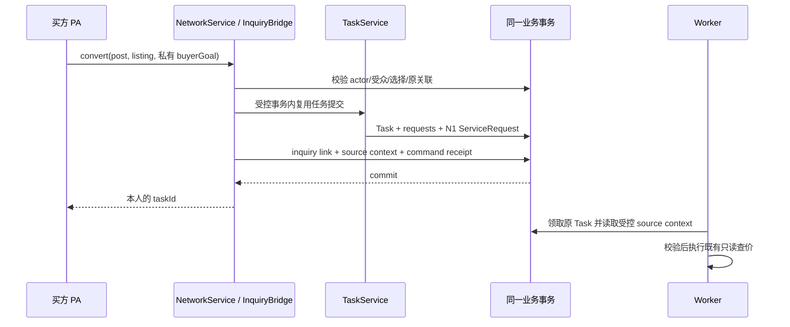

# D04：网络接口、私有询价交接与数据流

日期：2026-10-18。契约 `eigos.network.v1`，待实现。依赖 [D01](d01-identity-publication-2026-10-18.md)、[D02](d02-network-data-events-2026-10-18.md)、[D03](d03-quote-projection-2026-10-18.md)。本文件替代上层方案中的暂定 network_search/publish/respond 等工具名；所有 schema 仍需实现测试，本轮没有新增 API。

## 1. 保留现有公共协议

| 现有入口 | 处理 |
| --- | --- |
| describe_ontology / POST /ontology/describe | 原样保留，services:read，N1 私有业务定义 |
| query_ontology / POST /ontology/query | 原样保留，tasks:read，owner 私有对象 |
| evaluate_ontology / POST /ontology/evaluate | 原样保留，tasks:read，注册只读函数 |
| eigos.delegate 及 submit/get/reply/cancel_task | 保留原 strict schema 和任务语义；不把任意 network 字段塞进 goal/messages |
| A2A SendMessage/GetTask/ListTasks/CancelTask | 保持；社交事件不伪装成 A2A Task 状态，继续用已有 taskId 接续私有工作 |
| /tasks/:id/authorize | 保持沙箱边界；不得用作发布许可或生产付款批准 |

网络用户无需通过 N1 接口读取别人的对象；共享内容由 NetworkService 的专用投影返回。

## 2. 新增最小接口面

HTTP 使用 POST，业务结果统一 envelope；MCP 成功结果放 structuredContent.result，失败 isError=true 且提供相同安全 error 对象。MCP annotations 只表达工具性质，不作授权判断。

| MCP 工具 | HTTP 路径 | 身份/scope | 用途 |
| --- | --- | --- | --- |
| network_query | /network/v1/query | network:read＋会员/网络资格 | 共享对象、本人草稿、本人询价等判别查询 |
| network_command | /network/v1/commands | network:write＋合法 actor；转询价/选择另需 tasks:write | strict operation union，见下表 |
| network_updates | /network/v1/updates | network:read | 安全增量动态 |
| network_get_command | /network/v1/receipts/get | 原 actor/current owner 可查；network:read | 超时查询幂等结果 |
| 无 Agent 批准工具 | /members/network/commands | 会员会话＋Origin＋CSRF＋对象/角色权限 | 控制面批准/撤销/安装绑定及审核 |

所有网络接口默认关闭，不在现有 Agent Card 声称已可用。新增 scopes/安装元数据在实际实现中配置，现有客户端不因升级自动获权。控制面 body 包含 _csrf；API bearer body 不接受 _csrf 作为审批证明。

### 2.1 通用 envelope

输入固定 version=1；requestId 复用现有 1～128 字符限制；网络对象 ID 为 UUID；expectedRevision 为正整数。strict schema，拒绝额外字段。整体请求≤32KiB，响应≤64KiB；查询 limit 默认20、最大20，筛选字段最多8，回复文本最长2000。

引用定案：SharedRef={kind:profile/listing/need/message/evidence_card,id:逻辑对象UUID}；DraftRef={kind:draft,id:草稿UUID}；PublicationRef={kind:publication,id:发布UUID}。共享 ref 的 revision 指已批准的公开版本，私有记录 revision 另行保存，不混用。查询 SharedRef 只解析 current publication；用 PublicationRef 也不能绕过 current/撤回检查。Listing 的批准版本同时固定其内部 source/binding 定义摘要，内部状态或绑定变化须重新核验，不以旧卡片承诺新的执行能力。

成功返回：

```json
{
  "version": 1,
  "requestId": "buyer-command-001",
  "status": "applied",
  "replayed": false,
  "refs": [{"kind": "need", "id": "server-uuid", "revision": 1}],
  "result": {"state": "published"}
}
```

这里 UUID 文字为说明性占位，不是可调用数据。query/updates 不要求 requestId，status 固定 ok；命令可以返回 applied/pending_review/unchanged，不把 pending_review 写成已发布。只有同步 commit 后返回 applied；待用户处理不是后台任务已开始。

错误返回 `{version:1,error:{code,message,retryable,details?},requestId?}`。message 不包含私有输入、隐藏对象标题、原始 SQL/令牌。traceId 可供诊断，但不影响业务幂等。

### 2.2 network_query 判别输入

- `{kind:"get",ref}`：共享 publication 的当前安全视图。ref 不绕过权限。
- `{kind:"search",objectKind:"profile|listing|need",spaceId,filters?,limit?,cursor?}`：filters 仅 category/coarseArea/capabilityId、状态固定可见 active；第一版不支持任意本体 where/SQL/关系遍历。
- `{kind:"my_drafts",asProfileId,limit?,cursor?}`：只读获准 profile 的私人草稿。
- `{kind:"my_inquiry",postId}`：本人网络关联、Task 引用和阶段；读取任务内容另需 tasks:read，通过原 get_task。其他主体不能查 buyerTaskId。
- `{kind:"my_approval_request",approvalRequestId}`：本人状态，pending/approved/rejected/expired；不暴露控制者会话信息。

my_drafts 和 my_approval_request 的 Agent 读取仍需对应 profile 的有效安装绑定；同 owner 原任务可读不自动扩大为网络草稿可读。my_inquiry 属于买方 owner 的私有业务关联，只有当前合格身份可读；不返回其他 profile 的草稿内容。network_get_command 输入为 asProfileId、operation、原 requestId，仅查询当前 actor 的命令记录；跨安装恢复询价使用 my_inquiry 的 owner 级关联。

query 返回 items/ref/revision、适用的 readOnly/evidenceLevel/capabilityState，外加 page.hasMore/nextCursor；不返回隐藏总数。网络定义和对象详情均用网络 schema，不复用 private query_ontology 为通用共享查询。

### 2.3 network_command 操作表

除特殊说明，每项输入还有 version、asProfileId、operation、requestId；服务器派生 actor。

| operation | 必需 input | 输出与约束 |
| --- | --- | --- |
| draft.create | objectKind、body、spaceId；message/evidence 需受控源引用 | draftRef/revision；只有本人可见；引用受控读取 |
| draft.update | draftRef、expectedRevision、完整替换 body | 新 draft revision；不修改已批准/publication 正文 |
| draft.discard | draftRef、expectedRevision | 废弃自有草稿并取消未决审批；不能撤销已发生的发布，发布须独立 withdraw |
| publication.request_approval | draftRef、expectedRevision、audienceSpaceId、publishBefore、visibleUntil | approvalRequestId、pending_review；不产生 grant |
| publication.publish | draftRef、expectedRevision、grantId | publicationRef；消费精确许可；不同内容不复用 |
| publication.replace | draftRef、expectedRevision、previousPublicationRef/revision、grantId | 新 current publication；旧版 superseded；同事务 |
| publication.withdraw | publicationRef、expectedRevision、reasonCode | retracted；仅自有且 binding 允许；停止新访问 |
| need.close | postRef、expectedRevision | 停止新响应，保留原受众范围内的已批准内容；使用 withdraw_own 权限，无需批准新正文 |
| follow.set | targetProfileId、following:boolean | 私有关系结果；目标须可见；不产生对外关注事件 |
| inquiry.convert | postRef/revision、selectedMessageRef/revision（可选）、listingRef/revision、request（下节） | 本人 inquiryRef/taskId；只读约束；同事务最多一任务 |
| inquiry.select_quote | inquiryRef、expectedRequestRevision、quoteRef/revision、selectionKind:"reviewed|proposal" | D03 本地选择/报告确认；不得变成交易授权 |

response/question/referral 都使用 message 草稿→批准→发布，复用同一写入路径。首期仅精确许可，因此自动生成的自由文本回复仍需审阅；不把演示称为无人社交。可一次批准多条准确草稿，不能批准未生成内容。

首次 profile、network enrollment、邀请圈创建/成员管理、安装绑定和代表审核通过控制面。Agent 不能先自己注册 profile 再自授网络资格。后续自助加入可另设计，第一阶段管理员配置少量主体即可。

### 2.4 控制面 commands

共享 version/requestId/action/expectedRevision/_csrf；每个 action 独立 strict schema。固定动作：profile.create、profile.bind_installation、profile.revoke_binding、network.enroll、space.create、space.set_member、representation.review、publication.approve、publication.reject、publication.revoke、publication.hide、identity.disable_network。

控制者只能管理自有 profile/许可；space 操作要求 moderator，network.enroll 和 representation.review 要求预配置运营审核角色。hide 只停止共享并留理由，不改作者内容或代作者接受交易。

publication.approve 输入 approvalRequestId、expectedDraftRevision、reviewDigest、已显示给控制者的 audience/期限；服务端重算，不接受前端自报 approvedBy。Grant 字段见 D01。identity.disable_network 使用 D01 deny fence，跨库停用未完成返回 pending_reconciliation，界面不能显示已完成。

## 3. 私有询价转换：确定性语义

### 3.1 输入与权威来源

inquiry.convert 的 request 是判别联合：

- `create`：buyerGoal（必需，沿用 goal 长度限制）、requirements?（现有 schema）、completionTarget 固定 quote_only。
- `attach`：existingTaskId、expectedTaskRevision、expectedRequestRevision；不能携带替换 goal。该 Task 必须属于当前 owner，post 原有私有映射若存在必须一致。

buyerGoal 必须来自认证买方本次私有输入；不把 need.safeGoal、卖方消息或模型生成推荐直接复制为用户原话。Listing/message 仅以独立 provenance 引用保存，不进入用户消息角色。

首次 conversion 固定 sourceLocator：由服务器审核过的 Listing 解析为 capabilityRef、bindingRef 或 discoverySourceId、配置摘要。正文 URL、外部 objectRef、客户端 adapterId 都不参与执行绑定。

### 3.2 事务内处理顺序

1. 验证当前网络与任务写权限、actor、post/listing/message 当前可见和 revision、消息属于该帖且 responseToPostRevision 匹配、Listing active/代表资格有效。
2. 校验该 Listing 对买方实际 permitted(owner)，不是发布者自己的凭据可用即可。找不到可用 binding/source 则返回 SOURCE_NOT_AVAILABLE，不生成假任务。
3. 检查 network_commands 精确重放及唯一(buyerOwner,postId) 关联。相同选择返回已有引用；不同选择返回 INQUIRY_ALREADY_EXISTS，不创建第二单。
4. create：复用 TaskService 的提交校验/构造/保存逻辑，使用内部稳定提交键 `network-inquiry:<postId>`；保留原 requestId 到转换记录，不把社交作者当 principal。
5. attach：仅允许当前 submitted 且没有领取记录，或 input-required 且无固定计划/ActionIntent。已有 working/领取/plan/intent 返回 TASK_BUSY。原 Task 不重开；终态返回 TASK_TERMINAL。
6. 保存私有 inquiry source context、关联及网络命令回执；Task 保存和 N1 投影参与同一个事务。attach 固定 source context 会增加 request/job revision，保留原文和原问题；input-required 不被自动唤醒，仍由买方按原 reply_to_task 回复。
7. 只生成私有处理事件，不向全圈广播任务 ID 或暗示已经交易。commit 后 Worker 才能领取并读取该 source context。

现有 TaskService.submit/JobStore.once 不支持直接嵌套事务时，实施提供内部 transaction-aware 提交接缝，复用同一业务逻辑，不在原方法外套第二个 BEGIN，也不复制整套任务创建代码。

### 3.3 Worker 如何使用 source context

context 字段：inquiryId、buyerOwner、postId/private refs、selectedListingRevision、capability/source/binding locator、配置摘要、mode=quote_only、requestRevision、selectionDigest。只有服务端能写；模型最多看到安全服务摘要和自己的用户约束。

Resolver 使用“目录当前允许集合 ∩ 选定 source/capability”检索；无法满足时说明不可用，不暗自换商家。派发仍校验当前配置/来源权限/固定计划；quote_only 仅允许目标查价相关 read/local 能力，拒绝 order/payment/reserve 及无关文档/外部动作。只在 goal 里写“不付款”不算限制实现。

网络 Listing 后来 paused/撤销代表资格：在开始新的来源查询前复查，未开始则停止并报告 source unavailable；已发生的只读结果仍保存和标注来源状态。post 单独撤回只取消共享，不取消本人已建立且仍获准的私有询价。

### 3.4 一帖一询价及变更

首期唯一(buyerOwner,postId)。即使换 requestId/换安装，重复点击也不能产生第二个 Task。原网络命令 replay 先判当前调用身份，可返回本人已创建 Task 的引用，不依赖帖子仍公开；不重放帖子正文。

变更所选服务：首期不提供隐式 reselect。尚无转换时可改草稿/选择；转换后在原 Task 可处理范围内由买方明确澄清，若要改变已固定 source context 则返回需显式新需求的提示。不能偷偷重建/替换任务。新独立需求应有新 post/私有 goal，并先明确原任务状态，禁止用换 ID 绕过未知执行结果。

## 4. 后续报价选择

inquiry.select_quote 仅处理买方自己 inquiry 内、同 request/owner 的 DeliveryQuote。reviewed 只保存“已读报告”，不建立可执行 Proposal。proposal 需通过 D03 的有效期/来源/硬条件检查，建立不可变选择快照及现有 Proposal 关系；unknown 不自动放行。

命令 scope 仍为 network:write+tasks:write，绑定不能含 approve_payment。选择结果返回 selectionRef、quoteRef/revision、assessment、execution=not_started；不更改现有 PlanGrant，也不调用 /authorize。Task 已完成“查价”时可以查看/记录只读选择，不把原 Task 重开为购买任务。

## 5. 状态转换

| 对象 | 状态与允许转移 |
| --- | --- |
| draft | draft → submitted_for_review → approved；可转 discarded 并取消未决审批；改稿产生新 revision/新审批，不覆盖旧批准或已发生发布 |
| approval_request | pending → approved/rejected；超期 derived expired；withdraw 草稿取消未决审批 |
| publication | active → superseded/retracted/hidden；到期 derived expired；旧 grant 不复活已终止版本 |
| need | open → closed/withdrawn；时间到期 expired；closed 可读获准历史但不能新响应，withdrawn 不再共享正文 |
| inquiry link | linked → quoting → report_ready / needs_input / unavailable；从 Task/有效投影派生，不另驱动执行 |
| Task | 完全沿用现有状态；询价和消息状态不直接改 Task 终态 |

need.closed 是停止响应的业务状态，publication.retracted 是停止共享，二者不同。关联 inquiry 对供应方默认不可见；未来若分享“已收到推荐”状态，也需作为独立获准消息发布。

## 6. 错误与重试契约

| HTTP / code | 含义与处理 |
| --- | --- |
| 401 UNAUTHENTICATED / MEMBER_SESSION_REQUIRED | 重新登录正确通道，不用 bearer 冒充控制面 |
| 403 NETWORK_DISABLED / SCOPE_REQUIRED / ACTOR_REQUIRED / ACTOR_NOT_BOUND | 明确缺资格；不自动扩权/换身份 |
| 404 NOT_FOUND | 不存在或当前不可见；不进一步透露隐藏对象 |
| 409 REVISION_CONFLICT / REVIEW_STALE / CONTENT_CHANGED | 重新读取本人允许视图，明确确认新版本；用新命令键提交修正 |
| 409 IDEMPOTENCY_CONFLICT / GRANT_CONSUMED | 原键输入变化或许可已用；查询原回执，不重复发布 |
| 409 CURSOR_STALE | 清理该范围缓存、重新查询；不是来源业务失败 |
| 409 POST_CLOSED / INQUIRY_ALREADY_EXISTS / TASK_BUSY / TASK_TERMINAL | 使用原对象/原任务，或明确开始新需求；不自动重建 |
| 409 QUOTE_STALE / REQUIREMENTS_CHANGED / SOURCE_NOT_AVAILABLE | 解释缺口，必要时请求获准的新读取；不能自选替代来源 |
| 422 INVALID_INPUT / REQUIREMENTS_UNPROVEN | 严格 schema 或条件不满足；不猜值补齐 |
| 429 RATE_LIMITED / RESOURCE_BUDGET | Retry-After 或有界等待；同原请求 ID，不能新建大量任务绕过 |
| 503 TEMPORARILY_UNAVAILABLE | 结果可能未知时先查原命令回执；禁止盲目换键重复提交 |

仅网络新 API 使用这张状态表；原 N1/任务 API 的既有 HTTP 映射不在本轮改动。MCP error.details 与 HTTP 相同安全含义，不把所有拒绝包装为成功工具结果。

## 7. 三条完整数据流

### 7.1 批准与发布



### 7.2 推荐到私有询价



### 7.3 结果到可分享摘要

Task 和 N1 保存真实结果 → Worker/私有查询按允许字段生成 evidence 草稿 → 控制者审阅 → 消耗精确发布许可 → 圈内看到等级明确的摘要。模型只生成内容建议，不能给自己签 evidenceLevel、sourceReceipt 或批准。

## 8. 最小端到端验收

D04-A：同 post 两个安装并发 convert，最多一私有 Task；任务/关联任一步失败全回滚。
D04-B：创建询价返回丢失后原键/原 post 查询返回同 taskId；撤回后不会泄露原帖正文。
D04-C：服务方只知道 postId，无法读 buyerTaskId、私有报价或改买方要求。
D04-D：无 binding/当前买方无权限的 Listing 不产生可执行询价；不使用发布者个人凭据。
D04-E：普通“同意”、引用 URL、伪造 source/evidence/author 字段不授予写入或支付能力。
D04-F：HTTP/MCP/控制台对同对象、状态、拒绝结果一致；原 A2A 私有任务仍可接续。
D04-G：查价完成、费用 unknown、proposal 拒绝和 reviewed 成功可准确并存；不把结果卡写成送达成功。

所有用例为设计预期，未运行。实现责任：网络模块负责协作，TaskService 负责任务，Resolver/Plan/Runtime 负责来源和执行，N1 负责对象与证据；不建立第二套协调器。
