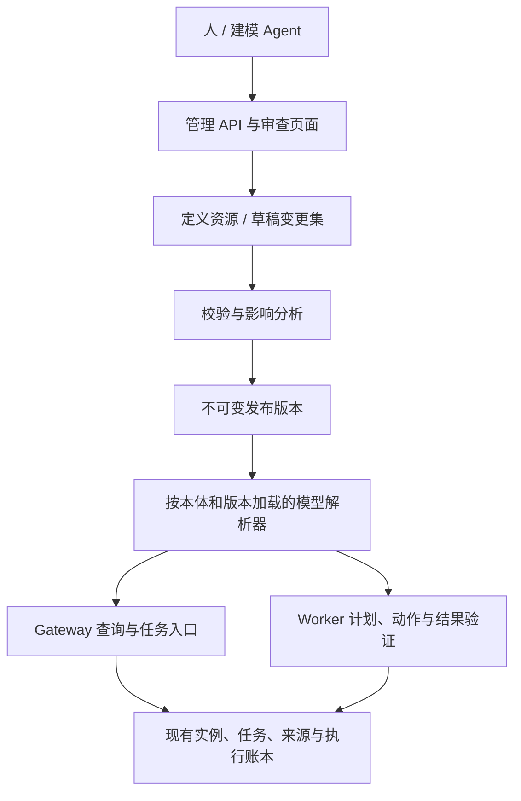

# 四类本体定义的动态管理：架构审查与实施计划

日期：2026-10-21。状态：**用户已批准完整 P0–P6；实现及本地验收完成，提交与 CI 按对应分支回读。**

已确认的产品范围：第一版采用 **Agent/API 优先，配基础审查与发布页面**。整体实施范围已获批准，按下述验收条件交付。

审查基线：`codex/member-paotui-agent`，`4530e009adf88c24a8ac5942f3b9cf01ab1d36da`；业务模型 `eigos.business@15`、执行契约 `ontology-execution-v16`。用户已授权实现、验证、提交并推送当前分支，等待准确提交的 CI 终态；不部署、不真实下单或付款。此处保留批准时的审查基线，当前结果另见实施记录。

## 1. 审查结论与目标

当前已经用代码表达 **Object Type、Link Type、Interface、Action Type**，并能更新对象实例、执行已注册动作和回写结果。缺少的是把这四类定义作为平台内可管理资源的完整机制：定义持久化、草稿、校验、依赖分析、版本发布、运行时加载及退役。

因此需要补的是**动态元模型管理层及其运行时接入**。前一轮领域属性补足、18 题基线和 24 题复测，不构成这一层已经实现的证据。

本计划的完成目标：在既有引擎支持的字段、规则和连接器能力范围内，授权的人或 Agent 可以通过管理接口创建／修改这四类定义；校验并发布后，Gateway 和 Worker 无须重新编译或重启即可让新任务使用新定义；已有任务仍绑定明确版本，事实、权限和历史执行证据不被静默重解释。

新的外部 API、连接器、复杂校验函数或执行原语仍可能需要开发和部署。保存一个 Action Type 不会自动产生这些能力。

### 参考 Palantir 的具体部分

- Ontology Manager 将对象、关系、接口、动作等作为独立可查找和管理的资源：[官方导航说明](https://www.palantir.com/docs/foundry/ontology-manager/navigation)。
- 四类资源均支持受控分支变更与保护规则：[本体分支说明](https://www.palantir.com/docs/foundry/ontologies/branching-ontology)。
- Interface 不仅有属性和关系，还可以约束实现类型应提供的 Action：[接口创建与动作约束](https://www.palantir.com/docs/foundry/interfaces/create-interface)。
- Action 的规则能表达对象／关系变更，并连接函数和外部系统：[Action 类型说明](https://www.palantir.com/docs/foundry/action-types/explore-action-types)。

以上是上游能力依据。下文的模块、接口和阶段是针对 EIGOS 的设计建议，不声称与 Palantir 的实现完全一致，也不假定任意 schema 变化都能立即生效。

## 2. 当前代码的主要缺口

| 审查项 | 当前证据 | 必须改变的部分 |
| --- | --- | --- |
| 定义来源 | [business-model.ts](../packages/ontology/business-model.ts) 在模块加载时组合领域数组，创建唯一 `businessModel` | 建立持久定义资源与不可变发布版本；代码定义转为初始种子和受版本管理的内核扩展 |
| 定义格式 | [model.ts](../packages/ontology/model.ts) 的属性直接包含 `z.ZodType`，构造器一次性编译 | 分开可序列化声明与运行时编译结果；不能直接把当前对象转成 JSON 就认为语义保真 |
| 实例与定义版本 | [object-store.ts](../packages/ontology/object-store.ts) 按 owner/type/id 存储，读取时要求行上的定义摘要等于当前模型摘要 | 增加本体命名空间与准确版本解析；保留写入 schema、历史事实和兼容视图策略 |
| Interface | 已有继承、属性映射、关系约束和按接口查询；没有独立的接口动作约束结构 | 增加动作能力约束、参数映射及实现校验；明确可选属性和可选能力的语义 |
| Action 可执行性 | `changes`、`submissionCriteria` 多为字符串说明；[action-submission.ts](../packages/ontology/action-submission.ts)、[planning-session.ts](../packages/coordinator/planning-session.ts) 仍按具体领域／动作名称判断 | 为通用数据动作提供声明式规则执行；已有领域规则转为有签名和版本的受信任处理器引用 |
| 函数与程序绑定 | [object-functions.ts](../packages/ontology/object-functions.ts) 使用静态调用 schema 和分发；[agent-program.ts](../packages/core/agent-program.ts) 的 schema/validate/invoke/project 由程序实现 | 定义可见性、参数校验、函数处理器及执行绑定必须一致；动态定义不能只出现在目录里 |
| 模型版本与计划 | [plan.ts](../packages/coordinator/plan.ts)、[planning-contract.ts](../packages/ontology/planning-contract.ts) 引用全局模型；计划、上下文读取凭据还会核对模型摘要 | 按任务解析已锁定的发布版本，不能用“当前最新版”验证所有历史计划 |
| 外部入口 | [MCP](../apps/gateway/mcp.ts) 已有 describe/query/evaluate；没有四类定义的管理接口 | 新增共享管理服务、管理 API 和 Agent 工具，分别验证定义管理权限与业务执行权限 |
| 发布与迁移 | [迁移入口](../packages/ontology/integration-migration.ts) 支持已知历史版本；没有通用发布、兼容分析与激活记录 | 区分定义发布、实例迁移、运行时激活、回退；不能发布时直接重写全库摘要 |
| 数据映射 | [领域投影](../packages/ontology/domain-projection.ts)、[购物投影](../packages/ontology/commerce-journey-projection.ts) 由受信任代码转换来源 | 新类型必须说明数据由谁提供、如何映射、哪些字段可编辑；类型定义不等于已经有数据来源 |

另外，[ExecutionCatalog](../packages/core/catalog.ts) 已能登记带来源依据的动态供应方绑定，但只适用于已知 capability/adapter。它不是动态创建本体类型或安装执行代码的机制。

## 3. 四类定义分别需要补什么

| 定义 | 首版管理内容 | 生效前的关键校验 |
| --- | --- | --- |
| Object Type | 稳定资源 ID、API 名称、显示信息、主键、属性 schema、数据来源／映射、实现的接口、可编辑字段、生命周期 | 主键和命名唯一；数据 schema 可编译；字段来源、敏感性与写入权明确；已有数据兼容；所需处理器可用 |
| Link Type | 两端对象／接口类型、正反向名称、基数、必要性、链接来源、增删规则和删除策略 | 端点存在；双向导航一致；接口端点可解析；基数及跨 owner／命名空间策略成立；删除不留下悬空关系 |
| Interface | 必需／可选属性、继承、属性映射、关系约束、动作能力约束及实现映射 | 无继承环；实现类型满足约束；可选字段缺失有明确行为；Action 参数、目标类型、效果分类兼容 |
| Action Type | 参数、默认值规则、前置条件、声明式变更、函数／连接器绑定、效果类别、输出、幂等与回读要求、接口实现 | 参数和变更可验证；写入目标可授权；绑定和处理器版本存在；前置条件可执行；预览与执行使用同一契约 |

发布状态与执行可用性应分别表达。例如一个动作可以已经发布但尚无执行绑定，发现接口须明确返回“仅定义／不可执行”，不能让 Agent 据此承诺服务完成。

## 4. 推荐架构

### 4.1 定义存储与生命周期

首版复用 SQLite 和现有共享事务机制，不额外引入数据库、消息总线或独立服务。建议新增以下概念；名称在契约定稿时固定：

- `Ontology`：本体命名空间、所属组织／项目、默认发布版本及管理权限。
- `DefinitionResource`：四类资源的稳定身份与 API 名称。
- `DefinitionRevision`：不可变的某次定义内容、摘要、依赖、作者和来源。
- `ChangeSet`：基于某个已发布版本的可编辑草稿，支持增改、退役、差异及冲突检查。
- `OntologyRelease`：完整依赖闭包和准确资源版本清单。
- `ActivationRecord`：哪个命名空间激活了哪个发布版本、校验结果与切换审计。

草稿可反复编辑；发布后不可原地修改。首版支持“从发布版本创建变更集 → 校验 → 差异审查 → 发布 → 原子激活”，并发发布用预期版本阻止覆盖。复杂多分支自动合并可后续补充，不影响上述闭环。

### 4.2 声明格式与编译器

定义文档使用有版本的 JSON 契约；属性 schema 采用明确支持的 JSON Schema 子集。编译后继续利用现有类型、基数、字段访问和参数检查机制。

必须盘点现有 Zod refinement、transform、派生计算和跨字段约束。不能表达为普通 JSON Schema 的逻辑，使用准确的 `validatorRef`／`functionRef` 和版本，并由代码中的受信任处理器执行；不允许静默丢掉校验，也不直接执行定义文档中的任意 JavaScript。

静态编译缓存按本体及 release digest 隔离。事实、来源、权限、撤销状态仍实时检查。当前领域中的金额、数量、时间和严格业务 schema 优先复用。

### 4.3 运行中的版本选择

新任务保存准确的 `ontologyId + releaseId/digest`。查询、计划、函数、Action、投影及独立验收都从同一上下文解析定义。Gateway 和 Worker 从持久存储解析已激活版本，不通过原地修改全局单例完成切换。

模型版本与后端执行契约版本分开：新引擎中的 R1 任务可在 R2 发布后继续使用 R1，但对象、来源或权限变化仍会触发已有的新鲜性／撤销检查。旧后端任务继续遵循既有历史只读政策，不因定义管理改造自动重放。

回退只改变后续使用的发布版本，不撤销已经发生的业务动作，不恢复已撤销权限，也不删除 R2 留下的事实和执行记录。被任务引用的旧 release 必须可恢复读取。

锁定定义还不够：旧任务引用的函数、校验器和适配器实现版本也必须仍可用。若运行时已不支持该版本，应明确进入不可继续执行的状态，不能借最新实现替旧合同运行。

### 4.4 实例、多版本读取与数据映射

持久身份要明确本体命名空间，避免不同本体中的同名类型混淆。现有 `{type, id}` 引用在默认本体内保留兼容解释；历史请求、回执和计划不批量重写来加入新字段。新入口与任务上下文携带明确本体范围。

首版将已发布资源的 API 名称和主键视为稳定身份。显示名称可独立调整；API 重命名、类型拆分和退役后的同名复用必须走明确兼容策略，不能让旧引用指向另一类资源。

实例保留写入时的定义版本、原始事实摘要和来源。兼容版本视图须有明确规则；不允许自动补默认值、丢字段或换定义摘要来伪装兼容。无法兼容的旧视图应明确拒绝或要求升级。实际对象变化仍按 revision／digest 使旧计划失效。

类型要区分可由用户管理的数据和来源权威数据。对新建的普通业务类型提供通用实例写入与映射能力；对酒店库存、商品条款、支付、授权、来源回执和执行证据等，沿用受信任来源及专用写入边界。配置新类型本身不取得成员凭据或供应商准入。

### 4.5 Action 必须真正接入执行

首版支持两条明确路径：

1. **声明式数据动作**：创建／更新对象、添加／移除关系，以及按策略逻辑删除对象。先预览准确变更集，再通过权限、版本和基数校验后事务应用。对象变更、幂等结果及审计须在同一持久事务中提交；崩溃后按原操作标识回读，不能重复写入。删除保留审计，受保护的历史证据不进入普通删除入口。
2. **受信任函数或连接器动作**：定义引用既有版本化处理器、参数映射和结果合约，沿用 `ActionIntent → Attempt → Observation → Assessment` 及原操作恢复。新增外部协议或代码仍需正常工程交付。

数据写入须有单独、范围明确的效果和授权语义（建议增加 `object_write`），不能借现有 `local/read` 分类绕过写入权限。它与订单、付款等业务授权分开；定义发布权也不包含执行权。

沿用现有授权和 Intent 账本，扩展本体范围、动作版本、目标对象／字段、预期 revision 等契约；不为普通对象写入虚构收款方或付款额度，也不再建立一套平行批准账本。

Interface 的动作能力约束要解析到具体实现 Action，并验证参数映射与效果类别。调用时重新核对实际对象类型、已发布定义、当前权限和执行绑定。

### 4.6 人与 Agent 的管理入口

用户已确认第一版采用 **Agent/API 优先，配基础审查与发布页面**。本计划据此安排管理接口和页面范围。

共享一个管理服务供 HTTP、MCP 和页面调用，提供四类定义的检索、读取、草稿编辑、校验、差异、发布、激活和退役。不要为每个业务类型生成一套专用管理工具。业务 A2A 任务继续使用同一模型解析与权限机制。

定义管理权限至少区分查看、编辑草稿、校验和发布／激活；审查规则按项目配置。业务 Agent 的 `tasks:write` 不自动获得模型发布权。运行任务可按需发现相关定义和 schema，避免把全部本体加入每轮上下文。

定义中的敏感字段标记、来源说明和函数引用不能覆盖底层数据权限。降低敏感标记、将用户管理字段改为来源权威字段、或引用能读私有证据的函数，均须经过对应权限与处理器契约检查。

基础页面包括四类资源目录、定义和依赖详情、变更差异、校验错误、发布／激活状态及历史。完整图形拖拽编辑器不是这一推荐首版的前提。

## 5. 具体修改范围

以下新路径是建议模块，不是已经存在的实现。

| 工作包 | 主要现有位置 | 建议新增／调整 |
| --- | --- | --- |
| 定义契约与编译 | [model.ts](../packages/ontology/model.ts)、[business-model.ts](../packages/ontology/business-model.ts)、各领域 `*-model.ts`／`service-domains.ts` | `packages/ontology/definition-contracts.ts`、`model-compiler.ts`；种子导入器；分离内核扩展与业务定义 |
| 注册库与发布 | [store.ts](../packages/core/store.ts)、[transaction.ts](../packages/core/transaction.ts)、[integration-migration.ts](../packages/ontology/integration-migration.ts) | `definition-store.ts`、`definition-service.ts`、`release-resolver.ts`、兼容／影响分析器；所有写入遵守已有事务归属 |
| 实例与历史读取 | [object-store.ts](../packages/ontology/object-store.ts)、[history-schema.ts](../packages/ontology/history-schema.ts)、[object-evidence.ts](../packages/ontology/object-evidence.ts) | 命名空间、写入 schema 引用、版本视图、受控删除和查询缓存隔离；保留历史来源校验 |
| 接口与多态动作 | [model.ts](../packages/ontology/model.ts)、[service-domains.ts](../packages/ontology/service-domains.ts) | 必需／可选属性及关系语义、Interface action constraints、具体实现映射和发布时验证 |
| 函数与动作运行 | [object-functions.ts](../packages/ontology/object-functions.ts)、[action-submission.ts](../packages/ontology/action-submission.ts)、[agent-program.ts](../packages/core/agent-program.ts)、[catalog.ts](../packages/core/catalog.ts)、[capabilities/catalog.ts](../packages/capabilities/catalog.ts) | 版本化函数／校验器注册、声明式规则解释器、通用数据动作；把专用领域逻辑接成明确扩展合约 |
| 计划与恢复 | [plan.ts](../packages/coordinator/plan.ts)、[planning-session.ts](../packages/coordinator/planning-session.ts)、[planning-contract.ts](../packages/ontology/planning-contract.ts)、[task-context.ts](../packages/coordinator/task-context.ts)、[runtime.ts](../packages/coordinator/runtime.ts)、[agent-runtime.ts](../packages/coordinator/agent-runtime.ts) | 全局模型引用改为任务锁定版本；上下文、批准、派发、恢复及验收核对相同契约 |
| 权限与效果 | [domain.ts](../packages/core/domain.ts)、[policy.ts](../packages/core/policy.ts)、[agent-authorization.ts](../packages/core/agent-authorization.ts)、[actions.ts](../packages/ontology/actions.ts)、[execution-model.ts](../packages/ontology/execution-model.ts) | 定义管理权限、数据写效果、受保护核心资源规则；更新对应账本与 schema，保留精准业务授权 |
| 来源与投影 | [task-projection.ts](../packages/ontology/task-projection.ts)、[domain-projection.ts](../packages/ontology/domain-projection.ts)、[commerce-journey-projection.ts](../packages/ontology/commerce-journey-projection.ts)、现有来源程序 | 通用数据映射声明和受信任投影器版本引用；验证现有适配器与新定义兼容 |
| Gateway／Worker／页面 | [app.ts](../apps/gateway/app.ts)、[mcp.ts](../apps/gateway/mcp.ts)、[tasks.ts](../packages/core/tasks.ts)、[worker/runtime.ts](../apps/worker/runtime.ts) | 共享模型解析器与定义管理服务；新增管理路由和基础页面；业务任务协议保持兼容 |
| 验证与文档 | [现有架构验证](ontology-architecture-completion-2026-10-21.md)、当前迁移／执行／权限测试、README、CONTEXT、集成说明 | 动态定义专项演练、旧新版本并存、管理 API 权限、发现预算、完整回归及源码固定证据 |

四类定义的初始内容、实例存储、动作执行器、协议入口都会受影响。这是一项跨层改造，不能按“只改 model.ts”估计范围。

## 6. 分阶段实施与退出条件

| 阶段 | 工作 | 退出条件 |
| --- | --- | --- |
| P0 契约定稿与迁移试验 | 固定定义格式、命名空间、版本引用、权限和数据写效果；盘点不可直接序列化的 Zod 逻辑；建立旧模型导出／编译对照 | 四类资源与迁移策略可审查；不支持的校验有准确处理器引用；确认哪些摘要可原样保留、哪些需要明确兼容映射 |
| P1 注册库和模型编译 | 实现资源、修订、草稿、release 存储；导入当前定义为首个受控基线，保留只读导出比较 | 重启后可复原完整模型；导入幂等；既有 schema 的正反例和语义保持；事实与历史批准不被改写 |
| P2 版本解析与实例接入 | Gateway／Worker／任务／计划改用准确 release；处理实例命名空间、历史 schema 和编译缓存 | 同一引擎中 R1/R2 可并存；无关元数据发布不破坏在途任务；已变化的数据或权限仍阻止旧计划 |
| P3 四类定义管理与发布 | 完成四类草稿编辑、依赖校验、差异、冲突、兼容分析、发布与原子激活；补 Interface 动作约束 | 悬空端点、继承环、错误实现映射和不兼容变更被阻止；发布失败不影响当前版本 |
| P4 动态 Action 与来源映射 | 通用数据动作、规则解释、函数／适配器绑定、授权与回读；现有领域处理器按版本合约接入 | 新定义动作无需新增分发分支即可对受管对象产生受控效果；定义但未绑定的动作明确不可执行；外部效果仍用既有账本恢复 |
| P5 Agent/API 与审查页面 | 统一管理服务的 HTTP/MCP 入口和基础页面；业务查询、任务上下文、动作发现按版本更新 | 人和 Agent 能完成相同定义管理流程；无权者看不到受限定义；分页和按需读取不突破现有预算 |
| P6 现有领域迁移与验收 | 将现有业务定义切换为注册库权威来源，移除运行时对旧数组的隐式兜底；运行专项演练及已有五类流程回归 | 不能出现“新演示动态、原业务仍另走静态模型”的双轨结果；完成代码检查、审查、提交／推送、准确 SHA 的 CI 和远端回读 |

P1–P3 可以先完成定义读取与发布基础，但只有完成 P4–P6 才能宣称这四类定义的动态管理已贯穿实际运行。实施范围内不部署常驻实例，也不进行真实下单、付款或预约。

## 7. 必须通过的专项验收

| 编号 | 场景 | 可观察的通过条件 |
| --- | --- | --- |
| D01 | 空白业务本体创建 Object Type | 通过管理接口创建属性／主键，发布后可创建和查询实例；未编辑 TypeScript、未重启 Gateway／Worker |
| D02 | 新建和修改 Link Type | 正反向导航、基数、接口端点和删除策略生效；错误链接写入整体回滚 |
| D03 | 动态 Interface | 两个新对象类型实现同一接口，字段映射和可选字段行为正确；缺少必需能力时发布被拒绝 |
| D04 | 声明式 Action Type | 新建动作能在准确授权下创建／修改对象和关系，留下变更与执行记录；重复请求或提交后崩溃只产生一次变更；没有新增动作名称分支 |
| D05 | 接口动作分派 | 同一接口动作约束映射到两个具体 Action；按实际对象类型和参数映射执行，错误映射被拒绝 |
| D06 | 发布与执行分离 | 已发布但无绑定、未授权或处理器版本不匹配的动作不能执行；不得通过修改定义扩大业务权限 |
| D07 | 草稿与并发发布 | 草稿不影响正在运行的模型；两个作者基于同一旧版本发布时冲突可见，不能覆盖他人修改 |
| D08 | 原子激活 | 编译、迁移准备或依赖校验失败时旧 release 保持可用；Gateway/Worker 不读到半套定义 |
| D09 | 在途版本 | R1 任务与 R2 新任务分别使用所锁定定义；对象变化仍要求重新验证，授权撤销立即生效 |
| D10 | 不兼容变更 | 改主键、删必需字段、收窄枚举、收紧基数、移除接口动作等须给出影响和迁移要求；不能静默批准 |
| D11 | 历史和回退 | 旧回执、原计划摘要及来源可核对；回退 active release 不删除新数据、不重放外部效果、不恢复旧授权 |
| D12 | 身份与边界 | 同名类型在不同本体中隔离；普通元数据编辑不能伪造支付完成、来源回执、执行授权或他人成员连接 |
| D13 | 新类型数据来源 | 普通受管数据可写；来源权威字段仅能经准确映射／受信任处理器写入，缺来源字段保持未知 |
| D14 | 发现与上下文 | Agent 只读当前有权使用的定义与依赖；发布／回退不串缓存，定义增加不会要求扩大已有读取预算 |
| D15 | 原业务覆盖 | 购物、酒店、即时叫车、预约接送、自驾租车继续通过适用沙箱验收；跑腿及其他已有领域严格 schema 保持 |

建议用“设备／会议室使用申请”作首个新领域：通过管理入口创建两个资源 Object Type、一个申请 Object Type、一个共同 Interface、申请到资源的 Link Type 和两个实现接口约束的 Action Type。动作完成的是内部申请记录及链接，不冒充真实预订。这样可以验证引擎确实处理了原先没有的四类定义，而非仅换了已有类型的名称。

随后用现有酒店或购物沙箱绑定验证动态 Action 定义能接入原有授权、执行、回读与验收链。验证不能止步于页面保存成功、类型可见或声明式动作返回成功。

## 8. 迁移与取舍

- **保留并复用**：领域 schema、来源隔离、不可变回执、原始指令、业务事实与执行账本、准确授权、租约／取消／迟到结果保护、既有适配器和独立验收。
- **需要替换**：由模块加载拼接的唯一当前模型、在运行路径上散落的静态定义权威、只按最新全局摘要判断所有任务的方式。
- **需要补齐**：元数据控制层、发布／激活、接口动作契约、通用数据动作、版本化函数与映射契约、模型版本感知的所有读写路径。
- **不能只做**：把 TypeScript 数组搬到 JSON/YAML 后仍需重新构建；或者只建定义数据库，却继续用旧代码数组决定运行行为。
- **首版不包含**：任意代码在线执行、全部 Palantir 可视化工具、全域事件自动化、动态 Object Set 产品、what-if 场景分支、正式 OWL 推理或新的真实供应商接入。这些与四类定义管理相关，但不是本轮同一交付。
- **BFO 的位置**：可保留语义参考映射；不以导入 BFO 作为动态定义运行的前提，也不把类映射当成来源或授权。

风险最高的部分是 Action 的真实可执行性、旧新模型并存和历史事实兼容。第一阶段先做导出／编译与迁移试验，再据结果细化拆分；现在不承诺未经验证的工时或把大量文件修改算成已完成比例。

## 9. 已批准的实施边界

已批准的整体方向是：**运行时可管理的四类定义 + 不可变版本发布 + 任务绑定准确版本 + 动态动作执行 + 现有业务完整迁移**。

管理入口已按用户选择确定为“Agent/API 优先、基础审查发布页面”；上述 P0–P6 的实施范围与验收条件均已获批准。

完成后核对本地与远端、运行验证、审查提交范围、提交推送，等待该 SHA 的 CI 成功并回读。部署、真实订单、真实付款不在本次范围内。
