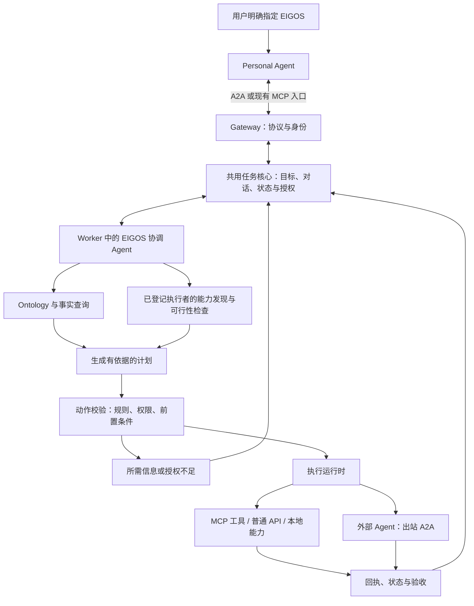

# EIGOS：先确定服务流程，再用 A2A、Ontology 与执行运行时实现

> 历史设计／验证记录：相关独立运行模式已于2026-10-18退役。现行入口、部署和能力以 [接入指南](integration.md) 与 [后端说明](registered-capabilities.md) 为准；下文保留历史，不作为当前启动操作。

日期：2026-10-15。状态：架构提案，未实施。

本轮按用户要求评估协议能力、目标流程和架构；没有继续修改业务代码，也没有配置 Grok 或部署服务。已有 Gateway／Worker 改动与 Grok 客户端草稿保留。本文是在 [本体与执行方向](ontology-execution-direction.md) 上补充可实施的边界，不代表当前已经拥有通用履约能力。

## 1. 产品流程是设计起点

用户在自己的 Personal Agent（PA）里明确说“用 EIGOS 帮我做这件事”。PA 联系 EIGOS，传递目标、允许分享的背景和已知授权。EIGOS 负责判断、澄清、协调执行和验收；PA 负责与用户沟通并呈现结果。首版不以 PA 自动发现并主动推荐 EIGOS 为必要条件。

用户点名 EIGOS 是委托意图，不是对任意金额、供应商和操作的授权。已有且适用于当前动作的授权应直接使用；只有缺失授权或实际条件超出授权时才补问。

关键问题应依次回答：

1. 这次用户要的是可行性评估、计划／文档，还是实际业务结果？
2. 我们知道涉及哪些业务对象和动作吗？哪些事实仍未知？
3. 有没有具体可调用的执行者，并且当前身份能使用它？
4. 所需信息、预算、时间和操作授权是否足够？
5. 如何执行、查证、处理失败，什么证据才表示交付？

“知道怎样做”“找到宣称能做的 Agent”“目前可执行”“已经完成”是四个不同结论。

## 2. 协议能力与本系统职责

A2A 支持能力自述、消息／任务协作、状态和交付交换；MCP 支持工具与资源接入。官方汽车维修店示例把客户沟通、维修判断和供应商协作与工具调用分别组织起来。EIGOS 可参考其中“店长”的职责，而不用把每项内部动作暴露给客户。出处见 [S1]。

| 层次 | 负责的问题 | 不会自动解决的问题 |
| --- | --- | --- |
| A2A | 与 PA／独立供应商 Agent 建立标准协作 | 不提供业务本体、全网供应商搜索、自动承接或履约保证 |
| MCP／普通 API | 调用一个明确的工具或业务接口 | 不负责整体目标的计划、授权和验收 |
| Ontology | 统一业务对象、关系、动作和规则 | 不会凭空获得订单接口、用户权限或实时库存 |
| OAG 与模型规划 | 根据本体和可追溯事实理解需求、提问、提出计划 | 模型建议不直接成为已授权动作或真实业务事实 |
| 执行与验收 | 校验动作、调用连接器、记录回执并核验结果 | 协议成功或模型 completed 不能代替业务完成证据 |

OAG 在本提案中按 Ontology-Augmented Generation 理解，作为我们的实现方法，不作为 A2A 扩展协议名称。Palantir 的对象／关系／动作模型与动作提交条件可作参考，但本文不建议因此引入 Palantir 产品或依赖。参考 [S5][S6]。

## 3. 用汽车维修店例子对照 EIGOS

| 官方例子中的角色 | EIGOS 中的对应职责 |
| --- | --- |
| 客户或客户的助手 | 用户与 PA（首个验证客户端为 Grok Bot） |
| 店长 Agent | EIGOS 协调 Agent：接待、澄清、可行性判断、执行协调 |
| 维修人员及专业知识 | 具体业务领域的对象、动作、规则、验收定义 |
| 诊断仪、维修手册等工具 | MCP 工具、HTTP API、本地受限程序 |
| 零件供应商 Agent | 通过 A2A 接入的外部服务提供者 |
| 维修结果及检查 | 业务回执、实际交付物与验收结论 |

这些是职责边界，不要求一开始创建多个模型 Agent。首版一个协调模型加明确的业务动作执行器即可；遇到独立供应商时才需要出站 A2A。内部 Gateway 与 Worker 之间保持任务存储接口，无需额外套一层 A2A。

## 4. 推荐的目标链路

### “买一杯咖啡”的流程样本

| 阶段 | 应做的事 | 不满足条件时 |
| --- | --- | --- |
| 接收目标 | 区分“写采购计划”“看看能否购买”“实际买并送达” | 不擅自把购买降级为文档生成 |
| 评估范围 | 识别商品、规格、门店／供应商、报价、地址与交付期限 | 只问影响可行性和执行的必要信息 |
| 发现执行者 | 在已登记供应商中找商品查询、订单与配送能力 | 未接入就说明缺口；不能把跑腿查询当成咖啡购买 |
| 核实事实 | 读取本次商品可售性、报价及有效期、配送范围 | 区分不可用、未授权、超时与未知 |
| 确认可承接 | 形成具体可执行方案：谁提供、做什么、多少钱、何时、怎么验收 | 不能仅凭供应商 Card 宣称即可承接 |
| 核验授权 | 使用已有预算／动作授权；不足时请求明确授权 | 不以 PA 自己生成的“用户同意”代替有效授权记录 |
| 执行 | 防重创建订单，追踪支付和配送 | 调用超时先查原订单，不盲目重新下单 |
| 验收 | 按约定确认订单、支付、送达和交付是否匹配 | 支付成功不等于咖啡已送达；证据不足要说明 |

这个例子是流程设计，不代表当前接通了咖啡供应商。

## 5. 发现机制：找到候选者，再验证本次可用性

PA → EIGOS：用户配置一次 EIGOS 地址及认证连接；Grok 在明确委托后读取或按缓存规则刷新 Card。持久保存地址和调用方式，不永久复制一份能力清单。

EIGOS → 执行者：先使用管理员明确登记的能力／供应商目录。每条记录区分：

- 定义：服务语义、动作输入输出、限制、验收要求。
- 接入：具体适配器／A2A 地址、协议版本、认证方式。
- 验证：来源、上次核验时间、验证范围；测试替身与真实调用分开记录。
- 当前可用性：调用方身份、地域／租户、时间、库存／报价、服务状态。

能力状态建议采用本系统内部值：`unverified`、`verified`、`temporarily_unavailable`、`disabled`。本次任务的承接判断另行记录 `supported`、`needs_information`、`needs_authorization`、`unsupported`、`unknown`。这两组值不是 A2A TaskState。

外部 Card 只提供候选线索。新地址不会因为出现在模型回答或供应商消息里就被自动信任或获得用户数据。未来接目录时需增加实际目录适配器；A2A 本身没有规定统一的目录搜索 API。[S2]

## 6. Ontology 与 OAG 的最小落地范围

### 6.1 定义层与事实层分开

定义层表达“订单有哪些状态、什么动作需要什么条件”；事实层记录“这笔订单现在是什么状态、来源是什么、多久前查到”。模型提出的猜测不得覆盖供应商回执或用户已确认的信息。

建议先定义以下共用概念，再为一个业务场景增加具体对象：

| 概念 | 最小用途 |
| --- | --- |
| Goal／Constraint | 用户目标、交付要求、预算、时限与禁止事项 |
| Service／Provider | 业务能力与提供者，支持范围及验证情况 |
| BusinessObject／Relation | 具体业务对象及关系，如报价关联商品、订单关联报价 |
| Action | 输入、前置条件、授权要求、执行适配器和预期结果 |
| Authorization | 主体、对象、动作范围、有效期及必要的金额／方案绑定 |
| Execution／Evidence | 执行尝试、防重标识、外部引用、来源和观察时间 |
| Artifact／Acceptance | 交付物、验收规则、通过／部分／失败／证据不足的结论 |

### 6.2 模型在何处使用本体

接收目标 → 查找相关对象和动作定义 → 查询授权范围内的实时事实 → 识别缺口 → 形成计划 → 程序校验每个动作 → 执行 → 将新证据写回事实层 → 再判断下一步。

模型负责理解、选择和解释；规则与执行运行时负责校验和真正操作。把本体文档仅拼进提示词，无法保证预算、权限或状态转换得到执行。

### 6.3 首版不必先建通用知识图谱平台

保留 Node／TypeScript 与 SQLite。先用版本化类型定义、关系引用、动作契约和可测试的规则表达一个领域；事实记录带来源与时间。动作运行时通过统一接口调用已有适配器。是否采用 RDF／OWL、图数据库或向量检索，应由后续关系查询、推理和规模需求决定，本轮不新增基础设施。

“供应商 X 的 create_order”需要映射为 EIGOS 的业务 Action，且明确字段、单位和状态转换；语义相似不能替代验证。任务固定其本体和验收版本；执行时重新核验实时事实及授权有效性。

## 7. Card 应如何发布

Card 是本体／服务目录中“适合公开的已启用能力”的投影，不是整套内部本体。标准 `skills` 说明任务范围、示例和交付边界；输入字段 schema、预算与方案结构属于 EIGOS 应用契约，不能伪称 A2A 标准字段。

新“接待与可行性评估”能力只有在实现、验证后才能声明。届时可以说明：能检查已接入能力是否适合本次需求，并报告缺失条件或不支持。不能把“可以评估”写成“任何任务都能完成”。

业务能力公开条件建议为：已有实现、达到声明范围所需的验证、部署已启用、对外可用且描述没有越过身份或地域限制。当前仅本地单用户可用的跑腿与 CSV 模拟能力，应与面向客户的真实服务区分。Card 不是实时库存或保证接单的承诺，具体任务还需可行性检查。

## 8. A2A 交互与状态设计

推荐首版保留“任务型 Agent”，减少同时维护 Message-only 会话与任务会话的复杂度：一个委托 Task 可贯穿澄清、评估、授权、执行与验收，内部记录业务阶段。创建任务只表示接收追踪，不表示已同意下单或保证履约。

A2A 也允许 Message-first 的轻量协商，未来可以添加；它不是合规必选项。已有任务创建后继续该任务，终态后需要新任务并关联原上下文，不复活旧任务。[S3]

| 业务情形 | 对外 A2A 表达建议 |
| --- | --- |
| 已接收但未开始处理 | SUBMITTED |
| 正在评估／执行／核验 | WORKING，并用状态消息说明当前阶段 |
| 缺少规格、地址等信息 | INPUT_REQUIRED |
| 缺少下游访问或动作授权，需客户端协助 | AUTH_REQUIRED，说明授权方式；凭据通过约定的安全通道获得 |
| 明确不能承接用户要求的履约目标 | REJECTED，说明能力缺口 |
| 执行或评估中发生错误 | FAILED，另附业务结果；不得暗示外部副作用一定未发生 |
| 约定的任务交付已验收 | COMPLETED |
| 接受任务取消请求 | CANCELED；供应商订单是否撤销必须单独确认 |

若用户只要求“评估能不能做”，评估报告可作为该任务的交付，结论“不支持”也能完成评估任务。若用户要求真实购买，返回“我评估完了”不能将购买任务标记 COMPLETED。

当确需客户端补足动作授权时，按 A2A 1.0 的 in-task authorization 使用 AUTH_REQUIRED；普通业务问答继续使用 INPUT_REQUIRED。凭据不放到聊天正文。已有 CSV 模拟确认流程需明确标注历史语义，不能直接当作真实交易授权模型。

阻塞 SendMessage 必须等待终态／中断态；超时或服务关闭应明确返回错误或由传输结束，不能以正常结果返回仍在 WORKING 的任务。非阻塞调用明确设置 returnImmediately，客户端持续查询。业务验收与协议 TaskState 之间的映射必须测试。

## 9. 安全与身份：采用用户提供的 Enterprise 指南

正式环境使用 HTTPS 并校验证书。认证依赖 OAuth／OIDC 等既有机制，凭据获取在 A2A 之外完成，每个受保护请求通过请求头传递。用户身份来自验证后的认证信息；业务消息里自报 userId 不能成为权限依据。[S4]

建议的边界：

- PA → EIGOS：访问令牌与租户／用户隔离，权限包括允许的数据和操作。
- EIGOS → 供应商：独立的供应商授权，不能直接把 EIGOS 的入站 Bearer 令牌转交第三方。
- 业务动作：执行前核对授权、对象、金额／方案版本和有效期。长期连接不等于长期允许任意购买。
- 证据与审计：保留任务、动作、供应商引用和状态转换；凭据与完整敏感正文不进入普通审计日志。

用户给出的专题页是设计指导；具体 JSON 字段以项目锁定的 1.0 规范及 SDK 为准，例如使用 `securitySchemes`／`securityRequirements`。TLS 指南与规范的推荐版本措辞有所不同；生产以当前安全配置为准，优先 TLS 1.3，不将本文视为已部署的安全验证。

## 10. 对现有实现的评估

| 当前实现 | 评估 | 调整方向 |
| --- | --- | --- |
| Gateway／Worker 分进程，共用身份、任务与持久领取 | 可保留的基础；不是完整产品流程 | 不再拆更多仓库或服务 |
| A2A 文本请求默认进入 agent.execute／brief.prepare | 缺少目标与承接判断，可能把外部业务目标送进文档服务 | 新统一接待路径先解析目标和执行模式；旧结构化入口保留兼容 |
| TaskService／Job 类型直接依赖具体 CSV、跑腿、executor | 共用核心与具体业务耦合 | 抽出任务、动作、能力、证据与授权接口；适配器在应用组合处注册 |
| Worker 按具体 service 分支 | 适合原型，不足以支持动态计划 | Worker 负责调度通用工作项；业务动作通过已注册适配器执行 |
| services.ts 与 Card 描述 | 仍是配置清单，不能证明本次可用 | 连接能力验证记录与发布规则；新业务先验证再公开 |
| 模型输出 ask_user／complete | 可用于文档服务 | 新协调器增加有类型的提问、查能力、提议动作、核验等决策；保留受限文档执行器 |
| 五分钟阻塞超时／模拟任务提前返回 working | 已识别协议偏差 | 先修阻塞语义与回归测试 |
| Python Grok 客户端草稿 | 固定 EIGOS service 参数，未验证安装和真实复用 | 待接待契约稳定后再完善；明确是 EIGOS 客户端而非通用 A2A 实现 |

代码依据：[A2A 入口](../apps/gateway/a2a.ts)、[任务服务](../packages/core/tasks.ts)、[领域类型](../packages/core/domain.ts)、[Worker](../apps/worker/worker.ts)、[文档执行器](../packages/capabilities/executor.ts)、[能力说明](../packages/core/services.ts)。

## 11. 分阶段实现与验证

### 阶段一：协议纠偏与角色契约

修正阻塞返回；明确非阻塞查询、状态、幂等和终态处理；区分旧文档生成与新的委托接待。回归同时覆盖 MCP／A2A 的共同身份和任务。对能力不足返回真实结论，不用生成计划冒充外部执行。

### 阶段二：最小 Ontology＋一个可验证的流程

先以现有文档／CSV 审计能力验证对象、动作、规则、证据和验收贯通。咖啡作为“不支持”的负例。增加能力过期、无授权、错误供应商结果等用例；测试替身仅证明控制流程，真实数据／模型调用另行记录。

### 阶段三：Grok 一次配置、两次独立使用

配置稳定地址、受限凭据引用和接入技能。第一次真实委托验证必要补问、原任务续接、实际交付和读回；新一轮对话仅点名 EIGOS，不再贴地址／脚本，验证配置复用。再用未接入的咖啡购买需求验证不会虚假接单。历史 Grok 成功一次的证据不能替代本次复用验证。

### 阶段四：一个真实外部业务

选定并核实具体供应商接口、身份授权、履约状态和失败恢复，再添加对应业务本体。做端到端受控验证后，才将实际履约能力公开到 Card。此阶段依赖真实供应商能力；不预设阿宝、美团或任何其他平台已提供所需接口。

## 12. 验收重点与尚待确定的事项

需要能被反例推翻的检查：

- 仅有供应商 Card、没有可用连接器时，系统不得报告“可以执行”。
- 过期报价、超出预算、没有有效授权的动作不能提交。
- 相同目标的网络重试不得重复产生外部动作；未知结果要先查证。
- 暂停补问／授权后可恢复同一未终结任务；终态任务不可重开。
- 供应商说“成功”但缺少约定证据时，业务验收不能通过。
- 本体版本和事实来源可追溯；模型臆测不能改变对象的真实状态。
- 用户只授权评估时，不能发生真实下单；授权已覆盖的普通动作不重复问确认。
- Grok 的一次配置能在下一次委托继续使用，且能力禁用／变更能被发现。

后续真正决定实现范围的两项输入是：首个要交付的真实业务场景，以及该业务的实际供应商与授权条件。其余可先沿用现有同机运行时完成协议和本体的最小验证。尚未选定数据库新产品、云服务或自动支付方案。

## 参考来源

- [S1：A2A 与 MCP，汽车维修店示例](https://a2a-protocol.org/latest/topics/a2a-and-mcp/#example-scenario-the-auto-repair-shop)
- [S2：Agent Discovery](https://a2a-protocol.org/latest/topics/agent-discovery/)
- [S3：Life of a Task](https://a2a-protocol.org/latest/topics/life-of-a-task/)
- [S4：Enterprise-ready，TLS／认证／授权](https://a2a-protocol.org/latest/topics/enterprise-ready/#transport-level-security-tls)
- [A2A 1.0 规范](https://a2a-protocol.org/v1.0.0/specification/)，特别是 SendMessageConfiguration、AgentSkill、TaskState、In-Task Authorization。
- [S5：Palantir Ontology 概览](https://www.palantir.com/docs/foundry/ontology)
- [S6：Action submission criteria](https://www.palantir.com/docs/foundry/action-types/submission-criteria)

本提案中的模块、领域概念、验证阶段与实现顺序是针对 EIGOS 的设计建议，不是上述协议或产品强制规定的架构。
