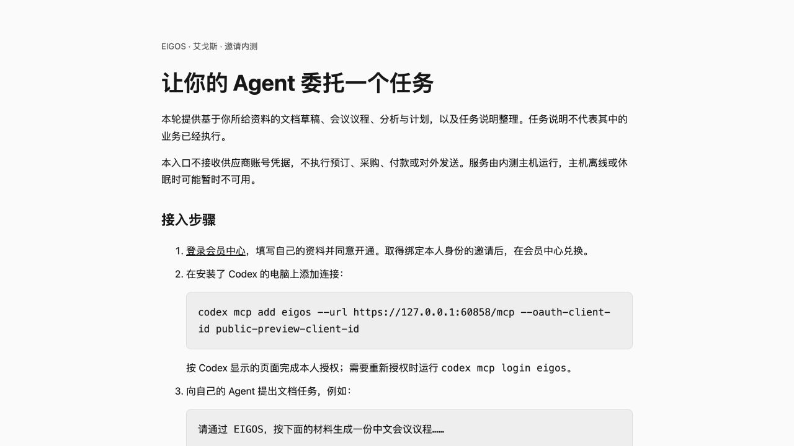

# MCP 邀请内测：首次发布前的工程准备快照

记录时间：2026-10-22 03:02（Asia/Shanghai）。**本目录保留首次发布前的工程准备快照，下面的未完成门槛是该时刻的状态，尚未证明公网内测可供用户使用。** 后续自有域名的部署方法见[内测发布说明](../../invite-beta-operations.md)，实际运行状态需单独回读。

用户已授权推进独立 HTTPS 邀请内测入口、客户端接入和独立用户验收。本轮选择 Codex 作为首个待验收客户端，首批范围为文档交付、任务说明整理及任务状态回读。

## 已检查内容

- 内测配置要求 HTTPS/JWT、准确 audience、邀请制、独立持久数据库和明确的客户端 ID；拒绝加载开发令牌、私人供应商来源、网络发布与交易沙箱。
- 额外签名 scope 不能扩大公开入口的任务权限。未受邀用户、其他 OAuth 客户端、跨用户任务读取及已停用连接均被拒绝。
- 邀请绑定准确会员身份；不能由另一会员兑换。停用连接后，更换访问令牌不能恢复调用资格。
- MCP 与 A2A 共用会员和任务检查。公开目录不显示建模写入或付款工具，A2A 不宣称付款扩展可用。
- Auth0 配置计划包含独立 API、会员门户、设备授权客户端及预登记的原生 MCP 客户端；原生客户端使用授权码和轮换刷新。计划已生成，没有调用 `--apply`。
- 部署脚本增加独立 `invite-beta` profile，复用不可变发布、依赖检查、备份和失败恢复。代理检查限定准确入口及本机目标，不要求改动既有私人端口。

相关工程回归 **45/45**、完整回归 **915/915** 通过，类型检查、构建及差异检查通过；编译后工程端到端 **9/9** 通过。对应提交的远端 CI 与同步状态单独回读。这些测试使用明确的本地身份与协议 fixtures，不代表真实 Auth0 或外部用户验收。

## 页面检查

本地隔离实例只用于查看接入页，使用假的公开客户端 ID 和身份提供方地址，没有认证用户、没有 Worker，也没有业务执行。页面的标题、服务范围、会员入口、原生 Codex 命令与结果读取说明已实际查看；临时实例和标签页随后关闭。

## 尚未完成

| 门槛 | 当前状态 |
| --- | --- |
| Auth0 管理登录 | 现有会话过期；发起的设备登录未完成并到期，需要本人重新登录 |
| 新内测 API／OAuth 客户端配置 | 仅生成计划，未实际创建或更新 |
| 公网 HTTPS 入口 | 未启用拟使用的专用 Funnel 入口，未发布新运行实例 |
| Codex 原生 OAuth 登录 | 待真实提供方配置完成后核验，不能由参数与文档判断为通过 |
| 两个独立认证用户 | 待实际登录、邀请、本人任务交付与跨用户拒绝验收 |
| 原生客户端实际续期、撤权和部署后恢复 | 待实际运行验证；现有工程测试不能替代 |

本轮未发送用户邀请，也没有真实预订、下单、付款或履约。部署授权仍然有效；身份平台登录是当前外部前提，不需要再次确认同一部署范围。

接续方法见[运维与验收说明](../../invite-beta-operations.md)，用户步骤见[接入指南](../../invite-beta.md)。原始日志、配置计划和临时输出保留在忽略目录；没有把令牌、客户端密钥或邀请凭据归档进仓库。
