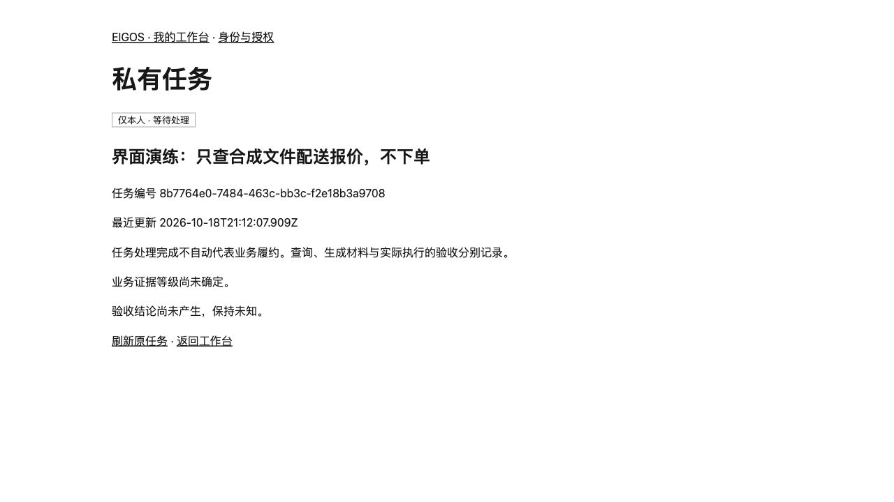

# T12/T13 工程与界面验证

2026-10-19（Asia/Shanghai）。基线 T11 `54904cbc40e53f4d4953faa78989b9d672500d78`，已包含 `origin/main` `aa50b2af594f1cc6936cc75a30c0033f6b95407c`。交付源码以包含本记录的提交及该 SHA 的 CI 为准。

完成声明：T12 界面与协议工程联调；T13 联合工程验证。**T13 的完整阶段验收未完成**，人工参与、当前版真实 PA／来源复验与真实对照见[门槛记录](../../network-t13.md)。

## 界面实测

使用仅监听 127.0.0.1 的一次性测试 Gateway、临时 SQLite 与合成会员；未使用真实 OAuth 凭据、私人地址或商家账户。浏览器实际执行工作台 → 原任务 → 填写合成选项 → 提交 → 原任务状态变为等待处理 → 刷新，Task ID 始终一致。

首次提交因继承 no-referrer 产生 Origin:null，被既有严格同源校验拒绝。修复网络页面 Referrer-Policy 为 same-origin 后复测通过；未放宽 CSRF 或允许来源。HTTP 回归另行检查响应头、错误来源／CSRF、跨 owner 和旧问题竞态。



截图只含本轮合成业务文字及临时任务编号；没有令牌、真实联系地址或个人信息。它证明界面提交和读回，不证明 Worker 已取得报价或真实业务完成。测试服务和临时数据库在验证后关闭清理。

## 自动检查

- `npm run check`
- `npm test`：428 项通过（包括 5 个新增工作台测试及扩展的完整联合链）。
- `npm run build`
- `npm run test:e2e:run`：8 项独立进程验证通过。
- `git diff --check`

工作台测试覆盖：同任务补问、跨账号与 bearer 拒绝、CSRF／Origin 拒绝、翻页、旧游标、unknown 状态、auth-required 不可用回复批准、源纠正造成方案与摘要失效、写事务内重查问题版本。完整联合链覆盖选择、批准、发布、去重、撤回和两协议读回。失败记录没有删去测试来规避。

## 重跑入口

```sh
npm run check
npx tsx --test tests/network-workbench.test.ts tests/network-gateway.test.ts
npm test
npm run build
npm run test:e2e:run
git diff --check
```

这些命令默认使用临时合成夹具，不调用真实来源或生产模型。本轮无新依赖、部署、常驻服务切换、真实交易或外部消息。
