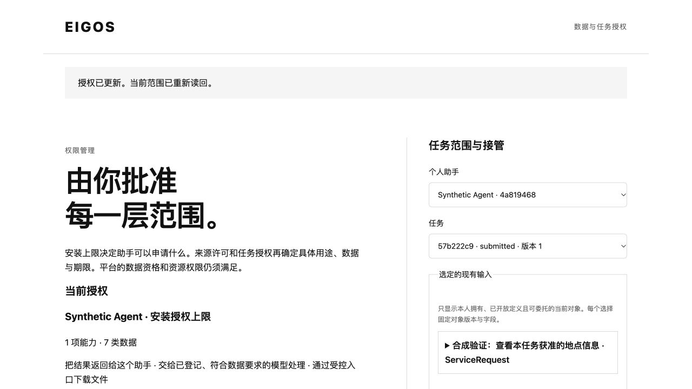

# S2–S4 本地验证记录

范围为显式 foundation v2 的资源、任务数据、Worker 和输出保护。资料均为合成 fixture；没有访问真实来源、支付、迁移常驻库或部署。汇总结果见 [summary.json](summary.json)，实现边界见 [S2–S4 说明](../../security-s2-s4.md)。

| 证明 | 位置 |
| --- | --- |
| 资源角色独立于数据授权；Editor／Owner 不自动获得执行权；候选 Link 的旧、新端点检查 | `tests/security-data-policy.test.ts` |
| 同会员多安装、多任务；Interface、反向共享 Provider、过滤、opaque cursor；不完整函数为 unknown | `tests/security-data-policy.test.ts` |
| 全部 TaskView 返回、写入回执、当前重放授权、受控文件、输入标签合并、模型渠道及标签升级 | `tests/security-output.test.ts` |
| HTTP／MCP／A2A 共同权限与安全 metadata；来源批准／撤销、不可替换的审阅、显式任务接管 | `tests/security-protocols.test.ts` |
| 既有程序通过真实 Coordinator／Worker 执行合成的两次地点搜索、一次估价；输出继承输入标签；来源收窄与 snapshot 标签升级阻止旧交付 | `tests/security-worker.test.ts` |
| 撤销后的专用原操作观察；普通 graph／模型／新派发不可用；事实仅审计、不推进任务；三次停止和来源撤销 | `tests/security-recovery.test.ts` |
| 会员 CLI 跨进程拒绝；平台 CLI revision CAS、候选定义只读审阅与角色撤销 | `tests/e2e/security-foundation.test.ts` |
| 继承的安装／成员撤销、跨库失败、当前领取、过期管理租约、迟到事实保护 | `tests/security-s1.test.ts`、`tests/security-s1-gateway.test.ts` |

浏览器实测完成了来源选择 → 审阅 → 批准 → 当前范围回显 → 撤销审阅 → 撤销回显。390px 视口下页面宽度同为 390px，无横向溢出。使用随机 `.localhost` 域名隔离 Cookie，临时库及预览进程已关闭，来源调用为 **0**。

CPU 采样定位到重复的权限／依赖读取；已将复用限定在一次有界同步读取内，并保留结束时授权复核。正常 Worker 回归使用原有 10 秒租约和 30 秒期限；临时长租约采样不计入最终通过证据，采样脚本和 profile 已移除。

当前 60 个代码路径摘要和 103 类型／823 属性清单通过检查；新增两个 typed observedData 虚拟字段，没有放宽原 snapshot 的内部策略。S0 命令是源码审计，不探测部署状态。完整回归 **656 项通过**（本地并发数 2），编译后进程 E2E **10 项通过**；类型检查、构建、S0 专项 8 项和清单／diff 检查通过。首轮失败及修复后的重跑范围在 summary 中记录；远端 CI 以提交后的精确 SHA 回读为准。

S5 尚待离线迁移、客户端适配、真实来源逐项投影与独立运行验收。其他未适配来源保持拒绝；没有真实供应商 original-operation observer。该记录不证明生产三层权限已启用。
