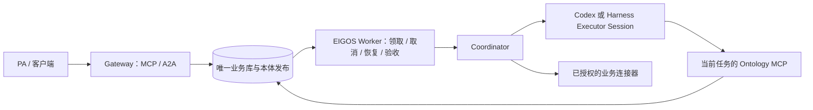

# 开发与运行

本仓库是一个 TypeScript／Node.js 工程，使用一份依赖锁和统一验证流程。目录职责见[仓库结构](architecture/repository.md)。

## 本地开发

要求 Node.js 22.13 或以上，并使用仓库的依赖锁：

```sh
npm ci
npm run setup:dev
npm run dev
```

`dev` 启动 Gateway 和 Worker 两个进程。也可分别运行 `npm run dev:gateway` 与 `npm run dev:worker`。构建后使用 `npm start`，或分别使用 `start:gateway`、`start:worker`。配置模板为 [`.env.example`](../.env.example)。

Gateway 负责协议、身份和任务入口。Worker 负责持久领取、模型、连接器、恢复和验收。模型及供应商凭据仅配置在需要它们的执行侧。能力开关应一致，构造目录不等于来源健康或任务已经执行。

Worker 的原生本体规划将任务专属 Ontology MCP 标记为必需服务：CLI 等待它初始化后才启动模型回合；初始化失败时停止本次调用。启动上限仍为 15 秒，单次工具调用上限仍为 30 秒。这样可避免可选 MCP 的初始目录等待窗口结束后，模型在缺少本体工具的情况下直接返回。规则见 [Codex MCP 配置](https://learn.chatgpt.com/docs/extend/mcp?surface=cli)。

原生规划和结构化审查均使用进程专属的私有 Codex 配置与业务角色说明，排除宿主的全局 `AGENTS.md` 和无关技能目录。配置仅引用经过文件权限检查的原 Codex 认证文件；清理临时目录不会删除原认证存储。Gateway／供应商凭据不传入模型进程，模型选择、当前数据许可和 Worker 的执行／验收检查仍分别处理。技能排除使用 [Codex 的逐技能配置](https://learn.chatgpt.com/docs/build-skills#enable-or-disable-local-codex-skills)，不修改操作者的技能文件或全局配置。

原生模型调用在 `RunEvidence.nativeTiming` 和私有用量账本的同名字段中保留分段计时；超时、取消、进程失败和无效结果也保留已观察到的阶段。计时使用同一单调时钟，分别记录本地 MCP 准备、CLI 拉起、初始化与工具目录握手、首次工具调用、客户端工具等待、服务端请求／处理、模型输出和退出。缺失边界为 `null` 或省略，未结束的工具区间保留 `pending`，不补造完成时间。

`cliToTurnMs` 包含可能重叠的 MCP 握手，不能与握手耗时相加；`cliBeforeMcpRequestMs` 和 `mcpReadyToTurnMs` 可进一步定位握手前后的 CLI 启动耗时。`turnOutsideToolsMs` 包含模型、传输和调度等待，不代表纯推理时间。记录最多 96 个区间及省略计数，仅含固定阶段／工具名、状态、时间和输入字节数，不保存提示词、参数、结果内容或凭据；用量汇总接口不公开这些私有诊断。先依据这些边界定位问题，再调整具体实现。

输出边界是 CLI 的已完成消息，并非首个 token。`firstOutput` 可包含过程消息；仅当 CLI 标明 `final_answer` 时记录 `finalOutput`，否则该边界保持未知。最终结构化结果仍须读取并解析，业务决策仍须有本体提交回执，两者不能由计时记录代替。

## Codex 与 Harness 执行器

Super-agent 整体可以承担广义 Worker 的角色，但上游原型还包含来源监听、Ticket、Policy、排队与回报。此处复用的是它调用 Harness 的 Executor Session；EIGOS Worker 仍是任务执行宿主，Coordinator 在其内部调用模型和业务连接器。运行配置选择 `codex` 或 `harness`，进程名本身不能证明当前使用哪种模型。



Worker 可显式选择 `EIGOS_EXECUTOR=harness`。适配采用 Super-agent 原型的独立 Executor Session 边界，通过 DeepSeek Harness 的 `sdk-minimal` JSON-RPC 接口运行模型；不启动原型的 GitHub／飞书来源、第二套 Ticket／Policy 引擎或独立正式任务库。EIGOS 继续负责持久领取、当前授权、取消、原操作恢复与结果验收。Gateway 只按相同开关公布文档能力，不启动 Harness，也不需要模型凭据。

已验证的外部运行版本为 `@deepseek-ai/dsh@0.2.1-rc.5`，使用 Node.js 22.22.3。运行环境与项目依赖分开安装，例如 `npm install --prefix /opt/eigos/harness-runtime @deepseek-ai/dsh@0.2.1-rc.5`。配置入口见 [`.env.example`](../.env.example)；Worker 必须设置绝对路径 `EIGOS_HARNESS_CREDENTIAL_FILE`，文件须由运行用户拥有、权限不大于 `0600`，不能是符号链接。

`codex-oauth` 读取现有 Codex 登录 JSON 中当前的 ChatGPT access token，通过 Harness 的 `openai-codex` 通道调用所选模型；不把 refresh token、原 Codex home、Gateway 令牌或供应商凭据传入模型进程。原登录仍是刷新凭据的唯一写入方。远程副本过期时调用停止，须由原登录刷新后更新私密副本；不能以重建任务、切换凭据来源或自动换模型掩盖失败。`api-key` 使用私有纯文本文件和明确的 DeepSeek 模型；两种方式都不会在缺失或过期时回退至其他模型。

每次调用使用新的私有 home、随机会话 ID 和只含当前任务的配置。Shell、文件工具和工作目录工具在宿主配置层关闭；原生规划仅接入 Worker 创建的 loopback Ontology MCP，并保留实际服务端读取与决策回执。文档及单次只读决策不接入工具。调用只在原提示已入会话、唯一模型回合成功结束、输出符合 JSON Schema 后返回；入队、空闲通知或模型文字不能单独证明业务完成。Harness SDK 初始化默认最多 45 秒，可通过 `EIGOS_HARNESS_INITIALIZE_TIMEOUT_MS` 配置为 1–90 秒；它包含进程和 SDK 装载，并取原总调用截止的剩余时间上限，不在原执行预算外另加时间。MCP 单次调用最多 30 秒。

SDK 没有单会话取消接口，因此每次调用独占进程；取消、超时和关闭会终止并回收该进程组，再清理私有 home。外部来源返回后的执行与验收仍独立检查 EIGOS 原任务权限和领取身份。Harness Worker 固定一个并发领取，原 Codex Worker 保持已有两个并发上限。

Foundation 按模型接收方分别使用 `harness-openai-codex`（GPT OAuth）和 `harness-deepseek`（DeepSeek API）通道。现有 `codex-native` 许可及另一接收方的 Harness 许可不会自动赋予它；启用前须审核实际模型接收方与数据出口许可，并通过已有管理入口配置相应通道及授权。部署预检按所选执行器和凭据类型核对通道，不自动修改权限策略。真实模型、Linux 候选部署、正式实例切换与业务完成须分别验证。

输出使用流式 UTF-8 解码，跨数据块的中文与 emoji 保持原文。适配器等待使用记录的 `begin` 确认后才启动进程，并等待 `finish` 确认后返回；预派发确认失败或结果未知时不调用模型。SQLite 与 PostgreSQL Worker 均已接入相同的预派发确认和持久用量回执合同；PostgreSQL 适配在实际发出提示词前还检查原领取、模型通道、来源与原尝试。执行器接线、真实模型验收、镜像发布和正式实例切换分别记录；不能套用 Codex 镜像或合成测试结论证明 Harness 已上线。

上游接口与边界：[Super-agent 执行说明](https://github.com/deepseek-ai/dsh-superagent-prototype/blob/main/docs/003-execution.md)、[Harness SDK](https://github.com/deepseek-ai/deepseek-harness/blob/master/packages/sdk/protocol/README.md)、[多模型与 OAuth](https://github.com/deepseek-ai/deepseek-harness/blob/master/packages/llm/llm-pi-ai/README.md)。

## 一个共享存储

`EIGOS_STORAGE_BACKEND` 默认是 `sqlite`。该模式的 Gateway 和 Worker 必须使用同一个持久 SQLite 文件及相同绝对 `DATABASE_PATH`，分进程不能使用 `:memory:`，也不能复制数据库到两个位置扩容。

`postgres` 模式已接入 Gateway 与 Worker 的正式启动代码，可让常驻 Gateway 和 ECS 等执行主机连接同一 PostgreSQL 业务 schema；会员身份使用同一目标会员 schema。启动必须显式选择后端，并提供原 Foundation JWT authority、受控私有 binding、真实导入／schema 校验与单独激活回执。候选导入、配置文件和模块测试本身不会启用目标库，完整迁移流程见[部署说明](guides/deployment.md)。

```dotenv
EIGOS_STORAGE_BACKEND=postgres
EIGOS_POSTGRES_BINDING_FILE=/absolute/private/primary/postgres-binding.json
EIGOS_AUTHORITY_FILE=/absolute/private/primary/authority.json
EIGOS_AUTH_MODE=jwt
EIGOS_SECURITY_MODE=foundation
```

数据库密码由宿主秘密环境 `EIGOS_POSTGRES_PASSWORD` 提供；binding 固定目标身份、TLS CA 摘要、schema、策略和回执，不携带明文密码。禁止退回另一数据库、关闭 TLS 校验或绕过激活。Gateway 持有唯一资格 publisher；Worker 先验证原 Gateway 的就绪资格，不创建第二个 publisher。

本体定义、发布引用、任务、授权和执行账本处于同一业务存储。新任务固定准确本体 release；Worker、MCP、A2A 和回读按该版本解析。会员登录会话使用独立会员库，Worker 不读取会员会话。详见[共享本体](../packages/ontology/README.md)。

PostgreSQL 适配器把任务、授权、发布引用和本体投影放在同一业务事务中。共享业务事务先锁定永远为空的 `eigos_business_mutex`，再取得数据库快照，排队后读取的状态与资格保持一致。运行角色需要该空表的 `UPDATE` 权限，以及 `eigos_lock_runtime_authority()`、`eigos_current_runtime_authority()` 的执行权限；运行权威表的读取和修改继续由受限管理入口负责。

任务读取服务使用 `PostgresDatabase.read()`。读取取得同一互斥表的共享锁，多个读取可以同时进行；业务写入继续取得排他锁。读取事务使用 READ COMMITTED，共享锁期间业务事实和权限写入被阻挡，而各请求可以维护自己的私有分页游标。调用方限定为已审查的查询、计算和任务视图。运行权威通过受限只读函数检查，并在 COMMIT 确认后再次读取；当前身份、授权、字段与回传有效期继续在各自边界检查。

对象查询和 Function 在同一次请求内共享准确发布的只读快照。共享范围随事务结束关闭，下一次请求重新核对发布。运行权威、权限和当前业务事实使用各自的实时检查。

已经验证的发布正文及编译模型按受信注册表隔离复用，缓存最多 8 项、16 MiB 正文。每次请求仍从数据库核对发布行、模型摘要和当前正文的 SHA-256；命中后只返回内容指纹，避免重新传输和解析整份正文。正文变化触发重新读取与完整验证，删除、错误别名或模型摘要不匹配仍会拒绝。缓存只保存不可变定义。

PostgreSQL 的本体读取共用已有的定义过滤和计算程序：对象可见性在筛选、计数和分页前核验，导入的原分页令牌继续受原安装、任务授权和权限版本约束。定义查看与函数调用分别授权；计算缺少完整可见证据时保持未知。派生字段的输出约束保留实际输入及当前字段权限，私有来源正文仅用于内部证据校验，不直接返回给 Agent 或模型。

PostgreSQL 启动可先调用 `preparePostgresKernel()`，在资格发布器开始计时前分阶段预热已有编译器，再通过 `new PostgresDatabase(..., { kernel })` 绑定到业务事务。各执行／读取组件也应显式接收同一个 ready builder。原 release 查询、别名、正文摘要和模型摘要仍逐次核验；当前 namespace、角色、来源和数据权限仍各自检查，不缓存权限。此方式避免首次同步编译阻塞资格心跳，不延长任何租约或超时。

远程事务不能把旧数据库快照中的资格时间戳当成新的固定授权期限。`PostgresDatabase` 可接收独立的 `eligibilityPool`，默认可使用已独立配置的续租池；入口和提交前通过只读 `READ COMMITTED` 检查同一原 manager、身份代次、围栏、策略及精确授权正文。资格正常续期时允许原事务继续；数据、角色、任务权限和原领取的固定截止时间仍分别约束操作。COMMIT 回复到达后还会重查当前资格，避免持有的旧回复越过停用或撤销。

新任务及后继授权在提交前无法从另一连接读到。发行器仅在新行、绑定、运行资格和事件均成功后保存事务内私有回执，并核对实际元组版本；回滚或旧事务的回执不能认证既有授权。回传检查按该可信回执选择本次提交的新授权，保留原任务与原固定期限。没有独立检查连接时，读取继续受快照中的较短资格期限约束。

PostgreSQL Worker 的空队列轮询先读取当前运行权威和调度布尔值，不占业务事务锁。只有可靠的空结果才跳过本次轮询；候选存在、到期领取或待清理领取仍走原来的完整领取流程。这个提示不授予权限、不更新租约，也不缓存；查询失败不能当作没有任务。

`PostgresWorkerStore.project` 用显式 GraphProgram 在同一原领取事务内保存任务、真实来源投影、权限绑定和输出封装。旧 `checkpoint`／`finish` 回调继续只接受同步状态变更。实际模型响应通过 `recordActionRun` 保留原文档用途和不变回执；模型仍在事务外运行。模型宿主可安装 `withModelDispatchGuard`，在 CLI 文件准备结束、提示词进入子进程前复查当前模型通道、任务及来源资格。原已提交发送标记通过 `assertDispatchAllowed` 再查，不能创建第二次尝试或恢复失效权限。

常驻 Linux／ECS Worker 的 PostgreSQL 连接使用独立续租连接池：`new PostgresDatabase(businessPool, schema, authority, { leasePool })`。续租在独立事务中核对原令牌、任务版本、身份、授权及期限，只更新租约到期时间；业务提交、取消和结果写回继续经过共享业务事务。模型工具通过 `PostgresWorkerStore.readEvidence` 读取时，事务内核对原领取头部，入口和回传前另查同一令牌的当前有效期，避免旧数据库快照误用已更新的心跳时间；该查询不延长租约。租约在外层提交前再次核验，数据与角色的固定期限仍独立约束结果。Worker 结束时，业务结果、完成回执与运行资格撤销原子提交；只按该回执清理原令牌的物理领取记录，避免与心跳竞争或重放业务写回。宿主层持有数据库凭据，模型进程使用任务范围内的本体工具。启动入口按显式后端选择存储；默认值仍是 SQLite。已持久化 checkpoint 的正常收尾可只释放原领取并记下完成回执，不重复改写任务、本体或输出封装；它仍核对当前资格、原令牌、租约和提交边界，也不证明业务目标完成。切换入口须完成对应协议、所选执行器与迁移验收。


PostgreSQL 会员库使用 `PostgresMembershipDatabase`／`PostgresMemberStore`，保留导入回执、原身份、会话 CSRF、安装／令牌绑定及邀请语义。Gateway 的会员与注册路由接受可等待的存储接口；权限审批另有原子 `applyPermissionReview` 接口，不能把异步回调传给 SQLite 的同步事务。

`PostgresAuthorizationPublisher` 从可信会员库及实际 bearer 绑定取得当前资格。它使用独立控制连接池，维持原有 60 秒资格租期、30 秒刷新和原 manager token。未改变身份与状态的 ACTIVE 时间戳可以独立刷新；代次、拒绝、恢复和授权状态变化仍经业务事务。连接或提交回复超过 10 秒时淘汰连接并保留首次错误，迟到回复不能恢复旧 publisher。撤销会员／连接／安装前必须先提交 deny fence；使用 `coordinate()` 时不能再为同一操作重复安装 deny observer。发布器不签发或延长业务授权，普通刷新不能恢复已拒绝身份。

`PostgresDocumentExecution` 只执行已持久化的原文档动作。发送标记与准备读取先提交，模型调用在事务外进行；实际模型发出提示词前再次核对原尝试、当前权限和相同输入。模型用量、文档用途的原回执、独立观察审计、真实来源投影及组合输出封装分别按顺序持久化。取消、撤权或映射失败保留原操作，不自动重放；生成草稿后仍需模型选择和完整任务验收，不能直接标为整个目标完成。当前未接通的延迟输入继续拒绝执行。

PostgreSQL 启动入口与实际异步 TaskService 已接通 MCP／A2A、会员审批、本体管理、受控 CallerAction、输出封装和原任务取消／恢复。已经安装的只读来源通过注册程序、账户／来源状态和原 TaskRelay 通道工作；当前 DiDi 只读适配保留实际加密回执、Pipeline、规范事实与固定 Goal 的验证。未知程序、缺失绑定、未安装的付款／供应商观察器或不受支持的输入引用继续拒绝。来源只读接通不授予下单或付款权限。

Relay 服务端的节点／联系人／密文信箱与 Gateway、通信节点自己的凭据／outbox／inbox 是不同持久状态。PostgreSQL 节点存储保留原身份和密文历史，以宿主管理的 AES-GCM wrapping key 封装服务节点凭据；迁移须单独完成 v2 全量快照、独立回读和完整库存绑定，不能在目标端生成新身份填补缺口。

`apps/gateway/main.ts` 和 `apps/worker/main.ts` 根据后端调用受审查的 host 装配。`createPostgresWorker` 保留原所选 Codex／Harness、模型通道和私有凭据来源；两者均须实现 acknowledged model-dispatch 与持久用量确认，不能自动换模型或借用另一接收方许可。模型与执行器在业务事务之外运行，原生本体工具、独立目标审阅、文档／已注册来源组件和原任务验收各自保留当前权限边界。源码入口存在不等于 ECS／Cloudflare 已完成正式切换；真实模型、来源服务端接受和原任务最终结果仍须逐项验收。固定镜像与本体流程见[发布指南](guides/ontology-releases.md)。

`PostgresActionJournal` 在同一业务事务中保存原操作、预算占用、发送标记和观察结果；观察回执可先独立保存，失去领取后不能据此推进任务。`createPostgresActionAuthorization` 核对原计划、输入、角色、来源、授权和实际规划凭据。各业务程序仍须提供真实语义校验、原始来源响应校验，以及适用时的首次选择校验；缺少接口会拒绝执行。最终映射、结果输出封装与接受状态须在同一事务内完成。延迟输入的准备与实际发送仍需分别接通，不能只信任已保存的输入摘要。

## 领取与恢复

领取、续租和结果提交绑定 owner、任务 revision、领取令牌及有效期。队列准备完成后才开始新租约；迟到结果不能覆盖取消、改版或失效领取。未知外部效果保留原操作身份，只进行原键查证。

有效补充信息和技术恢复沿用原任务，保留累计预算和已确认事实。异步来源的健康等待使用持久 `nextAt` 与有界退避。重复校验失败可以暂停并等待修复；不能通过重置任务或伪造用户回复绕开问题。

Agent 的同类校验／完成失败在没有新投影来源证据或已核验 scope 恢复时，累计三次即技术暂停。改写模型解释、改变 JSON 排版或提交另一个同样失败的参数不会重置计数；原反馈及输入摘要保留。新的已验证来源结果允许继续修正，但不会清除累计任务预算或放宽最终验收。

Worker 每次心跳仍检查当前权限，并通过同步状态列提前察觉取消；该轻量提示不授予任何执行权限。完整任务正文、版本、权限与租约判定继续用于续租、派发和提交，只到续租时点才重查并续租原领取。标量领取检查保留重复 JSON 键的 `JSON.parse` 最后值语义和损坏记录拒绝行为，不把完整历史复制到临时大对象表。超时／关闭后的恢复写回使用独立 scope：保留原角色、授权、版本和租约校验，移除的仅是已中止的执行截止检查；原执行 scope 继续拒绝迟到结果。授权失效或租约已过期时，写回仍不得提交。

恢复元数据写回最多 45 秒，原任务执行截止时间、15 秒默认领取租约、来源新鲜度和业务授权期限均不因此延长。`run-local.mjs` 在关闭时最多等待 50 秒，再强制停止仍未退出的直接子进程；正式主实例的 LaunchAgent 显式设置 `ExitTimeOut=60`。当前 macOS 将更长的配置限制为 60 秒，因此必须同时回读配置和系统有效值，保持应用退出宽限在该上限内。关闭前后的恢复状态必须从原任务回读，不能仅以进程已经退出作为成功依据。

Linux 使用专用非 root 用户的 `com.eigos.primary.service`，启用 user lingering 后可在开机和退出登录后运行。systemd 的 `TimeoutStopSec=60s`、`KillMode=control-group` 覆盖相同的应用退出预算；部署器等待停止的上限为 75 秒。SQLite 模式由同一 supervisor 启动并共用本机持久库；PostgreSQL 模式允许 Gateway 与执行 Worker 分处常驻主机，但必须指向同一受审查权威和原任务库。执行环境保持在 ECS 等宿主，不把 Codex CLI／Harness 放入请求型 Cloudflare Worker。安装、迁移和真实入口验收见[部署说明](guides/deployment.md)。

任务控制对象的来源证据与追加式读取审计分别维护。相同对象版本、正文和出向关系未变时，重复保存保留其原始输入证据；后来的读取不会反向成为旧记录的输入。关系改变、新对象或新版本仍合并当前完整输入约束。新模型产出使用新的计划、尝试或观察身份，不能仅因显示值相同复用旧来源；业务输出及验收结果继续记录当前模型信息约束。

来源复用不复用访问许可。同安装、同请求版本的替换授权可以保留已记录的来源，但字段、当前成员关系、来源权限、撤销和到期仍独立检查。旧绑定首次加入来源摘要时保守保留其已有依赖；不会为了提速删改历史约束。SQLite 同步边界与 PostgreSQL 异步读取／投影均执行这些检查；不能把一次读取或密文传输成功当作后续动作的授权结论。

只读任务可以由模型一次选择有界依赖图：独立查询并发执行，后续查询只使用原账本中已验收的具名输出。标量选择必须是动作定义中声明的纯函数，并与同一步、同一个输出端口的观察绑定；歧义、过期或权限变化会阻止后续查询，交回模型处理。组合步骤的每个 `inputRefs` 都须包含 `port`，包括计算标量的引用；缺少端口的原生提案在 MCP 提交时拒绝，模型可在同一会话内修正，Worker 的语义与权限检查继续独立执行。

原生目标允许模型通过 `plannedGoalCompletion` 预先选择各组件的未来证据和固定目标对应关系，仅适用于明确支持该能力的只读模块。Worker 在来源返回后重新读取证据，运行组件验证器、完整目标检查和原权限校验；预先选择验收条件本身不代表任务完成。未通过验收的计划保留原结果并进入下一次决策，不重新派发已确认的查询。

## 验证

```sh
npm run check
npm run build
npm run test:changed
npm run test:e2e:changed
git diff --check
```

默认按相对 `origin/main` 的全部分支改动选择测试，包含本地暂存、未暂存和新增文件。用 `npm run test:scope` 预览范围；其他基线传 `-- --base=<ref>`。全量回归、CI 触发与范围回退规则见[测试与 CI](guides/testing.md)。

自动测试使用隔离数据库和合成模型／来源。进程级测试验证真实进程与协议接线，仍不能证明真实商家操作或履约。实际业务验收需要独立来源回读。

`npm run ontology:check` 校验可编辑的供应商绑定，`ontology:sync` 将验证后的数据放入生成目录。构建自动完成同步。`dist/` 是构建产物，不是另一份编辑来源。

## 部署

正式运行统一为一个主权威，公网和私有兼容地址只承担传输入口。Gateway、Worker、Ontology MCP 共用同一任务库和发布注册库，见[统一运行与路由](architecture/runtime-authority.md)及[部署说明](guides/deployment.md)。代码同步、进程更新、已有数据库迁移和真实业务操作分别验收。已有任务不能因为代码更新而自动重放。

## Foundation 运行边界

默认 legacy 保留已有接口。foundation 要求独立持久任务库、JWT Agent 安装和匹配的权限策略；Gateway 发布短期资格，Worker 按原授权检查，不能读会员登录库或通过旧接口回退。现有模式、迁移、副本验证和来源资格见[本体权限指南](guides/ontology-security.md)。切换或部署须按实际授权执行，本次代码整合不等于某个实例已经迁移。
