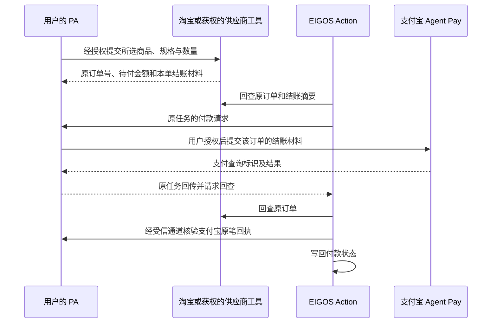

# 淘宝下单与支付宝 Agent Pay

普通淘宝订单由淘宝在买家提交订单后生成。商家或平台提供的 MCP 工具只有在取得对应下单权限时才可代买家提交，最后拿到淘宝原订单号和该单的结账材料。用户也可在淘宝完成提交并将原单留在自己的 PA 环境。淘宝联盟提供商品搜索及导购链接。EIGOS 的淘宝购物交接到商品链接为止，普通买家下单和结账资格需要向供应商核验。 [淘宝订单生命周期](https://developer.alibaba.com/docs/doc.htm?articleId=1029&docType=1&treeId=796) · [淘宝联盟商品搜索](https://developer.alibaba.com/docs/api.htm?apiId=64759) · [EIGOS 购物交接](https://github.com/proerror77/eigos/pull/167)

EIGOS 的付款请求标识和任务 ID 负责关联及重试，真实款项由支付宝处理，并由支付宝产生支付交易号。发起请求前绑定原订单、商品规格、数量、收款方、实付金额、币种和结账摘要。原始收银台、钱包和凭据留在 PA。支付宝返回处理中或结果暂时未知时，PA 保留原入口及原查询材料，继续查原笔付款。供应商订单状态和支付宝付款状态分别回查。 [支付宝商户接入文档](https://aipay.alipay.com/docs/agent-pay/skillpay.html) · [支付宝收银台流程](https://github.com/alipay/payment-skills/blob/main/alipay-payment-skill/references/cashier-payment.md)

## 合成联调

`alipayAgentPayRehearsal` 提供可选的 Ontology 定义片段，通过已有版本化 Function 扩展注册运行，不改变默认发布定义。演练 Action 沿用准备、交接和回查的分工，并复用原任务的 PA 请求和响应。一个已登记的订单只对应一个付款请求，从原任务交给同一 PA。PA 响应可请求回查或保留未付，确认支付宝付款时，读取器分别取得原订单和独立交易回执，并校验订单号、实付、币种及结账摘要。 [Palantir Action 规则](https://www.palantir.com/docs/foundry/action-types/rules) · [Action 事务一致性](https://www.palantir.com/docs/foundry/action-types/consistency-guarantees)

`npm test -- --suite=24` 中的支付宝用例发布该片段，使用本机模拟供应商 MCP 产生合成原单及结账材料，并模拟 PA 付款受理和结算。测试验证原订单与金额一致、同一订单绑定一项任务、跨账号响应拒绝、支付响应重试、处理中状态以及独立回查后的写回。该扩展接收 `synthetic` 证据与 `sim-` 订单标识，适用范围是隔离联调。正式启用需要供应商提供获权的下单、结账和原单查询接口，PA 接入官方支付工具，以及可独立核验的正式付款回执。
