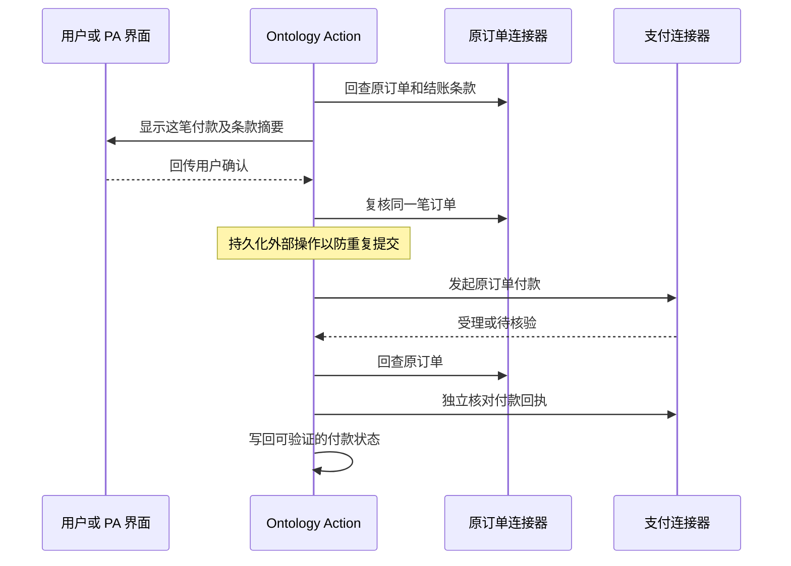

# 淘宝下单与支付宝 Agent Pay

普通淘宝订单由淘宝在买家提交订单后生成。取得对应下单权限的供应商工具可代买家提交。淘宝联盟提供商品搜索和导购链接。EIGOS 的普通淘宝购物交接到商品链接为止，买家下单、原单查询和结账材料的权限需要向供应商核验。 [淘宝订单生命周期](https://developer.alibaba.com/docs/doc.htm?articleId=1029&docType=1&treeId=796) · [淘宝联盟商品搜索](https://developer.alibaba.com/docs/api.htm?apiId=64759)

## Ontology 付款 Action

付款由 Ontology 的 Function-backed Action 调用已绑定的支付连接器。Action 校验原订单、规格、数量、收款方、应付金额、币种和结账摘要。需要用户确认时，原任务接收绑定这些条款的同意。Worker 继续同一个 Action 请求并登记外部操作，再调用连接器。用户界面或 PA 只呈现条款并回传确认。外部支付凭据和收银台材料保留在已授权的连接器中。 [Function-backed Actions](https://www.palantir.com/docs/foundry/action-types/function-actions-overview) · [外部连接](https://www.palantir.com/docs/foundry/data-connection/external-functions)

支付提交和结算分别记录。提交响应丢失时保留原操作，后续查询原订单和原笔付款。只有两边的证据匹配才记录已付款。 [Action 事务一致性](https://www.palantir.com/docs/foundry/action-types/consistency-guarantees)

## 合成验收

`alipayAgentPayRehearsal` 是可选的 Ontology 定义片段，通过版本化 Function 注册。登记原单后用 `PrepareAlipayAgentPayRehearsal` 绑定付款和原任务。调用 `AgentPay.submit`，通过 `readAlipayAgentPayRehearsal` 查看提交和结算状态。需要刷新时调用 `AgentPay.refresh`，读取供应商原单与独立交易回执。

`npm test -- --suite=24` 使用本机合成 MCP 验证用户确认后同一 Action 直接调用连接器、回执丢失后只读原单，以及错误金额回执被拒绝。该定义只接受 `synthetic` 证据和 `sim-` 订单，独立于默认生产发布。

## 正式通道

正式上线需要可授权的订单和结账来源，以及对应的支付宝连接。办公收银台由获权连接器取得原单支付材料，支付宝要求用户确认时在支付宝界面完成。若采用支付宝服务端委托支付，平台必须先签约并取得用户委托授权，商户也必须提供该笔订单的 `prepay_id`。平台调用 `alipay.trade.agent.delegation.pay` 时提交同一授权的协议号和委托 ID，并核对支付宝签名结果及原订单。淘宝订单号不能替代 `prepay_id`。 [办公收银台](https://aipay.alipay.com/merchant-guide) · [支付宝委托支付](https://aipay.alipay.com/docs/agent-pay/delegation-pay.html)
