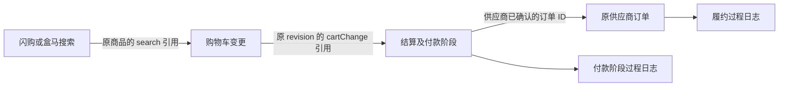

# 淘宝闪购和盒马

| 服务 | Action | 结果 Function |
| --- | --- | --- |
| 淘宝闪购 | `SearchTaobaoInstantDelivery` | `readTaobaoInstantDeliverySearch` |
| 盒马 | `SearchHemaProducts` | `readHemaProductSearch` |

两项服务使用 dsh-waimai 中对应账号已选的配送地址。闪购可以按菜品或商品名称查当前配送范围的搜索结果，也可以读取附近推荐店铺或指定店铺菜单。盒马按已分配的配送组查商品，并读取样本商品的 SKU 数量。查询 Action 将只读快照提交到调用者自己的 Ontology。交易 Action 的能力范围和授权见下文。

## 在同一台机器上配置来源

1. 从 [dsh-waimai 仓库](https://github.com/vb2250158/dsh-waimai) 下载并固定分支提交 `006f3e06df22cb01b6baf6627f9ca09dd46a6777`（0.9.1）。在其源码目录运行 `npm install --ignore-scripts --no-audit --no-fund`，按 [独立 MCP 说明](https://github.com/vb2250158/dsh-waimai/blob/master/docs/standalone-mcp.md) 创建私有状态目录及两个独立令牌文件，然后运行 `npm run start:mcp`。保留回环监听。登录、账号选择和地址选择在 dsh-waimai 页面完成。
2. 在本机 `/mcp` 用 dsh-waimai 的公开令牌调用 `list_connections`，记下对应平台的 `accountRef`。将每个 EIGOS owner 和平台绑定到其自己的已选账号。运行 EIGOS 的账号必须能安全读取绑定文件与私有 Host 令牌文件。以下为绑定文件示例，两条记录可独立启用。文件权限为 `0600`，`tokenSha256` 对去掉首尾空白的令牌计算。
3. 给 Gateway 和 Worker 设置 `EIGOS_DSH_WAIMAI_CONNECTION_FILE=/绝对路径/本机绑定.json`，发布候选定义，并为对应 owner 分配 Action、执行 Function、结果对象和各自来源（`Eigos/source/TaobaoInstantDelivery` 或 `Eigos/source/Hema`）权限。dsh-waimai 的 `/host` 必须与执行进程处于同一网络命名空间。远端 Gateway 的回环端口无法访问本机 dsh-waimai。

```json
[
  {
    "owner": "local-developer",
    "provider": "TaobaoInstantDelivery",
    "active": true,
    "expiresAt": "2027-01-01T00:00:00.000Z",
    "accountRef": "4ee50433-6d87-4adb-9775-9cda669c00d1",
    "port": 3815,
    "tokenFile": "/private/dsh-waimai/host.token",
    "tokenSha256": "aaaaaaaaaaaaaaaaaaaaaaaaaaaaaaaaaaaaaaaaaaaaaaaaaaaaaaaaaaaaaaaa"
  },
  {
    "owner": "local-developer",
    "provider": "Hema",
    "active": true,
    "expiresAt": "2027-01-01T00:00:00.000Z",
    "accountRef": "e4da3d57-9284-4737-99e5-92299854ab37",
    "port": 3815,
    "tokenFile": "/private/dsh-waimai/host.token",
    "tokenSha256": "aaaaaaaaaaaaaaaaaaaaaaaaaaaaaaaaaaaaaaaaaaaaaaaaaaaaaaaaaaaaaaaa"
  }
]
```

## 用 EIGOS MCP 搜索

在 EIGOS 的 `complete_with_action` 中传入：

```json
{
  "requestId": "instant-milk-1",
  "action": {
    "interface": {
      "type": "InstantDeliveryInquiry",
      "implementation": "TaobaoInstantDeliverySearch",
      "action": "search"
    },
    "input": { "mode": "products", "query": "牛奶", "limit": 5 }
  },
  "read": { "function": "readTaobaoInstantDeliverySearch", "resultParameter": "search" }
}
```

`mode: "stores"` 读取一页附近推荐，`query` 可按店名筛选当前页。拿到 `merchantId` 后，使用 `mode: "menu"` 和 `merchantId` 读取该店菜单，`query` 可选。查盒马时改用 `GroceryDeliveryInquiry`、`HemaProductSearch`、`readHemaProductSearch`，输入 `{ "query": "鸡蛋", "limit": 5 }`。

- `listedPriceMinor` 是人民币分。它是搜索或菜单标价。结算价、运费和优惠没有查询。
- `stockEvidence: "verified"` 表示只读的独立库存调用返回了数量。闪购只有能匹配同一门店、同一商品且为单规格的结果才使用库存总数。盒马多规格逐项保留数量。每次最多核验三个商品。未取得数量时 `stockQuantity` 为 `null`，人工验证时返回 `verification_required`。
- `complete: false` 表示查询受分页、数量上限、配送组或来源失败限制。结果按观察时间保存，五分钟内可通过返回的 `search` 引用读回。绑定被撤销、改换或过期时需恢复对应授权并发起新查询。
- 闪购搜索里的盒马门店是闪购渠道的观察。只有 `Hema` Action 代表盒马直连。闪购和盒马可能分别要求人工验证，请在官方渠道处理。

接入沿用 [External Functions](https://www.palantir.com/docs/foundry/data-connection/external-functions)、[Function-backed Actions](https://www.palantir.com/docs/foundry/action-types/function-actions-overview) 和 [Ontology MCP](https://www.palantir.com/docs/foundry/ontology-mcp)。本机 Host 令牌只由连接器使用，连接器只接受固定白名单与回环端点。每次已批准的交易至多调用一个供应商写入工具。结果对象保留经校验的商品事实和状态，不包含地址、账号引用、会话或供应商原文。

## 购物车、下单和支付

购物车和下单需要在对应来源绑定里设置 `allowOrders: true`。闪购调用 dsh-waimai 付款接口还需要单独设置 `allowPayment: true`，并在 dsh-waimai 私有界面完成付款方式配置。两个开关默认关闭。来源开通、账号登录和每次交易授权分别检查。开发验收用合成供应商。

| 能力 | EIGOS 入口 | dsh-waimai 接口 |
| --- | --- | --- |
| 购物车、商品规格和配料 | `readLocalDeliveryCart`、`readLocalDeliveryItemOptions` | `account_cart`、`account_retail_cart`、`account_item_options`、`account_retail_resolve_search`、`account_probe_menu`、`account_product_detail` |
| 购物车变更 | `ChangeLocalDeliveryCart` | `account_cart_change`、`account_retail_add`、`account_cart_add` |
| 结算报价和盒马配送时段 | `PreviewLocalDeliveryCheckout`、`SelectLocalDeliveryWindow` | `account_checkout`、`account_retail_checkout`、`account_select_delivery` |
| 创建订单 | `SubmitLocalDeliveryOrder` | `account_submit` |
| 付款交接和闪购付款 | `PrepareLocalDeliveryPayment`、`PayTaobaoInstantDeliveryOrder` | `request_payment`、`get_payment_options`、`pay_order` |
| 原单和付款回读 | `RefreshLocalDeliveryOrder`、`readLocalDeliveryRecentOrders` | `get_order_status`、`account_orders` |

1. 闪购餐饮使用 `taobao_meal`，闪购商超用 `taobao_retail`，盒马用 `hema`。搜索结果提供 `merchantId` 和 `itemId`。读取商品规格时传这两个标识。盒马与闪购商超还需要原关键词。读取购物车取得 `revision`，仅闪购餐饮支持从一个现有行减一件。闪购商超支持单规格加购，盒马支持当前在售 SKU 加购。
2. 在原 PA 交互任务中用 `DeliveryCartEditing.change`，将结果绑定到 `readLocalDeliveryCartChange` 的 `change` 参数。用户确认商品、规格和数量后，使用原购物车版本执行一次。供应商结果未知时重新读取购物车，核对数量。
3. 用 `PreviewLocalDeliveryCheckout` 传入当前 `cartRevision` 和人民币分预算 `maxAmountMinor`。盒马必须显式选择购物车 `lineIds`，来源当前要求每行数量为 1。盒马若要求选配送时段，用 `SelectLocalDeliveryWindow` 重报价，再核对新金额及费用。
4. 通过 `DeliveryOrdering.submit` 对当前 `LocalDeliveryCheckout` 对象执行 `complete_with_action`，将返回值绑定到 `readLocalDeliveryCheckout` 的 `checkout` 参数。Action 会等待 `local_delivery.order_approval`。PA 只有在用户确认商品、地址、时段和最终金额后，才通过 `respond_to_task` 回传 `{ "decision": "approve", "termsDigest": "原请求摘要" }`。
5. `PrepareLocalDeliveryPayment` 返回原订单的支付入口类型。盒马使用官方 App。闪购可从私有界面完成付款，也可在开通付款能力后用 `DeliveryOrdering.pay`。付款请求需要用户单独确认原订单和金额。若供应商要求二次验证，在原私有收银台完成。付款提交反馈需经 `RefreshLocalDeliveryOrder` 独立确认才显示已支付。
6. `RefreshLocalDeliveryOrder` 使用原报价对应的供应商下单记录及官方订单做匹配。网络中断后，EIGOS 保留原操作并禁止自动重发。供应商无法给出唯一的原单证据时，由用户查看原平台订单。

扫码、短信验证码、收货地址选择、Alipay 登录、支付密码、收银台链接和资金来源设置均在 dsh-waimai 私有页面使用。上游 0.9.1 提供订单和支付回读，取消订单、退款与独立运单轨迹没有可调用接口。闪购支付验证类接口通过私有收银台继续原付款，EIGOS 只保存其状态。

## 业务关系和自动回查



- 在 `ChangeLocalDeliveryCart` 传入原搜索 `search`，Action 按来源账号、商品和店铺验证后建立 Link。在 `PreviewLocalDeliveryCheckout` 传入 `cartChange`，Action 会比对来源绑定和原购物车版本。已经在 dsh-waimai 里建好的购物车可以直接预览结算。
- 确认的供应商订单通过 `LocalDeliveryCheckoutOrder` 关联到原结算。订单未确认时不创建供应商订单对象。来源回读确认身份后再补建 Link。结算的 `stateLogs` 是实付与确认阶段记录，供应商原单的 `fulfillmentLogs` 是配送阶段记录。付款成功和配送完成分别判断。
- 下单 Action 在记录原派发的同一事务登记 `RefreshLocalDeliveryOrder`。首次约一分钟后回查，正常每五分钟继续，临时读不到时退避。默认最长四小时，原单明确送达、关闭或取消后结束。查询使用原账号与原订单。用户可以用 `StopLocalDeliveryOrderObservation` 停止默认回查。
- `RefreshLocalDeliveryOrder` 已标记为 `observation/readback`。Workbench 可用 `LocalDeliveryCheckoutStateLog` 分析结算状态，或用 `LocalDeliverySupplierOrderFulfillmentLog` 按履约阶段建立 [过程规则](automation.md#过程规则)。短期后台回查之外的关注需要显式设定期限，参见 [持续关注](continuous-observation.md)。

这些关系、状态投影与时间条件分别沿用 Palantir 的 [Link types](https://www.palantir.com/docs/foundry/object-link-types/create-link-type)、[Machinery](https://www.palantir.com/docs/foundry/machinery/core-concepts) 和 [Automate](https://www.palantir.com/docs/foundry/automate/overview)。
