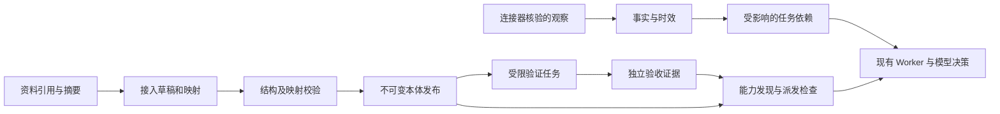

# Ontology Pipeline：服务接入、验证与事实更新

Pipeline 把服务资料、概念及字段映射、验证记录、发布版本和来源观察接入现有本体注册库。实现位于 `packages/ontology/pipeline/`，使用原业务 SQLite；本体发布仍是唯一版本权威，任务仍由现有 Ontology + LLM + Worker 执行。



## 接入合同

`PipelineIntake` 的格式为 `eigos.ontology.pipeline.v1`，单项最多 40 KB。它引用已注册的动作和连接器，不携带代码、凭据或业务授权。

| 字段 | 含义 |
| --- | --- |
| `serviceId` | 稳定的接入身份；已治理的服务和动作不能通过改名、删除或回退绕开规则 |
| `source` | 材料身份、版本、摘要、观察时间及不含凭据的 HTTPS／URN 引用 |
| `programRef`、`configurationDigest` | 准确的运行程序和配置；资料描述不会安装新处理器 |
| `vocabulary` | 统一概念、别名和对象类型；别名参与动作搜索 |
| `actions` | 动作定义摘要、所需证据等级、业务写入所需的独立回读动作 |
| `mappings` | 来源字段到本体属性的有界路径映射、状态对应表、原生身份字段和失鲜上限 |
| `conditions` | 声明的地区、付款路径及操作代理条件；未知条件不推定满足 |
| `fixtures` | 明确标识的合成输入和预期结果；不能作为真实执行证据 |

不同来源可以复用同一概念和动作。字段映射只支持属性路径和值表，不执行表达式或外部代码。未识别状态可以显式映射为 `unknown`；缺少必要字段、重叠目标或不合法的状态被拒绝。具备新协议、认证或交互的来源仍须开发受信任连接器。

持续维护的供应商绑定文件仍放在 `packages/ontology/definitions/`；不同格式的接入材料不要混入该目录根层现有 MCP 模块扫描。真实资料及配置保存在私有存储，合成案例见 `tests/fixtures/ontology-pipeline.ts`。

## 管理流程

继续使用 `POST /ontology/v1/commands` 与 MCP `manage_ontology_definitions`；查询使用 `/ontology/v1/query` 与 `query_ontology_definitions`。它们共享 `DefinitionService` 的身份、命名空间、修订和响应大小检查。

1. 用已有 `create_draft` 创建草稿。Foundation 复用已审查的业务定义；通用模式可另用 `put_definition` 添加概念、关系或兼容字段。
2. `put_pipeline_intake` 绑定 `draftId + expectedRevision`，保存接入记录并推进草稿修订。
3. `validate_pipeline_intake` 运行确定性结构和映射校验，记录 `mapping_test / synthetic` 证据。它不调用模型或服务商，不声称连接器已执行。
4. 调用 `publish_draft → activate_release`；发布内部会重新运行完整草稿校验，通用模式还可预先调用 `validate_draft` 查看校验详情。发布包含精确 intake 摘要；修改资料、映射或相关定义后须重新验证，激活时再次检查。旧发布和旧任务引用保持不变。
5. 有匹配的实际执行记录时，以 `verify_pipeline_task` 提供当前草稿、服务和 **taskId**。服务端加载原任务、准确动作及已接受的执行意图，不接受客户端上传的“成功证据”。只有独立验收通过的同 owner、程序、配置和环境记录才可采用。
6. 没有执行证据或需要更新时，使用 `prepare_pipeline_validation`。完成验证任务后仍需单独登记其证据；不会自动升级目录中的能力。

| 命令 | 所需权限 |
| --- | --- |
| `put_pipeline_intake`、`validate_pipeline_intake` | `ontology:write` 和命名空间管理权 |
| 发布、激活、`verify_pipeline_task`、`report_pipeline_source_change`、`revoke_pipeline_verification` | `ontology:publish` 和命名空间管理权；引用任务还需其读取权限 |
| `prepare_pipeline_validation` | `ontology:publish`、`ontology:read`、`tasks:write` 和命名空间管理权 |

共享 `eigos.business` 的管理继续需要 `ontology:admin`。普通 PA 的默认 task scopes 不包含发布权限。Foundation 模式通过现有安装授权、来源授权和 TaskDataGrant 准备验证任务：先在同一事务中建立有期限的任务授权，再以该任务权限检查准确的程序和动作合同；任何检查失败都会一起回滚任务、授权和幂等记录。授权有效期不超过父级授权、请求的验证截止时间和原任务授权上限。相同请求的重试不会续期或复活已撤销的授权。

Foundation 的 HTTP/MCP 入口只开放 Pipeline 查询、草稿创建／丢弃、接入映射验证、发布／激活及验证任务和证据管理。完整接入合同与命名空间状态只向该命名空间的管理者开放；任务用途、事实、变化和动作发现还需当前任务读取权限。通用定义编辑、声明式动作准备／批准以及旧管理页面保持关闭。

只改变发布标签或 Pipeline 元数据的版本，必须与已审查的业务模型具有完全相同的命名空间、定义摘要和动作实现，才能复用当前权限策略。发布或激活实际字段、关系或动作变化仍会被拒绝，需要单独完成权限模型审查。历史发布、模型指纹及字段权限不会为此重写。

受限验证任务必须指定当前发布、一个接入服务、具体目标、请求幂等键和不超过十分钟的截止时间。它只开放该服务准确程序、配置和动作，以及必要的本地编排。正常的来源连接、目标核对、租约、取消、业务效果授权、原操作恢复和独立验收仍然生效。提出验证任务不能批准报名、订单或付款。

Foundation 的任务接口继续返回裁剪后的 TaskView。证据登记必须先确认调用者仍可读取已验收的结果，再在同一事务内加载服务端的原任务和意图账本；客户端不能补交这些内部字段。HTTP/MCP 的验证准备与 A2A 的任务读取使用同一任务 ID 和当前授权。

验证记录追加保存，绑定 intake、映射和引用类型／动作的合同摘要。有效期不超过实际验证时刻后的 24 小时，过期重新校验或重新取证；不能通过重复引用旧任务把实际验证时间改为现在。已经用于一种来源／映射的任务不能再为不同映射背书。配置或来源版本改变后，旧验证不自动覆盖新版本。

映射验证和任务执行证据分别进行有界读取，新增任务记录不会挤掉仍有效的映射校验。接收来源观察、准备验证任务时只检查选定的服务；发布和激活仍检查完整本体文档，拒绝互相冲突的绑定。

证据按动作记录。例如报名提交可以是 `live_operation`，最终独立查询是 `live_readonly`；最终任务的一个等级不能替代两项动作各自的证据。缺少可信动作等级时保留未验证。本地程序可使用 `local_test`，不能据此开放真实外部操作。

已验收动作的来源等级兼容现有 `evidenceLevel`、滴滴的 `evidenceKind` 和美团的 `receipt.evidenceKind`；冲突等级会被拒绝，缺失的真实等级不能从整项任务补齐。观察时间使用来源回执中的最早已记录时间，不因证据登记而刷新。

## Agent 使用与审计

四类信息分别保留：提供者声明、EIGOS 验证、当前授权／可用性、本次操作及独立验收。验证结果始终包含 `availabilityProof=false` 和 `authorizationProof=false`。

已登记的动作返回 `definition_only`、`verification_required`、`verified`、`expired`、`revoked`、`source_changed` 等检查结果。受限验证任务另标为 `validation_only`。尚未进入 Pipeline 的已有绑定标为 `unmanaged`，继续使用原受信程序的检查，不将它们自动标成已验证。

动作发现会包含有界的验证状态。`serviceConditions` 可以指定地区、允许的付款方式及操作代理是否可用；缺失或不匹配的声明返回 `conditions_unmet`。这些条件不替代任务本身的硬约束和实时查询。

Worker 在派发事务内及连接器写入前再次核对 Pipeline 状态。每次使用记录准确发布、接入摘要、映射和验证 ID。证据过期或撤销不会使原本未知的外部操作被重新提交；恢复仍按原操作身份查证。

新增查询：

- `get_pipeline_intake`：草稿或准确发布中的接入合同。
- `get_pipeline_task_uses`：按当前任务和来源授权返回已使用的发布与验证引用；仅有任务状态读取权限的安装看不到其他安装的来源使用记录。
- `get_pipeline_task_changes`：任务依赖受到的变化，按当前对象／字段读取权限投影。
- `get_pipeline_fact`：任务上下文中的来源、映射、观察时间、有效期、证据等级和健康状态；不返回私有原始载荷或其完整属性摘要。

Foundation 的事实、变化和发现响应继续执行接收方与输出通道检查，任务元数据查询不是绕过字段或输出授权的第二入口。

## 事实更新

连接器核验来源响应后调用内部 `JobStore.ingestPipelineObservation`，提供准确发布、服务、映射、原生账号和对象身份、事件 ID、来源版本、时间、证据及读取开始时的修订。HTTP/MCP 没有接受任意事实或完成证据的写入口。

身份按 owner、来源、账号、对象类型和原生 ID 隔离。时间、价格或材料版本变化不会制造新实体；跨来源同名对象不会自动合并。映射不能写授权、身份断言、执行账本、来源回执或受管数据类型。当前只有 active intake 能更新规范事实；历史任务不能用旧映射覆盖新来源状态。

事实写入、观察历史、依赖失效和任务唤醒在同一业务事务内完成：

- 同键同内容重复观察返回原处理结果，不刷新事实或制造新完成样本。
- 原生旧版本不覆盖新版本；当前同版本内容冲突保留历史并标记 `conflicted`。
- 没有原生版本时，只有独立回读且读取修订仍匹配才能采纳；本地接收时间不会被当作供应商版本。
- 新鲜度取来源有效期与映射失鲜上限的较早值。执行和验收前复查，过期不能继续充当当前事实。
- 无语义变化的刷新保留对象和语义版本，只更新观察记录及有效期；不会因读取投影省略了私有字段而重写对象或唤醒依赖任务。
- 显式依赖可细化到顶层属性；Worker 自动登记已读取的映射对象时保守覆盖其全部属性。场馆变化可只影响日历和交通输入，不使报名状态发生变化。
- `read_task_context` 向模型返回当前任务的 `sourceChanges`，变化发生在模型读完之后时会使旧决策回执失效。已完成任务不会因此重开。
- 可读的可选字段被删除时，变化通知仍保留该字段名；受限或未授权字段继续过滤。派发校验使用对象修订，并在内部单独核对完整来源事实的完整性，不把完整私有属性摘要与模型的字段投影摘要混用。

本模块提供事实接入和依赖变化接口。持续轮询、Webhook 认证、长期观察合同、完整 Guardian 修复以及真实日历连接仍遵守[态势感知合同](../architecture/situation-awareness.md)，不由本模块自动启用。独立观察分支的调度和日历实现未混入此 PR。

## 验证边界

`tests/ontology-pipeline*.test.ts` 覆盖版本／重启、映射复用、候补及未知状态、证据隔离、有效期、撤销、来源漂移、派发拦截、验证任务权限、事实去重／乱序／冲突、字段依赖及两种管理入口。Foundation 联测使用合成统一 authority、现有权限账本和 Worker，覆盖父级／任务截止时间、跨安装隔离、独立连接回读、证据启用与失效，以及 HTTP/MCP/A2A 的同任务行为。

报名测试使用现有 Worker、任务授权和独立回读，来源及模型均为合成夹具。它验证工程流程，不证明真实报名、日历写入、叫车或付款。相同合成任务的模型调用次数保持不变；真实模型的 token、延迟和完成率需在相同模型、目标与来源条件下另行测量。


## 来源关系映射

字段映射可声明 `links: [{linkType, targetMapping, nativeId, many?, optional?}]`。例如房型映射通过原始 `hotelId` 字段连接同一接入中的酒店映射：

```json
{
  "linkType": "RoomTypeHotel",
  "targetMapping": "hotel",
  "nativeId": ["hotelId"]
}
```

目标身份由当前 owner、来源、来源账号、目标类型和原生 ID 共同生成；原始数据不能直接提供任意对象引用。先导入目标实体，再导入引用它的对象。目标必须有同一发布映射下的当前有效观察；缺失、过期、冲突或来自另一个账号时，整个来源更新回滚。此有界入口不自动递归创建目标，也不支持通过一次单对象映射初始化循环必需关系。

`many: true` 要求来源字段是至多 50 个唯一字符串原生 ID 的数组，并符合 Link 的基数；每个对象总计最多 200 个映射关系。未声明 many 时只接受一个原生 ID。`optional: true` 允许字段缺失，并清除该映射声明的关系；必需关系仍由本体校验拒绝清空。更新只替换本映射声明的关系类型，不删除其他业务关系。

关系定义进入验证合同摘要。字段与关系在同一事务提交；仅关系变化也推进来源语义版本，通知依赖该对象的当前任务，并使旧规划关系快照失效。字段值未变时不额外改变实体属性 revision。所有来源更新仍经过原有授权与时效检查。
