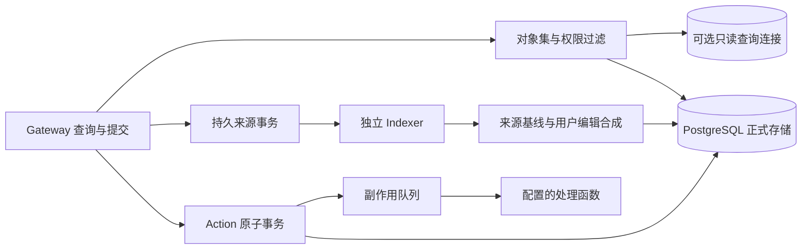

# Ontology 运行服务

Gateway 通过 HTTP `POST /ontology/services/<operation>` 和 MCP `ontology_<operation>` 提供相同服务。请求体是对应操作的参数。MCP 工具目录公开完整参数 Schema。对象集计算也作为 Agent 工具提供，任务可以直接返回集合或聚合结果。

| 职责 | 操作 |
| --- | --- |
| 对象集 | `evaluate_set`、`aggregate_set`、`save_set`、`get_set`、`list_sets`、`delete_set` |
| 来源索引 | `submit_index`、`index_status`、`retry_index`、`cancel_index` |
| 编辑与物化 | `edit_history`、`edit_policy`、`materialize`、`read_materialization`、`materialized_links` |
| 发布治理 | `project`、`assign_project`、`create_branch`、`get_branch`、`list_branches`、`update_branch`、`prepare_branch`、`review_branch`、`merge_branch`、`rebase_branch`、`catch_up_branch` |
| 逻辑与副作用 | `function_versions`、`effect_status`、`retry_effect` |

读取需要 `ontology:read`，修改需要 `ontology:write`，各模块继续检查资源级授权。管理接口还要求相应项目或本体的定义权限，使用能够写治理表的管理服务数据库账号。普通 Gateway/Worker 账号按所需表授权，权限配置表由管理角色维护。

## 对象与属性安全

`npm run access:configure -- /absolute/path/permissions.json` 支持 `subjects`、`properties`、`policies` 和 `memberships`。`policies` 每项包含对象 `type` 和 `policy`。`policy.read` 控制整行，`policy.properties` 控制单元格，`policy.markingsProperty` 指定保存标记数组的属性。

策略表达式包含 `all` 与 `any` 条件数组。`equals` 比较属性与固定标量，`subject` 比较属性与已验证身份，`member` 检查属性中的字符串或字符串数组是否包含调用者所属组织或组。`memberships` 每项以 `subject` 指定身份，`groups` 与 `markings` 配置成员关系和可访问标记。`group:<组名>` 可以作为资源授权的 subject，将同一资源授权赋予组成员。

对象仍有 owner 数据分区。组成员关系用于该分区中对象的行与属性策略。保存集合的 `readers` 分享查询定义，计算结果沿用读取者的数据权限与 owner 范围。

SQL 过滤、Interface 属性映射、关系导航、聚合、历史读取和物化读取应用同一策略。编辑现有对象需要读取实例，修改隐藏字段与删除包含隐藏字段的对象会失败。Action 读取带安全标记的数据后，写出的对象必须保留这些标记。任务缓存与副作用投递会重新检查读取依赖，包含控制可见性的对象数据。

## 数据与进程

构建后使用 `npm run start:indexer` 启动独立索引与副作用进程。多个实例通过 PostgreSQL 行锁和租约分配工作。Gateway、任务 Worker 和 Indexer 可分别增加实例数。索引数据和源 offset 原子提交，Action 编辑、历史及副作用入队也共用事务。

Gateway 可配置 `QUERY_DATABASE_URL` 使用独立只读连接池，包括已有的物理复制只读节点。每次读取核对数据库身份及主库 WAL 位置，副本延迟、身份不符或不可用时回读主库。Action 内部读取保持原事务连接，确保提交前校验与编辑一致。数据库复制、容量和网络由部署环境配置。

`EIGOS_EXTENSION_MODULE` 是受信任部署模块的绝对路径，可导出 `functions` 版本注册数组和 `effects` 处理函数 Map。发布工具、Gateway、Worker、Indexer 使用相同配置。Function 的不可变实现标识和版本共同决定绑定摘要。副作用由已注册名称调用，处理函数接收稳定幂等键和取消信号。远端系统应据此去重，投递采用至少一次语义。

## 升级

管理角色执行 `npm run db:upgrade`，为既有 schema 增加治理、集合、来源基线、编辑历史、索引和物化表。已有对象首次编辑保留原值作为来源基线。更新运行账号的授权后准备新发布，再激活已验证的候选。

| 账号职责 | 数据库授权 |
| --- | --- |
| Gateway/Worker 读取 | 既有定义和对象表，以及 `object_policies`、`security_memberships`、`ontology_resource_projects`、`edit_policies` 的 SELECT |
| 对象编辑 | `source_values`、`object_edits` 的 SELECT/INSERT/UPDATE/DELETE，`edit_history` 的 SELECT/INSERT 和序列 USAGE，业务对象与关系的相应编辑权限 |
| 对象集 | `object_sets` 的 SELECT/INSERT/UPDATE/DELETE |
| 索引生产与消费 | `index_streams`、`index_transactions` 的 SELECT/INSERT/UPDATE，加对象编辑权限 |
| 物化 | `materializations`、`materialized_objects`、`materialized_links` 的 SELECT/INSERT |
| 副作用 | `action_effects` 的 SELECT/INSERT/UPDATE |
| 发布管理 | 治理与发布表的编辑权限，以及候选对象、关系和来源/编辑状态复制权限 |
| 查询连接 | 对象、关系、`storage_identity` 的 SELECT，连接强制只读 |

默认对象集完整计算和单次物化上限均为 10000 个对象，物化最多 100000 条关系，单次来源事务最多 1000 个写入和 1000 个删除。超限明确失败。来源生产者负责提供连续 offset 和批次删除列表。支持的策略表达式、索引批次与只读查询节点配置均由本页和各模块指南定义。

详见 [对象集](object-sets.md)、[索引与编辑物化](indexing.md)、[发布治理与 Function 版本](governance.md)。
