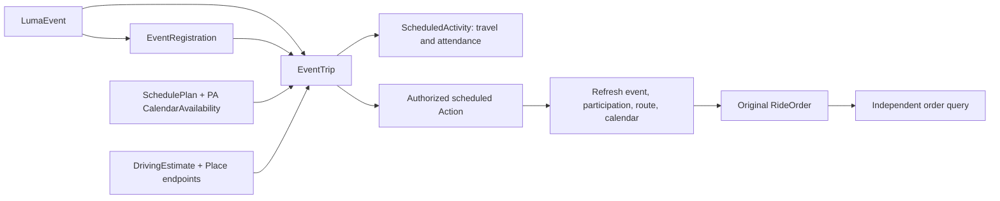

# 服务接口与定时出行

本体负责服务身份、对象关系、业务条件和授权范围；Worker 负责持久化到时执行。活动报名、行程合并、叫车授权、订单创建和独立回查分别保留状态，不以“任务完成”代替供应商履约。

餐厅搜索、门店详情和点评预订入口见[大众点评连接](dianping.md)。

淘宝、天猫与京东商品搜索和买家交接见[淘宝和京东购物](marketplace-shopping.md)。

## 自驾用餐计划

用同一个 PA Task 提交目的地、想吃的菜和已知的出发点。Agent 可调用 `searchRestaurantNotes` 发现小红书候选，使用 `readWeather` 查高德短期预报，用 `readWeatherHistory` 向原 PA 请求历史天气。历史回传区分站点观测与再分析，并报告日期覆盖是否完整。通过高德查询去程和返程，用既有 `PrepareSchedulePlan` 请求原 PA 的授权日历忙闲并校验整个行程。

小红书笔记用于发现候选。针对选中的餐厅、菜品和用餐时段，`readDiningAvailability` 向原 PA 请求带来源与有效期的店方供应信息。只有原任务的当前回执可以用于 `StageDiningActivity`。用 Scenario 提案保存去程、用餐和返程。PA 审阅后提交原有 `CommitSchedulePlan`，提交事务复核餐厅回执与日历条件，再通过 `readSchedulePlan` 读回内部安排。过期回执会阻止保存。该链路的外部调用均是查询。

### Worker 来源连接

配置 `EIGOS_XIAOHONGSHU_CONNECTION_FILE` 时，Gateway 和 Worker 使用运行身份拥有的私有 JSON 文件。给目标 owner 授予 `Xiaohongshu`、`PAWeatherHistory` 和 `PADiningAvailability` 所需的来源和 Function 权限。连接绑定同一 owner、启用状态和过期时间。非 loopback 连接必须使用 HTTPS 和私有 `tokenFile`。小红书 MCP 连接仅调用 `search_feeds`，输出公开笔记标题及规范链接。同一 Task 续接 PA 回传时复用查询结果，并重新检查连接权限。

```json
{"owner":"VERIFIED_OWNER","active":true,"expiresAt":"FUTURE_ISO_TIMESTAMP","endpoint":"http://127.0.0.1:18060/mcp"}
```

未配置 Worker 直连接口时，通过原 Task 的 `xiaohongshu.notes.search` 请求已授权 PA 执行同样的只读搜索。连接器在 Grok 或 Cursor 中显示为本机专用时，需要 Worker 可达的受控端点或由具备该能力的 PA 回传。该路径复用既有的 PA 请求和 Scenario 审阅。[外部查询 Function](https://www.palantir.com/docs/foundry/data-connection/external-functions) · [Ontology Scenario](https://www.palantir.com/docs/foundry/ontology/overview-ontology-scenario)

## 已实现的接口

Interface 按业务语义命名，供应商名称放在具体 Object Type、来源和实现 Action 上。新增供应商实现同一业务契约，并提供自己的连接器、Link 映射与执行条件；不能只因协议同为 MCP 就假定语义、授权或副作用相同。

酒店通过 `HotelSearch` / `HotelOffer` 选择 RollingGo 或飞猪。机票通过 `FlightSearch` / `FlightOffer` 查询飞猪航班。两个业务域均可独立查询，结果按供应商保留。

| Interface / Object | Action 或 Function | 来源与范围 |
| --- | --- | --- |
| `EventSearch` / `LumaEventSearch` | `search` → `SearchLumaEvents` | 默认向原 PA 请求其已连接的 Luma MCP；也支持显式配置的 Luma API |
| `HotelSearch` / `RollingGoHotelSearch` | `search` → `SearchRollingGoHotels` | RollingGo 酒店搜索，参考价，供应商有效期未知 |
| `HotelSearch` / `FliggyHotelSearch` | `readFliggyHotels` 或 `search` → `SearchFliggyHotels` | 飞猪指定地点及日期的酒店候选，展示价和跳转链接 |
| `FlightSearch` / `FliggyFlightSearch` | `readFliggyFlights` 或 `search` → `SearchFliggyFlights` | 飞猪单程、往返及直达航班候选，保留航段、当地时间和展示价 |
| `TravelOfferInquiry` / `TravelOfferSearch` | `search` → `SearchTravelOffers`，`readTravelOfferSearch` | 并行查询两家酒店与飞猪机票，保留每路状态及已成功的搜索页 |
| `ProductSearch` / `ShopifyProductSearch` | `search` → `SearchShopifyProducts` | Shopify Global Catalog 的精确商家与变体身份 |
| `ServiceOffering` | `readServiceOffering`、`evaluateServiceOffering` | 共享来源、有效期和可用性检查；未知值保持未知 |
| `ServiceSearchResult` | `readServiceSearch`、`readServiceSearchPages` | 读取单个或多个查询页，保留每个来源的身份、时效与完整性 |
| `HotelOffer`、`FlightOffer`、`ProductOffer` | `select` → `AttachPlanService` | 按 Interface 的 Link 映射挂到 `SchedulePlan` |
| `AttendableEvent` / `LumaEvent` | `register` → `PrepareEventRegistration` | 准备指定票种的参与者报名，返回 `proposed` |
| `EventRegistration` | `AuthorizeEventRegistration`、`ExecuteEventRegistration` | PA 明确授权后，经原 PA 的 Luma 账号执行零费用报名及独立回查 |
| `EventRegistration` | `RefreshEventRegistration` | 只读回查原报名，允许候补或待审批状态更新；不创建新的报名尝试 |
| `DrivingEstimate` / `DidiDrivingEstimate` | `observe` → `ObserveDidiDrivingTime`、`readDrivingEstimate` | 滴滴 `maps_direction_driving` 返回的时长和距离 |
| `EventTrip` | `PlanEventTrip`、`AuthorizeEventTrip`、`ExecuteEventTrip` | 将活动、日历、路线、报名和定时叫车关联 |
| `RideOrder` / `DidiRideOrder` | `readEventTrip`、`RefreshDidiRideOrder` | 保留原订单 ID；创建回执与独立状态回查分开 |
| `EventTrip` | `CancelEventTrip` | 停止后续定时执行；已经发出的供应商订单仍须单独处理 |

`readServiceSearch` 返回 `complete`、`cursor` 和证据类型。RollingGo 的 top-N 搜索、Shopify 的有界结果都不能证明“其他结果不存在”。酒店住宿不会自动占用用户整段日历；商品没有交付时间时不能被算作按时到货。选入行程只保存内部计划。预订与付款使用单独授权的飞猪交易 Action。

活动、酒店方案和商品变体按供应商、账号绑定、原生身份及必要的报价条件确定对象身份；刷新不会为同一活动另造一个身份。旧版本或同一时间的冲突事实被拒绝。原结果页的成员关系保留；若对象已有更新来源，读取旧页会明确提示已被替代，不会返回空数组或把新价格当成原页价格。

来源字段还会与运行层保留的 `source_values` 基线核对。人工备注等非来源字段可以保留；人工改动的活动时间、地点或价格不会因一次刷新就被认证成供应商事实。

### 飞猪机票与酒店

单独查询可经 `evaluate_ontology` 调用 `readFliggyFlights` 或 `readFliggyHotels`。机票传 `origin`、`destination`、`departureDate`，按需加 `returnDate`、`directOnly`。酒店沿用 `place`、`checkIn`、`nights`、`adults` 和 CNY。两者默认返回最多 5 项，可用 `limit` 请求最多 10 项。搜索页是有界样本。

查机酒或比较酒店时，用 `TravelOfferInquiry.search`（实现类型 `TravelOfferSearch`）提交 `hotel`、`flight` 或两者。传入 `hotel` 会并行调用 RollingGo 与飞猪酒店搜索，传入 `flight` 会在同一批启动飞猪机票搜索。用 `complete_with_action` 可直接返回 `readTravelOfferSearch` 的结果。要排程时先完成查询，再用结果页中的候选引用创建 Scenario 或关联计划。已持有单独 Action 返回的页引用时，仍可用 `readServiceSearchPages` 读取。

每个来源独立校验原用户的 Action、Function、来源权限和连接。结果区分已查询（可能为空）、需授权、供应商不可用以及飞猪酒店不支持的币种。一路供应商查询失败时仍保存其他已成功的结果。保留来源身份、访问模式、时效和展示价。飞猪酒店保留 `occupancyVerified=false`，`amount` 为未知，`priceDisplay` 保留起价或脱敏价。航班保留当地时间和展示票价，实际库存、税费、乘客总价和退改条件由飞猪确认。

连接方式参考 [FlyAI 官方 CLI](https://flyai.open.fliggy.com/docs/quickstart)。来源及只读 Function 的建模参考 [Palantir External Functions](https://www.palantir.com/docs/foundry/data-connection/external-functions)。保留结果的 Action 只编辑 EIGOS 的结果页和候选对象，按 [Ontology MCP](https://www.palantir.com/docs/foundry/ontology-mcp) 公开。飞猪跳转链接供用户自行核价、选择和确认。

已有滴滴原订单后的状态轮询、按需司机位置和接驾提醒见 [滴滴原订单追踪](didi-ride-followup.md)。

#### 选中飞猪报价后打开供应商详情

PA 从一次飞猪酒店或航班搜索结果中取得用户选定的 `offer` 和对应的 `search` 对象引用。通过 `complete_with_action` 调用 `TravelOfferSelection.prepare`，实现类型为 `FliggyTravelOfferHandoff`，把返回引用绑定给 `readFliggyTravelHandoff.handoff`。

返回值保留来源提供的 HTTPS 详情链接、日期／航段、原始展示价、`accessMode`、证据类型及有效期。试用连接可用，酒店的掩码价和起价按原文返回。没有受支持链接、来源账号变化、搜索页被替代、报价过期或本地价格／链接被编辑时，需要重新选择有效报价。交接状态 `ready_for_review` 表示买家可以打开供应商页面核对；后续预订另行授权。EIGOS 只写入选中记录及其关联，沿用 [Function 支持的 Action](https://www.palantir.com/docs/foundry/action-types/function-actions-overview) 与 [对象支持的关联](https://www.palantir.com/docs/foundry/object-link-types/create-link-type)。

## 飞猪合作方机酒交易

机酒搜索继续使用 FlyAI 和 RollingGo 并行查询。进入交易时使用飞猪 TOP 的可交易库存标识。FlyAI 展示价、酒店卡片 ID、航班号和跳转链接无法代替分销商品、政策 ID 或京杭报价 `itemId`。

| 业务 | Ontology 操作 | 供应商能力 |
| --- | --- | --- |
| 酒店 | `readFliggyHotelRates` → `PrepareFliggyHotelBooking` → `CreateFliggyHotelBooking` → `ConfirmFliggyHotelPayment` | 酒店通用分销验价、建单、已收买家款后的支付确认 |
| 酒店 | `RefreshFliggyHotelBooking`、`CancelFliggyHotelBooking` | 按原分销订单号查单及无罚金取消 |
| 国内机票 | `readFliggyFlightQuotes` → `PrepareFliggyFlightBooking` → `CreateFliggyFlightBooking` → `PayFliggyFlightBooking` | 京杭询价、生单、支付，当前支持一位成人的国内单程直飞标准产品 |
| 国内机票 | `RefreshFliggyFlightBooking`、`CloseFliggyFlightBooking` | 原订单详情、独立核对付款和票号证据、未支付关单 |

用 `readFliggyHotelBooking` 或 `readFliggyFlightBooking` 呈现已记录的预览与原订单状态。确认由已认证且有对应 Action 权限的 PA 直接调用，提交预览的 `approvalDigest` 和 `amountMinor`。建单前重新验证原标的、日期、金额及条款。供应商响应丢失后通过 `Refresh…` 按原外部订单号回查。已确认的供应商操作沿用原回执。此处支持国内机票未支付关单和通用分销无罚金退订。已出票退改签、国际机票、国际酒店分销、酒店促销及罚金退订需要单独适配各自合同。

配置部署用户拥有的绝对路径 `0600` JSON 文件。两份文件都需要 `owner`、`account`、`appKey`、`appSecret`、`enabled` 和 `expiresAt`。Gateway 与 Worker 用同一连接，为目标 owner 独立授予 `FliggyHotelDistribution` 或 `FliggyFlightJinghang` 的源权限和对应的对象、Function、Action 权限。

- `EIGOS_FLIGGY_HOTEL_CONNECTION_FILE` 另需 `distributor` 和 `hotelProfilesFile`。入住人文件为数组，每条包含 `id`、`expiresAt`、`contact: {name,phone,email?}` 和按房分组的成人姓名数组 `rooms`。用标准酒店 ID 查询合作方房型报价，再提交 `standardHotelId`、`itemId`、`ratePlanId`，配合实际入住离店日期、到店离店时间和人数创建预览。酒店支付确认需要由已核对买家入账的分销商写入 `hotelPaymentsFile`，记录 `orderId`、`outOrderId`、`receiptId`、`amountMinor`、`currency`、`receivedAt`。
- `EIGOS_FLIGGY_FLIGHT_CONNECTION_FILE` 另需 `session`、`channelName` 和 `flightProfilesFile`。乘机人文件为数组，每条包含 `id`、`expiresAt`、`contact` 和一位成人 `passenger`，两者包含 `name`、`mobile_phone_number`、`mobile_country_code`。乘机人还包含 `birthday`、`credential_type: 0` 和 `credential_no`。京杭交易方还需满足飞猪的聚石塔调用条件。

联系人、证件、建单密钥和票号留在供应商请求边界。Action 只写入业务标的、订单标识和经过核对的状态。测试走签名与 PostgreSQL Action 记录，供应商传输由隔离夹具提供，证据为 `synthetic`。正式供应商履约须独立验证。

建模依据见 [Palantir Actions](https://www.palantir.com/docs/foundry/action-types/overview)、[External Functions](https://www.palantir.com/docs/foundry/data-connection/external-functions)、[飞猪酒店验价](https://open.alitrip.com/docs/api.htm?apiId=65064)、[酒店建单](https://open.alitrip.com/docs/api.htm?apiId=65071)、[酒店支付确认](https://open.alitrip.com/docs/doc.htm?articleId=121390&docType=1&treeId=817)和[国内机票京杭](https://open.alitrip.com/docs/api_list.htm?cid=20764)。

## 一条活动出行计划



Agent 先取得来源对象与驾驶时长，再在 Scenario 中调用 `PlanEventTrip`。它按以下关系计算时间，并创建出行和参加活动两个占用区间：

```text
arriveAt = event.start - entryMinutes
departAt = arriveAt - drivingDuration
callAt   = departAt - waitMinutes
```

候选冲突保留在 Scenario 中供比较。PA 使用 `CommitSchedulePlan` 合并确切修订，再用 `AuthorizeEventTrip` 授权已确认报名的行程。授权包含车型、币种与估价上限、最早/最晚叫车时间、准确地点确认和对最终车费可能变化的明确接受。当前滴滴实现支持 CNY，不能把其他币种直接混算。供应商没有提供硬性最终车费上限，因此本系统不会把估价预算说成最终费用保证。

Worker 默认在原叫车时间前十分钟开始核查，最多每分钟重新检查一次，并在计算出的叫车时间执行。活动时间或路况改变时，在授权窗口内重算时间，同时复核整个计划的 PA 日历与内部资源占用。地点、账号、来源授权改变，报名未确认、活动取消/状态未知、超预算或无法按计划到达时停止执行。`readEventTrip` 返回具体执行状态与原因。

已发单或已取消的行程作为历史记录保留，其活动仍参与资源冲突校验，但旧的来源有效期不再阻塞同一计划的后续排程。候补或待审批报名可通过 `RefreshEventRegistration` 在新的只读 PA 任务中刷新原记录，无须重新报名或再次授权报名。

已在外部日历中的同一活动可以由 PA 从忙碌区间中排除，但必须返回带 `calendarEventId` 和 `identityVerified: true` 的 `exclusions`，且只能排除请求中指明的 Luma 活动。内部参加活动的 `ScheduledActivity` 仍保留其时间占用。无明确排除授权的普通日历请求拒绝排除项。

## Grok PA 续接

Luma 账号和日历凭据留在 Grok。EIGOS 通过原任务的 `pa-request` 请求以下能力：

| capability | PA 工作 |
| --- | --- |
| `luma.events.read` | 使用已连接的 Luma MCP 查询；返回原生活动 ID、准确/模糊地点、时间、活动状态和分页信息 |
| `luma.participant.register` | 仅在本次确切票种、零费用和截止时间的授权内报名；独立读取原报名结果 |
| `luma.participant.status` | 读取原报名、原参与者的最新状态；不得重新报名 |
| `calendar.freebusy` | 返回完整范围、时间区、来源版本、有效期、空闲及忙碌区间 |

Grok 使用返回的 `responseSchema` 构造回传，并调用：

```text
list_pa_requests({limit: 20, cursor?: ...})
respond_to_task({taskId, requestId, response})
```

HTTP 对应 `GET /pa/requests` 和 `POST /tasks/:id/pa-response`；已有 A2A 原任务续接继续有效。源查询和 PA 等待都恢复原任务。未来定时执行有独立的执行任务，同时记录 `sourceTaskId`、`scheduleId` 与原业务对象。PA 直接准备报名或行程时可传 `sourceTaskId`，它必须属于同一 owner；模型执行不能冒用另一个原任务。

Grok 必须持续处理这个待办入口，或由其现有常驻 PA 服务轮询。仅在聊天中连接 Luma MCP，不会自动使一个离线的聊天会话在未来醒来。无人回传时，EIGOS 保留等待状态，到授权截止时间终止；不会臆造日历或报名结果。直接批准合并与执行的 PA 入口需要 `ontology:write` scope 和对应 Action 授权；任务与待办入口使用 `tasks:read` / `tasks:write`。

PA 返回的 Luma 结果标记为 `pa_reported`，包括稳定账号引用与证据摘要。它不等于 EIGOS 直接取得的供应商回执。报名只支持本次授权的零费用参与者操作；如果 Grok 中的 MCP 不支持该操作，应回传 `unsupported`。主办方的添加宾客或审批宾客接口不能冒充参与者报名，也不能将待审批、候补或未知结果报告为已确认。

## 供应商连接

`EIGOS_SERVICE_CONNECTION_FILE` 指向运行用户拥有的 `0600` JSON 数组，按 owner 和供应商绑定。每个绑定必须唯一，且有显式截止时间。

```json
[
  {
    "owner": "VERIFIED_OWNER",
    "provider": "RollingGo",
    "bindingId": "account-specific-id",
    "active": true,
    "expiresAt": "FUTURE_ISO_TIMESTAMP",
    "credentialFile": "/absolute/private/rollinggo-key",
    "credentialSha256": "SHA256_OF_TRIMMED_FILE_CONTENT"
  }
]
```

RollingGo 凭据是原 API Key 文件。Shopify 凭据文件是 `{ "clientId": "...", "clientSecret": "..." }`，只在 Shopify 的固定端点交换短期 token；既支持字符串也支持数组形式的 scope 元数据。可选 Luma API 凭据是 API Key，只做事件/日历读取；它没有本版所需的完整参与者操作。未配置 Luma API 时自动走 PA。显式禁用、过期或有冲突的 API 配置会报错，不绕过撤权切换账号。

飞猪用同一连接数组新增一条 `provider: "Fliggy"` 绑定。运营方可显式选择 `mode: "trial"` 体验查询，保留 `owner`、`bindingId`、`active`、`expiresAt`，省略凭据字段。正式 `mode: "key"` 使用 FlyAI API Key，并设置 `credentialFile`、`credentialSha256`。连接文件由 Gateway 和 Worker 共同读取。为符合资格的 owner 授予对应的 Function、Action 和 `Eigos/source/Fliggy` 访问权限。并行查询另需授予 `SearchTravelOffers`、`searchTravelOffers`、`readTravelOfferSearch` 和结果对象权限。结果页记录访问模式，连接配置改变后旧结果需要刷新。交易 API 使用独立的 TOP 合作方连接，见「飞猪合作方机酒交易」。

滴滴原连接文件新增可选 `ordersEnabled`，默认 `false`。启用连接器不等于用户授权；具体行程仍必须通过 `AuthorizeEventTrip`。查询连接器与订单连接器分开，订单 trace ID 由服务端在发单前新估价取得，不接受模型或 PA 提供的 trace ID。账号/凭据授权摘要改变后旧行程不能继续发单。

## 持久化、权限和恢复

`scheduled_actions` 保存时间、截止期、Action 契约、原任务关系和执行任务；未来尚未启动的计划不锁住旧发布。到时按当前发布检查同一 Action 契约和权限后创建执行任务。PA 续接和周期性检查沿用这个任务，Worker 重启后从 PostgreSQL 恢复。已开始的任务沿用已有发布规则。

`external_operations` 在真正发单前保存原操作标记。供应商成功但后续业务提交失败时保留回执，可回查原订单；网络结果不明或进程在发单后退出时标记未知，禁止自动重新创建。没有假设滴滴支持调用者提供的幂等键，也不宣称分布式 exactly-once。`CancelEventTrip` 停止后续执行，返回记录仍能显示已发出或未知的外部操作。

主线的 `action_effects` 继续负责已声明副作用的投递。`external_operations` 是供应商原操作的去重与回执记录，不是第二个执行队列；恢复回执会重新验证原数据权限，状态读取不直接暴露私有回执。定时业务仍进入同一套 Tasks/Worker。

升级仍在原 PostgreSQL schema 执行 `db:upgrade`。常驻角色新增以下表权限，定义/授权表继续只读：

| 表 | 权限 |
| --- | --- |
| `scheduled_actions`、`external_operations` | SELECT、INSERT、UPDATE |
| `tasks`、`source_calls`、`pa_requests` | 沿用 SELECT、INSERT、UPDATE |

对象和关系编辑依旧经过 Action。PA 待办和任务结果在读取时重新检查数据权限，不能通过待办绕过来源或对象撤权。真实业务开通、发布和验收分别进行；工程测试不会开启生产下单或付款。

## 当前验证与限度

回归覆盖源对象入库、Interface 映射、原 PA 续接、Scenario 合并、最新报名状态、日历冲突、账号变更、授权撤回、超预算、截止时间、重启恢复、重复竞争和丢失订单响应。测试参与者与订单均为 synthetic。

2026-11-13 的只读现场检查确认：滴滴 MCP 暴露驾驶路线、创建订单、原订单查询等工具，驾驶路线读取成功；Shopify 当前 Global Catalog 暴露三个读取工具；RollingGo 当前 API Key 暴露四个酒店读取工具。Shopify 和 RollingGo 均通过本版 Action → 来源投影 → Interface 结果读取，在隔离 PostgreSQL 中取得 `live_readonly` 结果，没有真实报名、下单或付款。

真实 Grok Luma 账户的参与者操作，以及真实叫车后的接驾、到达和最终履约仍须独立验收。查询响应、工具目录、合成订单或绿色 CI 都不代替这项验收。

## 订单后台观察

启用 v37 对应的业务定义后，取消飞猪酒店订单或支付京杭机票时，系统同时登记一次对原单的有界观察。调用方需拥有相应刷新 Action、业务对象与原连接的访问权限。供应商写请求的回复即使丢失，后台仍能沿原订单号核查。新的观察通过已持久化的 ScheduledActions 运行。首次回查在一分钟后，正常等待时每五分钟检查，读取失败会退避，观察期限为四小时。

| 业务对象 | Machinery 跟踪的属性 | 结果依据 |
| --- | --- | --- |
| FliggyHotelBooking | state | 原订房详情确认取消、关闭或退款处理状态。取消成功和退款到账需要分别举证。 |
| FliggyFlightBooking | issuanceState | 区分未付、付款待核实、已付待出票、已出票、已关闭。付款与出票使用各自证据。 |
| DidiRideOrder | 沿 watches 读取 DidiRideWatch.state | 由现有跟单记录提供接驾和行程阶段、来源观察时间及观察终止原因。 |

在工作台的 Machinery 里打开流程实例，查看正式状态转换及其来源。具备任务读取权限的用户还可查看自己针对该对象的单对象后台 Action、状态、下一次检查和截止时间。授权撤回、超过期限或供应商详情无法确认时，保留最后可验证的业务状态。历史定义沿用原有人工刷新方式；发布新定义并给实际执行身份授予新增 ProcessLog 的读取权限后才能从 Machinery 查看。合成订单覆盖此路径；生产供应商接入和履约验收另行进行。

### Shopify 匿名商品搜索

Shopify [Global Catalog](https://shopify.dev/docs/agents/catalog/global-catalog) 支持携带 UCP Agent profile 的匿名跨店搜索。已有 `SearchShopifyProducts` Action 使用绑定用户自己的来源授权，将供应商返回的商品、变体、卖家、价格与可售状态写入对象。来源标识包含配置摘要，过期、撤销或 profile 变更会使原绑定失效。配送时效仍为未知。

部署 Gateway 后，可公开读取 `/.well-known/shopify-catalog-agent.json`。公开模式从 Gateway 的 HTTPS `PUBLIC_URL` 生成自身的 profile URL。在现有 `EIGOS_SERVICE_CONNECTION_FILE` 中为已授权用户添加条目：

```json
{"owner":"<已验证的用户身份>","provider":"Shopify","mode":"public_catalog","bindingId":"shopify-global","active":true,"expiresAt":"<授权到期的 ISO 时间>"}
```

此模式使用 Shopify 的固定 Global Catalog 地址，无需商家店铺、API 密钥或用户登录。仅本机 loopback 开发模式使用 Shopify 官方示例 profile；生产绑定始终使用本方 Gateway 发布的 profile。现有客户端凭据绑定继续使用原有 token 交换路径。

## 酒店订单取消后的接送复核

正式行程确定依赖后，由原身份调用 `BindTripHotelBooking`，传入 `trip`、`plan`、`booking` 和接送的当前 `revision`。绑定针对原订单和具体接送，原计划同时归集接送和复核结果。同程的其他接送仍按各自条件执行。已有行程只有在能核验原始关系时才补绑定；当前入口接受尚未授权的行程。绑定已取消的原订单后，回放它的正式取消转换可生成复核结果。

由具有原单、关系和回读 Action 权限的身份使用现有 `save_rule` 登记一次规则。之后供应商回读提交的取消转换由 Indexer 消费。

```json
{
  "name": "Review trips after confirmed hotel cancellation",
  "enabled": true,
  "process": { "type": "FliggyHotelBookingStateLog", "to": "cancelled" },
  "effect": {
    "action": "ReviewTripHotelDependency",
    "input": {},
    "related": {
      "path": ["dependentTrips"],
      "sourceParameter": "booking",
      "transitionParameter": "transition",
      "targetParameter": "trip"
    }
  }
}
```

接送和行程都可沿 `hotelDependencyReviews` 读回处置。复核保留正式转换引用、原酒店订单、能定位的原车单以及需要重新授权的状态。已有车单只回查原单，仍待确认的原操作进入 `awaiting_original_order`。未发单时撤销旧的计划执行许可，并停止仍待执行的原排程。绑定核验后的新酒店订单后，`ReplanTripHotelDependency` 使用新查或仍有效的路线，重新校验并更新原接送的时段和活动。原 PA 使用 `AuthorizeEventTrip`，传入调整后接送的当前修订和许可。批准校验该修订对应的待审复核，并在同一事务中更新复核及建立新的内部排程。

授权和 `ExecuteHotelDependentTrip` 提交供应商发单意图前都会重读已绑定酒店订单，所以前序取消已经提交、Indexer 暂未处理时，旧接送也会停止在供应商写入之前。若原供应商操作意图先提交，则保留其回执并回查原操作。初次启用前或消费后才补的关系，需要从对应转换前显式重放。过程规则、读取权限、来源连接和真实履约各自校验。

### 行程连续跟进

用 `StartItineraryContinuity` 为同一 `SchedulePlan` 下的航班、接送和酒店活动登记一次跟进，传入三个 `ScheduledActivity` 引用、已确认的接送地点、出站缓冲、最晚到店时间、检查间隔及截止时间。接送活动的原始时长作为初始车程。可选择关联已获权的 `FlightWatch`、酒店原单或滴滴原车单。已有供应商状态、PA 观察和排程候选保留各自的证据。没有原车单引用时，评估表示当前图谱没有登记原单，供应商侧仍可由原 PA 核对。

- `ReportItineraryObservations` 接受原 PA 的航班预计到达、酒店最晚到店时间及精确地点。一次提交可以更新两侧。隔离 Sandbox 接受 `synthetic` 报告。同一证据重放不重复登记，迟到或冲突的旧观察会被拒绝。
- Action 日志中的已提交字段变化进入现有 Indexer 效果队列。按关联查找跟进对象，再读取计划、最新证据和完整的日历约束。供应商回查可复用现有航班和订单的监测。航班监测状态即使没变，关联的预计到达时间变化也会触发复核。
- Worker 在同一个持久排程上主动检查，并在接送时点或最晚到店时间接近时提前复核。读不到来源或日历时保留待核实原因。接送地点变化时，`SetItineraryTransferRoute` 只接受端点完全吻合且仍有效的路线估计。
- 原计划沿 `itineraryContinuity` 查询候选时段、冲突、原单和下一次检查。已有车单时保留原单与待退改状态。取得原车单取消回执后，复核可以给出新候选，原单仍可追溯。`AcknowledgeItineraryHandoff` 在人工处理时保存与当前评估摘要绑定的交接说明。后续变化会产生新的评估摘要。`StopItineraryContinuity` 停止后续检查并保留历史。

该版本覆盖到达航班、接送和到店的一条行程。复核写入本体内的候选和处置状态。供应商订单的修改与取消继续由原供应商 Action 和单独的用户授权完成。[关系承载约束](https://www.palantir.com/docs/foundry/object-link-types/create-link-type#object-backed-links) · [对象变化触发](https://www.palantir.com/docs/foundry/automate/condition-objects#objects-modified-in-set) · [到期检查](https://www.palantir.com/docs/foundry/automate/condition-time)
