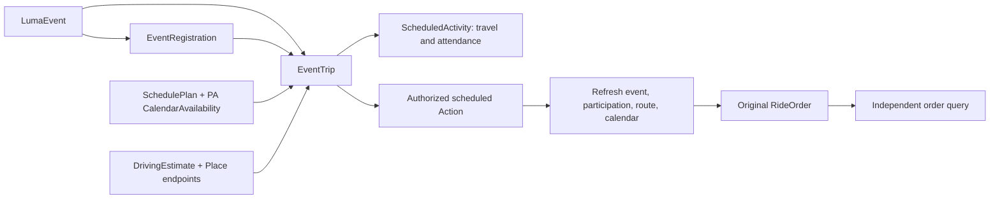

# 服务接口与定时出行

本体负责服务身份、对象关系、业务条件和授权范围；Worker 负责持久化到时执行。活动报名、行程合并、叫车授权、订单创建和独立回查分别保留状态，不以“任务完成”代替供应商履约。

## 已实现的接口

Interface 按业务语义命名，供应商名称放在具体 Object Type、来源和实现 Action 上。新增供应商实现同一业务契约，并提供自己的连接器、Link 映射与执行条件；不能只因协议同为 MCP 就假定语义、授权或副作用相同。

酒店与机票是不同业务域。后续飞猪、携程等可分别实现 `HotelSearch` / `HotelOffer` 与机票契约；`FlightSearch` / `FlightOffer` 尚未发布，也没有可用机票实现。既有滴滴 `Location`、`RideEstimatable`、`RideInquiry` 及已发布对象名称保留兼容性，新的具体实现使用供应商前缀。

| Interface / Object | Action 或 Function | 来源与范围 |
| --- | --- | --- |
| `EventSearch` / `LumaEventSearch` | `search` → `SearchLumaEvents` | 默认向原 PA 请求其已连接的 Luma MCP；也支持显式配置的 Luma API |
| `HotelSearch` / `RollingGoHotelSearch` | `search` → `SearchRollingGoHotels` | RollingGo 酒店搜索，参考价，供应商有效期未知 |
| `ProductSearch` / `ShopifyProductSearch` | `search` → `SearchShopifyProducts` | Shopify Global Catalog 的精确商家与变体身份 |
| `ServiceOffering` | `readServiceOffering`、`evaluateServiceOffering` | 共享来源、有效期和可用性检查；未知值保持未知 |
| `HotelOffer` / `RollingGoHotelOffer`、`ProductOffer` / `ShopifyProductOffer` | `select` → `AttachPlanService` | 按 Interface 的 Link 映射挂到 `SchedulePlan`，不依赖某家具体类型名称 |
| `AttendableEvent` / `LumaEvent` | `register` → `PrepareEventRegistration` | 准备指定票种的参与者报名，返回 `proposed` |
| `EventRegistration` | `AuthorizeEventRegistration`、`ExecuteEventRegistration` | PA 明确授权后，经原 PA 的 Luma 账号执行零费用报名及独立回查 |
| `DrivingEstimate` / `DidiDrivingEstimate` | `observe` → `ObserveDidiDrivingTime`、`readDrivingEstimate` | 滴滴 `maps_direction_driving` 返回的时长和距离 |
| `EventTrip` | `PlanEventTrip`、`AuthorizeEventTrip`、`ExecuteEventTrip` | 将活动、日历、路线、报名和定时叫车关联 |
| `RideOrder` / `DidiRideOrder` | `readEventTrip`、`RefreshDidiRideOrder` | 保留原订单 ID；创建回执与独立状态回查分开 |
| `EventTrip` | `CancelEventTrip` | 停止后续定时执行；已经发出的供应商订单仍须单独处理 |

`readServiceSearch` 返回 `complete`、`cursor` 和证据类型。RollingGo 的 top-N 搜索、Shopify 的有界结果都不能证明“其他结果不存在”。酒店住宿不会自动占用用户整段日历；商品没有交付时间时不能被算作按时到货。酒店预订、商家结账和付款尚未接入这条执行链。

活动、酒店方案和商品变体按供应商、账号绑定、原生身份及必要的报价条件确定对象身份；刷新不会为同一活动另造一个身份。旧版本或同一时间的冲突事实被拒绝。原结果页的成员关系保留；若对象已有更新来源，读取旧页会明确提示已被替代，不会返回空数组或把新价格当成原页价格。

## 一条活动出行计划



Agent 先取得来源对象与驾驶时长，再在 Scenario 中调用 `PlanEventTrip`。它按以下关系计算时间，并创建出行和参加活动两个占用区间：

```text
arriveAt = event.start - entryMinutes
departAt = arriveAt - drivingDuration
callAt   = departAt - waitMinutes
```

候选冲突保留在 Scenario 中供比较。PA 使用 `CommitSchedulePlan` 合并确切修订，再用 `AuthorizeEventTrip` 授权已确认报名的行程。授权包含车型、币种与估价上限、最早/最晚叫车时间、准确地点确认和对最终车费可能变化的明确接受。当前滴滴实现支持 CNY，不能把其他币种直接混算。供应商没有提供硬性最终车费上限，因此本系统不会把估价预算说成最终费用保证。

Worker 默认在原叫车时间前十分钟开始核查，最多每分钟重新检查一次，并在计算出的叫车时间执行。活动时间或路况改变时，在授权窗口内重算时间，同时复核整个计划的 PA 日历与内部资源占用。地点、账号、来源授权改变，报名未确认、活动取消/状态未知、超预算或无法按计划到达时停止执行。`readEventTrip` 返回具体执行状态与原因。

已在外部日历中的同一活动可以由 PA 从忙碌区间中排除，但必须返回带 `calendarEventId` 和 `identityVerified: true` 的 `exclusions`，且只能排除请求中指明的 Luma 活动。内部参加活动的 `ScheduledActivity` 仍保留其时间占用。无明确排除授权的普通日历请求拒绝排除项。

## Grok PA 续接

Luma 账号和日历凭据留在 Grok。EIGOS 通过原任务的 `pa-request` 请求以下能力：

| capability | PA 工作 |
| --- | --- |
| `luma.events.read` | 使用已连接的 Luma MCP 查询；返回原生活动 ID、准确/模糊地点、时间、活动状态和分页信息 |
| `luma.participant.register` | 仅在本次确切票种、零费用和截止时间的授权内报名；独立读取原报名结果 |
| `luma.participant.status` | 读取原报名、原参与者的最新状态；不得重新报名 |
| `calendar.freebusy` | 返回完整范围、时间区、来源版本、有效期、空闲及忙碌区间 |

Grok 使用返回的 `responseSchema` 构造回传，并调用：

```text
list_pa_requests({limit: 20, cursor?: ...})
respond_to_task({taskId, requestId, response})
```

HTTP 对应 `GET /pa/requests` 和 `POST /tasks/:id/pa-response`；已有 A2A 原任务续接继续有效。源查询和 PA 等待都恢复原任务。未来定时执行有独立的执行任务，同时记录 `sourceTaskId`、`scheduleId` 与原业务对象。PA 直接准备报名或行程时可传 `sourceTaskId`，它必须属于同一 owner；模型执行不能冒用另一个原任务。

Grok 必须持续处理这个待办入口，或由其现有常驻 PA 服务轮询。仅在聊天中连接 Luma MCP，不会自动使一个离线的聊天会话在未来醒来。无人回传时，EIGOS 保留等待状态，到授权截止时间终止；不会臆造日历或报名结果。直接批准合并与执行的 PA 入口需要 `ontology:write` scope 和对应 Action 授权；任务与待办入口使用 `tasks:read` / `tasks:write`。

PA 返回的 Luma 结果标记为 `pa_reported`，包括稳定账号引用与证据摘要。它不等于 EIGOS 直接取得的供应商回执。报名只支持本次授权的零费用参与者操作；如果 Grok 中的 MCP 不支持该操作，应回传 `unsupported`。主办方的添加宾客或审批宾客接口不能冒充参与者报名，也不能将待审批、候补或未知结果报告为已确认。

## 供应商连接

`EIGOS_SERVICE_CONNECTION_FILE` 指向运行用户拥有的 `0600` JSON 数组，按 owner 和供应商绑定。每个绑定必须唯一，且有显式截止时间。

```json
[
  {
    "owner": "VERIFIED_OWNER",
    "provider": "RollingGo",
    "bindingId": "account-specific-id",
    "active": true,
    "expiresAt": "FUTURE_ISO_TIMESTAMP",
    "credentialFile": "/absolute/private/rollinggo-key",
    "credentialSha256": "SHA256_OF_TRIMMED_FILE_CONTENT"
  }
]
```

RollingGo 凭据是原 API Key 文件。Shopify 凭据文件是 `{ "clientId": "...", "clientSecret": "..." }`，只在 Shopify 的固定端点交换短期 token；既支持字符串也支持数组形式的 scope 元数据。可选 Luma API 凭据是 API Key，只做事件/日历读取；它没有本版所需的完整参与者操作。未配置 Luma API 时自动走 PA。显式禁用、过期或有冲突的 API 配置会报错，不绕过撤权切换账号。

滴滴原连接文件新增可选 `ordersEnabled`，默认 `false`。启用连接器不等于用户授权；具体行程仍必须通过 `AuthorizeEventTrip`。查询连接器与订单连接器分开，订单 trace ID 由服务端在发单前新估价取得，不接受模型或 PA 提供的 trace ID。账号/凭据授权摘要改变后旧行程不能继续发单。

## 持久化、权限和恢复

`scheduled_actions` 保存时间、截止期、Action 契约、原任务关系和执行任务；未来尚未启动的计划不锁住旧发布。到时按当前发布检查同一 Action 契约和权限后创建执行任务。PA 续接和周期性检查沿用这个任务，Worker 重启后从 PostgreSQL 恢复。已开始的任务沿用已有发布规则。

`external_operations` 在真正发单前保存原操作标记。供应商成功但后续业务提交失败时保留回执，可回查原订单；网络结果不明或进程在发单后退出时标记未知，禁止自动重新创建。没有假设滴滴支持调用者提供的幂等键，也不宣称分布式 exactly-once。`CancelEventTrip` 停止后续执行，返回记录仍能显示已发出或未知的外部操作。

升级仍在原 PostgreSQL schema 执行 `db:upgrade`。常驻角色新增以下表权限，定义/授权表继续只读：

| 表 | 权限 |
| --- | --- |
| `scheduled_actions`、`external_operations` | SELECT、INSERT、UPDATE |
| `tasks`、`source_calls`、`pa_requests` | 沿用 SELECT、INSERT、UPDATE |

对象和关系编辑依旧经过 Action。PA 待办和任务结果在读取时重新检查数据权限，不能通过待办绕过来源或对象撤权。真实业务开通、发布和验收分别进行；工程测试不会开启生产下单或付款。

## 当前验证与限度

回归覆盖源对象入库、Interface 映射、原 PA 续接、Scenario 合并、最新报名状态、日历冲突、账号变更、授权撤回、超预算、截止时间、重启恢复、重复竞争和丢失订单响应。测试参与者与订单均为 synthetic。

2026-11-13 的只读现场检查确认：滴滴 MCP 暴露驾驶路线、创建订单、原订单查询等工具，驾驶路线读取成功；Shopify 当前 Global Catalog 暴露三个读取工具；RollingGo 当前 API Key 暴露四个酒店读取工具。Shopify 和 RollingGo 均通过本版 Action → 来源投影 → Interface 结果读取，在隔离 PostgreSQL 中取得 `live_readonly` 结果，没有真实报名、下单或付款。

真实 Grok Luma 账户的参与者操作，以及真实叫车后的接驾、到达和最终履约仍须独立验收。查询响应、工具目录、合成订单或绿色 CI 都不代替这项验收。
