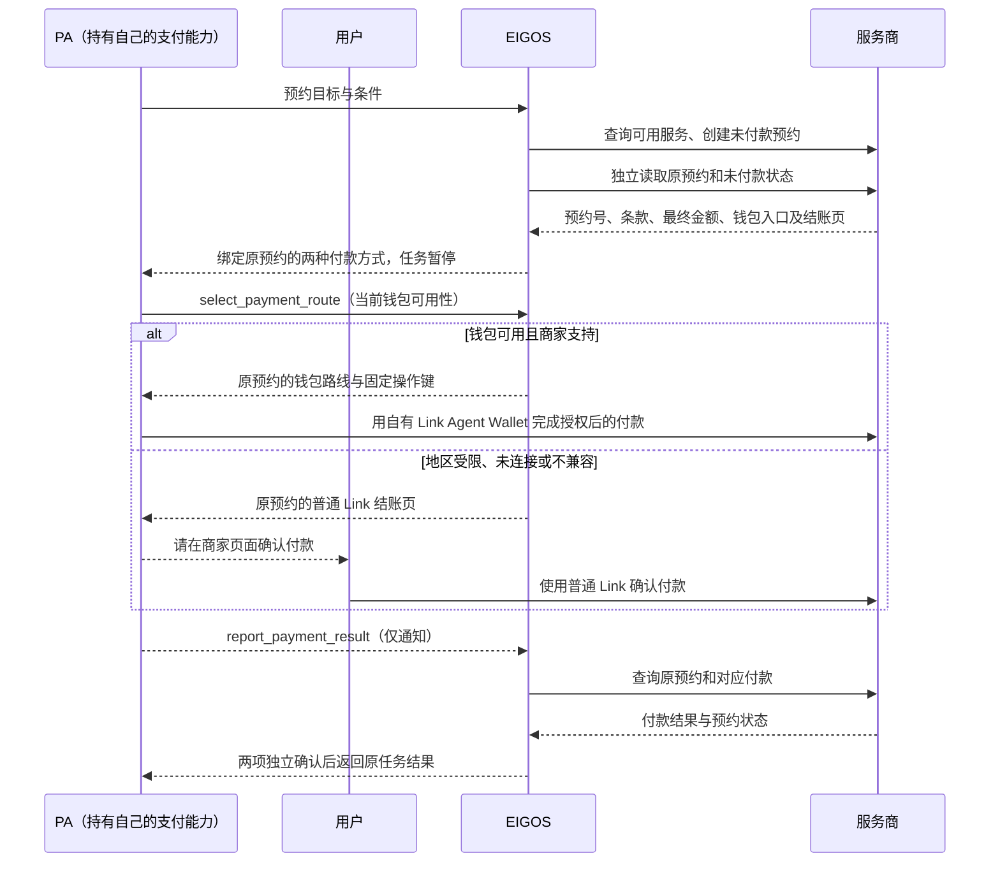

# 预约准备 → 双路线 Link 付款 → 服务商独立回读

当前 `booking.pa-payment.sandbox@3` 已支持明确无需付款且完整价格为零的预约，独立预约确认即可完成；付费预约仍沿用下述双重回读。新的免费参与者模型和 Luma 浏览器接入见[免费报名说明](free-booking.md)。


EIGOS 把服务预约准备到待付款，向 PA 返回同一预约的两种付款方式。优先使用 PA 的 Link Agent Wallet；钱包不可用或服务商不支持时，交给用户在服务商提供的普通 Link 结账页确认付款。两种方式都只向 EIGOS 提交状态通知，随后由 EIGOS 独立查询服务商的付款和预约，二者都匹配才关闭任务。

当前提供隔离测试实现：服务商 HTTP 模拟器、PA 测试钱包、模拟网页结账和模型决策夹具。`booking.pa-payment.sandbox@2` 默认关闭，两个执行端点都限定为已配置的本机来源。普通 Link 测试页明确标注为本地模拟，不收集卡号、不连接 Stripe，也不能证明真实 Link 已付款。

另外进行过官方 Link CLI 与 Stripe 官方测试商家的准入检查：测试商家返回了有效的 402 付款请求，但实际账户连接受地区准入限制，CLI 未取得授权，因此没有创建消费请求或提交支付。该准入检查不构成钱包接入成功，也不改变此前普通 Link 网页付款可用性的判断。常驻部署及已安装的 PA 客户端没有自动更新；真实服务商、实际钱包和真实商家结账页仍需独立接入。



## 执行与权限

| 动作 | 效果 | 核验 |
| --- | --- | --- |
| `SearchBookingOffers` | 只读 | 取得服务、时段、人数、完整费用与条款 |
| `CreatePendingBooking` | 预约，支付花费为 0 | Agent 实际读取和评估来源，取得准确预约许可后创建一次 |
| `ReadProviderBooking` | 只读 | 查询原预约，可用旧观察作为身份引用 |
| `RequestPAPayment` | 本地发布与暂停 | 必须已独立读到有效待付款预约及尚未收款的付款状态；不发起付款 |
| `ReadProviderPayment` | 只读 | 查询服务商记录的原预约付款 |
| `WaitForPAPayment` | 本地暂停 | 保留同一个付款请求，要求查证原付款，不生成新付款指令 |

动作由现有 Agent 循环选择。每轮必须读 Ontology，写动作继续绑定准确来源、计划和授权；没有新增第二个业务调度器。预约写入之后，钱包操作属于 PA；网页付款确认属于用户。程序没有 `payment` 效果的动作，也不持有用户的 Stripe/Link 密钥。

付款交接一旦发布，运行时禁止该任务再次创建或修改服务商业务对象，只允许查询原对象与本地等待。取消、退款和改约的后续业务需要独立明确的接口与授权，不通过重新下单掩盖未知结果。

## 路线选择与防止重复付款

两条路线共同保存在不可变的 `request.terms` 中，`routePolicy` 固定为 `prefer_link_agent_wallet`。钱包入口 `handler` 和网页入口 `checkout` 均来自同一服务商的已核验预约。`checkout` 必须包含原预约号、收款方、服务商返回的结账 URL、支持标记和 `userConfirmationRequired: true`；PA 不猜测或自行拼接付款 URL。

| 当前事实 | 选择 |
| --- | --- |
| PA 钱包明确可用，服务商支持 | `link_agent_wallet` |
| 地区不支持、未连接、没有钱包连接器或明确不可用，服务商提供普通 Link 结账 | `link_checkout`，等待用户确认 |
| 服务商明确不支持钱包，但提供普通 Link 结账 | `link_checkout`，无需为了此单连接钱包 |
| 钱包状态未知，服务商可能支持钱包 | 先查清可用性，不把超时解释成不可用 |
| 两条路线都不可用 | 保留原任务并说明缺口，不生成另一付款地址 |

PA 的可用性观察最多保留五分钟，使用固定的状态及原因，不包含账户、卡号或钱包令牌。它只影响路线选择，不构成付款权限或收款证据。选择前还要核对当前任务、原预约、未付款来源、金额、收款方、条款和期限。

`select_payment_route` 的结果保存到 `metadata.delegation.agent.paPayment.selection`，包含路线、原因、原请求摘要和固定 `operationId`。同一请求 UUID 幂等；路线一经发出，就可能已经被执行，不再自动改路。PA 必须保存并复用原操作键，发送钱包请求前再次读取当前任务。区域拒绝不触发循环登录或重新申请授权。

付款提交、拒绝、超时、处理中或状态未知之后，只回读原操作。当前不提供在途付款切换接口；取消 EIGOS 任务也不会撤销已经打开的商家结账页、钱包凭证或服务商预约。

## PA 请求与通知契约

Agent Card 发布 `/.well-known/eigos-pa-payment`，其中提供 JSON Schema、消息类型与证据边界。待付款任务保持 `TASK_STATE_INPUT_REQUIRED`，同时包含：

- `metadata.delegation.phase = awaiting_pa_payment`
- `metadata.delegation.agent.paPayment.request`：稳定的请求 ID、摘要、所属任务与版本、原预约、条款摘要、最终金额/币种、服务商、两种支付方式、有效期。
- `paPayment.selection`：选定路线、当前可用性观察、选择原因、操作键和摘要。
- `paPayment.status`：`awaiting_pa` / `awaiting_user` / `reported` / `awaiting_provider` / `verified` / `withdrawn`。

PA 在首次发起付款前重新读取任务，检查它仍在等待、路线与原选择一致、期限有效、收款方和金额已获用户授权。钱包路线使用 PA 自己已建立的连接；网页路线向用户呈现服务商原结账页。原支付身份和条款在两条路线中始终相同。

本版本的 `handler.type` 只允许 `sandbox.pa-wallet`，钱包路线使用独立测试钱包模拟 Link Agent Wallet。不得把模拟条款交给真实钱包。测试钱包使用与 EIGOS 来源读取凭据完全不同的凭据，服务商拒绝用 EIGOS 来源令牌调用钱包付款。网页模拟器要求用户明确确认原金额，校验表单来源和一次会话的防伪值；钱包与网页共同核对原预约，不能各收一次款。

先通过 A2A 结构化 `SendMessage` 或 MCP `select_payment_route` 选择路线：

```json
{
  "action": "select_payment_route",
  "handoffId": "<原 request.id>",
  "handoffDigest": "<原 request.digest>",
  "wallet": {
    "status": "unavailable",
    "reason": "region_unsupported",
    "observedAt": "<当前可用性观察时间，ISO 8601>"
  }
}
```

可用时报告 `status: "available", reason: "ready"`；不可用原因还包括 `not_connected`、`connector_missing`、`wallet_unavailable`。未知时使用 `status: "unknown", reason: "unknown"`。Python 客户端的 `payment-route --task-id ... --input-file ... --request-id ...` 接受不含 `action` 的三个字段 `handoffId`、`handoffDigest`、`wallet`。

若付款前的来源观察过期，使用 Python `reconcile --task-id ... --request-id ...` 或 MCP `reconcile_task` 让 Agent 回读原预约与付款，再读取同一任务。此操作复用已有的 `/tasks/{id}/reconcile` 接口，不创建付款、消费请求或替代预约，也不伪造“已尝试付款”通知。

PA 完成一次尝试后，通过同一 A2A 任务发送结构化 `SendMessage`：

```json
{
  "action": "report_payment_result",
  "handoffId": "<原 request.id>",
  "handoffDigest": "<原 request.digest>",
  "outcome": "submitted"
}
```

外层 `message.taskId` 使用原任务 ID，`message.messageId` 使用稳定 UUID。MCP 工具 `report_payment_result` 接受相同字段，并显式提供 `taskId`、`requestId`。现有 Python 客户端新增：

```sh
python3 <saved-script> --config <saved-profile> payment-result \
  --task-id <original-task-id> --input-file <report.json> \
  --request-id <stable-uuid>
```

客户端的报告文件只包含 `handoffId`、`handoffDigest`、`outcome`。`outcome` 可为 `submitted`、`declined`、`unknown`、`canceled`。接口拒绝额外的钱包凭据、卡号、SPT、API key 或付款 URL；自由文本“我付过了”不能替代此通知。

相同 UUID 与内容幂等返回；同一 UUID 内容变化拒绝。新通知到达时若原回读正在执行，返回冲突，调用方查询任务后用原 UUID 重试，避免丢失通知或破坏 Worker 租约。每个任务最多记录 20 条不同通知。过期通知仍可用于查证原付款，绝不续期或创建替代预约。

这是版本 2 的 EIGOS A2A 应用契约，不是新增的通用 A2A 标准支付方法。MCP 与 A2A 读取及修改的是同一份路线选择与任务记录。

## 付款确认与预约确认分别核验

PA 的通知不会变成 `SourceReceipt`。服务商响应使用独立来源凭据验签，并固定任务所有者、请求版本、配置、模型计划、Intent、Attempt 和回读序号。

每次新通知或明确回读请求递增 `readbackSequence`，防止在同一毫秒内复用通知之前的旧观察。完成要求：

1. 原预约 ID、服务商、时段、人数、价格、支付入口与最初预订条款一致。
2. 服务商独立付款记录为 `paid`，收款方、金额、币种、条款摘要均匹配，实际付款未晚于原有效期。
3. 服务商独立预约记录为 `confirmed`。
4. 两份观察来自当前回读轮次，并由 Agent 在完成决策中实际读取和评估。
5. 固定用户条件与共用验收检查全部通过。

“PA 已批准”“付款已提交”“网页显示成功”“跳转带有 paid 参数”“只收到了钱”或“只有预约确认”都不能单独完成任务。最终确认表示预约成立，不表示参加服务、到店或实际服务交付。

## 中断、取消和未知状态

- 未付款预约的创建响应丢失：只按原操作键查询，不能创建第二个预约。
- PA 付款响应或通知丢失：PA 查询原支付；`unknown` 通知或 `reconcile_task` 唤醒 EIGOS 对原服务商对象的读取，不再付款。
- 付款处理中或预约尚未确认：进入 `awaiting_provider`，保留原付款请求和条款。
- 错误金额、币种、收款方、预约号、条款，退款或预约过期：不得关闭为成功。
- Gateway/Worker 重启：从持久任务和原付款请求继续；不重新收集钱包凭据或创建预约。
- 路线选择后重启：保留原路线与操作键，不重新评估后切换路线。网页响应丢失或重复提交只处理原结账会话。
- 任务取消或等待期限结束：付款请求标记 `withdrawn`；已发出的 PA 付款不会因此自动撤销。迟到通知只能触发对原服务商的有界只读查证，不能重新打开任务或生成完成交付物。
- 旧租约返回的结果保留在动作账本中，不能投影新完成状态。本地交接发布与其动作结果原子保存，中断时由 Agent 重新读取后决定。

## 本地测试配置

`npm run setup:booking-sandbox` 只准备私有文件，不启动服务、不修改主 `.env`、不连接钱包。默认输出 `data/booking-sandbox/`；可传一个空目录或本工具已管理的目录作为参数。

`provider.env` 用于 `npm run dev:booking-sandbox`。服务商模拟器持有两种分离的测试凭据。`gateway-fragment.env` 只包含 EIGOS 应使用的配置：

```dotenv
EIGOS_ACTION_SANDBOX=true
EIGOS_BOOKING_SANDBOX_URL=http://127.0.0.1:3433
EIGOS_BOOKING_SANDBOX_TOKEN_FILE=/absolute/private/path/source-token
```

Gateway 与 Worker 使用相同的本机 development 配置。PA 测试钱包读取自己的 `pa-wallet.json`，其令牌不能复制给 EIGOS。模拟器只监听 loopback，没有访问任何外部支付网络的客户端。

旧 `EIGOS_STRIPE_TEST_*` 开启配置现在会被启动检查拒绝；EIGOS 不再从这些变量取得商家付款执行能力。历史 Stripe 接口实现保留为明确注入的商家测试夹具。部署单独验收；旧版本任务保持准确版本和只读边界，不混跑不兼容的 Worker。
