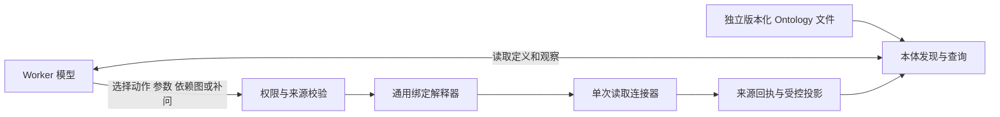

# MCP 接入的独立本体与模型规划

2026-10-23 代码契约：`ontology-execution-v15`、`eigos.business@15`。公共任务入口仍为 MCP／A2A 的 `eigos.delegate`。

## 实际接入范围

| 已实现的供应商通道 | 独立维护来源 | 运行方式与边界 |
| --- | --- | --- |
| 滴滴官方 MCP | [`didi-readonly.json`](../ontology/didi-readonly.json) | 地点搜索、车型估价；只读白名单 |
| 美团个人 stdio MCP／官方 CLI | [`meituan-readonly.json`](../ontology/meituan-readonly.json) | 公开地点、本人地址簿、已选地址详情、费用预览；单次业务调用只执行一个 CLI 读取 |
| Shopify 公共／商家目录 MCP | [`shopify-catalog.json`](../ontology/shopify-catalog.json) | 搜索、详情、商家目录读取；必要的 HTTP 发现也作为独立动作声明 |

UCP 测试结账、Stripe、预约及交易沙箱当前使用 HTTP 或本地模拟器，不能算作新增的供应商 MCP 接入。保留的 Stripe Treasury MCP URL 是预留配置，没有可执行接入。上述改造不启用真实订单、付款、取消、司机查询、购物车或结账工具。MCP／A2A 本身是 PA 的入站协议，不代表供应商都使用 MCP。

## 定义、规划和执行

初始化只创建任务范围，不搜索商品、不读地址、不准备报价。模型通过 `describe_ontology` 取得实际的 `read.mcp` 和 `read.module`：工具名、参数表达式、来源依赖、版本摘要及完成评估函数。模型选择需要的动作、观察、参数、并行或分轮方式，以及何时补问或结束。`requires` 只声明所需证据，解释器不会自动调度里面的动作。

解释器支持输入／任务范围／受信配置／所选来源对象的字段引用，以及有界的 JSON 对象、数组、常量和枚举查表。没有表达式执行、动态代码或任意 URL 调用。Shopify 的端点来自配置商家的来源验证发现；美团的电话和地址 ID 来自私密来源；滴滴坐标来自任务中实际返回的地点。绑定文件不能扩展执行端的工具、主机、身份或写权限。

标准 MCP 握手、元数据校验和鉴权属于协议处理，不是业务流程。一次模型选择的业务读取至多对应一个供应商业务操作；连接器不自动补齐其他读取、不选择第一项、不自行刷新报价或宣布完成。Shopify 已知变体可跳过搜索；美团两端详情可以并行或分轮读取；地点搜索可先查任意一端。

## 私密信息与持久执行

美团本体观察只包含地址数量、选择是否就绪及安全报价事实。地址选项、原生 ID、坐标、联系人和电话保存在 owner／任务私密上下文；模型决定补问后，由主机向原任务所有者呈现来源问题。未真正展示的选项不能仅凭编号被授权。地址变化使旧选项失效，排序变化不改变已展示编号。

同一组地址来源必须使用一致的私密凭据上下文。连接器在供应商调用前检查该上下文，避免混用旧地址簿与另一凭据下的详情；值和指纹不进入模型。刷新来源后，仍按来源身份与实际已展示选项匹配用户选择，不发起新授权流程。

意图和尝试仍在调用前持久化。观察投影及私密缓存写入都使用当前领取令牌、租约、任务状态和 revision 的事务保护。取消、回复改版或租约丢失后，迟到来源不能覆盖任务、改写选择或产生成功观察。失败／未知读取不会被连接器自动重放；新调用必须有新的模型决策。完成需要模型选定、读取和评估来源，程序再独立核对硬性条件与回执。

## 维护与迁移

维护步骤见 [`ontology/README.md`](../ontology/README.md)。只改现有绑定／依赖时，校验和同步数据后重载即可，沿用既有 Worker 构建。版本与内容摘要进入动作、程序配置、模型快照和运行快照；不会在任务中途热替换。

旧美团候选准备、隐式地址补齐和执行时固定复查已从生产目录删除。历史实现仅在 `tests/fixtures/legacy-paotui` 中支持旧回执与工程回归，不被常驻运行包加载。旧验收格式参考放在 `examples/legacy`；当前 `observe-mcp-readonly.ts` 只回读已有任务和来源，不会提交目标或调用供应商。

v14 及更早任务不迁移、不自动领取／续跑；旧结果保留可读。更新既有实例须停止旧 Worker 并备份，避免不同契约同时操作同一任务库。

## 验证含义

专项测试覆盖独立文件修改、嵌套参数与查表、实际模型决策与定义摘要、缺失／过期／跨任务来源、私密数据隔离、凭据上下文变化、未展示选项、取消与迟到写入、MCP 协议和单次 CLI 命令计数。公开地点的完整 Gateway／Worker 运行测试使用合成 CLI 和模型替身；它验证接线与边界，不证明真实供应商、真实 PA 或真实业务完成。

真实只读检查须另外核对模型运行、实际供应商回执和独立验收。过期后按验收时点回放的证据明确标记为历史回放，不能当作当前报价。任何测试通过、HTTP 成功或查询完成都不表示订单、付款或履约已经发生。
