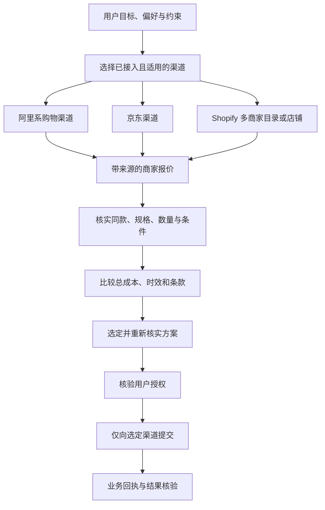

# EIGOS：多渠道发现、同款匹配与方案比较

2026-10-15。业务模型补充，未写接入代码、未调用商品搜索或下单接口。

用户方向：同一购买需求可以询问阿里系、京东、Shopify 等多个渠道，聚合其商家候选与报价后，再选择方案。EIGOS 不预先绑定唯一平台；实际渠道必须先取得可用接入与相应授权。

## 1. 渠道、商家、商品与报价分开

- Channel 是询问服务的入口，可能代表一个平台、聚合 Agent 或单店。
- Merchant 是实际销售或接受预订的主体。
- ProductVariant 是具体商品和规格。不同渠道的原生标识不能直接当成同一标识。
- Offer 是某商家经某渠道提供的售卖条件：同一商品可有多个 Offer。
- Comparison 是 EIGOS 针对用户需求形成的比较结果。
- Proposal 是从候选中选定、经重新核实、准备交给用户确认的方案。

多个渠道可能返回同一个商家和商品。可以归组显示，但要保留各 Offer 的价格、优惠资格、配送、售后和来源差异；不能把两个有不同条款的报价合成一个虚假的“最低价商品”。

## 2. 对共用对象的最小扩展

不需要“淘宝本体”“京东本体”“Shopify 本体”各维护一遍购买逻辑。沿用 ServiceRequest、Provider、ServiceEngagement、CandidateOption、Proposal、Authorization、ExecutionAttempt 和 Evidence；新增可复用的 Offer、Comparison，明确 Provider 的 Channel／Merchant 角色。

| 关系 | 含义 |
| --- | --- |
| 一个 ServiceRequest → 多个 ServiceEngagement | 对不同渠道分别查询，保留各自状态和时限 |
| 一个 Channel → 多个 Merchant | 聚合入口与具体卖家不是同一层 |
| 一个 ProductVariant → 多个 Offer | 同款商品在不同商家／渠道有不同售卖条件 |
| 多个 Offer → 一个 Comparison | 统一比较口径，并说明覆盖范围、缺项及排序依据 |
| 一个 Comparison → 一个选定 Proposal | 常规单商品请求选定一条执行路径；拆单或多商家采购须另有明确需求 |
| Proposal → Authorization → 选定渠道的执行尝试 | 多渠道比价不等于多渠道同时下单 |

## 3. 业务 Action 的扩展

1. **DefineComparisonTarget**：明确目标是精确同款，还是允许替代品；保留型号、规格、数量、成色、目的地和用户硬约束。
2. **SelectChannels**：按品类、地区、账号可用性、查询能力和用户许可选择渠道。不同渠道可以只具备查询、报价、下单或售后中的一部分。
3. **DiscoverCandidates**：对符合条件的渠道发出有界查询，可并行；记录回复、超时、无结果、需授权等不同状态。
4. **MatchProducts**：校验候选与用户目标的对应。优先使用可靠的品牌／型号／商品编码与规格证据；名称或图片相似不足以认定同款。无法证明时标记不确定或替代品。
5. **NormalizeOffers**：统一比较数量、计价单位、币种、费用组成和适用条件；保留原币种及换算来源／时间。未知税费、运费或优惠资格不填成零。
6. **CompareOptions**：先检查必须满足的条件，再按用户明确的价格、时效、品质或售后偏好比较。没有唯一优胜者时展示取舍，不擅自编造评分权重。
7. **SelectAndRevalidate**：选定后向该渠道重新确认具体规格、库存、总价、时效和条款；失效或改变的方案重新核验授权。
8. **CommitSelectedOffer**：只提交已获准的选定方案；沿用执行防重、未知结果查证和不自动付款的边界。
9. **AssessOutcome**：核验订单与选定方案一致，后续按用户交付目标跟踪；不能仅因一个查询接口成功就认定购买成功。

## 4. “同样东西”如何核对

| 比较项 | 必须分清的差异 |
| --- | --- |
| 商品身份 | 品牌、型号、生产版本、销售地区；同系列不一定同型号 |
| 规格与数量 | 容量／尺寸／颜色／口味、单件与套装、赠品、数量 |
| 成色与保障 | 全新／二手／翻新、保修与退换条件 |
| 交付 | 能否送到、配送费用、承诺时间或估计时间 |
| 实际费用 | 商品价、运费、适用税费、必需服务费；条件优惠只有确认符合资格才计入 |
| 报价状态 | 查询时间、适用条件、有效期；展示价、估价与最终确认价分别记录 |

以咖啡为例：热拿铁和冰拿铁不能因名称接近就当成同一规格；“就近骑手代购”与“咖啡店直接配送”也应作为不同服务方案比较。用户允许替代时，可以比较替代方案，但明确展示差异。

## 5. 聚合后的选择与解释

比较不默认等于选最低商品标价。若用户要求“明天前到、全新、总成本最低”，先筛除不满足时限或成色的候选，再比较可核实的总成本。

仅用于解释的虚构例子：A 商品价 120、运费 20；B 商品价 135、运费 0；C 商品价 110、税费和运费未知。在其他条件相同且费用已完整的前提下，B 的已知总成本低于 A；C 暂不能被宣布为最便宜。这些数字不是实际查询结果。

每个 Comparison 应记录：

- 用户比较目标与使用的偏好／硬约束。
- 哪些渠道实际返回了结果，哪些超时、未授权或未覆盖。
- 哪些候选被认定为同款、替代或尚无法确认。
- 选择理由、主要取舍以及会改变结论的未知信息。

只收到两个渠道的结果时，可以给出阶段性选择，但应表述为“当前已查询渠道中的较优方案”；不宣称覆盖全网。第三个渠道超时不等于它没有商品。

## 6. 平台名称与当前证据边界

| 用户提到的方向 | 本轮核实 | 尚未证明 |
| --- | --- | --- |
| 阿里系／淘宝 | 蚂蚁官方定位阿福为健康助手；阿里官方说明千问与淘宝互通，支持购物发现、比较和交易等产品流程。阿宝是另一个支付宝生活服务入口。[S1][S2] | EIGOS 已取得千问／淘宝或阿宝的第三方购物查询／下单接口；不能互换这几个名字作为同一调用端点 |
| 京东 | 京东 AI 购官网描述商品选择、多品对比及下单能力。[S3] | 面向 EIGOS 的具体开放接口、凭据、地区和业务权限；产品可用不等于第三方接口可用 |
| Shopify | 官方提供 Global Catalog MCP 和单店 Storefront Catalog：前者跨符合条件的商家搜索，后者限定店铺；还可查询商品变体详情。[S4] | 当前账户已完成认证、特定商品可送达并可结算，或所有商家／地区均覆盖 |

三路接入可以使用不同技术：A2A Agent、MCP 工具或正式 API。EIGOS 对齐它们的业务含义与证据，不要求所有渠道都使用 A2A。

## 7. 数据使用与下单边界

- 初始搜索仅传必要的品类、规格与粗粒度配送区域；不为比价向全部渠道发送完整用户档案、详细地址或无关偏好。
- 查询和比较阶段不创建多份真实订单；若某渠道只有创建购物车／结算会话后才能给完整报价，要单独记录该动作及其影响，不能伪装成纯查询。
- 用户确认前，选定报价必须重新核实；用户原授权若仍覆盖最新方案可以使用，超出范围则重新确认。
- 候选数据的保留遵守渠道约定。Shopify 当前 Catalog 指南明确不允许缓存搜索结果，图片需要实时呈现；因此不能把“保存完整候选快照”设为所有渠道的统一要求。[S4] 采用允许的引用与必要决策记录，展示或下单前重新查询；授权和订单回执的留存另外按相应契约处理。
- 下单超时先查选定渠道的原尝试，不能立即切到第二渠道重新购买，从而造成两份订单。

## 8. 对现有方案的修正

EIGOS 负责跨渠道目标理解、条件归一化、候选匹配、比较解释、授权边界与执行结果核验。阿宝／其他渠道分别负责自己的商品和服务查询、业务交互与执行。单路阿宝协作是多渠道模型的一个实例，不再成为唯一前提。

这份补充修改的是业务模型，尚未实现并行询价、同款识别或真实交易。下一步真实接入应分别验证各渠道的调用契约和当前权限，再从一个有可比报价的商品场景开始；不会因新增 Object 名称就宣称三路服务已经接通。

## 官方来源

- [S1：蚂蚁阿福的健康助手定位](https://www.antgroup.com/news-media/press-releases/1765785600000)
- [S2：千问与淘宝互通，阿里官方说明](https://home.alibabagroup.com/zh-HK/document-1991231293551017984)
- [S3：京东 AI 购官网](https://aigou.jd.com/)
- [S4：Shopify Catalog：跨商家／单店搜索与使用要求](https://shopify.dev/docs/agents/catalog)

以上平台事实与 EIGOS 的拟议职责分开记录。对象关系和比较流程是项目设计，不是各平台已承诺提供的统一接口。
