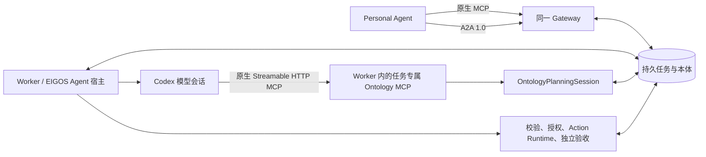

# 原生 Ontology MCP 与统一 PA 实例

运行契约为 `ontology-execution-v18`。Gateway、Worker 和本体存储使用同一发布快照和任务数据库；PA 的 MCP 与 A2A 指向同一 HTTPS origin。这里描述实现和验收方法，实际部署结果以当次运行证据为准。

## Agent 与工具的运行位置

EIGOS Agent 的持久状态和执行循环在 Worker 中。模型会话由本机 Codex CLI 承载，推理请求使用其已配置的模型服务。Gateway 不启动模型。每次需要模型决策时，Worker 在 `127.0.0.1` 的随机端口建立原生 MCP 服务，只把本次会话的连接交给该模型进程。

原生工具包括 `read_task_context`、`read_task_instructions`、`describe_ontology`、`discover_actions`、`query_ontology`、`evaluate_ontology`、`assess_conditions`、`propose_action`，按会话实际权限提供。模型通过 MCP 取得真实结果和回执，然后调用 `submit_decision` 提交决策及引用的回执。最终模型输出必须匹配该工具返回的决策摘要。生产代码不再把模型输出中的工具调用 JSON 当作原生调用。

`submit_decision` 只提交决策，不执行业务效果，也不将 Task 标为完成。后续仍由原有 Action Runtime 检查当前对象版本、精确授权、预算和供应商结果，完成独立验收后回写任务。

美团适配器原有的 stdio MCP 是来源适配层，和这里的通用本体接口职责不同；启用来源仍需要其原有授权。公网邀请测试配置继续只提供文档与任务说明能力。

## 会话隔离与证据

- MCP 服务绑定当前 owner、taskId、请求 revision 和有效领取。模型不能通过参数选择别人的身份或任务。
- 随机会话凭据只进入模型进程的 MCP 运行配置，不进入提示词、工具参数、任务或审计。用户全局 MCP 配置不被加载。
- 会话最多接受 20 次读取尝试、24 次总工具尝试；输入 schema 被拒绝的调用也计入。原有对象数量、返回字节和指令覆盖校验继续生效。
- 取消、失去租约或关闭模型会话后停止访问。迟到的模型结果不能推进任务。
- `Job.runs[].nativeMcpCalls` 保存 Codex 客户端实际工具事件的名称和状态；`ontologyMcp` 保存会话、taskId、工具读取回执和决策提交状态。原始模型推理与凭据不归档。

一个原生模型会话可包含多次 MCP 工具调用，用量按该真实模型运行记录；工具尝试数和本体读取预算单独核对。

## 唯一接入目标

当前主部署使用 `invite-beta` profile。`get_runtime_info` 和 `/health` 返回相同的 instance、backend、releaseDigest 和 ontologyTransport；这些字段描述安装版本，不替代实际任务验收。

OAuth 资源采用规范 URL，例如 `https://eigos.mandonothing.com/`。Auth0 API Identifier、公开资源元数据和新客户端请求必须一致。迁移时可显式配置 `OAUTH_LEGACY_AUDIENCE=https://eigos.mandonothing.com` 接受原来已签发的同源令牌；校验只接受这两个精确值，不做任意地址归一化。tenant 与安装登记 claim 使用原有稳定命名空间。

公开 MCP 集成客户端登记 Codex 的精确 loopback 回调和 Grok Bot 实际使用的 `https://www.cursor.com/agents/mcp/oauth/callback`，使用 PKCE、本人 consent 和轮换刷新令牌，不发共享客户端密钥。

Grok 原生 MCP 的 OAuth 凭据由宿主管理。A2A 使用同一主实例的 AgentConnector 登记和设备授权，凭据留在本机 PA 私有目录。两次授权必须对应相同 `issuer + tenant + sub`；client ID 可以不同。不得复制另一个 PA 的令牌来伪装同一身份。

部署后运行 `npm run setup:primary-pa` 安装指向当前不可变发布快照的 A2A 客户端与技能安装文件。`discover` 会核对运行身份和 Agent Card 的 A2A origin。旧开发实例的数据库保留作历史资料，PA 技能和当前验收不再指向旧 loopback profile。

## 当次验收要求

1. Grok 通过原生 MCP 调用 `get_runtime_info`、`list_services`，保存实际版本和能力。
2. Grok 创建一个新任务，保留原 taskId；真实缺项在该任务中补充。
3. Grok 用 A2A 查询并回复同一任务，确认相同会员身份能够访问它。
4. Worker 的真实模型记录包含原生 Ontology MCP 客户端事件和对应本体读取回执。
5. Grok 分别用 MCP 与 A2A 读取同一 completed 任务，验收通过，交付物内容摘要一致。
6. 用当前发布的服务器审计与持久库独立核对 taskId、模型运行、发布摘要和交付物。历史测试、其他实例的成功或 HTTP 200 都不能替代以上记录。
