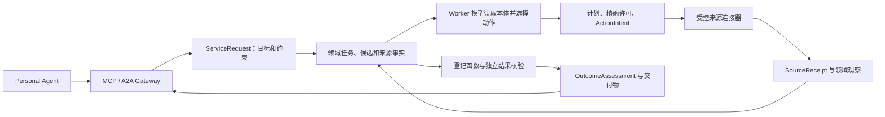

# Ontology 模型与接入能力总览

核对日期：2026-10-24，Asia/Shanghai。本文汇总对象模型、执行契约、来源接入与验证记录。源码与实际运行回读分别保存在[本轮快照](evidence/ontology-capability-inventory-2026-10-24/readback.json)。

**模型已经统一装配到 `businessModel`。当前工作分支有 103 个对象类型；本人常驻实例有 100 个。真实来源覆盖美团只读、滴滴只读、Shopify 目录，以及需要在线浏览器操作代理的 Luma 免费报名。Luma 尚未装入常驻实例。其他生活服务已有模型与沙箱，仍缺真实连接器。**

## 1. 版本与运行状态

| 核对范围 | 实现基线提交 | 执行契约 | 业务模型 | 对象／接口／关系／动作／函数 |
| --- | --- | --- | --- | --- |
| 本文工作分支 `codex/free-booking-luma` | `1ecb12f93aa278189c3f7708daec31f09d5377f6` | `ontology-execution-v16` | `eigos.business@16` | **103 / 3 / 256 / 52 / 34** |
| 本人常驻实例，本次实际回读 | `4b059089584b138f7f20774be258587dc3278e98` | `ontology-execution-v17` | `eigos.business@15` | **100 / 3 / 249 / 47 / 33** |

常驻地址为 `http://127.0.0.1:3430`。本次读取健康信息、Agent Card、认证后的本体定义及不可变运行快照，未提交业务任务。常驻代码来自另一条分支；执行契约编号更高，不表示包含免费报名分支的功能。其对象目录缺少 `RegistrationTask`、`RegistrationOffer`、`RegistrationRecord`，以及相关 5 个动作、7 个关系、1 个函数。后续文档提交不会改变上述实现基线或运行实例。

103 个是具体对象类型，另有 3 个接口；256 个是双向关系定义，每条只计一次。52 个动作定义不等于 52 个当前可执行工具。

## 2. 模型如何连在一起

装配入口是 [business-model.ts](../packages/ontology/business-model.ts)。[model.ts](../packages/ontology/model.ts) 维护对象、属性、接口、关系、动作与函数；[object-store.ts](../packages/ontology/object-store.ts) 提供按所有者隔离的查询与计算。来源投影写入已验证观察，模型通过查询和动作提案参与决策。

| 组成部分 | 已有模型／契约 | 维护位置 |
| --- | --- | --- |
| 委托、能力与供给 | `ServiceRequest`、类型化要求、`ServiceCapability`、`ProviderBinding`、`ResolvedCandidate`、`ResolutionScope`、`Comparison`、`DiscoveryCoverage` | [execution.ts](../packages/ontology/execution.ts)、[supply.ts](../packages/ontology/supply.ts) |
| 规划与读取依据 | `ExecutionPlan`、`PlanStep`、`PlanningSnapshot`、`PlanningReadReceipt`、`ObjectSnapshot`、`ConditionCheck`、`DecisionActionProposal` | [planning-contract.ts](../packages/ontology/planning-contract.ts)、[execution.ts](../packages/ontology/execution.ts) |
| 持久执行与权限 | `ActionIntent`、`ExecutionAttempt`、`BusinessSnapshot`、`PlanGrant`、`OutcomeAssessment`、`AfterSalesCase` | [actions.ts](../packages/ontology/actions.ts) |
| 业务对象图 | 下表全部 103 个对象、3 个接口和 256 个关系 | [business-model.ts](../packages/ontology/business-model.ts) 及其导入模块 |
| 来源绑定 | 工具名、参数来源、证据依赖、版本摘要及完成评估函数 | [独立定义包](../ontology/README.md)、[mcp-read.ts](../packages/ontology/mcp-read.ts) |

执行契约与业务对象图有部分同名概念，承担不同存储和执行职责，不重复计入 103 个对象。CSV 五项检查、金额／数量／时区 schema、运输分类规则属于契约或计算规则，也不另算业务对象。

## 3. 完整对象目录

以下每个具体类型只出现一次。属性、键、隐私字段、关系两端及基数以链接中的严格定义为准。

| 模型组 | 数量 | 全部具体类型 | 定义 |
| --- | ---: | --- | --- |
| 需求与决策 | 4 | `ServiceRequest`、`Proposal`、`Authorization`、`OutcomeAssessment` | [业务基础](../packages/ontology/business-model.ts) |
| 主体与渠道 | 4 | `Provider`、`Channel`、`ChannelParticipation`、`ServiceEngagement` | [业务基础](../packages/ontology/business-model.ts) |
| 地点与配送报价 | 5 | `Place`、`SavedAddress`、`Parcel`、`DeliveryRoute`、`DeliveryQuote` | [业务基础](../packages/ontology/business-model.ts) |
| 商品与实际交付 | 7 | `ProductVariant`、`ProductOffer`、`Order`、`OrderLine`、`Shipment`、`DeliveryEvent`、`DeliveryAllocation` | [业务基础](../packages/ontology/business-model.ts) |
| 餐厅预订基础 | 4 | `Venue`、`ReservationSlot`、`ReservationOffer`、`Reservation` | [业务基础](../packages/ontology/business-model.ts) |
| 资金与售后事实 | 3 | `Payment`、`Refund`、`AfterSalesCase` | [业务基础](../packages/ontology/business-model.ts) |
| 来源证据 | 1 | `SourceReceipt` | [业务基础](../packages/ontology/business-model.ts) |
| 美团原子读取 | 2 | `MeituanReadTask`、`MeituanReadObservation` | [meituan-read.ts](../packages/ontology/meituan-read.ts) |
| 滴滴地点与估价 | 3 | `RideEstimateTask`、`DidiPlaceObservation`、`RideEstimateObservation` | [ride-estimate.ts](../packages/ontology/ride-estimate.ts) |
| 打车完整业务 | 5 | `RideRequest`、`RideOption`、`RideTrip`、`RideRoute`、`TransportVehicle` | [六领域](../packages/ontology/service-domains.ts) |
| 医院挂号 | 8 | `AppointmentRequest`、`AppointmentOption`、`MedicalAppointment`、`Hospital`、`MedicalDepartment`、`Practitioner`、`PatientProfile`、`AppointmentSlot` | [六领域](../packages/ontology/service-domains.ts) |
| 外卖 | 5 | `FoodRequest`、`FoodOption`、`FoodDelivery`、`FoodMerchant`、`MenuItem` | [六领域](../packages/ontology/service-domains.ts) |
| 酒店 | 6 | `HotelRequest`、`HotelOption`、`HotelReservation`、`HotelProperty`、`RoomType`、`RoomInventory` | [六领域](../packages/ontology/service-domains.ts) |
| 行程安排 | 5 | `ItineraryRequest`、`ItineraryOption`、`Itinerary`、`ItineraryItem`、`TravelLeg` | [六领域](../packages/ontology/service-domains.ts) |
| 预约用车／自驾租车 | 6 | `VehicleRequest`、`VehicleOption`、`VehicleBooking`、`VehicleClass`、`RentalPolicy`、`VehicleInspection` | [六领域](../packages/ontology/service-domains.ts) |
| UCP 结账 | 2 | `CheckoutRequest`、`CheckoutSession` | [commerce.ts](../packages/ontology/commerce.ts) |
| 早期商品读取投影 | 1 | `CatalogRead` | [catalog-read.ts](../packages/ontology/catalog-read.ts) |
| Agent 商品查询 | 3 | `CatalogTask`、`CatalogObservation`、`CatalogEndpoint` | [catalog-agent.ts](../packages/ontology/catalog-agent.ts) |
| 交易与履约流程 | 18 | `CommerceTask`、`FulfillmentContext`、`CommerceMerchantSearch`、`CommerceProduct`、`InventoryObservation`、`InventoryReservation`、`FulfillmentPlan`、`CustomsAssessment`、`LandedCostQuote`、`Cart`、`CartLine`、`CommerceCheckout`、`CommerceOrderObservation`、`CommercePaymentObservation`、`CommerceDeliveryObservation`、`DeliveryPromise`、`FulfillmentGroup`、`FactRequirement` | [commerce-journey.ts](../packages/ontology/commerce-journey.ts) |
| 运输与海关依据 | 2 | `RegulatoryReference`、`CustomsRuleSet` | [customs-policy.ts](../packages/ontology/customs-policy.ts) |
| 商家侧 Stripe 测试观察 | 1 | `StripePaymentObservation` | [stripe-payment.ts](../packages/ontology/stripe-payment.ts) |
| 预约与 PA 付款交接 | 5 | `BookingTask`、`BookingOffers`、`BookingObservation`、`BookingPaymentObservation`、`PAPaymentRequest` | [booking.ts](../packages/ontology/booking.ts) |
| 免费活动报名／通用预约 | 3 | `RegistrationTask`、`RegistrationOffer`、`RegistrationRecord` | [free-booking.ts](../packages/ontology/free-booking.ts) |
| **合计** | **103** | | |

3 个共用接口是 `EvidenceBacked`（来源可追溯）、`CommerceFact`（有版本依赖的交易观察）、`Offer`（配送／商品／预订报价共性）。`Offer` 约束价格性质、费用覆盖和新鲜度；其他带金额的候选不会自动成为商业报价。

模型分开表达商家注册地／实际发货地／商品原产地，搜索区域／交付地址，显示价格／预估价／完整报价，房间数／人数，服务费／押金，以及提交／确认／付款／实际交付。滴滴估价观察不会自动生成真实 `RideTrip`；报名确认也不证明已经到场。

## 4. 全部动作与计算

52 个动作中，**28 个声明只读契约，14 个声明有界操作契约，10 个是决策定义**。只有能力程序实际绑定、身份／环境／来源校验通过的动作才可执行。

| 模型组 | 全部动作定义 |
| --- | --- |
| 基础决策，2 个 | `RequestDeliveryQuote`、`SelectOffer` |
| 六领域决策，6 个 | `RequestRide`、`RequestMedicalAppointment`、`RequestFoodOrder`、`RequestHotelReservation`、`BuildItinerary`、`RequestVehicleBooking` |
| UCP 决策，2 个 | `PrepareCheckout`、`CompleteCheckout`；执行器另有准确的 `ucp.checkout.*` 操作绑定 |
| 美团读取，5 个 | `SearchMeituanLocations`、`ReadMeituanAddresses`、`ReadMeituanSenderDetails`、`ReadMeituanRecipientDetails`、`EstimateMeituanDelivery` |
| 滴滴读取，2 个 | `SearchDidiPlaces`、`EstimateDidiRide` |
| 商品目录，4 个 | `SearchPublicCatalog`、`InspectCatalogVariant`、`DiscoverMerchantCatalog`、`ReadMerchantVariants` |
| 交易流程，17 个 | `ReadCommerceContext`、`SearchCommerceMerchants`、`ReadCommerceProduct`、`ReadCommerceInventory`、`ReadCommerceFulfillment`、`ReadCommerceCustoms`、`QuoteCommerceLandedCost`、`CreateCommerceCart`、`ReadCommerceCart`、`UpdateCommerceCart`、`CancelCommerceCart`、`PrepareCommerceCheckout`、`SubmitCommerceOrder`、`SubmitCommerceUnpaidOrder`、`ReadCommerceOrder`、`ReadCommercePayment`、`ReadCommerceDelivery` |
| Stripe 测试，3 个 | `PrepareStripePayment`、`PayStripePayment`、`ReadStripePayment` |
| 预约／PA 付款，6 个 | `SearchBookingOffers`、`CreatePendingBooking`、`ReadProviderBooking`、`ReadProviderPayment`、`RequestPAPayment`、`WaitForPAPayment` |
| 免费报名，5 个 | `InspectRegistrationPage`、`SubmitFreeRegistration`、`SubmitFreeRegistrationSandbox`、`ReadParticipantRegistration`、`WaitForRegistration` |

| 计算组 | 已登记函数，共 34 个 |
| --- | --- |
| 业务基础，9 个 | `offerFreshness`、`remainingQuantity`、`actualArrival`、`reservationStatus`、`deliveryQuoteMatches`、`withinBudget`、`reservationMatches`、`productOfferMatches`、`slotAvailability` |
| 六领域，12 个 | `rideEligibility`／`rideOutcome`、`appointmentEligibility`／`appointmentOutcome`、`foodEligibility`／`foodOutcome`、`hotelEligibility`／`hotelOutcome`、`itineraryEligibility`／`itineraryOutcome`、`vehicleEligibility`／`vehicleOutcome` |
| UCP，2 个 | `checkoutReadiness`、`commerceOrderOutcome` |
| 目录，2 个 | `catalogReadStatus`、`catalogObservationStatus` |
| 交易流程，2 个 | `commerceObservationStatus`、`commerceJourneyStatus` |
| 运输／海关，2 个 | `shippingGateStatus`、`customsGateStatus` |
| 美团／滴滴，2 个 | `meituanReadStatus`、`rideEstimateStatus` |
| 付款／预约／报名，3 个 | `stripePaymentStatus`、`bookingObservationStatus`、`registrationStatus` |

`SourceReceipt` 分开记录 `synthetic`、`provider_test`、`user_asserted`、`live_readonly`、`live_operation`、`live_fulfillment`。验收核对准确对象、revision、属性和关系摘要及来源；测试通过或模型回答不会提升证据等级。海关和运输规则目前用于合成流程，`pass_sandbox` 不构成真实法律或清关批准。

## 5. 现在能接什么

### 入站 Agent、身份与模型

| 接入方 | 已实现接入 | 已有验证与限制 |
| --- | --- | --- |
| Personal Agent | `/mcp` 远程 HTTP；`/a2a` 的 A2A 1.0 JSON-RPC；共同任务入口 `eigos.delegate` | Grok／Monk PA 已完成本机真实往返；其他客户端须满足现有鉴权、Schema 和续接合同 |
| 本体读取客户端 | `describe_ontology`、`query_ontology`、`evaluate_ontology`，以及认证 HTTP 对应接口 | 可发现定义、读取本人对象、导航关系并计算；未开放任意对象写入 |
| Auth0／会员 Agent | OIDC、OAuth/JWT、scope、会员和 Agent 安装登记 | 有[真实 Auth0 与参考客户端验证](evidence/auth0-member-2026-10-16/README.md)；当前本人常驻为 loopback 开发身份 |
| Worker 推理与文档模型 | 已配置的 Codex 运行时 | Gateway 不运行模型；其他模型提供商仍需适配 |

MCP／A2A 是 PA 的入站协议。下游分别使用 MCP、CLI、HTTP 或浏览器桥接。尚无任意 MCP Server 的在线安装、任意 PA 计划导入或客户本机工具回调功能；新增来源仍要登记和绑定。

### 真实来源与本地交付

“常驻已登记”表示本次在服务目录和配置中发现该能力。本次未重新调用供应商；历史成功记录不能证明此刻凭据、网络、库存或报价仍有效。

| 来源／能力 | 本次常驻状态 | 当前实现能完成什么 | 最接近的实际证据 |
| --- | --- | --- | --- |
| 美团：`geo.search@1`、`address.book.read@1`、`delivery.quote@2` | 已登记，仅本人本机；公开地点受配置范围限制 | 地点、本人地址簿及详情、同城跑腿运费预览 | [真实 PA 地址选择和报价](evidence/persistent-pa-2026-10-18/README.md)，无订单／付款／送达 |
| 滴滴：`ride.estimate.query@1` | 已登记；生产只读来源 | `maps_textsearch` 地点查询、`taxi_estimate` 路线车型估价 | [真实模型和滴滴来源](evidence/didi-readonly-2026-10-23/README.md)；独立开发实例验证，非 Grok PA 叫车 |
| Shopify：`commerce.catalog.query@2` | 已登记；当前商家为 **Purity Coffee** | 商品搜索、变体详情、商家目录发现与读取、公开价格比较 | [真实 PA 查询与比较](evidence/agent-catalog-pa-2026-10-19/README.md)；库存数量、配送及购买能力未证明 |
| Luma：`booking.participant.free@1` | **当前分支已实现，常驻未配置** | 本人已登录网页的免费报名、独立确认；需要在线浏览器操作代理及准确零费用预约许可 | [2026-10-23 真实免费报名](evidence/free-booking-luma-2026-10-23/README.md)；不是官方参与者报名 API 或无人值守连接器 |
| 文档：`document.compose@1` | 已登记 | 根据已提供事实生成 Markdown 草稿、议程或方案并核对格式和摘要 | [真实会员与模型生成议程](evidence/auth0-member-2026-10-16/README.md)；不执行文档中描述的业务 |
| 任务说明：`brief.prepare@2` | 已登记 | 生成任务说明，`execution=not_started` | [登记说明](registered-capabilities.md)；只有说明本身是目标时才完成 |
| CSV：`data.quality.audit.simulated@2` | 已实现，常驻未启用输入目录 | 对固定本地快照做完整五项审计：缺失必填值、重复 ID、邮箱、人民币金额和事件日期 | [CSV 文件核验](csv-file-verification-2026-10-15.md)；没有在线数据平台或真实收费接入 |

三个独立 MCP 读取包是 [`didi-readonly.json`](../ontology/didi-readonly.json)、[`meituan-readonly.json`](../ontology/meituan-readonly.json)、[`shopify-catalog.json`](../ontology/shopify-catalog.json)。合计声明 11 个动作绑定：寄件人与收件人详情复用同一上游工具，Shopify 发现是 HTTP 原语。定义包声明现有工具及证据依赖，编辑 JSON 不能获得新权限。

### 沙箱、测试及未接通部分

| 已有模块 | 当前可用范围 | 真实接入缺口 |
| --- | --- | --- |
| `commerce.journey.sandbox@2` | 常驻已配置；显式 sandbox 任务可查询并执行合成购物车、结账、订单和交付流程 | 真实商家、库存、报价、订单、付款与逐包裹交付来源；[真实 PA 沙箱验证](evidence/commerce-agent-pa-2026-10-20/README.md)的业务事实均为 synthetic |
| 六类 `service.<domain>.sandbox@2` | 打车、挂号、外卖、酒店、行程、用车／租车；受信代码显式注入测试提供者，常驻未配置 | 正式来源、权限、业务操作及独立回读；滴滴估价并未补齐打车执行，见[六类服务说明](service-domains-2026-10-18.md) |
| UCP prepare／confirm 两项沙箱能力，均为 `@1` | 已实现官方本地参考商家适配；需显式代码注入，常驻未配置 | 真实商家准入与商品／付款／订单来源；[本地 UCP 验证](ucp-local-integration-2026-10-18.md)不是线上商业订单 |
| `booking.pa-payment.sandbox@3` | 当前分支支持零费用预约，或 PA 的 Link Agent Wallet／用户 Link 结账后双重回读；常驻未配置预约来源 | 真实预约商家及 PA 钱包／结账；[现有验证](pa-booking-payment-flow.md)使用隔离提供方与钱包夹具 |
| `service.fulfillment.sandbox@1` 与沙箱售后 | 合成接单、模拟付款、交付、取消、退款；常驻未配置该提供方 | 真实服务商、交易及售后来源；相应适配器启用时才发布 `eigos.aftersales` |
| 商家侧 Stripe 测试适配 | 仅允许注入测试 transport；运行配置拒绝旧商家付款开关 | 正式账户与服务商路径尚未接入，见[历史测试边界](stripe-test-integration.md) |
| Stripe Treasury | 只有关闭的配置预留，不能启用 | 无账户授权、MCP 客户端、本体动作或执行能力，见[预留说明](stripe-treasury-integration.md) |
| 支付宝 AI 资源／阿宝／Agent Pay | 有研究、平台操作及探针记录；不在当前业务执行目录 | 阿宝正式调用合同、授权及出站连接器；Agent Pay 与真实商家付款路径，见[阿宝记录](abao-outbound-integration.md) |
| 微信小程序 | 研究阶段，无当前运行连接器 | 授权设备／平台接入与业务验证，见[研究记录](research/wechat-miniapp-authorized-automation-2026-10-22.md) |

现实下单、付款、变更、取消及退款没有开放。免费报名分支单独限定 `live_free`、`reserve`、完整金额为 0 和精确计划许可；本次未发起新报名或付款。

## 6. 本地设计稿中的网络协作模型

工作区还有尚未纳入版本控制的 D01–D04 设计稿，位于 `docs/design/`；本次保留原样。它们未进入上述 103 类型或当前运行目录。

| 设计组 | 拟议记录与用途 | 当前落地情况 |
| --- | --- | --- |
| 网络身份与代表关系 | profile、profile binding、representation、`RequestActor` | 设计；已有会员与安装登记可复用 |
| 服务与需求协作 | listing、need、message、evidence card、私有 inquiry 交接 | 设计；未实现 `NetworkService`／`NetworkStore` |
| 圈与关注 | space、membership、follow | 设计；无已运行的跨用户协作图 |
| 发布与共享权限 | draft、publication、audience set、`PublicationGrant`、approval request | 设计；精确受众与单次发布许可待实现 |
| 事件与恢复 | event、command、auth fence、seen refs | 设计；未开放 `network_query`／`network_command` |

这些设计复用委托、能力、报价、来源证据和动作执行核心；跨用户发布需要另外实现共享权限和投影，不能直接公开私人本体对象。

## 7. 扩展接缝与本轮核验

新增供应商沿现有接缝接入：明确业务终点与来源合同 → 必要对象／关系及来源映射 → 能力和提供者／AgentProgram 登记 → 受控原子连接器 → 来源观察及独立验收。登记总入口为 [capabilities/catalog.ts](../packages/capabilities/catalog.ts)，配置入口为 [core/config.ts](../packages/core/config.ts)。

已有领域覆盖了大量生活服务语义；新增真实平台通常首先缺正式连接器、授权和结果证据。增加 Shopify 商家仍需受信配置及来源核验；其他平台不能只填 URL 就自动执行。维护已有 MCP 绑定的方法见[独立本体说明](../ontology/README.md)。

本轮动态统计当前模型，比较常驻不可变运行快照，回读常驻健康、Agent Card 和认证后的本体描述，并对照既有真实／合成验证。本轮未查询私人业务对象、提交新业务任务或重新执行历史业务验证。

交付为文档与脱敏元数据快照。代码验证沿用实现基线的成功 CI，本次文档提交的 CI 与远端同步另行核对。以后更新本文时同时核对源码模型、能力目录和运行实例；带日期的历史设计与验收只说明对应时点的状态。
