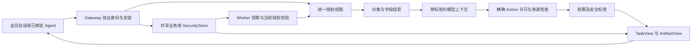

# EIGOS 三层权限实施方案：会员、Agent 与任务范围

日期：2026-10-24，Asia/Shanghai。状态：**S0 已交付，S1–S4 代码已实现；S5 迁移与运行验收待实施**。初始源码基线：`6abdb13`。阶段记录见 [S0](security-s0.md)、[S1](security-s1.md) 与 [S2–S4](security-s2-s4.md)。S2–S4 使用新 foundation v2 库和合成资料验证；常驻未切换。下文保留原设计与验收目标，实际支持范围和未适配路径以 S2–S4 说明为准。依据先行整理的 [Palantir 官方权限语义](research/palantir-permission-semantics-2026-10-24.md)。

## 1. 目标与交付范围

补齐三个相互叠加的层次：资源定义的查看／编辑／管理；对象、关系、属性的访问；派生结果、模型上下文与交付物的保护。身份维度贯穿三层，不再以 `ownerKey + tasks:read` 代表一个 Agent 的全部权限。

完成后应能表达：同一会员授权购物 Agent 读取任务 A 的商品与报价，授权出行 Agent 读取任务 B 的选定地址；二者不能读对方任务。给 Agent A 新增任务 C 要有独立任务授权；撤销安装后，旧 cursor、模型会话和幂等回执不能继续返回私有内容。会员本人仍有受控的自有数据查看与委托管理入口。

本方案保留 Gateway／Worker 分工、会员库与业务库分离、现有登录系统、所有者分区、业务许可及来源接入限制。不新增外部权限服务或依赖，不扩大真实业务操作。首期以同会员、多安装、多任务为完整验收边界；跨会员私人原图共享关闭，未来通过明确发布投影接入网络设计。

2026-10-24 用户已批准分阶段实施，并在 S1 后明确要求继续推进到 S4。实现保留在独立工作分支，默认 legacy 兼容模式；新 foundation v2 库已启用经过三层检查的协议路径。没有迁移常驻数据、部署或调用真实来源。资源定义发布仍走受信代码审查，当前管理接缝只检查候选定义；供应商安全投影和 S5 集成分别验收。

## 2. 当前基础与必须改造的位置

| 当前事实 | 已有位置 | 实施影响 |
| --- | --- | --- |
| Principal 有 issuer、tenant、subject、clientId、scopes；ownerKey 不含 clientId | [domain.ts](../packages/core/domain.ts) | 保留 ownerKey；增加独立的服务端 AccessContext，不把安装混入稳定对象身份。 |
| 会员、连接停用、安装登记／令牌绑定／撤销已存在 | [MemberStore](../packages/members/store.ts)、[AgentRegistrations](../packages/members/agents.ts) | 复用身份记录；安装 ID 来自 token 的已验证登记，不来自请求字段。 |
| Gateway 调用安装 authorize 后未把返回值传给 TaskService；仅指定 Agent OAuth client 走该分支 | [app.ts](../apps/gateway/app.ts) | 保存已验证 actor；其他 client 需显式主体类型与绑定，缺失安装不能自动当作会员本人。 |
| describe 只查 services:read；query／evaluate 只查 tasks:read | [tasks.ts](../packages/core/tasks.ts) | 数据访问补上资源查看权、安装与任务范围。scope 只作为接口上限。 |
| 对象、边、revision 按 owner；restricted 字段不能查询或过滤 | [object-store.ts](../packages/ontology/object-store.ts)、[model.ts](../packages/ontology/model.ts) | 在物理隔离上增加策略执行；禁止业务调用者继续裸传 owner 读取。 |
| 部分 Worker 规划有 request 范围；submit 按有无 tasks:read 保存 owner／request，Agent 决策另有 request bounds | [tasks.ts](../packages/core/tasks.ts)、[coordinator.ts](../packages/coordinator/coordinator.ts)、[planning-session.ts](../packages/coordinator/planning-session.ts) | 迁移这些限制为统一授权，不删除已有 request 保护；函数内部也必须受任务范围约束。 |
| 会话键仅含 owner／request／revision／model | [planning-session.ts](../packages/coordinator/planning-session.ts)、[model-session-pool.ts](../packages/capabilities/model-session-pool.ts) | 加入安装、grant 和权限版本；撤权后销毁上下文并重新读取允许数据。 |
| TaskService 返回内部 Job；A2A 可带 delegation、runs；幂等表缓存完整 Job | [tasks.ts](../packages/core/tasks.ts)、[a2a.ts](../apps/gateway/a2a.ts)、[store.ts](../packages/core/store.ts) | 所有出口统一生成 TaskView；重放先重新授权，不能返回旧授权下的完整缓存。 |
| 会员库 Gateway 专用，Worker 仅访问业务库；已有领取、租约、取消、迟到结果保护 | [架构说明](gateway-worker.md)、[Worker](../apps/worker/worker.ts) | 业务库持久化最小授权状态与拒绝标记，Worker 不读取会员档案或 Bearer。 |
| 工作区 D01–D04 是未跟踪、待实现的网络设计 | 本地 `docs/design/d01-identity-publication-2026-10-18.md`、`d02-network-data-events-2026-10-18.md`、`d04-network-inquiry-api-2026-10-18.md`；不作为本次 Git 交付依赖 | 复用 RequestActor、安装绑定、auth fence、精确发布许可的概念；不能称为现成实现。 |

上轮检查的 10 项对象／网关测试通过；合成实验确认 tasks:read 单独可读本人对象、同会员不同 client 可读同一数据。该证据只刻画当前行为，不证明新的安装／任务权限已存在。

## 3. 身份与授权合同

### 3.1 角色不是同一个 owner

| 概念 | 权威来源 | 能做什么／不能推出什么 |
| --- | --- | --- |
| 数据所有者 ownerKey | 已验证 issuer＋tenant＋subject | 保持私人数据分区；不是 Agent 的权限全集。 |
| 会员 memberId | 会员库映射 | 控制自己的委托；会员 active 不自动授予平台 schema 管理权限。 |
| Agent installationId | AgentRegistrations.authorize 返回的 registration.id | 区分同一 OAuth client 下的不同安装；clientId 不能代替 installationId。 |
| 资源命名空间角色 | 版本化 RoleGrant | 管理 schema 权限；不自动获得其他会员数据或解除标签。 |
| 任务授权 TaskDataGrant | 控制者授权＋服务端范围计算 | 只给特定安装、特定任务／revision 的数据用途；任务 ID 本身不是访问凭据。 |
| Worker 执行身份 | 持久化任务执行授权＋当前领取 | 代表该任务执行；不能使用进程级权限替代会员／安装限制。 |
| PlanGrant | 现有精确计划许可 | 管业务效果、金额、收款方、时效等；不授予额外数据访问。 |

拟新增服务端 `AccessContext`：actorKind（member_session／agent／worker／development）、ownerKey、memberId、clientId、installationId（按类型必需）、tokenScopes、taskId／requestRevision（任务路径必需）、grantRefs、authEpoch、policyVersion、checkedAt。用判别联合保证字段，不以可选字段缺失推断为更高权限身份。

公共请求只能选择 `taskId`、对象和字段，不能自报 owner、installation、role、clearance、approvedBy、grant 内容或可信标记。grantId 若暴露也只是选择器；服务端重新核对主体、归属、版本和状态。会员控制面沿用已认证会话、Origin 与 CSRF；普通 Agent Bearer 无权给自己扩权。

开发模式绑定明确的本机测试主体和安装，保留 loopback 限制；不能以“development”放行所有策略。旧安装缺少授权时返回 `AUTHORIZATION_REQUIRED`，由控制者按安装迁移；不把所有旧 tasks scopes 自动升级成新权限。

### 3.2 三种许可与一份执行凭据

| 新增记录 | 范围与生命周期 |
| --- | --- |
| AgentAccessGrant | 会员授予某安装的权限上限：可创建任务的能力、可见类型／字段组、可使用来源、可用输出渠道、有效期与 revision。固定枚举，禁止隐式 `*`；默认仅任务范围。 |
| TaskDataGrant | 固定 member／installation／task／requestRevision；绑定现有对象清单、可读取属性、可接收的本任务来源输出规则、目的、到期时间及撤销版本。只能是会员权限与 AgentAccessGrant 的子集。 |
| TaskExecutionAuthority | Gateway 接受任务时持久化的执行授权引用、scope 上限及 auth 版本；由 Worker 重查当前状态后使用。不存原始 JWT／cookie，不等同租约。 |
| PlanGrant（复用） | 继续约束精确 Action plan、effects、金额、payee、环境和有效期。数据权限收窄后，即使 PlanGrant 仍有效也不能继续原派发。 |

任务创建可在已授予的安装上限内自动获得“提交内容＋该任务受控生成的观察”权限，不为每次安全读取弹审批。引用原有地址簿、历史订单等会员资产，必须来自已有明确授权或控制者选择的输入绑定；模型提出 objectRef、关系可达或执行过一次查询都不能自行扩权。

续接若只补足原授权范围的输入，保持上限并更新请求 revision；若新增来源、字段、对象范围、目标接收者或用途，形成待批准的新 grant，未获授权的分支不派发。同会员另一安装接管必须有新的 TaskDataGrant，并清空旧模型上下文。任务终态不自动对其他安装开放；原安装结果读取保留到 grant 到期或撤销，新的执行需新的合法授权。

JWT 过期阻止新的入站调用；已接受任务可在独立 TaskExecutionAuthority 的有效期内继续。该有效期有控制者授权的上限，不由每次 Worker 领取自动延长；会员／安装撤销仍即时进入业务拒绝状态。`tasks:write` 单独可接收最小提交回执；后续数据读取需相应 scope＋TaskDataGrant，结束现有 write-only 等待返回完整 Job 的旁路。

对 write-only 提交，内部 Worker 可使用显式 `task.process` 操作授权处理本次提交内容和受控生成的任务观察；这来自获准的任务处理合同，不要求持有已过期的入站 Bearer，也不变成外部 `tasks:read`。读取既有会员资产仍须有足够的提交时 scope 上限与资产 grant；对外结果读取仍检查当前调用者 scope。S0 必须把内部处理、外部查询、已有资产读取三种 operation 分开，不能把所有检查写成简单的 scopes 包含判断。

### 3.3 统一判定

```text
对象读取 = 主体有效 ∧ scope满足 ∧ type.view
         ∧ 对象策略 ∧ mandatory labels
         ∧（Agent/Worker 时：安装授权 ∧ 任务授权）

属性读取 = 对象读取 ∧ 属性策略 ∧ 属性标签
业务派发 = 当前执行授权 ∧ action.execute ∧ 合法输入/目标
         ∧ submission criteria ∧ 来源授权 ∧ PlanGrant/预算/环境
交付输出 = 产物读取 ∧ 接收者/安装资格 ∧ 渠道许可 ∧ 输出标签要求
```

每次操作独立计算，默认拒绝；缺失属性、未知策略、过期授权或不可解析分类均不放行。多个许可可以在其明确批准的范围内提供候选授权，但不同层之间始终取交集，拒绝状态优先；不得把两个不同任务的 grant 拼成一个更大的任务授权。Owner、Editor、管理员名称都不能跳过 mandatory controls。

### 3.4 典型权限矩阵

| 操作 | 本人会员会话 | 安装 A：仅任务 X | 同会员安装 B：未获 X | 平台 schema Editor |
| --- | --- | --- | --- | --- |
| 读取 X 的获准业务数据 | 按本人数据与标签策略 | 按 X 的字段／来源／用途范围 | 拒绝 | 无会员数据特权 |
| 搜索本人全部历史任务 | 受控管理入口 | 默认拒绝，只列分配给 A 的任务 | 只列分配给 B 的任务 | 无特权 |
| 调用 X 的业务动作 | 仍检查动作和 PlanGrant | 仍检查动作和 PlanGrant | 拒绝 | 编辑定义不授予执行权 |
| 给 A 扩大数据范围 | 在本人的可授予上限内批准 | 只能提出请求 | 只能提出请求 | 无权代会员批准 |
| 改 schema／安全策略／降密 | 无默认平台权限 | 无 | 无 | 仅 schema 编辑；策略需 Owner，降密另需专门权限 |

## 4. 第一层：资源定义权限

引入轻量 `ResourceNamespace`，例如平台维护的业务模型及其模块；固定 `ResourceRef = kind + id + version`，kind 包括 objectType、linkType、actionType、function。它是权限容器，不是新文件系统，也不是会员私人对象分区。一个资源属于一个权威命名空间，继承其基础角色；首期不引入复杂文件夹继承。

| 角色／权限 | 语义 |
| --- | --- |
| Viewer / resource.view | 发现并读取获准定义；不授予实例数据读取。 |
| Editor / resource.edit | 编辑受管定义；编辑链接还需两端类型编辑权，编辑动作还需其 changes 对应资源编辑权；不能改安全策略或角色。 |
| Owner / resource.manage | 管理该资源／命名空间角色和策略；仍不能降密或跨会员读数据。 |
| action.execute、function.invoke | 独立运行权限；不由“能编辑定义”自动导出。 |

定义仍通过 TypeScript／ontology 包和现有发布流程管理。新增受信管理 CLI／服务接缝核验操作者、候选定义摘要、资源权限及版本；不增加在线 schema 编辑器。平台维护者初始角色由受控配置建立，会员不能自行成为平台命名空间 Owner。

`describe_ontology` 同时过滤类型、关系目标、动作 inputs／changes、函数和敏感绑定元数据；不能过滤 types 却仍返回全部 actions。隐藏定义不计入可见总数或 next 标记。实例查询同时检查具体类型和接口映射的权限，不能经公开 Interface 绕过受限具体类型。完整模型摘要只供内部校验；外部返回经过授权投影的摘要，避免把私有定义细节作为差异信号。

保留 `services:read` 作为定义接口 scope；为数据调用补充真正的 `resource.view` 判定，不用简单叠加两个 OAuth scope 冒充逐资源策略。平台可以为必要的非敏感定义配置普通会员 Viewer，但这是明确的策略默认值，不由会员身份隐式推导。

## 5. 第二层：对象、关系与属性策略

### 5.1 执行入口

拟新增 `packages/security/{context,policy,store,projection}.ts`：类型化策略求值器、版本化授权记录、受控投影。实现为现有工程内部模块，无外部策略服务。拆分存储访问：`AuthorizedOntologyView` 接收 AccessContext；原始读取／导入只在受信映射、迁移和内部账本模块可用。

所有 Gateway 查询、Worker 规划、`read/query/related/evaluate`、derived property、conditions 与 action input resolver 使用同一视图。上下文从调用链传递，函数不能自行重建只有 owner 的上下文。必要的内部完整性运算可以通过受限内部入口验证原始证据，但其数据、异常、digest 和引用不能直接返回给无权主体；默认业务计算只使用当前可见输入。

策略采用小型声明式条件集合：sameOwner、有效安装／任务 grant、允许的字段组、受控 task-object binding、允许的来源、标签资格。禁止执行任意 JS／SQL；缺失身份属性不通过；不以 NOT group／NOT marking 作为授予条件。安全条件引用的字段由单独管理接口修改，普通 Action 不能改 ownership、grant、标签或范围来给自己扩权。

### 5.2 任务范围不是图的任意可达性

新增 `TaskObjectBinding`，保存 taskId／requestRevision、ObjectRef、对象或观察版本、允许字段／用途、来源规则、grantRef 与状态。两类对象分别处理：

- 本任务生成的 ServiceRequest、领域 scope、Observation、Receipt：通过受信写入接缝在同事务建立归属和 binding；grant 只允许已登记的 program/source/output 类型规则，不接受模型自报生成对象。
- 可跨任务复用的地址、商品、服务商等：保持稳定业务身份；以多条任务 binding 表达不同任务可读范围，不向实体塞唯一 taskId，也不复制整个私人图。

`Provider → offers`、地址的反向关系、证据 subjects、相同来源账号的其他对象都不能自动扩大范围。每个返回对象及每条边都检查两端类型、对象、task binding 和关系策略；只有合法结果才进入本轮 seen refs。函数内部多跳也执行同样规则。任务要求完整集合而当前可见集合不完整时返回受控 `unknown/insufficient_access`，不能把剩余可见项当作全量得出错误业务结论。

对象版本变化时，task grant 对稳定实体的有效范围不自动扩大；新的字段／来源／用途需重新批准。TaskObjectBinding 可以按已批准刷新规则接收新观察，但仍固定来源、任务及字段上限，旧观察保留历史，不变成当前有效证据。

### 5.3 字段与推断路径

将 `restricted` 迁移为明确的 property policy 引用。初始迁移不得放宽现有禁读；`privatePayload`、凭据及本地敏感路径保持内部专用。其他字段由库存清单逐项映射：

| 字段组 | 建议默认 |
| --- | --- |
| 商品公开事实、一般服务描述 | 可被获准任务读取；来源公开不代表自动向全网发布。 |
| 任务目标、原始消息、地址、联系人、报名资料 | member-private；Agent 需本任务具体字段授权。 |
| 来源 observation 的 data／snapshot、结构体和数组 | 按嵌套字段拆出安全投影；第一版无法可靠拆分时整个结构取最严格标签并限制读取。 |
| Plan、模型运行历史、内部回执原文、源账号 ID、私有 locator | 内部／授权审计用途；不默认进入 PA TaskView。 |
| 支付凭据和令牌 | 不进入本体公共属性或模型；继续由现有私有凭据边界管理。 |

缺省查询省略无权字段；显式 select／filter／sort／aggregate 请求受限字段返回通用拒绝，不泄漏字段值。字段不存在、业务 null 与被限制必须在内部类型上区分；对已可见 schema 可返回不含值的 restriction 状态。主键／展示身份若敏感则隐藏对象，不返回断裂的匿名主键。

查询先收窄授权候选，再筛选／分页。禁止返回隐藏对象总数、原始 scanned 数、私有 owner revision 或未授权 evidenceRefs。cursor 使用受保护的不可读游标／服务端引用，绑定 actor、任务、grant、policy/auth 版本、查询摘要与期限；撤销后失效。接口查询、批量读取、精确 ID、关系导航、计算、错误信息必须有等价检查。

### 5.4 来源与业务动作

保留 `ExecutionCatalog.permitted(owner)`，加上明确的来源连接授权：member／installation／task、bindingId、source account 引用、允许 operation、期限和状态。Worker 拥有供应商凭据只是技术条件；不能代替该任务的来源许可。现有仅本机身份的连接器不能因新增此表就被开放给其他会员。

区分“禁止未来来源调用”和“已保存观察还能否读取”。来源断开停止新读取；历史证据按其保留／再访问政策处理，默认仍为原会员私有审计，原 Agent 不因持有旧 grant 自动继续访问依赖已撤销来源资格的数据。供应商特殊要求必须落入 source policy，不能靠删除历史事实假装外部操作没发生。

动作只允许已登记 changes／effects 和受控写入目标；创建对象即设置归属、对象策略、字段标签和 task binding。引用两端可见不等于允许建立任意新边。修改策略字段另有 manage 权限；删除要求足以覆盖目标及影响范围的授权。继续执行现有 PlanGrant、精确金额／payee、环境、幂等和取消保护。

## 6. 第三层：派生结果、模型与交付物

### 6.1 SecurityEnvelope

对象／属性及受控产物附带服务端生成的 `SecurityEnvelope`：所有者边界、requiredMarkings、classification（可选受限子集）、用途／渠道限制、lineage、policyVersion。标签是权限限制，不能凭标签反向获得资源权限。

普通 mandatory markings 全部满足；同一已定义分类层级取更严格级别；受众／渠道／用途限制取交集，期限取最早。不同分类域不可擅自按字符串比大小，首期遇到未支持的 OR／跨域组合拒绝传播。标签名如 PII、location、account-private 是 EIGOS 待登记类别；不能据此宣称兼容完整 Foundry CBAC。

派生函数、报告、Action 输出和模型输出记录输入 lineage，输出保护至少满足实际输入标签与动作输出下限。未知依赖或自由文本融合按整份输入的最严格组合保护；不能依靠 LLM 自报“已脱敏”去掉标签。某字段不在结果中也不证明无泄漏，汇总、比较、错误和数量同样可能带出信息。

首期没有自动降密。未来降密／对外发布要单独权限、确定性投影、准确内容摘要、接收者、渠道、期限和审计；该权限不由资源 Owner、TaskDataGrant 或 PlanGrant 推导。P13 的输入／输出边界是参考，不复制其可选配置及日志例外。

### 6.2 Worker 和模型

1. 模型输入通过 AuthorizedOntologyView 和统一任务／状态投影生成；审查 `agentModelContext`、request messages、state.input、plans、feedback、informationRequests 等非工具路径。
2. 持久化 read receipt 加入 AccessDecision／grant／policy 版本及输入标签；历史 receipt 是“当时读过”的证据，不是今天的访问凭据。
3. 会话键扩展为 owner＋installation＋task＋requestRevision＋model＋授权投影摘要。任何权限收窄、grant 撤销、标签升级都中止受影响会话并丢弃 prompt-data 缓存；重新启动时只重建当前允许历史。
4. 模型运行渠道本身也要满足数据标签的处理要求。当前 Codex 执行器通过配置登记允许处理的数据类别；不满足时停止模型输入，不因进程运行在本机就认定数据不外发。
5. 每次工具读取、模型输出采纳、动作派发和结果交付重查授权。历史输入已发给模型不能撤回，但可阻止本系统继续复用／输出；这项限制应明确呈现。

### 6.3 统一出口

新增 `TaskView`／`ArtifactView` 投影，供 HTTP、MCP、A2A 共用；内部 Job 不再是外部契约。默认返回任务 ID、业务状态、当前问题、安全结果、必要来源与验收摘要；完整 delegation、runs、原始回执、账本只给相应审计主体。

提交、补充回复、授权、取消、列表、get、wait、幂等重放、支付交接与未来事件订阅全部经过当前投影。`JobStore.once` 内部可保持防重复的结果引用，但客户端响应重新读当前对象并授权；不能重放已撤权字段。旧 receipt 的精确业务幂等语义保留，响应体不承诺永远字节相同。跨安装重复 requestId 默认不提供旧结果，需合法接管；幂等索引逐步加入 actor 维度，并另保留业务操作唯一键防止重复执行。

新增受控 artifact／attachment resource 记录和读取入口：生成内容带标签、来源和接收者限制，原始文件路径不出库。附件元数据和实际文件内容都要鉴权；共享文件或短期下载链接也校验撤销，不能只隐藏本体上的 URL。第三方既有媒体仍受第三方自身 ACL 管理，EIGOS 不能声称代其强制执行权限。

“返回给已授权 PA”也是一次交付，需校验安装接收资格；导出／分享给其他接收者需要独立的渠道和目标授权。下载之后无法阻止对方复制离线文件；交付前检查、审计、受控链接撤销是能保证的边界。

## 7. 持久授权、撤销与并发



### 7.1 存储责任

会员库继续保存身份、会员、连接和安装权威状态。新增安全记录在现有业务 SQLite 内：resource policies／role grants、最小 subject 状态与 auth epochs、AgentAccessGrant、TaskDataGrant／TaskExecutionAuthority、TaskObjectBinding、对象安全元数据、artifact security／lineage、授权审计。复用 JobStore 同连接事务；不在其事务外嵌套第二个 BEGIN。

主体投影只含 opaque member／installation 引用、有效状态、epoch、检查时效；没有邮箱、cookie、token 或刷新凭据。Worker 从业务库获得当前资格投影和 grant，Gateway 是资格投影的唯一在线写入者。代码与本机数据库属受信执行边界；此设计不防止有操作系统／数据库直接写权限的管理员篡改，生产隔离需另外部署验证。

### 7.2 跨库撤销顺序

借鉴现有 D01 的未实现设计，建立共用 `AuthorizationCoordinator`，不再为 network 和 ontology 各做一套 fence：

1. 停用会员、连接、安装或授权时，先在业务库事务提交 deny fence、递增相关 auth epoch，并使依赖 grant 不再有效。
2. 再更新会员库权威状态；第二步失败则保持拒绝、记录 reconciliation 项，不能报告完全完成或自动解禁。
3. Gateway 当前请求与 Worker 新读取／派发都在业务库检查 fence 和版本；资格新增反向处理：先核验权威资格，再激活业务授权，失败保持拒绝。
4. 会员恢复、安装替换不自动恢复已撤销 grant。授权扩张必须有新的批准和版本。
5. 所有入口包括会员 UI、安装 revoke、自助断开和 `scripts/members.mjs` 都走协调器。初期只支持一个资格管理 Gateway；管理 CLI 走本机协调接口，离线维护则先停任务入口与 Worker，再改库并重建投影。禁止保留会绕过 fence 的旧在线停用路径。

Gateway 维护短期资格投影 lease（建议初值 60 秒、30 秒刷新；实现时以故障测试校准），超过时效 Worker 停止新的非恢复工作。协调入口已提交的撤销不等待 lease 过期；lease 只覆盖 Gateway 失联和未完成同步，不替代即时 fence。无法确认投影新鲜度时拒绝执行，不能沿用无限期快照。

### 7.3 授权与领取是两道门

WorkClaim 保留 token、期限、revision，并绑定当前授权版本；模型运行和只读任务定期检查撤销并中止。写入 ActionIntent／ExecutionAttempt 时在事务内校验权限与领取；外部 I/O 仍在事务外。以“派发许可事务提交”为授权排序点：撤销先提交则不得新派发；派发先提交则属于已批准的在途操作，之后撤销尽力中止但不保证外部尚未开始。

回包后记录 Observation 时不丢弃事实；授权已失效则只进入受限审计／恢复路径，不采纳为新的可交付结果，不推进已取消任务。未知业务效果沿原 operation key 独立回读，不重下单；恢复用单独、最小的 recovery context，只能查既有操作，不调用模型重规划或公开新数据。来源已断开而无法回读时明确保留 unknown。

任务数据／策略修改采用 expectedRevision；授权版本变化令 cursor、决策快照、预备计划和缓存失效。提交响应前再次检查安全版本；定义清晰的响应授权检查排序点，不承诺撤回已完成授权并开始发送的网络数据。

## 8. Check access 与管理体验

新增只读 `check_access`：普通 Agent 只能检查自己的合法任务／资源；控制者可模拟其安装在本人任务上的权限；安全管理员在授予范围内测试候选策略。返回 allow／deny、稳定原因码、可见字段组、有效 grant／policy 版本及缺失的授权类别，不返回别人的身份列表、隐藏对象标题或值。

“当前访问检查”和“未保存策略试算”明确区分；试算只对合成或调用者已可见数据运行，不成为跨用户探测接口。它不能签发许可，仍须在实际读取／派发时重查。

会员页先提供三件事：每个安装的授权上限；每个任务的输入、来源、输出与期限；撤销／接管和必要的扩权请求。准确展示增量变化，禁止批准未展示的未来任意内容。已有授权内的普通读取直接继续；公开分享接入未来 PublicationGrant 时复用此控制面和审计。

### 8.1 拟议接口合同

现有 `objectQuerySchema` 是 strict schema，不能直接偷偷加入 taskId。建议升级工具输入合同，保留三种查询工具名并在工具发现中公布新 schema；升级参考客户端后统一切换，不并行保留能绕过策略的旧 owner-wide 入口。

| 接口 | 拟议输入／检查 |
| --- | --- |
| describe_ontology / HTTP describe | 原 search／limit／after，加可选 taskId；无 taskId 只按当前安装可见资源发现，带 taskId 再收窄到合法任务；不返回实例。 |
| query_ontology / HTTP query | `{version:2, taskId, expectedRequestRevision?, query:{原查询参数}}`；Agent 必须有 taskId 和任务 grant。 |
| evaluate_ontology / HTTP evaluate | `{version:2, taskId, expectedRequestRevision?, call:{原函数参数}}`；函数内部继承同一 AccessContext。 |
| get_task / reply / cancel / wait | 沿用 taskId 定位，新增任务成员资格与操作授权；所有响应只生成当前 TaskView。 |
| list_tasks / A2A ListTasks | 先按安装已获任务授权筛选，再分页；totalSize 若保留只能为可见任务数。 |
| check_access | 当前 actor＋合法 taskId＋operation＋resource selector；返回决策解释，不签发 grant。 |
| 会员权限控制面 | 分别创建／收窄／撤销安装授权，批准任务扩权／接管，查看本人资产；会话＋Origin／CSRF、expectedRevision、准确审阅摘要。 |

A2A 不新增伪造的协议方法：沿用 SendMessage／GetTask／ListTasks，服务端按已验证安装解析任务授权；Ontology 专门查询仍走现有 MCP／HTTP 接口。用户提交自由文本中的 taskId、installation 或“我已批准”不作为授权。

会员本人跨任务查看在受控会员入口完成，不通过给任意 Bearer 一个省略 taskId 的后门。首期新增 check_access 仍在既有读取 scope 内受策略约束；权限管理不新增通用 Agent `security:admin` scope。版本化错误至少区分 `AUTHORIZATION_REQUIRED`、`ACCESS_REVOKED`、`POLICY_CHANGED`、`SOURCE_NOT_AUTHORIZED` 和 `OUTPUT_NOT_ALLOWED`；对无权探测的对象只返回通用 not-found／forbidden，具体原因限授权审计查看。

## 9. 实施阶段与验收门槛

| 阶段 | 主要变更／文件责任 | 必须通过的验收 |
| --- | --- | --- |
| S0 合同与迁移清单 | 核对 103 个类型、属性／nested snapshot、输出路径、来源与历史任务；冻结 security schema、策略版本和角色默认值；生成迁移 dry-run 清单 | 每个类型／字段／出口有明确策略或明确内部专用状态；未知项不默认公开；无写生产数据库。 |
| S1 身份与撤销底座 | 新增 security context/store/coordinator；改 `app.ts`、members routes／agents／store、`scripts/members.mjs`；登记 AccessContext、grant、fence | 同 client 的两个安装能分开授权；伪造 installation／owner 拒绝；跨库故障保持拒绝；CLI 停用同样阻止 Worker；不开放新共享入口。 |
| S2 资源与任务数据策略 | 改 `model.ts`、`object-store.ts`、TaskService、task／domain/source projections；实现 AuthorizedOntologyView、RoleGrant、TaskObjectBinding、字段策略、check_access | 无 type.view 不能读实例；同会员 A/B 安装、X/Y 任务隔离；接口、关系、函数、分页无绕过；保留原 restricted 保护。 |
| S3 Worker 与 Action 闭环 | 改 coordinator、planning-session、conditions、agent-runtime、agent-program、model-context/session-pool、store claim/dispatch、source adapters | 模型和函数均按任务权限读取；授权变更销毁会话；撤销与并行派发排序可复现；PlanGrant 与来源许可独立有效；迟到事实不扩权。 |
| S4 标签与全部出口 | 新增 security envelope／lineage／TaskView／ArtifactView；改 MCP/A2A/HTTP、get/list/wait/mutation return、幂等回执、报告、附件和审计 | 多输入标签正确收紧；任务 metadata 不暴露内部数据；重放不恢复旧权限；外部模型／接收者不合格则阻止交付；无自动降密。 |
| S5 迁移与集成验收 | schema 版本、后端版本、fixture／客户端／文档更新；停止旧 Worker 后离线迁移；隔离实例演练再提出具体切换包 | 迁移前后对象／任务／账本一致；未知授权旧任务保持受限；无旧进程旁路；独立会员／Agent 读取证明；运行与代码交付分别记录。 |

依赖顺序 S0 → S1 → S2 → S3 → S4 → S5。可以分提交实现，但对用户启用必须有完整纵向控制；未完成 S4 不能宣布“三层补齐”，未完成迁移／运行验收不能宣布常驻已具备。阶段 feature gate 应按端到端受保护路径启用，不能让同一数据仍通过旧 raw Job／owner-only 查询公开。

每阶段范围内的已授权代码实施按项目规则运行 `npm run check`、`npm test`、`npm run build`、`git diff --check`，同步当前工作分支并等待对应 SHA CI 终态；进程／协议变化加相关 E2E。生产部署、来源新接入和真实业务操作另按实际授权，不因完成 CI 自动执行。

## 10. 必测场景

| 编号 | 可证伪场景 | 预期 |
| --- | --- | --- |
| T01 | 同会员、同 client、不同安装，A 授权任务 X，B 授权 Y | A 读 Y／B 读 X、用对方 cursor／回执均拒绝；会员控制面可看自有任务。 |
| T02 | 有 tasks:read 但无类型 Viewer；只有 schema Viewer 无任务数据许可 | 前者不能读实例，后者只能看定义；内部 worker 不通过缺 scope 绕过。 |
| T03 | 公共 Interface 查询受限具体类型，describe 指定隐藏 action/function | 不返回隐藏对象、字段、关系目标或定义内容。 |
| T04 | task X 的共享 Provider 反查 Y 的 offers；函数计算沿反向边读取 Y | 未绑定对象不出现；完整性不足的计算为 unknown，不伪装为全量。 |
| T05 | select／where／排序／聚合／分页探测隐藏联系人或对象 | 拒绝或安全空结果；没有 hidden count、scanned、私有 revision 或 evidenceRefs 泄漏。 |
| T06 | 相同地址用于两个任务，但字段授权不同；嵌套 snapshot 带联系人 | 两种投影不同；稳定实体不复制、不错误归属；嵌套值不旁路。 |
| T07 | 模型会话读过字段后撤销字段、任务或安装，随后复用会话 | 旧会话中止；旧摘要／prompt-data／receipt 不被当作许可；无旧内容输出。 |
| T08 | 撤销与 Worker 领取、并行 read、业务 dispatch、结果提交竞争 | 以事务顺序核对；撤销确认后无新授权；已派发操作只记录／恢复，不重放。 |
| T09 | 会员库更新失败、Gateway 崩溃、CLI 绕过尝试、资格 lease 到期 | 保持拒绝或停止新工作；没有权威状态不明却继续的路径。 |
| T10 | PlanGrant 有效但数据／来源授权撤销；数据授权有效但无业务许可 | 均不能新增业务派发；来源凭据存在不改变结论。 |
| T11 | 读低敏字段＋高敏字段后生成自由文本、错误、计算结果或文件 | 输出至少继承全部实际依赖；不能通过摘要或错误降密。 |
| T12 | get/list/wait、submit/reply/cancel 返回、MCP/A2A/HTTP、同 requestId 重放 | 同等访问判断和 TaskView；旧缓存、totalSize、metadata 不泄漏。 |
| T13 | 有对象引用但无附件权；有导出权但目标接收者不合格 | 拒绝实际文件／渠道交付；隐藏 URL 不当成附件保护。 |
| T14 | 停用安装后重新授权新安装；任务扩大来源／用途／接收者 | 不复活旧 grant；新授权和新上下文才可继续。 |
| T15 | 未登记策略、新字段、无法判定的分类组合、缺失身份属性 | 默认拒绝；不能通过 NOT membership 获准。 |
| T16 | 改变任务要求、创建新对象或修改安全字段试图扩大权限 | 普通业务 Action 不能授予权限；新对象同事务标记，失败整体回滚。 |
| T17 | 历史对象无法定位任务、旧幂等回执含完整 Job、旧 Worker 尝试启动 | 保留证据并隔离 Agent 访问；不自动复用旧授权；版本不匹配进程拒绝服务。 |
| T18 | 标签升级后读取旧产物／下载链接／日志；撤销已发操作后只读恢复 | 当前策略重查，必要时整份产物阻断；恢复不能成为普通读权限。 |

优先扩展现有 `ontology-objects`、`ontology-query-gateway`、`ontology-planning`、`worker-ontology-context`、`model-session`、`agent-onboarding`、`members`、`action-runtime` 和进程 E2E。新增安全策略测试覆盖组合规则、权限只减不增及并发排序；使用合成资料，不以真实地址／付款验证权限。

## 11. 迁移、回滚与兼容性

1. 先枚举本次安装／对象／任务／产物及所有出口，保存脱敏计数、摘要、版本和未能分类项。历史开发身份只能映射到明确的本机主体，不能套用真实会员身份。
2. 新增表和策略元数据，不改 ownerKey 与对象主键；安全元数据从业务对象属性中分离，避免让既有 source digest 失效。版本化安全策略摘要与业务证据摘要分别校验。
3. 用已有可靠 request／receipt／scope 证据回填 TaskObjectBinding。来源实体一对多绑定，无法证明归属的对象只供原会员受控历史查看，不自动给全部旧 Agent；未知敏感等级默认限制。
4. 老的 current task 未携带安装／执行授权时不自动继续。保留账本和独立恢复能力，由控制者为继续执行建立新授权；既有不兼容 backend 的任务仍只读。
5. 升级 query、TaskView、cursor、幂等和 write-only 行为属于可见合同变化；更新 `integration.md`、参考 PA 客户端、Agent Card／工具描述及相关 schema 版本。新策略缺失不回退至旧 owner-only 模式。
6. 现有 D01／D04 曾计划“旧私有任务权限不变”；本方案选择收紧私人任务范围，后续实施必须同步修订这些草稿的兼容性说明。统一 RequestActor 和 auth fence，避免两套许可互相绕过。此次不改其他作者草稿。
7. S5 在隔离副本完整演练，停止旧 Gateway／Worker 后备份会员库、业务库、私有产物和一致性清单，再迁移／启动新版本。禁止新旧 Worker 共用已启用新权限的数据库。跨进程检查 schema/security 版本一致。
8. 回滚不等于重新开放旧 API。失败时先关闭相关入口和 Worker，保留现有受限只读／恢复能力；只有完整回退数据库和配置、确认没有遗漏新事实或撤销状态，才考虑旧版本。已对外产生的事实不能靠恢复备份抹除。

新增标签对历史衍生产物采用当前安全依赖重新判定；不能只给新产物加标签而让旧下载继续公开。没有足够 lineage 的历史输出先设为原会员私有、禁止 Agent 导出，之后再做经核验的重新投影。

## 12. 待实施时冻结的决策与完成标准

本稿建议默认值：安装默认 task-only；跨安装接管显式授权；跨会员原图共享关闭；普通角色不降密；raw evidence／密钥不进模型；平台资源角色与会员数据所有权分开；授权扩展走已有会员控制面。具体来源 PII 字段清单、安装有效期、模型渠道数据类别及历史对象映射在 S0 形成可审查清单，不能由实施者静默放宽。

授权范围足够时，工作在边界内自动推进；确需扩权时，展示缺少的对象／字段／来源／用途／接收者及理由。普通数据读取、业务执行许可和对外发布许可分别管理，避免每一步重复审批，也避免把一次批准解释为无限授权。

完成证据包括：官方语义到代码／测试映射；T01–T18 实测结果；全量现有回归；迁移前后事实一致性；同会员两个真实登记安装的独立读取结果；撤销后的新请求与 Worker 行为；受控输出标签与附件检查。真实登记验证使用合成业务数据即可。源码、CI、部署和独立读回分别列状态，只有全路径验收后才声明三层权限在选定运行环境中生效。
