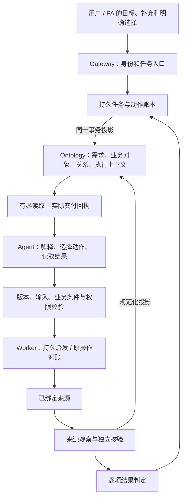
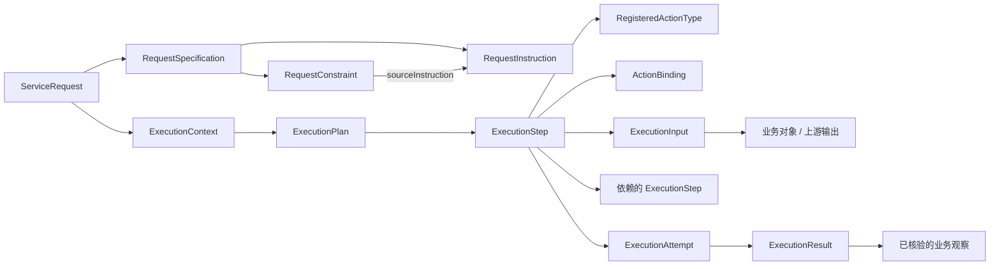

# EIGOS Ontology 架构与模型复审

日期：2026-10-20。范围：`packages/ontology`、Coordinator、持久执行账本、能力注册及当前来源投影。方法：按 Palantir 官方原则核对代码、实际关系和可证伪的业务问题，并由独立 Agent 复核反例。

**结论：模型的主要业务划分合理，但并不完备。当前是具备本体语义、来源证据和受控执行的混合架构；本轮修正了任务上下文、执行图、实体身份和提交条件的具体缺口，仍不能称为完整的通用 Ontology 执行平台。** 类型已登记、对象已产生、规则能运行、真实来源已接通是四种不同状态。本文不表示 Foundry 部署或 SDK 兼容。

## 1. 官方原则如何用于这次审查

| 原则 | 本仓库的具体检查 |
| --- | --- |
| 从业务领域出发 | `ProductVariant` 是商品规格，某次读取或报价是观察；医院、酒店、地址的身份不能由本次任务或价格决定。 |
| 避免重复概念 | 共用 `ServiceRequest`、`Provider`、`Channel`、`Offer` 接口；不同渠道的状态转换由来源映射处理。 |
| 稳定核心、允许扩展 | 领域对象独立扩展；新增技术记录不修改既有业务对象的 schema 指纹。 |
| 使用接口组合 | `Offer`、`EvidenceBacked`、`SourceEntityObservation` 表达真正共性，避免一个塞入所有领域字段的对象。 |

上述四项及其优先顺序来自 [Ontology design: Best practices](https://www.palantir.com/docs/foundry/ontology/ontology-best-practices)。本文右栏、修复方案与风险等级都是 EIGOS 的工程判断。

结构检查还要求：事实有清楚的归属；有独立身份和导航需求的概念用对象及关系表达，金额、数量等值保留为带类型属性；必要技术类型从默认业务目录隐藏。[Structural guidance](https://www.palantir.com/docs/foundry/ontology/ontology-structural-guidance)

Action 的提交条件必须在真正执行时成立，不能只展示在定义、提示词或按钮上。业务权限、对象权限、参数和当前上下文要分别核对。[Submission criteria](https://www.palantir.com/docs/foundry/action-types/submission-criteria)

验收以新使用者能否回答业务问题为核心。结构检查和测试数量不能单独证明模型易用、业务完整或模型推理可靠。[Design validation](https://www.palantir.com/docs/foundry/ontology/ontology-design-validation)

## 2. Object、Entity、Link、Action 的正确分工

| 概念 | 本项目中的含义 | 常见误用 |
| --- | --- | --- |
| Object Type | 定义一种对象的身份、属性、关系和业务意义，例如 `HotelProperty` | 把具体一家酒店当成类型；按 API 响应格式直接建类型 |
| Object / Entity | 某个有身份的实例，例如来源 A 的酒店 123 | 用酒店名称判断相同；把每次查询当成一家新酒店 |
| Observation / Event | 针对实体、时间和来源的一次陈述或发生记录 | 把旧库存覆盖成当前库存而丢失当时选择依据 |
| Link Type / Link | 可双向导航的关系定义及其具体实例 | 只有 JSON 中的 `{type,id}`，却没有关系；用数组顺序暗示关系 |
| Action Type | 用户或 Agent 作出的受控决策，定义输入、条件、修改及效果 | 把所有 HTTP 查询都声称为业务交易；认为定义存在就能执行 |
| Binding | 该动作对应的受控实现、版本及配置 | 把绑定存在当作当前用户已经授权 |
| ExecutionStep / Attempt | 某次计划中的调用，以及它的实际派发或对账尝试 | 重试时改变业务操作身份；用调用成功替代履约成功 |

“Entity”不需要另建一层通用表。一个具体 `ProductVariant` 对象就是该实体；其历史价格由报价或观察表达。业务观察也可以是有独立身份的对象。技术执行记录可进入同一本体供追溯，但默认业务视图应围绕包裹、地址、商品、酒店等业务概念。

## 3. 发现与本轮修正

| 级别 | 修复前的具体问题 | 本轮处理与验收依据 |
| --- | --- | --- |
| P1 | Agent 能从宿主注入的 Job/状态获得任务、步骤和候选，图里的对象不足以重建决策上下文 | 原生模型入口只给引用和工具契约；`read_task_context` 从当前任务图返回需求、当前事实、能力、候选、计划及观察。必须引用实际成功读取的回执。宿主验证依赖与真正交给模型的对象分别记账。 |
| P1 | 计划、步骤、Action 类型、依赖和执行结果没有完整的对象关系链 | 增加执行对象、双向关系及与业务输入/结果的类型化引用。任务、意图、尝试、观察和图投影在事务内同步。Agent 派发校验图结构与封存计划，篡改不能通过重新投影“修好”。 |
| P1 | 跑腿报价的包裹、路线主要在结果出来后才出现，选择仍依赖散落标量 | 报价前建立 `Parcel`、`DeliveryRoute` 和已选 `SavedAddress`；报价动作输入引用这些对象，执行时从当前对象及私密来源读取实际参数。缺少用户明确选择不能补造。 |
| P1 | 来源说“可用”，但菜品含忌口成分、车辆容量不足或酒店资源完全缺失，仍可判为 eligible | eligibility 改为验证候选自身的资源观察、每个商品/行程项、容量、身份、时段和政策。矛盾为失败，缺失为未知。提交入口和派发入口强制检查，Agent 跳过主动评估也无法绕过。 |
| P2 | 同一原生 ID 在不同来源下可被混淆；有些资源由报价覆盖需求的选择 | 身份包含来源命名空间；候选链接自己的资源与观察。需求中的显式资源选择不被候选覆盖。已知同请求多来源歧义返回未知，需明确对象选择。跨来源自动对齐仍未实现。 |
| P2 | 保存地址、商品等稳定实体与 Token、任务或报价绑定 | 保存地址按来源账户和原生地址身份稳定；商品按商家来源和原生规格 ID 稳定。观察、报价、订单项固定各自版本和条款；新数据不能倒退或冲突覆盖当前实体。 |
| P2 | 六域业务 Action 与 `domain.*.submit`、UCP 操作分离，定义中的条件不保证执行检查 | 显式 `providerOperation` 解析至同一 Action 定义，拒绝歧义映射；已绑定业务合约核对版本、实际效果和提交条件。执行尝试保留本次条件及来源引用；批准仍由独立准确计划策略处理。 |
| P2 | 上下文把全部定义、历史计划和记录反复展开；有效长请求可能超出强制读取上限 | 默认返回相关定义、当前事实和近期执行路径，历史对象按引用查阅；稳定定义可复用已交付回执，动态事实重新核对。长指令按任务和版本绑定分页，完整解释前检查实际文本覆盖。 |

具体实现入口：

- `execution-model.ts` / `execution-projection.ts`：执行图与需求断言的身份、关系和一致性。
- `task-context.ts` / `planning-session.ts`：有界上下文、模型实际读取回执与当前任务范围。
- `action-submission.ts` / `runtime.ts`：业务提交条件在宿主入口强制执行。
- `paotui-business-context.ts` / `paotui-agent.ts`：预报价业务对象及引用输入。
- `domain-projection.ts` / `domain-functions.ts`：来源实体、不可变观察与六域可行性。
- `catalog-agent-projection.ts` / `commerce-projection.ts`：稳定商品身份与报价/订单历史。

## 4. 修正后的架构与事实归属

数据库持久账本负责领取、租约、取消、幂等和迟到结果隔离。Ontology 为模型提供统一的业务与执行语义视图。二者是有一致性校验的运行账本及投影，不是声称已经去掉了全部内部状态存储。凭据、原始私密参数及完整 HTTP 内容不因“进入 Ontology”而公开给模型。

`ExecutionResult.applied` 表示被动作账本接纳，不等于已应用到当前任务。Agent 只读结果通过请求/租约栅栏后才更新任务；固定业务操作发生后，即使任务已取消，仍须保留可核实的实际效果，再由有效的任务检查点决定是否更新业务投影。不能为保持“取消后无更新”的表象丢弃可能已经发生的支付或订单事实。

网络协作还有独立的 `NetworkStore`：Profile、Representation、Listing、Space、Membership、NeedPost、EngagementMessage、Inquiry、QuoteSelection、Grant、Publication 等记录不在 `businessModel` 中。它们通过网络专用接口读取、批准和发布；当前只在询价转任务、报价选择转 `Proposal` 等交接处进入业务图。保留独立的发布与成员权限边界是合理的，但不能称为全部应用业务对象已经能从同一 Ontology 导航。后续应以明确的身份引用和有权限的关系视图连接两侧，避免复制两套可写事实。

业务层与执行层可按下列关系导航：

`RegisteredActionType` 是本次使用的定义快照；`ActionBinding` 是实现快照；权限在派发时重新判断。普通来源读取由 Agent 选择后产生观察；规范化投影是受控数据映射。每次数据库写入都造一个业务 Action，会模糊真正的决策边界。官方也区分决策 Actions 与数据转换，并支持用 [Action log](https://www.palantir.com/docs/foundry/action-types/action-log) 记录决策过程。

## 5. 预制模型逐组完整性审查

下面覆盖本次核对的业务/执行本体模型组，并单列独立网络模型边界。这里的“已实现”指所列本地代码与验收范围，不能外推为全部应用对象已统一或全部商业渠道可用。

| 模型组 | 主要对象、关系和 Action | 判断与具体缺口 |
| --- | --- | --- |
| 委托与当前需求 | `ServiceRequest`、`RequestSpecification`、`RequestInstruction`、`RequestConstraint`；规格包含指令/约束，约束可追溯来源和被替代断言 | 划分合理。修正后不会每次补充都把旧指令重新当成新实体。当前事实与历史原话同时保留，旧值不自动恢复为当前选择。 |
| 主体与渠道 | `Provider`、`Channel`、`ChannelParticipation`、`ServiceEngagement` | 角色设计合理，但各来源投影并未都生成参与角色及持续委托会话。不能由 Offer.provider 推断销售商家；跨来源统一主体仍待验证映射。 |
| 地点、保存地址和包裹 | `Place`、`SavedAddress`、`Parcel`、`DeliveryRoute` | 公开地点、私有地址、路线端点和查询范围分开是正确方向。当前跑腿路径已有预报价对象；地址隐私与账户范围有保护。坐标系未知仍是未知，不得推算正式距离/可达性。 |
| 配送报价 | `DeliveryQuote` 实现 `Offer`；关联 Parcel、Route、Provider、Channel、SourceReceipt；`PreviewDeliveryQuote` | 只读报价路径有实现。预估费用、费用完整性与最终费用不同；没有真实下单、付款和送达证据。旧固定读投影保留历史读取用途，不能自动迁移重放。 |
| 商品和报价 | `ProductVariant`、`ProductOffer`；商品当前观察、报价固定规格版本、来源商家及渠道 | 稳定身份与观察分离已修正当前 Agent 路径及 UCP 投影。公开目录读取不能证明实时库存、商家授权、跨境送达或最终税费。 |
| 购物与结账 | `CheckoutRequest`、`CheckoutSession`；`PrepareCheckout`、`CompleteCheckout` | 官方本地测试商家的受控沙箱流程已存在；商品、数量、金额、目的地与原订单可核对。没有通用 Cart 生命周期，也没有完整跨境责任、税费和清关模型。 |
| 订单与交付 | `Order`、`OrderLine`、`Shipment`、`DeliveryEvent`、`DeliveryAllocation` | 订单项、部分交付和撤回的表达合理；订单确认与实际送达分开。除当前沙箱映射外，物流事件、分配和跨主体履约尚无完整真实来源链。订单到销售主体/履约主体的角色关系还不充分。 |
| 餐厅预订 | `Venue`、`ReservationSlot`、`ReservationOffer`、`Reservation` | 可以表达时段、人数、占位、生效和订金条件，已有函数/演练。尚无当前可执行的真实餐厅预订 Action 绑定及来源。不能把模型定义算作已订妥。 |
| 付款、退款与售后 | `Payment`、`Refund`、`AfterSalesCase`，分别链接订单/预订及原付款 | 语义分离合理；本轮没有重建支付体系。运行账本中的沙箱补救链并未全部投影成这些业务对象；到账、退款完成和真实供应商回执仍需各自映射。 |
| 方案、授权与验收 | `Proposal`、`Authorization`、`OutcomeAssessment`；`SelectOffer` | 类型和部分提案工具存在。运行时 PlanGrant、条件判定和 closeout 仍以受控账本为权威，不能据此声称这三个业务对象已完整贯通。后续需有版本化映射，不能把 Plan 或 ActionBinding 冒充业务许可。 |
| 叫车 | `RideRequest/Option/Trip`、`RideRoute`、`TransportVehicle` 及来源观察；`RequestRide` | 需求、可选方案和行程结果分开，沙箱可核对容量、路线、时间、最终费用。未接真实叫车来源；接单不等于抵达。 |
| 医疗预约 | `AppointmentRequest/Option`、`MedicalAppointment`、`Hospital`、`MedicalDepartment`、`Practitioner`、`PatientProfile`、`AppointmentSlot` 及观察；`RequestMedicalAppointment` | 可核对院区、科室、医师、患者、时段和资格。私密身份不进入普通图读取。沙箱预约确认不证明真实挂号，也不表达诊疗完成。 |
| 外卖 | `FoodRequest/Option/Delivery`、`FoodMerchant`、`MenuItem` 及观察；`RequestFoodOrder` | 沙箱覆盖各 SKU/数量/规格、忌口、费用与交付；来源总标记不能覆盖菜品矛盾。真实餐饮成分及过敏信息需要来源证明，不足时保留未知。 |
| 酒店 | `HotelRequest/Option/Reservation`、`HotelProperty`、`RoomType`、`RoomInventory` 及观察；`RequestHotelReservation` | 沙箱覆盖日期、房数、容量、政策与确认/入住完成边界。酒店身份尚须来源限定；已知歧义会阻止选择，正常输入尚未全面改成跨来源可验证引用。 |
| 行程 | `ItineraryRequest/Option/Itinerary`、`ItineraryItem`、`TravelLeg` 及观察；`BuildItinerary` | 全部行程段及换乘可行性均需证据。形成计划与完成各项预订分别验收。当前合成行程不构成真实交通、酒店等复合预订。 |
| 预约/自驾用车 | `VehicleRequest/Option/Booking`、`VehicleClass`、`RentalPolicy`、`VehicleInspection` 及观察；`RequestVehicleBooking` | 沙箱区分带司机与自驾、资格、时间地点、押金及还车。实际车辆分配、验车和押金返还尚需来源接入。 |
| 来源读取与执行支撑 | `CatalogRead/Observation`、`PaotuiObservation`；作用域、端点、能力/候选包装及执行图 | 观察保留来源语义；实现包装标记为技术类型。它们补足 Agent 的可读执行上下文，不用来增加“已覆盖业务数量”。 |
| 网络协作与成员权限 | Profile、Representation、Listing、Space、Membership、NeedPost、EngagementMessage、Inquiry、QuoteSelection、Grant、Publication；成员与来源授权服务 | 这些有实际身份与生命周期，但由独立 NetworkStore/成员服务管理，未统一映射为本体对象。询价及选报价有局部桥接；普通本体工具不能导航全部网络关系。Publication Grant 与业务操作 Authorization 含义不同，不得合并授权。 |

## 6. 仍需完成的架构工作

| 优先级 | 未完成项 | 完成标准 |
| --- | --- | --- |
| P2 | 完整语义 Action 与所有固定操作统一 | 每个真实可执行业务操作对应一个明确的语义合约；新增提交条件无人实现时拒绝执行。纯适配器操作明确标识，不能伪造业务合约。 |
| P2 | 跨来源资源选择 | 输入可指定来源限定对象或受证据支持的统一身份；同原生 ID 的不同酒店、医院、商品不得自动合并。 |
| P2 | 方案、授权、验收、售后与业务图贯通 | 能从一次实际操作导航到准确授权、当时需求、逐条件结果、原订单和补救结果；当前撤销/失效即时生效。 |
| P2 | 网络模型与本体的有权限交接 | 从当前询价任务能追溯其需求帖、来源声明、选择与发布范围，遵循 NetworkStore 的成员、撤销和可见性规则；不能以业务图读取绕过网络权限，或复制一份失去同步的授权。 |
| P2 | 卖方、履约方及跨境责任 | 从订单能够分别找到有证据的销售主体、履约主体、目的地、费用责任和可执行服务范围；缺失不推断。 |
| P2 | 模型 schema 演进 | 明确各属性/关系必需性、原生版本和时间含义；调整已有 schema 时提供显式版本迁移及历史读取策略，不能直接改指纹后重跑旧任务。 |
| P2 | 真实业务验证 | 各领域完成独立来源接入、身份与权限核验、提交/异步状态/结果回读，以及目标完成证据。此前保持相应领域的沙箱或只读标识。 |
| P3 | 人工非建模者演练和规模表现 | 不给预定查询路径，由新人和独立 Agent 回答业务问题；记录正确率、耗时、必要读取量、歧义和求助。长任务上下文的有界测试不等于已证明所有生产规模。 |

## 7. 必须能回答的验收问题

1. 当前用户要什么，哪些条件来自原话，哪些已被后续更正？旧值为什么没有被重新采用？
2. 在调用查价之前，能否从任务找到包裹、所选地址、路线及可用读取 Action？
3. 从一个步骤能否找到其 Action 定义、实现绑定、输入对象、前置步骤、实际尝试及结果？失败和迟到结果会不会被当成完成？
4. 同一商品两次报价后，能否找到同一个商品和分别固定的条款？旧订单是否仍保留当时约定？
5. 两个来源都称酒店 ID 为 123，能否解释它们是否相同、用户到底选了谁？
6. 来源称方案可用，但车辆只有一个座位、菜品含忌口成分、酒店库存缺失时，执行入口是否拒绝？
7. 订单已确认但未送达、退款已受理但未到账、酒店已付款但未确认时，是否仍避免宣布目标完成？
8. 不让模型读取内部 Job 的完整内容，它能否通过授权的图读取继续工作？长指令能否分页读取并核对遗漏？

自动回归、独立复审、当前运行验证与远端同步的最终记录见本轮交付说明。历史证据只证明其对应代码和场景，不能替代修改后的验证。
