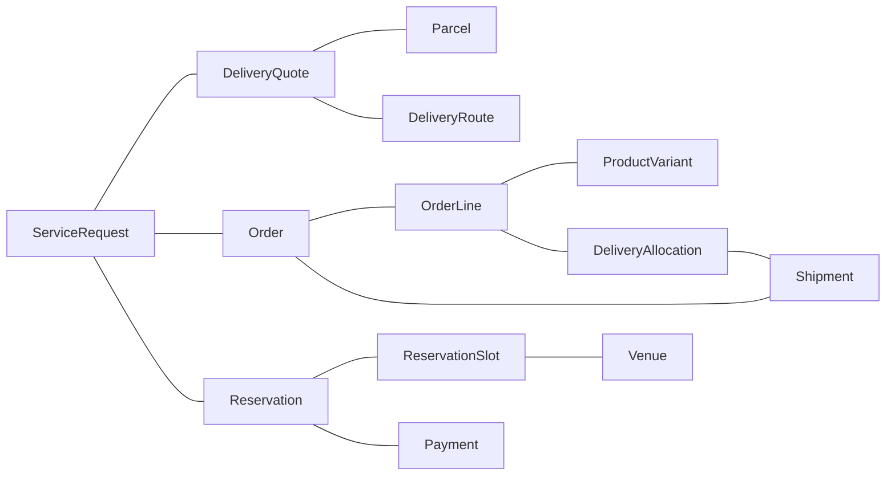

# EIGOS Ontology 规格：v0.2 落地细化

日期：2026-10-18。状态：按 Palantir 官方建模指南修订的规格基线；N1 对象模型及 [N2 模型查询／条件规划](ontology-n2.md) 已实现，并完成独立 Agent 九题复测。人工非建模者演练、领域动作和真实履约仍分阶段实施。规格最初核对的运行代码基线为 `29eb3740ae93b728e77b7f8283c785055f5da19b`。初稿 `66d6e1c` 没有逐条核对官方方法，不能将其作者走查视为完整本体验证。

本规格细化 [架构 v0.2](architecture-design-v0.2-2026-10-17.md)，沿用单仓库、Gateway／Worker、共享任务核心及 Ontology + LLM 决策分工。术语由 [CONTEXT.md](../CONTEXT.md) 维护；本文维护对象契约、语义规则和实现要求。原设计中的旧执行架构兼容建议已经撤销：历史记录保留只读，不自动迁移成可执行计划。

这里的 v0.2 是所沿用的架构文档版本，N2 的运行内核标记 ontology-execution-v4，业务模型为 eigos.business@2；具体领域定义与绑定各自独立版本，不以文档修订号替代运行契约版本。

建模依据为 Palantir 的[设计原则](https://www.palantir.com/docs/foundry/ontology/ontology-best-practices)、[结构指导](https://www.palantir.com/docs/foundry/ontology/ontology-structural-guidance)及[业务问题验证方法](https://www.palantir.com/docs/foundry/ontology/ontology-design-validation)。具体对象、接口、主键、属性来源、双向关系和数据映射以配套[对象目录](ontology-model-catalog-v0.2-2026-10-18.md)为准。官方原则与 EIGOS 的实施选择分别标明；采用方法不等于已经接入 Foundry 或实现其全部平台能力。

规格阶段交付了本文、[三个场景的设计验证](ontology-scenarios-v0.2-2026-10-18.md)、代码差距和[新阶段目标](backend-implementation-goals.md)。随后 N1 的代码与验证记录见 [验收记录](evidence/ontology-n1-2026-10-18/README.md)。两轮均不调用真实来源、不启动模型业务任务、不改变常驻服务或权限；订单、付款、占位、取消和退款均没有本轮执行授权。场景中的业务数据全部合成。

后续 N2 已在隔离环境运行实际模型查询与决策提案验证，仍只使用合成业务来源；没有真实交易或常驻切换。独立 Agent 与人工演练的不同状态以 [N2 验收记录](evidence/ontology-n2-2026-10-18/README.md) 为准。

## 1. 本体要回答的问题

本体定义 EIGOS 所理解的业务对象、关系、动作及其可验证含义。实现必须能回答：用户要求达到哪个结果；哪个主体通过哪个渠道声明什么能力；本次可用性依据什么事实；哪些条件已满足或仍未知；什么动作允许发生；取得什么证据才算完成。

“取得报价”“商品送达”“预订确认”是三个独立的业务终点。把结果封装为 artifact 是交付方式，不能替代业务终点。一个成功的协议响应或模型回答，也不能直接决定业务状态。

### 1.1 建模顺序与项目组织

先从三个实际业务问题识别实体与事件，再设计属性、关系和接口，接着定义 Functions／Actions 与来源映射，最后验证能否独立查询和决策。执行引擎的表名或 MCP 工具列表不作为本体的生成起点。下列三层是 EIGOS 的组织方式；具体模型由 Object Type、Property、Link Type、Interface、Action Type 和 Function 组成。

| 层 | 维护内容 | 变化方式 |
| --- | --- | --- |
| 共用核心 | 精简委托、主体身份、接口、对象关系、授权和结果规则；执行记录另有支持层 | 跨领域复用；变更需明确受影响契约和版本 |
| 领域本体 | 配送、商品购买与送达、餐厅预订的对象、属性、状态、谓词和验收器 | 每个领域独立版本；保留领域差异 |
| 提供者映射 | 源字段、单位、状态、身份、接口和回执如何对应领域契约 | 每个绑定固定输入映射、输出映射和证据校验版本 |

业务能力可以由多个提供者实现。美团等渠道属于绑定与事实来源；渠道菜单、地址、时段和某次报价属于对象实例，不为每条数据创建新本体。Ontology 定义层与运行事实层分别保存。

### 1.2 实现形式

沿用 TypeScript／Zod／JSON Schema、版本化注册表和本地 SQLite。关系先用类型化引用与查询实现；本轮不要求增加图数据库、RDF／OWL、向量库或独立服务。谓词引用受信任的校验函数，不能执行模型生成的表达式或代码。

定义包 `OntologyBundle` 至少包含 `ref`、依赖版本、具体对象／属性／双向关系、接口实现、查询／函数、Action 变更集与提交条件、来源映射、权限及验收规则和定义摘要。该名称表示 EIGOS 拟实现的内部打包契约，不是 Palantir 产品接口或当前已开放的工具。

## 2. 核心对象与身份

所有任务私有实例均有 owner、对象类型、稳定 id、revision 和创建时间；owner 来自认证边界。定义使用不可变的 `id + version + digest`。外部对象使用 `source namespace + external id`，不能用展示名称作为身份。

下表是业务概念与支持记录的职责清单，并非每行都是一个 Object Type。Parcel、OrderLine、Shipment、Venue、Reservation 等具体实体的身份、属性和来源见[对象类型目录](ontology-model-catalog-v0.2-2026-10-18.md#2-对象类型目录)；Offer 是接口，Fact 是证据视图，运行尝试是默认隐藏的技术支持记录。

| 核心对象 | 最小信息与责任 |
| --- | --- |
| User／PA | 用户与有效代理身份、可用数据范围；PA 转述、推断和用户明确指令分别标记 |
| ServiceRequest | 原文、消息来源、revision、目标类型、交付边界、约束、偏好、成功条件和获准上下文引用 |
| Requirement／SuccessCriterion | 对哪个对象的哪个属性提出何种条件，适用阶段、硬性或偏好、值与单位、原文依据和规则版本 |
| Provider／Channel／Merchant | 主体及入口、销售、履约等角色，原生身份与已验证的对应关系；同一主体可有多个角色 |
| ServiceCapability | 可产生的业务结果、领域版本、适用范围、必要输入、允许动作和验收规范；定义本身不绑定某一家提供者 |
| CapabilityClaim／CapabilityVerification | 谁在什么来源版本声明能力；哪项动作在什么范围、时间和环境经过何种验证 |
| ProviderBinding | capability、channel、实际提供者／履约方引用、受控 adapter、映射版本、访问条件和恢复能力 |
| ServiceEngagement | 一个需求与一个提供者的持续交互；本地／远端任务引用、补问和等待状态。一个需求可有多个 engagement |
| CandidateOption／RuntimeAvailability | 被发现的对象或服务选项，以及针对本次需求版本、用户、动作和时间的可用性判断 |
| Offer／Comparison | Offer 接口由三个具体报价类型实现；Comparison 是对象集和比较函数的结果，选定 Proposal 才是需要持久追溯的决策快照 |
| Proposal／ExecutionPlan | 用户可理解的选择与条款快照；固定输入、动作、依赖、定义／绑定版本和验收目标的执行计划 |
| Authorization | 来自用户或有效代理的动作、对象、数据、金额／收款方和有效期许可，附撤销版本 |
| ActionIntent／ExecutionAttempt | 默认隐藏的运行支持记录，保留稳定业务键及各次技术尝试；不要求业务用户从这些记录开始导航 |
| Observation／Evidence／Fact | 有业务身份的观察可建事件类型；原始响应按权限保留。常规事实属于具体对象属性，来源与推导通过证据视图关联 |
| OutcomeAssessment／AfterSalesCase | 对固定成功条件逐项判断；关联原业务对象的补救事项，不重写原任务的完成或失败历史 |

Money、Quantity、LocationValue、TimeWindow 等先作为组合值。只有需要独立生命周期或身份时才建立独立对象。例如本人保存地址条目有身份，本次路线保存经确认的地址快照与角色。

## 3. 关系与基数

这是业务导航关系示意，不是程序执行流水线。每条关系的正反向名称、基数和来源映射见[Link Type 目录](ontology-model-catalog-v0.2-2026-10-18.md#4-link-type-目录)。意图、尝试及租约继续用于后台执行与审计。

| 关系 | 基数及约束 |
| --- | --- |
| Request → requirements／criteria | 一个需求拥有多条条件；每条固定目标属性、来源与版本 |
| Capability ← Binding | 同一能力允许多个绑定；绑定准确引用一个能力版本及其动作映射 |
| Channel → Provider／Merchant | 可连接多个主体；聚合入口不自动成为销售方或履约方 |
| Request → Engagement → Candidate／Offer | 一个需求可询问多个提供者；候选只归属获准的需求与用户范围 |
| 同一业务标的 → 多个 Offer | 每个 Offer 保留自己的渠道、费用、条款与期限；归组不合并报价 |
| Proposal → selected Offer → Plan | 选择引用准确报价版本；目标、条款或绑定改变时重新评估计划及授权 |
| Shipment → DeliveryAllocation → OrderLine | 通过带数量与证据的关系对象记录部分交付；不能只在订单上写一个 delivered 布尔值 |
| Evidence → Fact → CriterionAssessment | 一条事实可有多个支持或冲突证据；判断必须列出实际使用的引用 |
| AfterSalesCase → 原业务对象／新 Request | 售后建立关联需求，原订单、付款和原需求记录保留 |

跨渠道“同店”“同款”是带证据的身份或等价关系。相同名称、相同坐标、不同 namespace 下相同 id 都不足以建立等价关系。`can_fulfill` 是带需求版本、动作与时间范围的评估，不能存成提供者永久具有的真值。

## 4. 属性语义、条件和报价

### 4.1 条件契约

每个条件必须包含：`subjectRef/role`、`predicateRef`、`operator`、类型化 `expected`、`phase`、`strength`、原消息及原文引用。`phase` 区分输入完整性、执行前可行性与执行后结果；未来送达条件在规划时尚未满足是正常情况，不能要求先有送达事实才开始规划。

| 属性 | 必须区分的语义 |
| --- | --- |
| 地点 | 搜索区域、取件地址、服务目的地、餐厅所在地；城市搜索输入不能证明配送可达或行政边界归属 |
| 数量 | 报价数量、用户申报重量、供应方计费重量、实际交付数量；件、杯、公斤、人数分别有单位规则 |
| 金额 | 标价、估价、覆盖明确费用范围的报价总额、订金、实际扣款、实际退款；未知金额不填零 |
| 时间 | 用户期限、供应方估计、供应方承诺、业务实际发生时间、系统收到回执时间；相互不得替代 |
| 状态 | 提供方声称支持、当前账号可访问、本次有可用性、动作发生、用户目标满足，分别判定 |

Money 使用整数 minor 文本和登记的币种精度；不默认为所有币种两位小数。Quantity 使用精确十进制及登记单位，计数单位必须是整数，转换只使用受信规则。时间保存绝对时刻、时区和用户原表述。坐标同时声明单位和已知参考系；参考系未知时如实保留未知。

谓词目录为每个 predicate 定义输入对象类型、角色、值类型、适用阶段、允许证据来源和 evaluator 版本。例如 `geo.query_scope_matches` 只验证实际查询范围；`delivery.destination_matches` 验证路线；`delivery.received_by_deadline` 需要实际交付时间。三者不能因都含地点或时间而互换。

硬性执行前条件为 fail／unknown 时，不派发依赖该条件的业务动作；可继续获准的补问或事实查询。偏好影响选择理由，不自动变成硬门槛。已经固定的条件只能由有权限的需求变更产生新 revision，模型不能为了得到方案而放松条件。

首版谓词目录包含下列语义。N2 已将其登记为类型化条件，并把有现成证据路径的规则接入只读计算；动作许可及完整交付证据不足的项保留 unknown，不能当作全部领域动作验收已实现。这些标识不表示十个同名公共工具。操作符由各谓词声明允许的类型，不能对任意字段自由比较。

| 规则 | 比较对象与阶段 | 可接受依据 |
| --- | --- | --- |
| `geo.query_scope_matches` | 实际查询的城市／关键词，读取结果验收 | 绑定准确输入摘要的来源回执 |
| `parcel.quote_matches_request` | 报价路线、申报重量、物品和服务，报价验收 | 用户已明确的请求＋同一查询的类型化回执 |
| `offer.total_within_budget` | 指定费用范围／性质的总额与预算，选择前 | 范围完整且币种兼容的报价，或来源明确允许的确定性求和 |
| `goods.variant_matches` | 每个订单项的规格与允许替代规则，选择前及送达后 | 规格事实或被验证的身份映射；送达后还需对应交付证据 |
| `goods.capacity_covers_quantity` | 本次可供数量与请求数量，选择前 | 有效的供应方产能／可售数量观察，不用展示列表数量代替 |
| `delivery.commitment_covers_deadline` | 提供方承诺与用户期限，选择前 | 对该路线、数量和服务有效的承诺；估计不能代替 |
| `delivery.receipt_matches_request` | 实收数量／规格／地点／时间，结果验收 | 同一业务对象的交付事实；来源不足时保留 unknown 或待人确认 |
| `reservation.slot_matches_request` | 餐厅、日期／时区、时段、人数，选择前 | 有效时段及可用性观察 |
| `reservation.confirmation_effective` | 准确预订的确认及生效条件，结果验收 | 餐厅／授权渠道确认，必要时关联订金到账证据 |
| `execution.within_authority` | 本次动作、数据、对象、费用与授权，派发前 | 受信任授权记录和策略校验，不能使用模型的同意判断 |

### 4.2 Offer 接口与具体报价对象

Offer 作为接口，约定报价身份、提供者／渠道关系、观察／有效期、价格性质和费用完整性等真实共性。DeliveryQuote、ProductOffer、ReservationOffer 是独立具体对象；商品规格、包裹重量、时段和订金属于对应类型，不集中到一个宽泛可空对象。代码传输层可以用判别联合表达具体类型，但不能把该传输结构当作业务对象模型。

价格性质至少区分 `display_price / estimate / firm_quote / unknown`；费用完整性另记 `complete / partial / unknown`。订金不冒充商品或配送总价。接口定义和属性卡见[报价接口目录](ontology-model-catalog-v0.2-2026-10-18.md#3-offer-接口与属性定义卡)。

| 具体 Object Type | 领域内容 | 不能强加的字段 |
| --- | --- | --- |
| ProductOffer | ProductVariant、商家、规格／数量、商品与交付条款 | 同名商品不能默认同规格或可替代 |
| DeliveryQuote | Parcel、DeliveryRoute、服务等级、申报／计费重量、报价适用范围 | 不需要虚构商品 id、零售门店或餐具费用 |
| ReservationOffer | Venue、ReservationSlot、人数、订金／取消／到店条件 | 不用商品库存或商品购买数量代替席位与人数 |

缺失实际商家身份的发现结果可以作为待核实候选保存，但不能成为需绑定明确交易对手的可执行购买方案。提供者与收款方身份必须在相应业务动作前明确；聚合渠道可以有被证实的代理角色。

估价可以满足“查估价”的目标；若用户要求最终费用不得超过预算，而来源未承诺费用上限，则最终费用条件仍未知。免费订座必须有明确零费用依据。比较只对同一领域、匹配目标与可兼容费用范围进行，不把送货报价与商品价格作同一总价排名。

## 5. 事实来源与证据

### 5.1 来源和写入权限

| 来源 | 可以支持的内容 | EIGOS 的处理 |
| --- | --- | --- |
| 用户／有效 PA 指令 | 本次目标、明确选择、授权范围、用户申报信息 | 保留原消息和代理权限；申报重量不升级为实际称重 |
| 提供者声明／目录 | 能力声明、入口和公开资料 | 进入 Claim；验证来源及映射后再判断动作可用性 |
| 获准提供方读取／回执 | 该来源权威范围内的报价、订单、预订或履约观察 | 验证身份、对象关联、schema、单位、时效及动作语义后使用 |
| 用户／接收方确认 | 收到情况或任务约定的主观质量 | 保留确认人及适用条件；不替代支付侧到账证据 |
| 程序派生 | 费用求和、同单位比较、固定规则评估 | 保留所有输入事实引用和规则版本，允许重算 |
| LLM 推断 | 意图解释、候选匹配假设、建议查询、计划提议 | 标为 inference；不能直接支撑库存、付款、履约或授权硬事实 |

源码存在一个工具、账户已登录、接口返回 200、远端 A2A Task 为 COMPLETED，分别只能证明其直接含义。来源签名可以支持来源与完整性，业务真假仍按相应验收规则判断。

### 5.2 最小事实与证据记录

常规事实以具体对象的类型化属性表达，附来源及有效性元数据；不要把所有字段拆成通用 Fact 对象。价格变化、交付和确认等有独立业务时间／身份的观察可以建立具体事件类型。证据视图能按 `subjectRef`、属性／谓词、来源、观察时间、有效期、适用范围和 owner 追溯。值未知时不填假值。

证据记录包含来源身份、原生对象／事件 id、接收时间、可保留载荷或受控引用及摘要、绑定／映射版本、证据强度和验证结论。原始私人数据不因成为证据就可进入模型、公开文档或跨用户图谱。

- 事实支持状态区分 supported、unverified、unknown、conflicted；过期在使用时依据事实期限判定，旧值与历史证据保留。
- 来源报告否定值是有依据的否定事实；查询超时或字段缺失是未知。
- 不同来源冲突时保留双方；按具体谓词的来源权限和版本规则处理，不能取“最后到达”或交给 LLM 猜一个真值。
- 旧回执或超时不能抹掉已确认付款；更新的取消事实可以改变订单当前视图，但不删除之前创建、付款的事实。
- `fixture / simulated / live_readonly / live_operation / live_fulfillment` 必须保留证据范围；推导和统计不能提升证据等级。各来源现有枚举由映射层规范化。
- 提供方不给有效期时可以设本地刷新上限，明确标记 `local_refresh_limit`；它不构成提供方价格或库存承诺。

## 6. 状态与转换

以下均为业务状态，协议层通过既有 MCP／A2A 状态映射表达。`unknown` 描述认知不足；不得用它覆盖同一操作已经证实且未被有效新事实推翻的状态。

| 对象／维度 | 状态或主要路径 | 转换依据 |
| --- | --- | --- |
| ServiceRequest 进度 | received → clarifying／planning → awaiting_authorization／executing → accepted／unmet／needs_review；可 canceled | 需求事件与逐条件验收；取消需求不直接取消外部业务 |
| RuntimeAvailability | available／unavailable／unknown／needs_input／needs_authorization | 固定需求、动作、身份和观察时间下的可执行性；历史成功不替代本次判断 |
| Offer 实例有效性 | observed → usable／incomplete／expired／superseded | 根据字段、期限、当前时间与新版本派生；不维护一份容易过期的永久 isFresh 布尔值 |
| ActionIntent | ready → dispatching → awaiting_remote／effect_unknown → effect_confirmed／rejected／needs_review；取消记录 canceled_before_dispatch／canceled_after_dispatch | 稳定业务键与经校验的观察；effect_confirmed 仅代表该动作 |
| Order | requested → pending → confirmed；随后可能 canceled | 供应方订单回执，订单状态与付款、履约分开 |
| Payment | not_started → pending／unknown → paid／failed | 支付侧可信结果；无响应不推断 failed 或未扣款 |
| Fulfillment | pending → partial → delivered／failed／disputed | 实际交付观察；partial 能否继续等待由剩余任务与期限决定 |
| Reservation | requested → pending／held → confirmed／rejected／expired／canceled | 时段、人数、确认方、保留期限及订金条件的证据 |
| Refund | not_started → pending／unknown → refunded／rejected | 实际退款到账事实；申请受理保持 pending |
| OutcomeAssessment | satisfied／unsatisfied／unknown／needs_human | 对固定目标和条件分别判断，保留支持与反证 |

Reservation 的 `held` 是有期限的占位；支付订金不自动变成 confirmed，必须满足渠道确认契约。免费预订可直接确认；经过 held 不是所有渠道的必需步骤。已确认预订后的变更／取消另有业务动作，不覆盖历史确认回执。

转换必须由该领域允许的事件和经校验的观察触发，不能让模型任意改状态。派发前取消可以阻止该动作；派发后取消只停止后续派发，原操作继续查证，不能据此认定供应商订单或占位已经取消。本地拟议引用始终与供应方业务引用分开，不能伪造订单或预订确认号。

整体验收在目标约定的评估时点进行：必需条件有明确违反则 unsatisfied；否则存在需要指定人员判断的条件则 needs_human；否则仍缺证据则 unknown；全部必需条件满足才是 satisfied。偏好未满足单独披露。进行中的部分送达可以继续等待；明确终结或过期后数量不足才确定失败。

## 7. 动作契约和执行边界

先区分对象查询、函数计算、来源同步和决策变更。官方 Action Type 定义的是对象、属性和关系的一组受控变更及提交时的规定副作用；不把所有读取工具都称为同一种本体 Action。[官方 Action 定义](https://www.palantir.com/docs/foundry/action-types/overview)

| 类别 | 本项目例子 | 输出／变化 |
| --- | --- | --- |
| Object Set／只读 Function | 查询地点、地址、有效报价、餐厅时段；比较报价、核算未交付数量、核验预订 | 返回获准对象、派生值和证据；不直接修改订单或付款 |
| 来源读取／规范化管线 | 通过 Ontology MCP 执行 search_poi／delivery_preview，验证并映射结果 | 来源对象及观察更新，保留身份、单位、时间与关联关系 |
| 决策 Action Type | AmendRequest、SelectOffer、RequestDeliveryQuote、RequestReservation、RequestRefund | 固定一组允许的对象／属性／关系变更和外部操作意图 |
| 技术运行操作 | dispatch／observe／reconcile、RPC、原键查证 | 支持上述过程的适配器操作；不会自行产生新的业务许可 |

每个 Action 定义参数、可编辑对象／属性／关系集合、提交条件、执行角色、业务授权与数据范围、预期状态、失败结果、审计和适用版本。提交条件和对象权限分别校验；只读 Function 不能绕过 Action 直接写业务对象。函数支持查询、导航和复用逻辑的依据见 [官方 Functions](https://www.palantir.com/docs/foundry/functions/overview)。

例如 RequestDeliveryQuote 记录对准确 Parcel／Route 的查价决策和待处理意图，来源回执经映射后才形成 DeliveryQuote；SelectOffer 固定选择关系，不改来源报价或声明已授权付款。RequestOrder／RequestReservation 记录业务请求，只有实际来源观察才形成订单或确认状态。准确变更集和来源责任见[Action 定义卡](ontology-model-catalog-v0.2-2026-10-18.md#61-两个具体-action-定义卡)。

现有代码的 ActionType／PlanStep 同时包含 read、local 和外部操作，它们属于当前执行契约。后续应明确区分 Ontology 决策动作与 ProviderOperation，不仅改名称；PA 入口仍提交业务目标，Gateway 不启动模型或来源读取。

授权事实由受信任的用户／代理通道产生，不能由“请求授权”动作自行生成批准。来源同步有自己的写入责任与审计，不套用用户编辑去覆盖支付／库存事实。

继续复用当前 Action Runtime：先落意图及派发记录，网络调用在事务外；观察先保存，再由有效领取者推进任务。未知副作用只查原业务键，禁止自动换提供者重做；没有查证契约时进入人工核对。健康 pending 不计作失败重试，所有循环受次数和时间上限约束。本文不会解除现有真实副作用禁令。

## 8. LLM 的职责与确定性校验

| 环节 | LLM 可提出 | 程序／来源负责确定 |
| --- | --- | --- |
| 理解目标 | 领域、结果类型、缺失输入、带原文引用的条件解释 | schema、来源、角色、单位、revision；禁止改写固定条件 |
| 获取事实 | 为满足具体条件而需要的已登记查询及对象引用 | owner、数据范围、来源白名单、参数与读取预算；Worker 调用 |
| 选择候选 | 对已检索候选解释可行性与偏好取舍 | 硬性前置条件 pass／fail／unknown、证据新鲜度与可比范围 |
| 提议计划 | 已登记动作、类型化引用及有界依赖 | 动作与输出类型、定义／绑定版本、前置条件、预算、授权及恢复策略 |
| 处理变化 | 补问、刷新、重规划或无可行方案提议 | 旧操作是否未知、原键查证、授权是否仍覆盖；不静默重复业务 |
| 解释结果 | 根据验收记录生成用户能理解的说明 | 业务状态和整体完成由证据及验收器确定 |

输入包只包含相关 OntologyBundle、获准需求上下文、有界候选、事实引用、未知／冲突项及已有动作结果。供应方文本作为不可信数据，不能覆盖规则。凭据、隐藏推理、无关地址簿和其他用户对象不进入提示词。

LLM 应能从业务名称和别名找到具体对象类型，通过受控 Object Set 查询、关系导航和 Function 获取事实，再提出 Action。固定流程模板可以支持执行安全，但不能成为识别对象与查明问题的唯一途径；独立验证时不预先给出查询路径。

模型输出采用版本化结构：`clarify / query_facts / propose_plan / replan / no_feasible_plan`，绑定 requestRevision、理由、对象／事实引用及必要参数。`query_facts` 必须指向已登记只读动作与具体待验证条件；不能接受任意 URL、SQL、脚本或新供应方代码。新能力映射只能进入待审核提议，不能在当前任务中直接发布。

首轮实现仍使用已校验的短流程模板，再逐步允许受约束的动作组合。无论模板或模型组合，都执行相同类型、前置条件、结果与授权检查，不能以模板绕过本体。

## 9. 三个领域的最小模型

| 领域 | 对象与重要属性 | 本次设计终点 |
| --- | --- | --- |
| 配送查价 | Parcel：申报内容／重量；DeliveryRoute：origin／destination 快照；DeliveryQuote：服务、价格性质、费用范围、有效性及条件 | 与原路线、重量和服务一致的报价已取得并交付；按来源披露估价及未知费用 |
| 商品送达 | ProductVariant、OrderLine、Order、Payment、Fulfillment；规格／数量、目的地、承诺与实际时间、完整费用 | 用户要求的商品、数量、规格、地点、时间及费用条件均有对应证据 |
| 餐厅预订 | Venue、ReservationSlot、Reservation；日期／时区、人数、confirmed 证据、保留／订金／取消条件 | 指定人数与时段的预订已获渠道或餐厅确认，并满足生效条件 |

验证包括成功、缺失事实、过期、部分完成和错误语义映射；详见 [场景与反例矩阵](ontology-scenarios-v0.2-2026-10-18.md)。商品送达与餐厅预订在此均是合成设计演练，当前实现并无对应真实业务验收。

## 10. 版本、存储与发布

定义、映射、谓词和验收器分别固定版本及摘要；变化不得原地覆盖已引用定义。运行事实追加来源版本，业务对象当前视图可重建。计划同时固定需求 revision、选中 Offer、定义／绑定、必要事实及授权引用。

保留当前身份、幂等、租约、迟到观察和私有 preparation 隔离。业务 Request 与协议 Task 逻辑上分开；当前可维持一对一入口，新增提供者交互通过 ServiceEngagement 显式记录，不借用远端 Task 完成状态作为本地验收。

切换新契约前检查在途工作并备份；不兼容历史计划只读，新请求使用新版本。若存在未知外部操作，先完成原操作查证或明确人工交接，不能用升级启动新的业务副作用。提供者定义发布与用户授权都不由 LLM 自动完成。

图谱先提供 owner 范围内的关系、声明、验证和事实查询。反馈按任务目标、领域、范围、证据等级与未知样本统计；跨用户聚合、长期偏好和自动排序训练另有数据范围，不因本规格自动开启。

## 11. 当前代码需要修改的地方

以下保留核对 `29eb374` 时的完整差距清单。N1 已建立对象查询及来源投影；N2 增加 `planning-contract.ts`、`planning-session.ts`、`reasoning-loop.ts` 和 `conditions.ts`，接入解释、规划、派发前复查及结果条件校验。原商品发现传输记录名为 ProductOfferSnapshot，避免与 Offer 接口混淆。完整领域动作与整体验收仍按后续阶段推进，不能把此表全部视为已完成；实际范围见 [N2 使用说明](ontology-n2.md)。

| 当前位置 | 已有基础／具体缺口 | 后续修改与最近验收 |
| --- | --- | --- |
| [execution.ts](../packages/ontology/execution.ts) | Requirement 主要是 quantity／budget／deadline／location／condition；地点仅字符串 ref，事实属性角色不足；ontology 为宽泛 object | 建立具体对象／属性／关系／接口定义契约，增加领域目标、角色、阶段及规则引用；版本化注册引用，不仅增加文字描述 |
| [supply.ts](../packages/ontology/supply.ts)、[comparison.ts](../packages/coordinator/comparison.ts) | Offer 强制商品与门店字段；比较围绕商品规格 | 定义 Offer 接口及 DeliveryQuote／ProductOffer／ReservationOffer 具体类型；共用查询约束、领域比较函数分别实现，独立价格性质／完整性 |
| [paotui-ontology.ts](../packages/capabilities/paotui-ontology.ts) | 对象名和规则文本已有，输入 schema 与动作 ref 已固定；缺统一对象／关系／动作变更集目录 | 补充主键、标题、属性来源、双向关系、只读函数和决策 Action 定义；技术只读操作与 Action 变更集分开 |
| [paotui-read.ts](../packages/capabilities/paotui-read.ts)、[paotui-request.ts](../packages/capabilities/paotui-request.ts) | 真地址选择、报价和回执已跑通；引用与摘要保护可复用 | 将路线、重量、估价／费用及有效性映射为领域事实／Offer，保留底层查询原语与用户流程能力的层次 |
| [paotui-geo-discovery.ts](../packages/capabilities/paotui-geo-discovery.ts) | 精确白名单、回执与来源配置固定已有 | 保留 PublicLocation 查询语义、`realSupply=false`；不得因统一 Offer 而把地点升级为商家供给 |
| [core/catalog.ts](../packages/core/catalog.ts)、[capabilities/catalog.ts](../packages/capabilities/catalog.ts) | 能力／绑定／来源分离；能力摘要超 16 项即拒绝 | 注册并核验模型构件及依赖；增加按业务名称／别名检索、对象集查询及关系导航，接口返回实现类型；保留身份过滤、上限和覆盖 |
| [coordinator.ts](../packages/coordinator/coordinator.ts)、[requirements.ts](../packages/coordinator/requirements.ts)、[delegation.ts](../packages/core/delegation.ts) | 真实解释、规划、原文依据与有界回合已有 | 输出条件角色与阶段；引入受控事实查询提议，记录 inference 与证据引用，禁止改写既有要求 |
| [resolver.ts](../packages/coordinator/resolver.ts) | 逐条件检查、unknown、来源超时与取消边界已有 | 从按 kind 的通用字段比较逐步转为注册谓词；核对对象角色、来源权限、单位、时效和冲突 |
| [plan.ts](../packages/coordinator/plan.ts)、[runtime.ts](../packages/coordinator/runtime.ts) | 短 DAG、准备流程、计划固定与动作恢复已有；整体验收主要取最后一步 delivery | 分开 Ontology Action 与 ProviderOperation，校验对象变更集及提交条件；按需求汇总关联业务对象／证据，缺证据保持 unknown；先模板后有限组合 |
| [actions.ts](../packages/ontology/actions.ts)、[sandbox-service.ts](../packages/capabilities/sandbox-service.ts) | 订单／付款／履约／退款快照与沙箱动作已有；无独立 Reservation 模型 | 增加 held、确认、生效条件与失效的预订语义；沙箱验证订金已付但未确认、部分交付仍进行等情况 |
| [store.ts](../packages/core/store.ts)、[tasks.ts](../packages/core/tasks.ts) | 意图、尝试、观察、反馈和私有准备已持久化 | 建立具体业务对象的当前属性／来源投影、双向链接、领域事件及派生查询；保留决策历史快照，避免复制多份当前事实；技术记录默认隐藏 |
| [policy.ts](../packages/core/policy.ts) | 当前真实副作用拒绝、沙箱精确授权和累计预算已有 | 保持拒绝策略；未来将领域对象、Offer 条款、数据范围与现有 grant 校验衔接，不能通过本体扩展获得新权限 |
| [domain.ts](../packages/core/domain.ts)、[mcp.ts](../apps/gateway/mcp.ts)、[a2a.ts](../apps/gateway/a2a.ts) | 统一任务、身份和 PA 协议入口已有 | 只投影必要的业务目标、事实／验收状态；两协议同任务含义一致，不更改 PA 主交互模式 |
| [ontology-backend.test.ts](../tests/ontology-backend.test.ts)、[migrated-capabilities.test.ts](../tests/migrated-capabilities.test.ts)、[supply-discovery.test.ts](../tests/supply-discovery.test.ts)、[fulfillment.test.ts](../tests/e2e/fulfillment.test.ts) | 当前内核、比较反例与进程故障回归可复用 | 将 23 个反例转成契约／规则／运行测试；另做非建模者和 Agent 的无路径提示业务问题演练，不能以单元测试或 CI 代替 |

当前 `execution.ts` 中名为 `Quote` 的结构主要承担本地模拟授权报价，应在后续改造时明确为沙箱专用记录；不将其直接当作本规格的通用 Offer。生产价格、用户方案和动作许可分别建模。

## 12. 实施顺序与规格验收

新的实施顺序是：规格基线 → 类型／事实／规则契约 → LLM 与规则衔接 → 真实只读候选方案 → 三领域动作与验收沙箱 → 获准业务的真实履约。各阶段具体目标及交付门槛维护在 [阶段目标](backend-implementation-goals.md)，已完成的执行内核与 PA 实测继续复用。

本规格的结构验收要求：具体类型有身份、属性来源和权限；关系有两侧名称、基数及映射；接口只表达真实共性；三个场景有明确终点和条件证据；每个 Action 有变更集、提交条件及未知结果处理；代码差距可定位到现有模块。

可用性验收另外开展：让非建模者与 Agent 分别依据业务问题在通用对象查询／导航环境中寻找答案，不提供固定路径或专用页面。N2 的独立 Agent 已完成两轮，第二轮九题通过数据及实际查询记录复核；正确性、耗时、路径和求助保存在 [N2 记录](evidence/ontology-n2-2026-10-18/README.md)。人工非建模者演练仍未运行，不能把作者走查、Agent、自动测试或 CI 当作其通过证据。[官方验证指导](https://www.palantir.com/docs/foundry/ontology/ontology-design-validation)

仍取决于外部契约的事项：真实商品／预订来源能返回哪些字段与身份、报价／占位有效期、写操作防重与查证、数据保留条件、押金和取消规则。这些字段缺失时按本规格保留 unknown 或拒绝相关动作，不预设某平台已经支持。多用户私人渠道授权、跨服务多订单优化、长期偏好和跨用户反馈属于后续独立范围。
