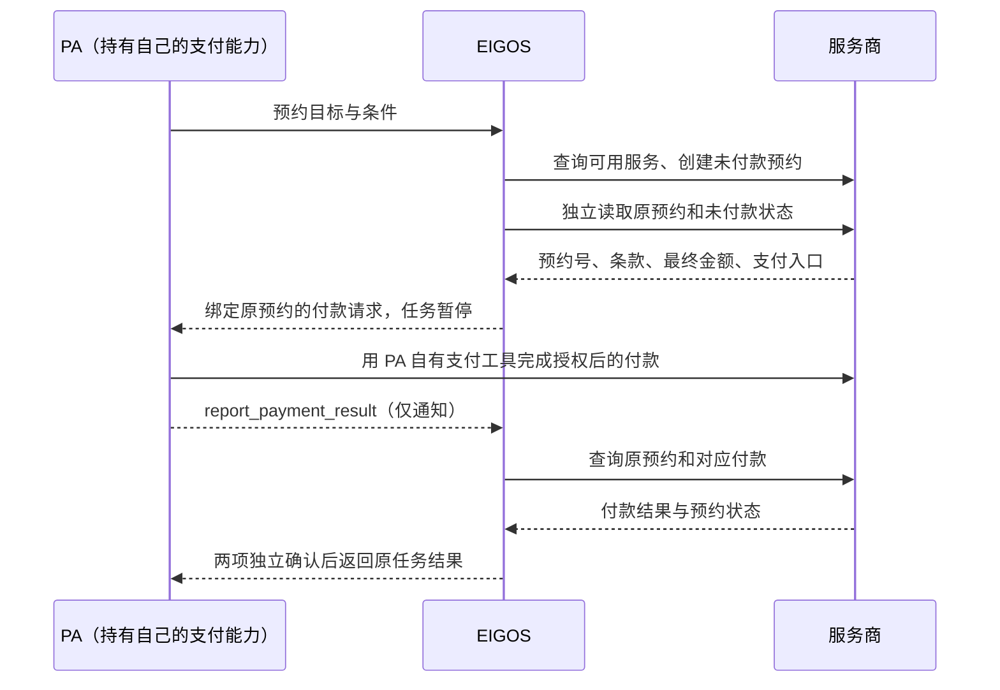

# 预约准备 → PA 自有支付 → 服务商独立回读

2026-10-20。运行契约 `ontology-execution-v13`，业务模型 `eigos.business@12`。

EIGOS 把服务预约准备到待付款，向 PA 返回准确付款请求；PA 使用自己的钱包或支付工具直接向服务商付款。EIGOS 接收的是状态通知，随后独立查询服务商的付款和预约，二者都匹配才关闭任务。

当前只提供隔离测试实现：服务商 HTTP 模拟器、PA 测试钱包和模型决策夹具。没有调用 Stripe/Link、真实钱包或真实预约接口，没有更新常驻部署。新增能力 `booking.pa-payment.sandbox@1` 默认关闭。真实服务商适配、PA 原生钱包连接和实际业务许可需要后续独立接入。



## 执行与权限

| 动作 | 效果 | 核验 |
| --- | --- | --- |
| `SearchBookingOffers` | 只读 | 取得服务、时段、人数、完整费用与条款 |
| `CreatePendingBooking` | 预约，支付花费为 0 | Agent 实际读取和评估来源，取得准确预约许可后创建一次 |
| `ReadProviderBooking` | 只读 | 查询原预约，可用旧观察作为身份引用 |
| `RequestPAPayment` | 本地发布与暂停 | 必须已独立读到有效待付款预约及尚未收款的付款状态；不发起付款 |
| `ReadProviderPayment` | 只读 | 查询服务商记录的原预约付款 |
| `WaitForPAPayment` | 本地暂停 | 保留同一个付款请求，要求查证原付款，不生成新付款指令 |

动作由现有 Agent 循环选择。每轮必须读 Ontology，写动作继续绑定准确来源、计划和授权；没有新增第二个业务调度器。预约写入之后，支付能力仍属于 PA。新程序没有 `payment` 效果的动作，也不持有用户的 Stripe/Link 密钥。

付款交接一旦发布，运行时禁止该任务再次创建或修改服务商业务对象，只允许查询原对象与本地等待。取消、退款和改约的后续业务需要独立明确的接口与授权，不通过重新下单掩盖未知结果。

## PA 请求与通知契约

Agent Card 发布 `/.well-known/eigos-pa-payment`，其中提供 JSON Schema、消息类型与证据边界。待付款任务保持 `TASK_STATE_INPUT_REQUIRED`，同时包含：

- `metadata.delegation.phase = awaiting_pa_payment`
- `metadata.delegation.agent.paPayment.request`：稳定的请求 ID、摘要、所属任务与版本、原预约、条款摘要、最终金额/币种、服务商、支付方式、有效期。
- `paPayment.status`：`awaiting_pa` / `reported` / `awaiting_provider` / `verified` / `withdrawn`。

PA 在首次发起付款前重新读取任务，检查它仍在等待、请求为 `awaiting_pa`、期限有效、收款方和金额已获用户授权。支付端点必须匹配 PA 自己已建立的服务商连接。PA 持久保存原付款请求与自己支付工具的操作身份，重试使用原幂等键。

本版本的 `handler.type` 只允许 `sandbox.pa-wallet`，不得把模拟条款交给真实钱包。测试钱包使用与 EIGOS 来源读取凭据完全不同的凭据，服务商拒绝用 EIGOS 来源令牌付款。

PA 完成一次尝试后，通过同一 A2A 任务发送结构化 `SendMessage`：

```json
{
  "action": "report_payment_result",
  "handoffId": "<原 request.id>",
  "handoffDigest": "<原 request.digest>",
  "outcome": "submitted"
}
```

外层 `message.taskId` 使用原任务 ID，`message.messageId` 使用稳定 UUID。MCP 工具 `report_payment_result` 接受相同字段，并显式提供 `taskId`、`requestId`。现有 Python 客户端新增：

```sh
python3 <saved-script> --config <saved-profile> payment-result \
  --task-id <original-task-id> --input-file <report.json> \
  --request-id <stable-uuid>
```

客户端的报告文件只包含 `handoffId`、`handoffDigest`、`outcome`。`outcome` 可为 `submitted`、`declined`、`unknown`、`canceled`。接口拒绝额外的钱包凭据、卡号、SPT、API key 或付款 URL；自由文本“我付过了”不能替代此通知。

相同 UUID 与内容幂等返回；同一 UUID 内容变化拒绝。新通知到达时若原回读正在执行，返回冲突，调用方查询任务后用原 UUID 重试，避免丢失通知或破坏 Worker 租约。每个任务最多记录 20 条不同通知。过期通知仍可用于查证原付款，绝不续期或创建替代预约。

这属于 EIGOS 的 A2A 应用契约，不是新增的通用 A2A 标准支付方法。

## 付款确认与预约确认分别核验

PA 的通知不会变成 `SourceReceipt`。服务商响应使用独立来源凭据验签，并固定任务所有者、请求版本、配置、模型计划、Intent、Attempt 和回读序号。

每次新通知或明确回读请求递增 `readbackSequence`，防止在同一毫秒内复用通知之前的旧观察。完成要求：

1. 原预约 ID、服务商、时段、人数、价格、支付入口与最初预订条款一致。
2. 服务商独立付款记录为 `paid`，收款方、金额、币种、条款摘要均匹配，实际付款未晚于原有效期。
3. 服务商独立预约记录为 `confirmed`。
4. 两份观察来自当前回读轮次，并由 Agent 在完成决策中实际读取和评估。
5. 固定用户条件与共用验收检查全部通过。

“PA 已批准”“付款已提交”“只收到了钱”或“只有预约确认”都不能单独完成任务。最终确认表示预约成立，不表示参加服务、到店或实际服务交付。

## 中断、取消和未知状态

- 未付款预约的创建响应丢失：只按原操作键查询，不能创建第二个预约。
- PA 付款响应或通知丢失：PA 查询原支付；`unknown` 通知或 `reconcile_task` 唤醒 EIGOS 对原服务商对象的读取，不再付款。
- 付款处理中或预约尚未确认：进入 `awaiting_provider`，保留原付款请求和条款。
- 错误金额、币种、收款方、预约号、条款，退款或预约过期：不得关闭为成功。
- Gateway/Worker 重启：从持久任务和原付款请求继续；不重新收集钱包凭据或创建预约。
- 任务取消或等待期限结束：付款请求标记 `withdrawn`；已发出的 PA 付款不会因此自动撤销。迟到通知只能触发对原服务商的有界只读查证，不能重新打开任务或生成完成交付物。
- 旧租约返回的结果保留在动作账本中，不能投影新完成状态。本地交接发布与其动作结果原子保存，中断时由 Agent 重新读取后决定。

## 本地测试配置

`npm run setup:booking-sandbox` 只准备私有文件，不启动服务、不修改主 `.env`、不连接钱包。默认输出 `data/booking-sandbox/`；可传一个空目录或本工具已管理的目录作为参数。

`provider.env` 用于 `npm run dev:booking-sandbox`。服务商模拟器持有两种分离的测试凭据。`gateway-fragment.env` 只包含 EIGOS 应使用的配置：

```dotenv
EIGOS_ACTION_SANDBOX=true
EIGOS_BOOKING_SANDBOX_URL=http://127.0.0.1:3433
EIGOS_BOOKING_SANDBOX_TOKEN_FILE=/absolute/private/path/source-token
```

Gateway 与 Worker 使用相同的本机 development 配置。PA 测试钱包读取自己的 `pa-wallet.json`，其令牌不能复制给 EIGOS。模拟器只监听 loopback，没有访问任何外部支付网络的客户端。

旧 `EIGOS_STRIPE_TEST_*` 开启配置现在会被启动检查拒绝；EIGOS 不再从这些变量取得商家付款执行能力。历史 Stripe 接口实现保留为明确注入的商家测试夹具，见[历史适配说明](stripe-test-integration.md)。常驻实例没有自动升级；旧版本任务保持原有只读边界，不混跑不同版本的 Worker。

## 参考

本地验证：456 项测试、7 项进程级 E2E、类型检查、构建和差异检查通过。其中 27 项预约付款专项覆盖 PA 独立支付、A2A/MCP 共用回读、Gateway/Worker 重启、重复或伪造通知、未收款检查、条款与收款方错配、过期、取消和租约失效。模型、钱包和服务商均为隔离测试组件；现有常驻实例和已安装的 PA 客户端/技能没有自动更新。

此分工与 Stripe 官方[服务预约与支付流程](https://docs.stripe.com/agentic-commerce/sellers/use-cases/booking)一致。PA 可在后续独立接入 [Link Agent Wallet](https://docs.stripe.com/agentic-commerce/agents/link-agent-wallet) 等自有支付能力；本次没有创建 OAuth 客户端、连接用户钱包、发起真实支付或宣称 Stripe/Link 联调已完成。
