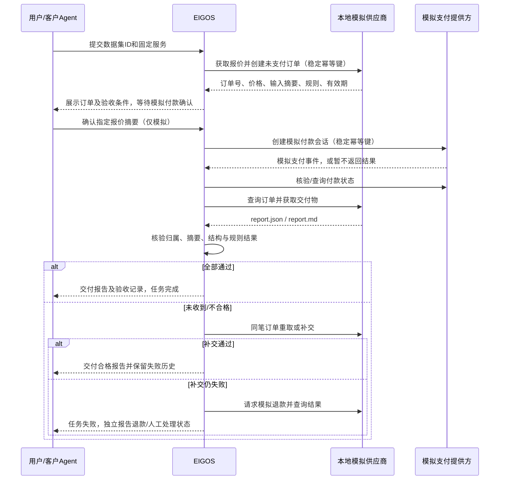

# EIGOS 首个试点：CSV 数据质量审计（仅本地模拟付款）

日期：2026-10-15。交付：可实施方案，尚未实现。支付均为 EIGOS 自建模拟，不是支付宝沙箱，不产生真实扣款、退款或商户履约上报。

## 1. 选择与成功标准

选择固定规格的“CSV 数据质量审计报告”，模拟供应商出售一次审计服务。客户是准备导入业务数据、需要确认重复、缺失和非法记录的运营人员或其 Agent。

相较开放式研究报告，本场景有确定输入、确定规则和可复算结果，能验证交易、交付与验收，而不把“模型认为不错”当作成功。试点验证工程闭环，不证明市场需求，也不证明外部供应商可信。

固定商品 `csv-quality-v1`：最多 1,000 行 UTF-8 CSV，列固定为 `record_id,email,amount_cny,event_date`。不引入 CSV 通用导入平台；首版只提供三个仓库内合成数据集，不上传真实客户资料、不访问外网、不调用 LLM。

交付两个文件：`report.json`（机器验收）和由它生成的 `report.md`（用户阅读）。报告内容包括：输入摘要、数据行数、每条规则的问题数、问题行号、规则版本和供应商处理记录。

验收成功：模拟付款已确认；交付文件属于该订单和该输入；报告问题集合与独立验收器结果完全一致；Markdown 与验收后的 JSON 一致；两种协议能读到相同结论。模拟订单价格固定为 `100` 分、`CNY`，只是测试常量，不代表未来实际售价或支付宝原生金额单位。

## 2. 固定验收规则

| 规则 | v1 定义 |
| --- | --- |
| 行数 | 不含标题；空行不计数据行；数据行从 1 编号，与物理行区分 |
| 缺失 | 每列去除首尾空白后为空即缺失；按列列出数据行号 |
| 重复 ID | 非空 ID 去首尾空白后区分大小写比较；报告所有重复组及组内全部行号 |
| 邮箱格式 | 非空值满足明确版本化的简化规则 `^[^\s@]+@[^\s@]+\.[^\s@]+$`；只证明格式，不验证邮箱存在 |
| 金额格式 | 非空值必须为非负十进制，整数部分为 0 或不带前导零的正整数，可有 1–2 位小数；拒绝指数、逗号、NaN、负数 |
| 日期格式 | 非空值为真实存在的 `YYYY-MM-DD` 日历日期；不接受自动纠正 2 月 30 日 |
| 结构 | 列名与列数必须匹配；UTF-8 解码和 CSV 语法错误在报价前拒绝 |

首版 fixture 避免引号、内嵌换行和转义，输入契约明确只接受该子集；未来真实上传前才选择成熟 CSV 解析器并扩充格式契约。缺失与非法格式分开计数；一行可命中多条规则，不将各规则计数相加当作问题行数。

`report.json` 必须含 `schemaVersion, orderId, inputSha256, rulesVersion, rowCount, findings, generatedAt, environment: simulated`。`findings` 保存规则代码、列名和排序后的数据行号；不回显邮箱等字段原文。验收器比较精确集合，不只比较数量。

独立验收器不能直接调用供应商的审计函数。固定 fixture 的预期结果由人工可核对的 golden 文件提供，另写独立规则检查；增加变换测试，确认修改输入、漏报、重复行号、错订单都会失败。文件哈希只能证明内容绑定，不能替代内容正确性检查。

## 3. 角色和完整流程

EIGOS 在本试点中是买方任务协调者；本地模拟供应商负责订单、审计、交付和退款处理；模拟支付提供方负责付款记录。三者逻辑分离并分别持久化，便于模拟“对方已成功，本地未收到”。同一进程内实现即可，不增加独立服务或消息中间件。



每个报价绑定 `taskId, supplierId, sku, inputSha256, rulesVersion, amountMinor, currency, expiresAt`，有效期默认 10 分钟。用户确认记录包含报价摘要与 `simulationOnly: true`；报价过期或内容改变必须重新确认，不把自由文本“好”解析成付款指令。

付款会话生成不等于 paid；模型、客户端和供应商的普通文字不能更新支付事实。模拟提供方事件使用本地测试密钥 HMAC 和独立的消息 ID，按表单封装测试解析、验签和重复通知。它仅验证 EIGOS 的事件处理边界，不模拟或证明支付宝 RSA2/From 通知兼容。

将来支付宝 PC 路径的替换点是付款交接：商户 `page.pay` 返回材料 → 官方支付 Skill → 官方通知/查单；本轮不安装 CLI、不生成真实签名串、不连接支付宝。移动路径和 Machine Pay 卖方路径暂不实现。具体官方边界见[前置研究](alipay-agent-pay-research-2026-10-15.md)。

## 4. 状态与失败补救

避免构造一个所有状态的笛卡尔积。对外保留粗粒度任务状态，细节放在独立业务记录中。

| 对象 | 最小状态 |
| --- | --- |
| 任务 | `input-required / working / completed / failed / canceled` |
| 付款 | `not_started / pending / unknown / paid / declined / closed` |
| 交付验收 | `not_started / awaiting / received / accepted / rejected / insufficient_evidence` |
| 补救 | `none / redelivery_pending / refund_pending / refunded / needs_review` |

只有 `payment=paid` 且 `acceptance=accepted` 可以令此服务任务 completed。退款成功也不把任务改成 completed。已终止任务允许继续记录迟到付款与补救事实；不能因 task terminal 就丢弃财务事件。

| 故障 | 动作与用户可见结果 |
| --- | --- |
| 付款取消或拒绝 | 不执行审计；显示未付款，可在有效报价下重试 |
| 付款请求超时 | 标 unknown，用原付款键查询；不得创建另一笔付款绕过未知状态 |
| 通知重复/乱序/伪造 | 伪造拒绝；重复落库去重；不让旧 pending 覆盖 paid；冲突状态主动查询 |
| 已付但交付下载失败 | 同订单最多重取两次，不重付，不重新执行服务；仍无结果后请求一次补交 |
| 报告漏项、错误摘要或错误订单 | 保存拒绝原因和文件摘要，隔离文件不作为合格交付；请求一次补交 |
| 补交仍不合格/无证据 | 任务失败，进入模拟退款；保留 `rejected` 或 `insufficient_evidence` 原因 |
| 退款已受理但未到账 | 只标 refund_pending；查询模拟提供方确认后才能标 refunded |
| 退款拒绝或超过截止时间 | needs_review，显示待人工处理事项；不伪称资金已恢复 |
| 取消与付款成功竞态 | 停止新业务动作，核对在途付款；若实际已付则进入退款补救 |
| 进程重启 | 恢复持久待办；先查询已发出的外部动作，再决定是否重试 |

首版模拟时间参数：付款查询上限 60 秒；支付确认后交付等待 30 秒；补交再等 30 秒；退款确认上限 60 秒；用注入时钟和手动 tick 测试，无需真实等待。这些是试点设置，不是支付宝 SLA。查询达到上限仍 unknown 时必须 needs_review，不能声称未扣款。

取消发生在验收完成后返回冲突；验收完成前取消不再交付为成功。报价有效期只限制新付款启动，不用于否认已发生的迟到付款。

## 5. 对外最小接口

新服务名 `data.quality.audit.simulated`，只能在显式启用且绑定 loopback 的试点模式注册。沿用六个 MCP 工具和 A2A 的提交/查询/回复/取消方法，不新增一套公网支付 API。

提交结构示例（新增 discriminated union 分支，保留原 brief 分支默认行为）：

```json
{
  "service": "data.quality.audit.simulated",
  "goal": "检查这份数据导入前是否存在质量问题",
  "datasetId": "duplicate-and-missing-v1",
  "requestId": "audit-demo-001"
}
```

`datasetId` 只能引用固定注册表，不接受路径、文件 URL 或外部下载地址。首次提交持久创建任务/待办；worker 取得报价后进入 input-required。`get_task` 返回 `quoteId, quoteDigest, expiresAt, simulatedAmount, environment` 与确认说明。

回复增加显式结构化分支：`{taskId, requestId, action: "confirm_simulated_payment", quoteId, quoteDigest}`。原 `{answer}` 分支仅用于原有补问流程，不能触发付款。A2A 使用一个 structured data part 承载同一动作，`messageId` 作为 requestId；普通 text part 不接受试点付款确认。

付款成功、拒付、延迟、补交失败等故障由测试 harness/本地演示脚本配置，不能由普通业务工具参数自行选择“支付成功”。回调通过注入 receiver 调用，不开公网 HTTP 路由。MCP/A2A 的读回包含相同的模拟标记、支付/验收摘要和补救信息；不要在工具结果暴露测试签名密钥。

## 6. 基于当前代码的最小实施方案

核对时工作区存在进行中的 `src/config.ts`、`src/domain.ts`、`src/store.ts` 修改及新 `src/executor.ts`。domain 已扩展 `agent.execute` 和 working/failed，但读取时 TaskService 仍调用 prepareBrief，A2A 仍限制 brief，不能把这些片段当作已集成完成。实施前重新核对最终基线，保留其他作者改动；本方案不修改它们。

| 文件/模块 | 最小改动 |
| --- | --- |
| 新 `src/pilot/contracts.ts` | 输入/确认/报价/报告 schema、试点状态、服务描述；定义供应商和模拟付款接口 |
| 新 `src/pilot/service.ts` | 提交、确认、取消、验收与补救的固定流程，不建立通用 DAG 引擎 |
| 新 `src/pilot/providers.ts` | 确定性供应商、模拟支付和故障注入；业务凭证与模拟 ledger 分离 |
| 新 `src/pilot/acceptance.ts` | 独立内容核验、文件绑定与验收记录；不调用供应商审计函数 |
| 新 `src/pilot/worker.ts` | 单进程 durable tick、到期工作认领、查询恢复、有限重试、停止/重启处理 |
| `src/domain.ts` | 合并新服务 schema 分支；Job artifact 改为兼容原 brief 的判别联合，增加试点 summary；不复用文档执行完成来表示审计验收 |
| `src/store.ts` | 迁移新增试点记录/待办/事件表；提供同一事务内写任务、待办、幂等收据的接口；保持旧库可读 |
| `src/tasks.ts` | 按 service 分发；原 brief 行为保留；试点 reply/cancel 走专属语义 |
| `src/mcp.ts`、`src/a2a.ts` | 使用共享 schema/能力注册；更新状态映射和确认解析，输出模拟证据摘要 |
| `src/app.ts`、`src/config.ts` | 显式开关、loopback 强制校验、依赖注入和 worker 生命周期；默认不注册试点 |
| `tests/pilot*.test.ts`、`examples/pilot-audit.ts` | 固定 fixture、故障测试、可复现演示；README/integration 增加模拟说明 |

持久化最小四类表：`pilot_orders`（owner、任务、报价/授权/付款/验收/补救快照和 revision），`pilot_work`（operationKey 唯一、动作、nextRunAt、attempt、租约），`pilot_events`（provider+eventId 唯一，事件摘要及处理结果），`pilot_artifacts`（owner/order/attempt、文件正文或受控引用及哈希）。小文件可直接存 SQLite，避免先引入对象存储。模拟供应商和支付记录另用测试 ledger 表，确保 worker 重启不丢对方状态。

原 `JobStore.once` 是同步事务且返回 Job。保留其作用，增加事务内 enqueue 能力；远程/模拟 provider 调用都发生在事务之外，不能在 once 中 await。operationKey 由订单和动作派生，重试沿用同一键。所有用户读写用受信 owner；通知用服务端订单映射定位 owner，不使用事件自报租户。

首版一条进程内 worker 即可；用数据库条件更新与 revision/租约防重复认领。下单、付款、补交、退款都采用“落盘动作 → provider → 落盘结果”。在 provider 已成功而落盘前崩溃时，恢复先用原键查询。模拟供应商必须保证同订单交付结果可重新读取，避免下载失败再次消耗服务。

已有 `interruptWorking()` 会把全部 working 任务标失败；接入时必须按服务区别处理：保留文档执行器原策略，试点订单从 durable work 恢复，不通过新建任务重付。并发取消后到达的 worker 结果须检查 revision 与取消事实，只更新付款/补救事实，不覆盖成 completed。

不新增 npm 依赖、不用外部队列、不接 LLM、不支持多供应商、分账、部分退款或任意文件上传。现有 scopes 可用于仅本地模拟动作，但显式确认不可省略；未来真钱需单独授权策略和 provider 接口评审，不能仅更换 URL 或开关上线。

## 7. 分阶段交付与验收

1. **契约与存储**：固定 fixture 和人工可核对预期；schema、报价摘要、owner 隔离、事务/幂等和迁移。验收：重复提交一张订单，变更输入同键冲突，旧 brief 数据仍可读。
2. **模拟交易与恢复**：provider ledger、worker、确认、付款核验、查单。验收：付款成功后崩溃再启动仍只有一笔付款；伪造/重复通知不改变事实。
3. **交付验收与补救**：两个报告文件、独立核验、重取/补交/退款。验收：正确报告通过；数量相同但行号错误失败；补交成功不再收费；退款受理不等于退款完成。
4. **协议入口与演示**：MCP 提交/A2A 确认/MCP 读回及反向路径；默认关闭和跨用户隔离。运行 `npm run check`、`npm test`、`npm run build`。

演示脚本必须输出三份独立 trace：正常交付；已付款后错误报告、一次补交恢复；已付款后持续失败、模拟退款确认。每份 trace 包含同一任务/订单的时间线、动作次数、支付记录、验收结果和最终文件哈希，醒目标注 simulated。

额外必测：报价过期和篡改确认；支付未知不重付；取消/支付/验收竞态；重复退款请求；重启后任务不丢；读其他用户订单统一不存在；报告正文与摘要不匹配；全部 fixture 不含真实个人信息。

完成边界：以上本地测试与三条演示通过，才称“本地模拟购买与验收闭环完成”。不能称“支付宝已接入”“真实支付通过”“外部服务履约已验证”。之后真钱联调是独立阶段，仍需确定商户、资格、官方回调契约与用户交易授权。

## 实施结果（2026-10-15）

本地模拟版本已实现，实际接口与范围见 [运行说明](csv-audit-pilot.md)。首版使用 Job 内持久步骤和独立模拟账本，限定单实例同步 tick；固定 fixture 用人工可核对的独立 golden 结果验收，未实现任意 CSV 上传、多实例租约或真实支付提供方。以上是对初始模块/表结构的收敛，不改变模拟支付、交付验收和补救目标。

验证：`npm run check`、全套 `npm test`（48 项）、`npm run build` 通过；`npm run demo:csv-pilot` 完成正常交付、补交恢复、持续失败后模拟退款三条链路。报告磁盘文件的 SHA-256 与 trace 中记录一致。包含新增 16 项专项/双协议测试；现有其他服务测试保持通过。没有连接支付宝/阿宝、没有真钱交易或部署。
