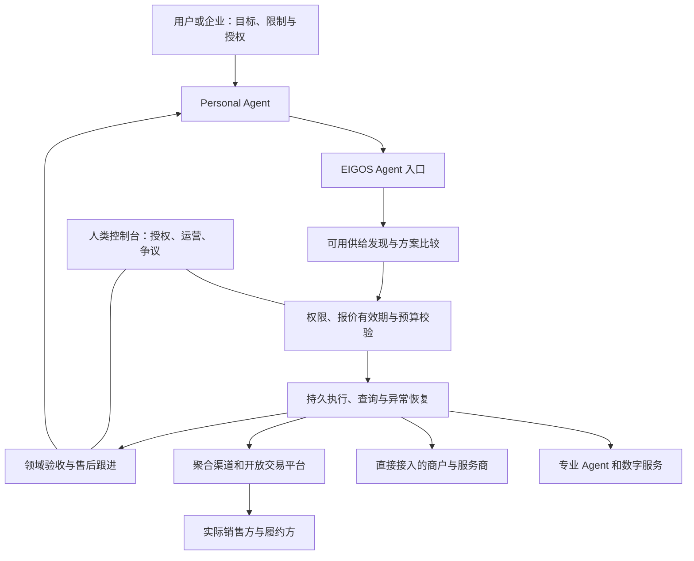

# 面向 Agent 的电商平台：行业研究与 EIGOS 产品设计建议

研究日期：2026-10-18（Asia/Shanghai）。交付性质：研究与产品建议，不是实施规格、生产验证或商业承诺。本次没有调用真实交易、修改运行服务、申请权限或对外联系。

## 1. 判断先行

**值得探索，但 “only for agents” 应定义主要交易接口和客户渠道，而不应成为排斥人的产品原则。** 买方主要是代表用户或企业的 Agent；卖方可以是商家、聚合渠道、软件服务商或专业 Agent。人的授权、商家运营和争议处理仍需要清楚的入口。

建议将 EIGOS 的候选形态定义为：**面向 Personal Agent 的可执行商品与服务市场，提供条件明确的方案、受授权的执行、持续状态及有证据的结果。** 这是本研究的产品提议，尚未修改品牌定位。

真正需要验证的不是“Agent 能不能调用下单 API”，而是：

1. 在同类需求上，EIGOS 是否比 PA 直接接商家提高成功率、减少人工时间或降低总成本？
2. 供应商是否愿意持续提供真实可售、可执行、可查证的服务，并承担约定的履约责任？
3. PA 开发者或最终用户是否愿意为这种增益付费，并重复使用？

如果只能聚合公开目录和转发工具调用，现有标准与大型平台会显著挤压价值。若能持续积累特定场景的可执行供给、可靠性记录、异常解决能力和复购分发，才可能形成市场。

## 2. 研究方法与证据等级

以用户提供的 [Fintechnize Agentic Commerce Stack](https://www.fintechnize.com/agentic-commerce-stack/) 为导航，使用其 2026-10-17 快照；重要结论追溯到官方文档、官方产品公告或项目现有证据。该地图的六层为 Agent 分发、发现与决策、商户数据与接入、交易编排、支付与融资、交易后服务；身份、授权、信任/风险、度量、互操作贯穿各层。它是功能分类，不是必须照抄的系统架构，也不是市场规模或生产采用率统计。[方法说明](https://www.fintechnize.com/agentic-commerce-stack/#methodology)

本文区分：

- **规范**：定义了如何交互，不代表有可用商家或商业准入。
- **官方产品/接口说明**：说明厂商提供什么，不代表 EIGOS 账户已具备权限。
- **厂商披露的业务使用**：有一定参考价值，不等于独立审计的交易或留存数据。
- **项目历史实测**：只覆盖证据中明确的场景、账户、时间和环境。
- **设计判断/待验证假设**：用于决定实验，不作为行业事实。

资料优先阅读当前版本。技术文档、营销页面和不同接入面可能更新不同步；不能把其中最宽松的陈述拼成一个不存在的通用权限。

配套详细资料：

- [协议、支付与身份研究](agent-commerce-protocols-2026-10-18.md)
- [市场案例、供给准入与商业模式研究](agent-commerce-market-2026-10-18.md)

## 3. 行业资料改变了哪些判断

### 3.1 发现与结账已经有强供给，不能再把“给 Agent 接口”当空白

Shopify 2026-10-13 公告发布 Shop MCP，将目录搜索、购物车和 Shop Pay 结账接入同一 MCP 连接；搜索无需 API key。其 Global Catalog 文档也提供跨商户发现和商品变体选择。这说明我们可以借用现有供给基础，但也直接挑战一个只做商品搜索与购买代理的平台。[Shop MCP 公告](https://shopify.dev/changelog/posts/add-shopping-and-shop-pay-checkout-to-any-agent-with-shop-mcp) · [Global Catalog](https://shopify.dev/docs/agents/catalog/global-catalog)

不能进一步推导“所有地区、商家、第三方客户端都支持无人结账”。Shop MCP、通用 UCP 接入、买家授权和支付处理是不同的接入面，需要分别核实。EIGOS 本轮未执行接入或付款验证。

新 Shop MCP 的当前文档明确：每家商户有独立 checkout，用户确认总额与支付方式后才能完成相应购买；`completed` 加订单对象才是下单证据。它也要求未知结果先读回，不能盲目重复付款。这些具体执行契约比“支持电商协议”的标签更有用。[当前总览](https://shop.dev/docs) · [结账与恢复](https://shop.dev/docs/checkout)

### 3.2 用户需求未必要求全过程留在聊天框内

OpenAI 2026-03-24 公告说明初版 Instant Checkout 的灵活性不足，转向加强商品发现，并允许商家使用自有结账体验；当前商家页继续体现这一方向。因此，跳转、嵌入式结账、专属 App 和 API 交易可能共存。不能把“需要用户接手一步”自动等同产品失败。[OpenAI 公告](https://openai.com/index/powering-product-discovery-in-chatgpt/) · [当前商家入口](https://chatgpt.com/merchants/)

**设计推论：** EIGOS 应维护可恢复的任务与明确交接状态。支付需要人确认时暂停在正确一步，完成后读回同一业务对象。任务连续性比 UI 是否始终在聊天窗口更重要。

### 3.3 售后已有人做，机会需要更精确

Google 的 UCP 订单生命周期说明已经覆盖履约及退货退款等事件；AfterShip 的 MCP 提供商家组织范围内的物流与退货查询，以及需确认的写操作。AfterShip 不同页面对工具总数存在差异，本研究不依赖数量论证。[Google 订单生命周期](https://developers.google.com/merchant/ucp/guides/overview/order-lifecycle) · [AfterShip MCP](https://www.aftership.com/docs/post-purchase-mcp/overview)

**设计推论：** 机会不能描述为“别人都只做支付，我们独家做售后”。更合理的假设是：跨渠道信息能否映射到用户同一个目标，部分交付和未知结果能否处理，补救能否有责任主体和可核验结论。已有商家工具也可能成为合作接口，而不是需要重造的模块。

### 3.4 中国生活服务的关键是调用方准入，不是支付按钮

支付宝当前开放平台公开展示 AI 开放平台邀测、CLI 及商业信任协议；这不能证明任意外部 PA 已获得阿宝的完整生活服务调用资格。[官方入口](https://open.alipay.com/)

EIGOS 的 [10 月 16 日调用方核查](abao-caller-application-path-2026-10-16.md) 记录：通用平台邀测通过，专项调用资格未确认。这是历史账户证据，本轮未重新登录核查。不能以已有 APPID、支付 Skill 或订阅成功代替供应链准入。

**设计推论：** 国内本地服务和国际开放商品目录应该使用不同的供给验证清单。不要因为 Shopify 可发现商品，就声称国内即时零售、餐厅或跑腿购买也可同样接通。

### 3.5 Agent 购买其他 Agent 的市场也已经存在

Virtuals 有公开 Agent Commerce Protocol SDK；Google Cloud 的客户案例描述其服务发现、服务级别与成功率等检索信号，以及比较需求、约定条款和最终产出的评价流程。这是可以参考的实际部署案例，但厂商客户案例不能替代独立交易审计，也不能证明模型能够可靠验收现实服务。[官方 SDK](https://github.com/Virtual-Protocol/acp-node-v2) · [部署案例](https://cloud.google.com/customers/virtualsprotocol)

**设计推论：** 数字 Agent 市场同样不是空白。值得借鉴的是明确的服务报价与交付评价；是否采用链上结算或发币，需要独立业务理由，不能由“Agent 交易”自动推出。

### 3.6 同一品牌的不同 API，不代表同一种供给权限

Instacart 普通开发者 MCP 教程列出的工具是食谱与购物清单生成；另外的 MCP/Connect 产品说明涉及更深的订单和履约能力，面向不同接入路径。不能把它们拼成“注册开发者就能自动买菜”的结论。[开发者 MCP 教程](https://docs.instacart.com/developer_platform_api/guide/tutorials/mcp) · [Connect](https://docs.instacart.com/connect)

**设计推论：** 平台供给数量应按实际可完成的动作计算。只会返回购物链接的来源可以有用，但不能计入自动下单或可退款供给。

## 4. “Only for agents” 实际包含三种市场

| 形态 | 谁决定、谁使用结果 | 交易标的 | 主要困难 | 与 EIGOS 的关系 |
| --- | --- | --- | --- | --- |
| Agent 代表人或企业采购 | 委托人承担支出并使用结果 | 实物商品、配送、预订、企业服务 | 用户授权、真实供给、履约与售后 | 与当前生活服务方向最一致 |
| Agent 为执行任务购买投入 | 上级任务或运营者授权预算 | API、数据、算力、软件工具、子任务 | 单位经济、质量验证、预算、递归调用 | 可共用交易基础，但需求和分发不同 |
| 平台售卖 Agent 产品 | 人或企业选择，Agent 被使用 | Agent 订阅、模板、技能、托管服务 | 产品效果、权限和持续交付 | 更接近软件/应用市场 |

“买卖双方都运行 Agent”是某些交易的实现方式，不必成为入驻条件。要求一家咖啡店先拥有独立 Agent，会增加供给成本；正式 API 或经过审核的业务适配器同样可以接入。

也无需设计“证明调用者是 AI”的门禁。应认证软件客户端、背后的用户/组织和代理权限；脚本与 LLM 都可以是合格客户端。Agent 是接口使用者，交易责任不能只落在一个随时可重建的 Agent ID 上。

**建议：以第一种市场作为业务方向；数字服务仅在有真实客户需求时另设垂直试验。** CSV 模拟审计可以验证内核，不能拿它替代生活服务市场的商业验证。

## 5. 平台应提供什么交易对象

传统电商仍需要 Product、Variant、Merchant、Order，不能全部改名为“能力”。新增的是让 Agent 可以判断“本次是否能实现目标”的明确交易条件。

建议采用三层：

1. **长期能力声明**：供应商在什么地区、条件下可以提供什么。
2. **本次可执行报价**：针对具体数量、时间、地点、规格和账户，给出的价格、有效期及条款。
3. **执行与结果记录**：真实接受了什么、实际发生了什么、哪些目标已满足。

例如，“可提供会议饮品配送”是能力；“指定门店的 20 杯指定饮品，明天 9:30 前送达指定地点，总费用及取消条件已明确”才可能成为可执行报价。这个例子仅用于设计，没有对应真实商家承诺。

最小报价信息：

| 内容 | 为什么必要 |
| --- | --- |
| 销售方、履约方、渠道、收款方及各自角色 | 解决谁接单、谁配送、找谁处理问题 |
| 商品/服务的准确身份、规格、数量、允许替代项 | 防止名字相近被当成同一商品 |
| 服务区域、库存/产能/时段与观察时间 | “平台有这项服务”不代表现在能执行 |
| 价格性质、全部已知费用、未知费用及有效期 | 区分展示价、估价和可承诺报价 |
| 承诺时间、估计时间和实际时间 | 避免以 ETA 冒充交付承诺 |
| 所需输入、数据权限、动作权限与支付条件 | 查询许可和购买许可分离 |
| 取消、退款、补救规则及升级路径 | 开始前知道失败后怎么处理 |
| 对应回执、查证方式和验收条件 | 防止只有“成功”字符串而没有业务证据 |

复用仓库已有 Offer 接口与不同领域报价设计，不把配送、实物购买和餐厅预订压成一个大量可空字段的“大商品表”。

## 6. 建议的产品形态

这是建议的职责图，不是新增独立微服务清单。

### 6.1 面向 PA：两种交互深度，共用一个交易核心

- **取方案**：PA 有自己的规划能力，向 EIGOS 获取可验证候选、价格和限制，保留自己的选择权。
- **委托结果**：PA 给出目标与边界，由 EIGOS 补问、选择可行方案、执行并报告结果。

这两种模式避免 EIGOS 强制每个强 PA 再经过一套不透明的完整推理。简单已知商品可以走确定性查询/执行路径，复杂需求才增加模型规划。核心状态、权限和证据必须一致，不能形成两套订单系统。

当前已公开入口是 `eigos.delegate`；上面的“取方案”是产品建议，后续需单独设计与验证公共契约，本轮不增加接口。

### 6.2 面向商户：最初提供轻量的供给接入与运营台

需要管理可售对象、价格/时段、履约范围、接单状态、异常与退款责任。供应方可以用现有系统接入，也可以在经过约定的试点中人工处理；人工过程应公开计入成本和干预率，不能标成自动履约。

先采用审核入驻、适配器白名单和能力分级。发布一个 manifest 不立即获得可信商户身份；未经验证的退款能力不能展示为已支持。

### 6.3 面向用户：一个可以理解和撤销的授权视图

展示买什么、向谁买、最多花多少、何时有效、允许何种替代、哪些数据会交给谁。默认授权应尽量绑定明确报价或有限范围；长期预算是后续产品，不应成为首期成立的前提。

超出预算、换了交易对手、改变不可替代规格，需要重新处理授权。若原授权已准确覆盖最新动作，无需为了“安全感”重复确认每个步骤。

### 6.4 面向运营：异常不是日志，而是待处理业务

至少区分：无可行供给、等待补充、等待授权、供应商处理中、外部结果未知、部分交付、需要人工验收、补救处理中、已解决。

对用户的任务状态和供应商的订单/支付/物流状态分别保存。停止 Agent 的任务不等于订单已经取消；退款申请也不等于钱已退回。可由规则验收的条件使用确定性核对；口味、体验等主观结果需要用户反馈或争议流程。

多商户组合需要显式定义部分成功的处理：一家接单、另一家失败时，是否保留第一单、能否免费撤销、是否允许替代、额外费用由谁承担。首版先限制为单一主要履约方；不能假定跨商家交易具备数据库式的“全部成功或全部撤销”。

## 7. 发现、排序和信任如何形成差异

### 7.1 先判断可执行，再比较优劣

推荐顺序：权限与地区/品类 → 硬条件 → 本次可用性和报价新鲜度 → 用户偏好 → 含全部已知费用的成本与风险。缺少关键事实时继续查询或标记未知，不让语言模型补齐库存、价格或承诺。

同时保存检索覆盖范围、超时来源和排除原因。只查询两个渠道就明确说两个渠道；不能输出“全网最优”。

不默认全网竞价或多轮 Agent 谈判。标准品固定价和服务商结构化报价通常足够成为第一版；只有实际业务需要定制范围、数量折扣或非标准服务时再提供 RFQ。

### 7.2 信誉应绑定场景与证据

应记录某供应方在某地区、某服务、某一时期的样本量、接单成功率、按时达成率、退款处理时间和人工干预率。分开保存供应商自报、渠道回执、用户确认和独立核验。

“100 次成功”应说明分母、取消/未知/部分结果如何处理、是否同一测试账户或模拟任务。新商家缺少样本时应显示不确定性，而不是自动获得默认高分。受控试单、限额和单独标记的探索流量是可检验的新商家机制。

任务模式、结果定义和客群不同的评分不能直接横向相加。验证记录需要版本与过期机制；一次测试成功不能永久证明可用。

### 7.3 分发利益必须透明

PA 可能代表买方，平台可能收卖方佣金。如果高佣金改变排序却被解释为“最适合用户”，会破坏信任。产品应区分自然排序、推广位与佣金信息，保存选择理由；首期不依赖竞价排名盈利。

商户文本、工具结果和评价都是不可信数据，不能修改授权、支付对象或系统规则。读取商户描述不意味着允许安装其代码或向其发送全部用户档案。

平台还需要买方保护供应方的机制：按用户/组织限制并发询价和预留，限制递归分包的深度及累计预算，防止 Agent 循环调用、虚假需求和反复占位。发现阶段只共享必要条件，完整地址等数据在选定且获准的交易路径中按需提供。来源条款决定哪些目录内容可以保存，不能统一镜像所有商户数据；决策证据、订单回执与内容缓存分别制定留存策略。

## 8. 协议的取舍：采用标准，保留业务核心

| 层次 | 可借用方向 | EIGOS 仍要解决 |
| --- | --- | --- |
| Agent 与工具/任务交互 | 已有 MCP、A2A | 用户隔离、任务连续性、错误与交接语义 |
| 商品目录、购物车、结账与订单 | UCP；按渠道采用 ACP 等 | 本地服务语义、报价归一、渠道权限和结果映射 |
| 代理授权与支付授权证据 | AP2 等可用生态 | 谁授权什么、权限是否仍有效、如何对应本次业务 |
| 支付网络、凭证与 Agent 识别 | 支付机构与卡网络的已开放方案 | 准入、金额/收款方校验、结果查证；不自行创造资金托管承诺 |
| 数字 API 的逐次付费 | x402 等，若选择相应业务与支付方式 | 内容/服务质量、重试、退款、买方预算和实际需求 |
| 履约及售后 | 供应商接口、物流/退货服务 | 目标级验收、跨系统关联、未知结果与责任升级 |

不同体系中的 ACP 可能指不同协议，接入记录必须写明组织、规范及版本，不能只保存缩写。各协议的精确当前范围与准入见配套协议研究。

第一版不需要发明新的通用商业协议，也不需要区块链、平台币、图数据库或自建支付网络。复杂度应由已验证的场景推动。底层仍可沿用单仓库 Gateway/Worker、共享任务核心和当前持久化方案；公网、多租户、跨机器可靠性是后续独立工程门槛。

## 9. 商业模式：谁付费，为什么不直接绕过我们

以下均为待验证商业假设，不是市场价格或收入预测。

### 9.1 首批客户应找能带来重复需求的 PA 团队

最终使用者是人或企业，开发者/PA 产品负责将任务带入网络。比起直接争夺所有消费者的聊天入口，先争取少量有重复需求的 PA 开发者、团队助理或企业助手，更容易观察真实失败和复购。

商家加入的理由是明确且增量的订单需求、较低接入成本、较少人工沟通；“未来 Agent 会很多”不足以形成供给。

### 9.2 初期可测试两类收费

- 向需求侧收订阅或明确的协调服务费，覆盖可靠执行和异常跟进。
- 经正式渠道/商家协议获得成交或技术服务费用；佣金是否允许、如何归因、退款后如何处理须逐项确认。

不能默认所有渠道有佣金，也不要将支付手续费当平台收入。首期不自任资金托管方、商家销售主体或无条件赔付方；未来要承担这些角色，应另做产品、商业和适用规则评估。

### 9.3 每单贡献需要覆盖失败成本

每单贡献 = 可实际取得的平台收入 − 来源/API/模型成本 − 支付或渠道成本（如由平台承担）− 人工处理成本 − 平台承担的补救成本。

仅作算术示意：若客单 100 元、平台收入比例 3%，只有 3 元收入；一次人工处理若耗时 10 分钟、按 60 元/小时计，成本已为 10 元，还没算模型/API。它说明低客单、低频、重售后的组合需要严格验证，数字不代表真实价格或目标抽成。

避免把 GMV、工具调用量或链上交易次数作为主要成功指标。一次用户目标可能产生许多查询与重试，反而增加成本。

### 9.4 防绕过依赖持续价值

连接器容易复制。值得积累的是：获准供给、准确场景映射、可验证履约记录、预算与采购政策、异常恢复、争议解决和跨 PA 分发关系。只有这些每次交易仍创造价值，买卖双方才有理由继续使用平台。

若官方接口已充分覆盖一个单商户简单任务，PA 直接调用可能更合适。我们应该允许这个结论，而不是用额外层级人为制造依赖。

## 10. 首个场景如何选择

选择标准是供给权限、重复需求、报价明确、结果可验证、异常可控和单位经济。下表是基于当前证据的定性设计判断，不是用户调研结果。

| 场景 | 吸引力 | 主要障碍 | 建议用途 |
| --- | --- | --- | --- |
| 已有跑腿地址选择与运费查询 | 现有真实 PA 和来源证据，可低成本推进 | 本人本机、只读；查价本身不证明交易收入 | 最近期技术路径：统一报价和比较 |
| 小区域、少品类的办公标准品补给 | 需求可重复、规格相对清楚、团队可能有支付意愿 | 必须找到正式接单与结果回读的商户/渠道 | 优先验证的商业候选，不预设已选定 |
| 单一区域会议饮品/餐食 | 时限与数量使协调价值易观察 | 峰时产能、替代、时效及部分交付复杂 | 获得稳定供给后再测试 |
| 广泛消费品购物搜索 | 开放目录可借用、商品丰富 | 强分发平台竞争、佣金和差异化不确定 | 用于验证跨商户 Offer，不做泛品类起步 |
| 餐厅/旅行多环节规划 | 用户愿意委托，潜在单次价值高 | 库存、订金、取消和跨供应商失败耦合 | 后续扩张，首期不做全旅程 |
| Agent 购买数据/API/数字服务 | 交付可快、某些结果易机器核验 | 独立需求、预算来源和质量评估未证明 | 单独商业假设；不替代原生活服务方向 |

**当前优先级：先完成可比较的真实只读 Offer，再用供给调查选定一个商业试点。** 不因为跑腿已经能查价，就默认它最适合作为长期市场；也不因为数字服务容易模拟，就把它宣布成已经验证的生意。

## 11. 从研究到可否继续的验证计划

本节是建议，未执行，也没有获得真实交易或外部招募的新授权。数字是试验规模与决策门槛提案，不是行业基准。

### 阶段 A：证明存在足够具体的需求和供给

- 找 3–5 个目标 PA 开发者/运营者，收集约 20 个重复出现的真实需求描述；如需对外联系另按用户授权执行。
- 对每个候选品类至少核对两家潜在独立供给，按发现、报价、下单、查证、履约、取消/退款逐动作记录权限与缺口。
- 明确谁签销售/服务合同、谁履约、谁收款、谁处理争议；同一聚合平台背后的两个店铺不等于两个独立渠道。
- 保留不能做的样本和原因，优先选择接口与责任边界完整的窄场景。

继续条件：至少一个重复需求类型有真实买方意愿、可行供给和明确结果证据路径。没有交易权限时，仅能进入只读验证。

### 阶段 B：只读的对照试验

使用相同需求分别比较：PA 直接用来源，与 PA 经 EIGOS。控制来源范围、信息新鲜度和任务难度，轮换顺序；不把历史页面缓存与实时查询混为公平比较。

记录：可用报价覆盖率、硬条件错误、费用缺失、报价新鲜度、人工补问次数、响应时间、模型/API 成本，以及在结果相同前提下省下的人工时间。小样本报告逐例结果和分母，不作统计显著或规模化宣称。

继续条件：EIGOS 在成功率、人工时间或总体成本中至少一项有可解释改善，其他关键项没有不可接受退化。如果直接调用同样好，缩小平台职责。

### 阶段 C：交易沙箱与故障验收

复用已有执行内核，补充所选领域的订单/付款/交付映射，验证失效报价、重复请求、外部成功后本地崩溃、部分交付、取消竞态、退款迟到等情况。沙箱指标单独保存，不计入真实成交或信誉。

### 阶段 D：获准后的小规模真实试点

只有具体业务、数据、预算和渠道权限明确后才开始。初期逐笔可审阅，保留实际人工兜底记录。先完成小批完整案例再考虑扩大到 50–100 次符合条件的任务；样本数本身不是规模化证明。

建议判据：

- 越权和重复购买为零容忍项；发现即暂停相关动作路径并查证。
- 商业成功以固定目标的实际达成为准，部分、未知、主动取消分别列出。
- 比较直接调用基线，测出是否减少干预或改善结果。
- 看重复使用、真实付费意愿及扣除人工后的贡献；不能靠测试团队自用冒充市场留存。
- 只有供给稳定且单位经济可接受，才扩大品类或提高自动授权程度。

## 12. EIGOS 当前处在什么位置

本轮读取的仓库 HEAD 为 `3266f35`。以下是源码、当前文档与已归档运行证据的综合判断；没有在本轮重跑业务任务或验证生产可用性。

| 范围 | 当前可依据的事实 | 尚不能推出 |
| --- | --- | --- |
| Agent 接入 | MCP/A2A 共用认证与任务，统一 `eigos.delegate` | 任意 PA 无适配即兼容、已有广泛分发 |
| 执行内核 | Gateway/Worker、持久任务、约束和授权校验、未知结果恢复、独立验收 | 已经支撑公共多用户商业生产 |
| 真实生活服务 | 10 月 18 日本人 PA 通过自然语言选择地址并取得真实运费 | 已下单、付款、配送完成或多用户共享个人凭据 |
| 公开发现 | 受限“北京市/天安门”查询返回 20 个公开地点 | 20 个可交易商户、可售库存或有效报价 |
| 业务状态机 | 沙箱接单、模拟支付、交付、退款及故障测试 | 真实交易闭环、真实售后成功率 |
| 领域本体 | v0.2 规格及三个场景结构走查 | 新契约已经实现或独立业务演练通过 |

依据：[README](../../README.md) · [当前后端](../registered-capabilities.md) · [阶段目标](../backend-implementation-goals.md) · [真实地址/报价证据](../evidence/persistent-pa-2026-10-18/README.md) · [公开地点证据](../evidence/public-geo-pa-2026-10-18/README.md) · [委托模型源码](../../packages/core/delegation.ts)

**与已有路线的衔接：** 不另起一个“电商平台后端”。N1/N2 完成本体对象、关系及独立问题验证；N3 将实际报价变成可比较 Offer；N4 验证所选领域的完整沙箱生命周期；N5 再在相应授权下进入真实履约。市场试验为这些阶段提供业务优先级，不替代它们的门槛。

最值得优先增加的产品资产是：一份逐动作的真实供给权限表、一组可重复的买方需求、一套带费用与条款的真实 Offer、以及与 PA 直连来源的对照结果。新网站、更多工具名和更多协议标志都不能代替这四项。

## 13. 建议作出的决策与仍需保留的问题

建议现在形成的方向：

1. Agent 是主要交易客户端；人保留授权、运营与争议入口。
2. 先围绕代表人/企业购买的真实商品和服务展开，与已有 EIGOS 方向一致。
3. 采取少量审核供给的窄场景市场，逐步形成可执行供给网络。
4. 接入通用标准与现成支付/商业系统，将投入集中在语义、可靠执行、验收和异常处理。
5. 用实际增益与付费验证平台价值，避免把架构完整度当成市场验证。

仍待证据决定：第一个付费客户是谁；哪个品类能取得完整权限；谁承担售后与赔付；平台收费发生在哪个环节；PA 为什么持续选择 EIGOS。没有这些答案时，可以继续做有边界的技术验证，但不应宣布已经找到可规模化的商业模式。
