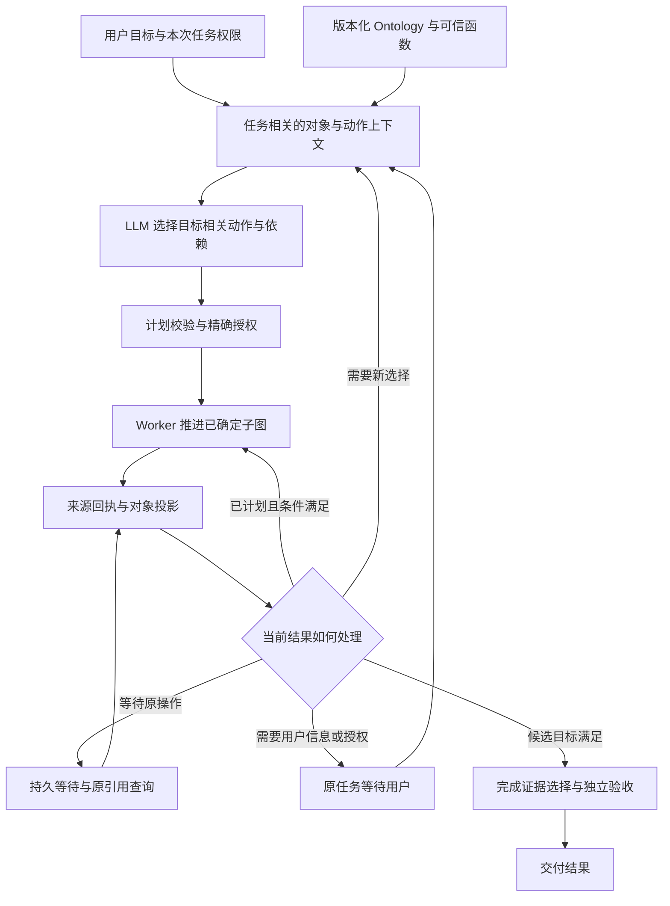

# Palantir Ontology：语义建模、可执行 Action 与 EIGOS 路径设计研究

研究日期：2026-10-24（Asia/Shanghai）。用户已确认「PaLM」指 Palantir Foundry／AIP Ontology。

本文保留改造前的研究与源码快照；后续已实施的 v20 合同和真实验证范围见[模型选择的只读依赖图](../ontology-read-dataflow-2026-10-24.md)。第 7 节的实现现状按其注明的源码版本理解。

范围：按当前问题阅读、交叉核对 40 页官方主干文档，覆盖语义建模、Action／Function、权限、外部写入、AIP 编排、Agent 状态、SDK 和验证；不是对 Palantir 全部子页面与 API 参考的穷尽阅读。没有运行 Palantir 环境，没有进行外部业务操作，也没有在本轮重新测量 EIGOS 延迟。各节以来源链接标明官方事实，以「建议」标明 EIGOS 设计；第 7 节另列实际源码证据。

## 1. 对当前问题的结论

Palantir 明确把 Ontology 分为语义元素（objects、properties、links）与能够产生变化的元素（actions、functions、dynamic security）。Action 的输入、规则和提交条件由构建者定义，复杂逻辑还需要编写 Function。[Ontology overview][s01] [Action types][s09] [Function-backed actions][s13]

据此得到的设计判断是：**语义图说明业务中有什么、如何关联；可执行合同说明能做什么；运行时决定何时绑定参数、执行、等待、验证和重新规划。不能从「存在 Link 或 Action 描述」推断系统已经能自动生成并推进业务流程。** 对减少串行 LLM 调用，值得学习的是这几层之间的明确合同，而不是仅增加本体说明文字。

术语需要区分：Palantir 的 Action 以受控的 Ontology edits 与相关副作用为核心。[Action types][s09] 本文对 EIGOS 的执行路径建议同时包括查询、观察、Function 和外部写入节点；查询节点也可以参与依赖图，但这不表示它们与 Foundry Action API 一一对应。

## 2. 如何建构语义模型

| 问题 | 官方文档给出的建模依据 | 对 EIGOS 的设计含义（建议） |
| --- | --- | --- |
| 从哪里开始？ | 对象应对应真实实体／事件，避免照搬数据表、API 响应或部门系统；围绕实际业务问题验证模型。[Best practices][s02] | 先定义「什么结果算完成」，再定义活动、参与者、报名、凭证等实体；不要从每个工具名生成一个业务对象。 |
| 什么是对象？ | Object type 是实体／事件的 schema，object 是实例，object set 是实例集合。[Object types][s04] | 分开「可报名活动」与「这一次报名」，避免在活动上放一个不能区分参与者的 `registered=true`。 |
| 如何给对象身份？ | Property 有明确类型；主键与展示标题承担不同作用；全部通过 Actions 生成数据的对象类型可以没有 backing datasource。[Properties][s05] | 使用稳定的内部 ID，加独立的 provider ID；名称、地点、状态不能充当稳定身份。 |
| Link 表示什么？ | Link type 定义对象类型之间的关系；一个 Link 本身已有双向可遍历的两侧，并非需要创建两个反向 Link。[Link types][s06] | `Registration → Event` 是业务关系；`Step B dependsOn Step A` 是执行依赖，需要另建明确的步骤合同。两者不要混为一种边。 |
| 关系本身有状态怎么办？ | 无自身元数据的关系可用直接 Link；带日期、角色、状态等元数据时，官方建议使用 object-backed link。[Structural guidance][s03] | 把参与者与活动间的报名建成 `Registration`，在其上保存状态、提交时间、provider reference 和凭证关联。 |
| 如何跨供应商复用？ | Interface 定义共同属性、Link／Action constraints 等抽象形状；不能直接实例化，必须落实为具体对象类型；一个对象类型可实现多个接口。[Interfaces][s07] | `Reservable`、`Schedulable`、`Locatable` 可表达共享能力；各供应商仍需具体输入映射和执行实现。 |

官方还建议事实只保留一个权威位置，用 derived properties 提供便利访问；稳定输入的预计算与依赖动态对象的运行时派生需要区分，后者也有查询成本。[Structural guidance][s03] 对 EIGOS，建议把地址、时间、证据来源的权威值与为了某次执行而冻结的快照区分开；快照应注明来源、版本和采集时点。

## 3. Action 应当是可执行合同

### 3.1 三个需要分开的部分

- **Parameters** 是有类型的外部输入，可以被规则、提交条件和参数覆盖配置引用；表单是否显示、是否可由用户修改是另外的配置。[Parameters][s10]
- **Submission criteria** 决定这组参数在当前用户／执行上下文下能否提交，可以组合业务条件；它独立于「谁能编辑 Action 定义」的权限。[Submission criteria][s11]
- **Rules／Function** 定义实际变化。规则能直接使用输入、对象属性、静态值、当前用户／时间进行映射；复杂跨对象计算可使用 function-backed action。[Rules][s12] [Function-backed actions][s13]

因此，**复制字段、类型检查、固定状态赋值、已确定的计算不必以一轮新的 LLM 推理来实现**。这是基于上述机制提出的 EIGOS 分工建议，不是 Palantir 对任意任务自动消除模型调用的保证。

### 3.2 Interface 合同不等于具体执行语义

Interface action type constraint 主要约束参数形状与具体 Action 的映射，不定义执行逻辑、提交条件、side effects 或表单。具体 Action 的语义仍需逐个审查。当前 TypeScript OSDK 可先解析映射，再调用满足约束的具体 Action，不能直接调用 constraint 本身；该能力及平台支持仍有 beta／部分支持限制。[Interface action type constraints][s08]

建议 EIGOS 也保持这个区别：公共接口可以要求「支持预订」「输入是可预订对象引用」，但不能仅因供应商映射符合参数形状，就认定它具有相同的取消、确认、支付或幂等语义。

### 3.3 建议的 EIGOS Action 合同检查表

以下是设计建议，不是 Palantir 配置字段的逐项翻译，也不代表 EIGOS 已实现：

| 合同部分 | 至少需要明确的内容 |
| --- | --- |
| 身份与版本 | Action ID、版本、实现／供应商 binding、兼容性与负责人 |
| 输入／输出 | 输入 schema、对象引用、必填字段、输出 schema、可供后续引用的字段 |
| 提交条件 | 允许的业务状态、证据时效、资源可用性、输入版本；提交时重新校验 |
| 授权条件 | 执行者、用户授权范围、外部影响、费用上限、到期时间；不从模型文字推导授权 |
| 确定逻辑 | 字段映射、计算、状态更新、允许写入的对象／属性 |
| 外部调用 | endpoint／adapter、超时、provider reference、幂等键、重复提交与未知结果处理 |
| 成功与证据 | 接受调用、提交成功、供应商确认、独立回读分别对应什么状态和证据 |
| 失败与恢复 | 可重试、需补参数、需重新选择、需用户决定、外部结果未知分别怎么处理 |
| 后续推进 | 哪些已批准依赖步骤可由执行器继续；哪些新事实必须唤醒 LLM；并行限制与取消传播 |

## 4. 权限与校验不能只留在 Prompt

Action 的可见、可编辑、可应用权限是不同问题。应用 Action 仍需通过提交条件并满足相关对象／数据源权限；只允许 Actions 编辑的配置与允许其他直接编辑的配置也有不同要求。[Permissions][s15]

多数据源对象的可见性可能是不完整的。例如，未获得权限的其他数据源属性在校验中可能呈现为 `null`；部分可见对象的修改与完整删除也有不同检查。[Permission checks][s17] **设计建议：EIGOS 的条件求值应区分「值为空」与「无权读取／尚未取得」，不要把未知当成满足否定条件。**

Read／write authorizations 是附加的数据安全边界，不授予原本不存在的权限，也不替代提交条件；页面标注 beta。官方还明确提醒，读时的行／列过滤不能被想当然地当成下游写入保护，输出安全需单独考虑。[Read and write authorizations][s18] [Permissions][s15]

设计建议：LLM 可以提议 Action，执行器应在真实执行前对输入、业务状态、权限、用户授权和目标证据做权威检查；检查结果要结构化返回，避免再让模型解释一句错误文本才能判断是否继续。

## 5. 外部业务路径的事务与验证边界

### 5.1 Ontology 事务不是跨供应商事务

Action 的原子性覆盖 Ontology edits，不覆盖通知、Webhook 或 backing function 的外部调用。默认 batched writes 在结束时原子提交，本次 Action 的后续读取不会看到尚未提交的自身编辑；staged writes 的支持与隔离限制另有条件。[Consistency and isolation][s14]

| 外部 Webhook 模式 | 官方执行语义 | 对路径设计的含义（建议） |
| --- | --- | --- |
| Writeback | 先调用外部系统，失败则不再执行其他变化；只能配置一个；响应输出可供后续规则使用。外部成功后，Ontology 编辑仍可能失败。[Webhooks][s16] | 保存外部请求身份和回执；不能在本地提交失败时直接重做业务请求。 |
| Side effect | Ontology 编辑之后执行；可有多条且无顺序保证；用户可能已经看到成功，外部调用才发生或失败。[Webhooks][s16] | 适用于允许尽力而为的副作用；不能把本地成功状态直接写成供应商履约成功。 |

官方默认只自动重试没有外部调用的 Action；有外部调用时，重新执行可能重复副作用。显式允许重试时需要调用可安全重复。Snapshot isolation 也不能自动阻止跨不同对象的 write skew。[Consistency and isolation][s14]

设计建议：EIGOS 把外部操作区分为 `not_submitted`、`submitted`、`confirmed`、`failed`、`unknown`；`unknown` 先查询原操作，而不是换供应商或重试。已批准计划的正常推进可以确定执行，但新外部影响仍必须满足原授权。

### 5.2 校验通过、API 成功与真实完成要分别记录

Apply Action API 明确说 HTTP 200 只说明服务器接收并处理了请求，需要检查 response 中的 validation。该 REST endpoint 当前不支持 parameter default values；不能把应用界面或 SDK 的行为直接套在 REST 调用上。[Apply Action API][s19]

Ontology Manager Test run 不提交 Ontology edits，会展示拟议变化与执行分解，并跳过 side effect webhooks、通知和 schedule build。但为计算结果所需的 writeback webhook／外部 Function 调用仍可能实际执行，官方会要求确认这些外部调用。[Test run][s20]

设计建议：EIGOS 验证合同应写清楚「只校验」「本地模拟」「真实调用」「供应商回读」的级别，不因一个入口名叫 test／validate 就认定绝无外部影响；对真实业务的最终完成要求供应商证据与验收条件同时满足。

## 6. 为 EIGOS 建立三种不同的路径

本节均为建议。其依据是官方将关系、Action 输入与规则、权限及外部写入分开建模的机制，不是声称 Palantir 自动生成这些流程。

1. **业务关系路径**回答「对象彼此是什么关系」。例如 `Participant → Registration → Event → Venue`，`Registration → Receipt`。关系帮助查询与取数，不自行执行报名。
2. **业务状态路径**回答「允许从什么状态变成什么状态」。例如报名从未提交到已提交，再到已确认；每次转移指向一个 Action，并带有授权、时效和证据条件。失败、取消、未知结果也应是明确分支。
3. **本次执行依赖路径**回答「在本次授权下，哪些步骤已确定，可以接着执行」。节点绑定具体 Action；边绑定所需输出／对象引用。执行器处理依赖就绪、字段绑定、条件求值、超时和回读；模型处理尚未确定的选择与例外。

以「活动报名、日历、出行估价」作为建模示例，可以把以下节点写成一份阶段计划；这只是设计，不代表本轮已授权或执行这些操作：

| 节点 | 输入绑定与依赖 | 正常推进条件 | 需重新决策的例子 |
| --- | --- | --- | --- |
| 读取活动与场地 | 活动引用 → 时间、场地、报名要求 | 信息齐全、来源与时效满足合同 | 地址含糊、时间冲突 |
| 报名提交 | 已选活动＋参与者＋该操作授权 | 已批准参数与条件再次校验 | 报名转付费、条件改变 |
| 报名回读 | 原提交的 provider reference | 独立确认＋保存凭证 | 请求超时且结果未知 |
| 创建日历 | 已确认活动的时间与地点引用＋日历授权 | 参数映射确定、回读日历结果 | 时间变更或重复事件 |
| 出行估价 | 活动地点／时间引用＋出发地 | 仅估价，保存报价时点与限制 | 找不到确定地点、报价不适用 |

叫车下单、付款与估价分别建模；当前项目禁止真实下单或付款。本设计不把估价自动升级成订单，也不从报名成功自动推导对其他外部操作的授权。

建议先让一个窄用例形成可验证闭环，再扩展接口与供应商：验收条件 → 对象／身份 → 有意义的关系 → Action 合同 → 参数与证据绑定 → 正常推进／例外分流 → 外部回读。提速目标应验证为「成功率与授权边界保持时，关键路径上的模型回合减少」，而非只看本体查询次数。

## 7. EIGOS 现有运行时与编排核对

### 7.1 官方的运行路径由哪些机制承担

Palantir 的 Ontology backend 本身包含元数据、对象存储、查询、写入编排和 Functions 等不同服务。[Ontology architecture][s37] 这支持一种分层理解：本体定义会被真实查询、计算与写入服务消费，LLM 是其中的调用者之一；定义本身不代替这些执行实现。

| 机制 | 已核对的官方行为 | 对 EIGOS 的设计启示（建议） |
| --- | --- | --- |
| AIP Logic blocks | 上一块输出可供后续块使用；`Apply action` 块可直接确定性调用 Action；另有执行函数、条件分支、循环和变量。[Blocks][s21] | 将参数绑定与已确定分支交给运行时。区分「模型可调用的工具」和「流程中直接执行的步骤」。 |
| Functions | 服务端代码可以读取对象属性、遍历 Link、计算并支持复杂编辑；各语言／版本支持范围需分别核对。[Functions][s38] | 把业务判断的确定部分注册为有版本的函数；自然语言说明帮助发现，实际校验由函数承担。 |
| AIP Analyst 的分工 | 官方将逐步工具探索、复用指令、确定函数与异步 Agent 分开；稳定计算可收进函数，避免中间结果反复经过模型。[Compute usage][s24] | 函数封装应对应稳定业务计算或已确定查询，保留真实来源与执行账本。 |
| Automate | 条件可以基于时间、对象或数据集；满足条件后执行 Action、Logic 或 Function 等效果。[Automate][s25] | 事件／时间驱动负责唤醒工作，任务是否需要模型判断另行决定。 |
| Agent Stack | 用 session、typed context items、events 和 state transitions 保存进度、等待参与者并续办任务。[Agent Stack][s29] | 持久任务状态承载连续性；模型会话负责当前决策，重启后仍可从账本恢复。 |
| Pro-code agents | 发布为异步函数，返回 `Void`；结果写入 Ontology 后再读取。[Pro-code agents][s30] [Publish and call][s31] | 异步受理、执行中与业务完成分别表示，调用方通过同一任务读取结果。 |
| OSDK／Ontology-as-code | SDK 类型来自相关本体子集；SuperRepo 中的 TypeScript 定义可编译为实体，定义与实现一起版本化。[OSDK][s39] [SuperRepo][s40] | 可以继续使用 EIGOS 现有 TypeScript＋JSON 定义；重点是单一维护来源、类型校验和运行快照。 |

几个采用限制需要同时保留：

- Automate 的显式 automation dependency 目前只支持 parent → child，不支持多级链；父执行成功或失败都会触发下游条件评估。[Automation dependencies][s26] 它不能直接作为「任意成功依赖 DAG 调度器」的现成依据。
- AIP Logic staged writes 页面标注 beta；嵌套编辑先暂存、执行结束后应用，接入 Automate 时需经 Action effect，而不是沿用 legacy Logic effect。[Staged writes][s22] 不同执行模式的语义不能混写。
- Logic 默认 user-scoped，也可以配置 project-scoped；后者的执行权限和日志可见性不同。[Execution mode settings][s23] 「始终以终端用户身份执行」不是所有配置通用的结论。
- 当前 `agent-studio` 概览重定向为 **AIP Chatbot Studio**。[Chatbot Studio][s36] 新 Agent Stack 页面把 agents in OSDK 和 AIP Logic 集成标为 coming soon；旧 pro-code agent 的 OSDK 调用与这组新 session API 要分别看待。[Agent Stack][s29]
- Workflow Builder 当前重定向为 **Workflow Lineage**，用于理解、管理和调试资源与依赖。[Workflow Lineage][s35] 图上的资源依赖可用于分析，不能单凭图推断有自动执行调度语义。

### 7.2 EIGOS 已有能力：先在现有结构上改进

源码核对起点是当前工作分支的 `6abdb13`。以下是本地源码证据，不是对常驻实例、某次运行或生产结果的认证。其他开发者的权限与 security-s0 改动正在同一工作区推进，本轮没有修改或纳入那些文件。

| 当前实现 | 源码位置 | 对原有慢任务假设的修正 |
| --- | --- | --- |
| 每次决策允许请求本体读取，返回后再产生模型响应；支持 Worker 先准备新鲜上下文 | [`reasoning-loop.ts`](../../packages/coordinator/reasoning-loop.ts)、[`planning-session.ts`](../../packages/coordinator/planning-session.ts) | 机械发现确实可能产生回合，但 `worker_snapshot` 路径已能省去部分发现往返。新决策的真实读取证据与历史会话分别处理。 |
| 一次 Agent 决策最多提交 4 个步骤，明确声明 `dependsOn` 与 `inputRefs` | [`agent-actions.ts`](../../packages/ontology/agent-actions.ts) | 已有动态子图合同，不能把现状概括为「每一个动作都必须重新问模型」。 |
| 全只读子图按自身依赖就绪执行；独立读取可并行；已有 pending plan 会直接续执行 | [`agent-runtime.ts`](../../packages/coordinator/agent-runtime.ts) 的 `run`／`execute` | 图内正常推进已有程序承担，且没有整批等待的屏障。应检查实际模型把多少可确定步骤放进了同一图。 |
| 图执行完会清除 pending plan 并回到 planning；最终 complete 也要求模型选择证据 | 同文件 `execute` 末尾及 `decision.kind === 'complete'` 分支 | 仍有清楚的阶段边界需要模型；要逐个判断该边界是否包含真实新决策。最终主机验收独立于模型主张。 |
| 动态 Agent 图的 `inputRefs` 绑定的是前一步已接受的 `ObjectRef` | 同文件 `executeStep` | 当前不是任意字段表达式。另一路通用 `ExecutionPlan` 已有带 `path` 的引用，扩展前应梳理两种合同，避免再造第三套。 |
| 业务写入要求当前已读事实与精确授权，不接受动态 `inputRefs`；每个阶段至多一个非 read 步骤 | 同文件计划校验；[`agent-authorization.ts`](../../packages/core/agent-authorization.ts) | 写入边界具有明确目的，不能为减少模型回合直接套用只读图的执行规则。 |
| MCP 映射、参数来源与证据前提已在独立 JSON 中维护 | [`ontology/README.md`](../../ontology/README.md)、[`mcp-read.ts`](../../packages/ontology/mcp-read.ts) | `requires` 明确只是证据前提，不会自动选择／执行上游动作。当前适配器也不负责选业务路径。 |
| Action 定义中的 `changes`／`submissionCriteria` 含文字元数据；实际 schema、来源与业务验证另由可信代码落实 | [`model.ts`](../../packages/ontology/model.ts)、[`agent-program.ts`](../../packages/core/agent-program.ts) | 不能仅靠读取说明自动获得通用状态转移执行器；也不能误称当前所有校验都由模型执行。 |
| 未知外部结果按原操作身份恢复；租约、取消与任务 revision 限制迟到结果 | [`agent-runtime.ts`](../../packages/coordinator/agent-runtime.ts)、[`actions.ts`](../../packages/ontology/actions.ts) | 状态查询、持久等待与恢复已有确定处理，进一步提速必须保留这些保障。 |

[`model-reasoning-latency.md`](../model-reasoning-latency.md) 已记录上下文预取、首轮解释与动作草案合并、临时会话复用、增量呈现等历次工作。因此这些不能再列成全部缺失的能力。该文档里的历史耗时与用户提供的「36 次模型调用／74 次本体读取／8 轮规划」都不是本轮实测；本轮不以它们断言当前实例的具体瓶颈。

**目前能成立的定位是：已有可执行子图；仍需检查图的决策边界、合同表达能力和上下文范围。是否因此变慢，需要同一任务的实际 trace 来证明。**

### 7.3 建议的整体架构

沿用 Gateway／Worker、Ontology 定义、AgentActionPlan 与持久意图账本，不另建一套脱离现有任务系统的业务流程框架：



图中的完成证据选择保留当前模型合同。未来若要让闭合、确定目标直接通过验证器结束，需要显式设计完成模式和迁移版本；本轮没有实施该变更。模型判定完成也不能绕过主机的硬条件与独立来源验收。

三类路径分别维护：

- **关系图**：Event 在哪个 Venue、Registration 属于哪个 Participant，供查询、取数与溯源。
- **动作与状态合同**：哪些证据允许执行哪个动作，可能产生哪些状态，以及如何确认。需要可执行的函数与 schema 承担条件检查。
- **本次计划实例**：模型已选的具体动作、依赖、参数来源、授权与版本。执行器只推进其中的就绪步骤，不从「所有可用动作」里自行选择业务目标。

动态组合发生在计划实例。可复用的业务规律保存在动作／函数合同中。二者让新任务能够组合已有能力，同时让确定的取数、计算与字段绑定连续执行。

### 7.4 建议补齐的机器可执行细节

以下是在现有合同上的演进建议，均未实现。具体字段命名应在实施时确定；不引入可执行任意代码的表达式语言。

| 部分 | 建议如何表达 | 执行责任 |
| --- | --- | --- |
| 目标 | 本次请求的硬要求、结果谓词、证据级别与允许的交付形式 | 模型解释目标；主机检查原请求与最终结果一致 |
| Action 可用性 | 输入对象类型、效果类别、当前绑定、授权范围、条件求值 `pass / fail / unknown` | 程序先做权威过滤；未知证据保留为待取得，不当作通过 |
| 前置与结果检查 | 注册函数 ID＋版本＋显式输入绑定；纯校验与外部读取分开 | 可信函数执行，输出结构化原因与证据引用 |
| 参数引用 | 当前对象引用、已选来源字段、前一步已接受输出；记录路径、类型、来源版本 | 执行器在输出真实产生后绑定，禁止预造 provider ID、价格或回执 |
| 已确定分支 | 计划中已选的分支＋有版本的纯条件函数；明确 unknown 走向 | 条件满足后推进指定步骤；新选择返回模型或用户 |
| 输出与业务后果 | 输出类型、状态枚举、影响对象、provider reference、证据要求 | 连接器返回事实，投影器登记受控对象，验证器检查后果 |
| 恢复 | 原操作键、可查证方式、等待上限、重放规则与人工交接条件 | 先查原操作；未知的外部写入不重放 |
| 完成 | 证据选择模式、目标谓词、独立 verifier 与拒绝原因 | 先保留当前显式模型完成；确定完成模式另行评审 |

可以从现有 `prepareContext` 演进出一个一次返回的决策视图：相关对象、当前值与来源、相关 Action 完整输入、纯条件检查结果、缺失证据和权限限制。保持已有真实读取回执及 owner／request revision 约束；允许模型按需补查。稳定定义可按摘要复用，来源事实的时效与授权仍在真实执行前核验。

Action 索引可以按类型、效果、输入需求和绑定筛小范围。**类型兼容、条件满足或只剩一个候选，都不足以单独授权执行；仍需属于本次已选择的计划。** 这是避免把「自动筛选」扩成「执行器自行决定业务路径」的关键约束。

跨服务字段绑定还要保留两层验证：先检查输出字段能否满足下游输入类型，再检查业务含义。例如活动场馆坐标可以用作目的地，但不能把供应商内部报名 ID 当作另一个系统的 event ID。接口抽象统一的是含义与能力，供应商事实仍由各自 binding 验证。

### 7.5 用当前滴滴只读链路说明决策边界

当前定义只有 `SearchDidiPlaces` 与 `EstimateDidiRide`。估价依赖实际返回的两端地点观察、所选地点 ID 和纯评估；详情见 [`didi-readonly.json`](../../ontology/didi-readonly.json)。

```text
模型：选择查哪两个端点、查询词和依赖
    → 执行器：并行运行两个已选搜索，保存真实观察
模型：根据返回候选选择地点；有歧义则向用户补问
    → 执行器：从已选来源绑定坐标、校验后估价
模型：选择完成证据
    → 主机：独立检查来源、路线和硬要求，再交付估价
```

两端搜索可以同图执行；来源尚未返回时，地点选择仍是信息边界。当前定义还要求模型读取和评估来源，因此不能仅因某次结果只有一项，就悄悄让连接器代替模型选中。

如果未来希望进一步消去纯机械地点选择，需要另行声明并验证一种足够明确的确定规则，例如：城市、规范化名称、唯一候选和有效坐标同时满足时，输出一个带来源证明的选择；多候选、同名异址或字段缺失立即转决策。即使采用该规则，也应由模型在本次计划中选用这种能力，主机保留全部返回候选和来源检查。它属于业务合同演进，不是传输层优化。

「报名 → 日历 → 出行」可沿相同方式建模，但日历／叫车连接器及其权限需要实际接入。报名后依据已确认凭证绑定时间地点属于确定的数据流；场馆不明、冲突、候补、转付费、授权过期和外部结果未知分别进入对应处理状态。不能为了预先规划而猜测这些事实。

### 7.6 建议的实施顺序与可证伪验收

本轮交付到研究与架构建议，没有修改执行代码、部署实例或开展真实业务测试。

| 顺序 | 产物 | 能证伪的检查 |
| --- | --- | --- |
| 1. 还原一条当前慢任务 | 同一 task／revision 的调用与事件时间线，标注每次模型响应的用途 | 区分模型响应数、模型会话数、图数与实际业务调用数；若模型仅占小部分，应调整优化方向 |
| 2. 固化现有合同 | 列出 Action／Function 的输入、状态、证据、授权和未知路径；标明文字说明由哪段可信代码落实 | 缺失、陈旧或越权来源必须阻止派发；不得因新增合同绕过现有 grant |
| 3. 扩展确定数据流 | 先针对只读图验证类型化输出绑定、纯计算与已选分支 | 能逐项证明下游参数来自真实接受输出；歧义／unknown 仍回到决策，取消和租约丢失不接着执行 |
| 4. 缩减机械回合 | 对同一用例比较现状与新设计；使用相同来源条件及成功定义 | 逐个指出消失的模型调用原先只做什么；保留成功率、证据与授权质量，不能只比较 token |
| 5. 再评估写入和完成合同 | 根据真实未知状态、异步回读与授权边界决定是否扩大连续执行范围 | 重启不重放写入；外部超时先查原操作；候补／估价／受理不得被当作履约完成 |

观测层应至少关联 task、revision、plan、step、intent、attempt、model run 与 source receipt。Span 记录开始／结束、父调用、类型、版本、失败和重试；模型另外记录可获得的 token、缓存和推理设置。官方 Trace views 提供的也是时间线、父子 span、操作类型和模型用量这些视角。[Observability][s32] [Trace views][s33]

端到端耗时按墙钟测量；父子 span 和并行 span 不能直接全部相加。分别比较首个可执行动作、首个真实业务动作和最终独立验收的时间。离线来源回放可以检验决策与恢复语义，但不能证明真实接口或模型延迟改善。不同模型／提示的重复样本与输出质量比较，可参考官方 AIP Evals 的测试用例和评价函数机制。[AIP Evals][s34]

批量化与后端聚合可减少重复调用，但需符合依赖与授权合同；官方 Automate 性能文档也强调批量条件、批量输入与批量计算配合。[Performance best practices][s27] 自动化重试有平台自己的规则，[Retries][s28] 不能直接迁移成 EIGOS 外部业务的重放许可。

## 8. 核心阅读地图与覆盖限制

以下 40 页是本笔记实际使用的来源；依据 2026-10-24 可访问的官方文档，部署版本、beta 开通和 SDK／语言支持仍需在采用时核验。

| 次序 | 官方页面 | 阅读目的 |
| --- | --- | --- |
| 01 | [Ontology overview][s01] | 语义、动作、逻辑与安全的总体分工 |
| 02 | [Ontology design: Best practices][s02] | 从业务实体与问题出发，避免照搬源系统 |
| 03 | [Ontology design: Structural guidance][s03] | 事实归属、派生值、接口、有元数据的关系 |
| 04 | [Object types][s04] | 类型、实例、集合 |
| 05 | [Properties][s05] | 属性类型、主键、标题、数据来源 |
| 06 | [Link types][s06] | 关系含义、双向遍历与边界 |
| 07 | [Interfaces][s07] | 抽象能力与具体类型、支持范围 |
| 08 | [Interface action type constraints][s08] | 参数形状、实现映射与执行语义的区别 |
| 09 | [Action types][s09] | 一次动作定义与提交的基本模型 |
| 10 | [Parameters][s10] | 输入与规则／条件的连接 |
| 11 | [Submission criteria][s11] | 用户、参数与上下文条件 |
| 12 | [Rules][s12] | 确定映射、对象／关系变化、规则组合限制 |
| 13 | [Function-backed actions][s13] | 复杂逻辑需要可执行实现 |
| 14 | [Consistency and isolation][s14] | 原子性、读写模式、并发与重试边界 |
| 15 | [Permissions][s15] | 定义权限、应用权限与下游写入保护 |
| 16 | [Webhooks][s16] | writeback／side effect 与外部成功边界 |
| 17 | [Permission checks for Actions][s17] | 多来源对象与部分可见数据 |
| 18 | [Read and write authorizations][s18] | 附加输入／输出安全边界，beta 限制 |
| 19 | [Apply Action API][s19] | 响应 validation 与 API 合同差异 |
| 20 | [Test run][s20] | 拟议编辑与可能真实执行的外部调用 |
| 21 | [AIP Logic: Blocks][s21] | 确定 Action、函数、参数传递与控制流 |
| 22 | [AIP Logic: Staged writes][s22] | 嵌套编辑、提交语义与 beta 模式差异 |
| 23 | [Execution mode settings][s23] | 用户／项目执行身份与日志范围 |
| 24 | [AIP Analyst: Compute usage][s24] | 逐步工具探索与函数封装的成本分工 |
| 25 | [Automate overview][s25] | 条件、触发与执行效果 |
| 26 | [Automation dependencies][s26] | 父子触发、成功／失败与多级链限制 |
| 27 | [Automate performance best practices][s27] | 批量输入、聚合与执行频率 |
| 28 | [Manual and automatic retries][s28] | effect／event 重试语义 |
| 29 | [The Agent Stack][s29] | session、类型化上下文、事件与状态转移 |
| 30 | [Pro-code agents][s30] | SDK、作用域与异步 Agent |
| 31 | [Publish and call a pro-code agent][s31] | 异步返回 Void、结果持久化与读取 |
| 32 | [Observability overview][s32] | 执行历史、指标与跟踪 |
| 33 | [Trace views][s33] | 请求时间线、父子 span、模型交互 |
| 34 | [AIP Evals][s34] | 用例、评价函数、版本与模型比较 |
| 35 | [Workflow Lineage][s35] | 资源依赖分析、管理与调试 |
| 36 | [AIP Chatbot Studio overview][s36] | 原 Agent Studio 的当前名称与用途 |
| 37 | [Ontology architecture][s37] | 元数据、查询、对象存储与写入服务分工 |
| 38 | [Functions overview][s38] | 可执行对象逻辑与语言支持边界 |
| 39 | [OSDK overview][s39] | 本体子集生成类型、权限与应用访问 |
| 40 | [SuperRepo core concepts][s40] | Ontology-as-code、构建与本地预览边界 |

本笔记没有核验特定 Foundry enrollment 的可用能力，没有覆盖上述产品的全部子页面、API／SDK 参考、Scenarios、完整数据接入与生产部署配置。采用 SuperRepo 等 beta 能力时，需另核对所用版本；本地 preview 只是对真实平台部分交互的近似。[SuperRepo][s40] 这些文档和源码也不能证明 EIGOS 某次任务的真实延迟瓶颈；那需要完整运行追踪。

[s01]: https://www.palantir.com/docs/foundry/ontology/overview
[s02]: https://www.palantir.com/docs/foundry/ontology/ontology-best-practices
[s03]: https://www.palantir.com/docs/foundry/ontology/ontology-structural-guidance
[s04]: https://www.palantir.com/docs/foundry/object-link-types/object-types-overview
[s05]: https://www.palantir.com/docs/foundry/object-link-types/properties-overview
[s06]: https://www.palantir.com/docs/foundry/object-link-types/link-types-overview
[s07]: https://www.palantir.com/docs/foundry/interfaces/interface-overview
[s08]: https://www.palantir.com/docs/foundry/interfaces/interface-action-type-constraints
[s09]: https://www.palantir.com/docs/foundry/action-types/overview
[s10]: https://www.palantir.com/docs/foundry/action-types/parameter-overview
[s11]: https://www.palantir.com/docs/foundry/action-types/submission-criteria
[s12]: https://www.palantir.com/docs/foundry/action-types/rules
[s13]: https://www.palantir.com/docs/foundry/action-types/function-actions-overview
[s14]: https://www.palantir.com/docs/foundry/action-types/consistency-guarantees
[s15]: https://www.palantir.com/docs/foundry/action-types/permissions
[s16]: https://www.palantir.com/docs/foundry/action-types/webhooks
[s17]: https://www.palantir.com/docs/foundry/object-edits/permission-checks
[s18]: https://www.palantir.com/docs/foundry/action-types/read-write-authorizations
[s19]: https://www.palantir.com/docs/foundry/api/v2/ontologies-v2-resources/actions/apply-action
[s20]: https://www.palantir.com/docs/foundry/action-types/test-run
[s21]: https://www.palantir.com/docs/foundry/logic/blocks
[s22]: https://www.palantir.com/docs/foundry/logic/staged-writes
[s23]: https://www.palantir.com/docs/foundry/logic/execution-mode-settings
[s24]: https://www.palantir.com/docs/foundry/aip-analyst/compute-usage
[s25]: https://www.palantir.com/docs/foundry/automate/overview
[s26]: https://www.palantir.com/docs/foundry/automate/automation-dependencies
[s27]: https://www.palantir.com/docs/foundry/automate/performance-best-practices
[s28]: https://www.palantir.com/docs/foundry/automate/retries
[s29]: https://www.palantir.com/docs/foundry/aip/agent-stack
[s30]: https://www.palantir.com/docs/foundry/agents/overview
[s31]: https://www.palantir.com/docs/foundry/agents/publish-and-call
[s32]: https://www.palantir.com/docs/foundry/observability/overview
[s33]: https://www.palantir.com/docs/foundry/aip-observability/trace-view
[s34]: https://www.palantir.com/docs/foundry/aip-evals/overview
[s35]: https://www.palantir.com/docs/foundry/workflow-lineage/overview
[s36]: https://www.palantir.com/docs/foundry/chatbot-studio/overview
[s37]: https://www.palantir.com/docs/foundry/object-backend/overview
[s38]: https://www.palantir.com/docs/foundry/functions/overview
[s39]: https://www.palantir.com/docs/foundry/ontology-sdk/overview
[s40]: https://www.palantir.com/docs/foundry/superrepo/core-concepts
