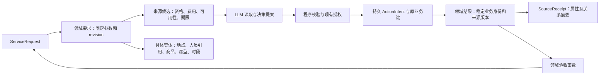

# 六类服务本体：实现、验收与接口缺口

2026-10-18。范围来自用户追加要求：打车、医院挂号、外卖、酒店、行程安排、订车／租车一起补齐对象、关系、规则、动作和完成验收，并实现与测试。订车范围经用户确认是预约用车（接送机、包车等）与自驾租车，不含购车。

本轮代码已实现六类模型、查询、条件、决策提案、来源投影、沙箱动作及独立验收。运行契约为 `ontology-execution-v7`，业务模型为 `eigos.business@5`。全模型有 **65 个具体类型、2 个接口、23 个只读函数、10 个决策 Action 定义**；六类扩展增加 35 个类型、12 个函数和 6 个 Action；后续 UCP 接入再增加 2 个类型、2 个函数和 2 个 Action。代码和合成流程不代表真实服务已接通；没有实际下单、付款、挂号或预订，也没有切换本人常驻部署。

## 1. 每类业务的对象与完成终点

每类保留三种不同身份：用户固定要求、来源候选、实际业务结果。它们通过双向关系接回同一 ServiceRequest，并固定需求 revision。具体字段由 [模型定义](../packages/ontology/service-domains.ts) 的严格 schema 维护，不接受随意增加的键。

| 领域 | 主要对象 | 具体业务对象 | 结果必须证明什么 |
| --- | --- | --- | --- |
| 打车 | RideRequest、RideOption、RideTrip | RideRoute、TransportVehicle | 指定起终点、人数、车型，实际上车及到达时间，完整最终车费；司机接单不算到达 |
| 医院挂号 | AppointmentRequest、AppointmentOption、MedicalAppointment | Hospital、MedicalDepartment、Practitioner、PatientProfile、AppointmentSlot | 正确就诊人、医院院区、科室、医生、时段及有效确认；资格和必要挂号费均已核实 |
| 外卖 | FoodRequest、FoodOption、FoodDelivery | FoodMerchant、MenuItem | 正确商家、每项 SKU／规格／数量、实际目的地和送达时间，完整费用及明确提出的食材限制 |
| 酒店 | HotelRequest、HotelOption、HotelReservation | HotelProperty、RoomType、RoomInventory | 指定酒店、房型、入住退房日期、时区、房间数、人数、取消条款和确认号；要求住宿完成时另查实际入住退房 |
| 行程安排 | ItineraryRequest、ItineraryOption、Itinerary | ItineraryItem、TravelLeg | 每段安排、交通可行性、衔接地点、绝对时间和缓冲、完整费用；方案交付披露未订项，订妥目标逐段核对确认 |
| 预约用车／租车 | VehicleRequest、VehicleOption、VehicleBooking | VehicleClass、RentalPolicy、VehicleInspection | 模式、车型、人数、取还地点、租期、资格、价格、押金和确认；完成使用另查交接、归还、验车及押金状态 |

医院模型处理行政挂号，不从症状推断诊断、科室适合性或治疗方案。PatientProfile 的证件和联系字段禁止通过 Agent 查询、筛选或交付物输出；业务关联使用不透明就诊人引用。自驾要求驾驶人引用与来源资格验证；预约带司机用车不要求用户提供驾照。

候选 Option 表示与准确参数绑定的本次可用性，未统一冒充商业 Offer。特别是 ItineraryOption 是方案候选。已有 Offer 接口仍只由配送、商品、餐厅预订报价实现；后续真实报价映射应按实际价格性质和费用范围接入，不能仅因为候选带金额就宣称是有效商业承诺。

## 2. 属性与关系

金额使用 `minor` 整数文本及币种，完整性单独记录；押金限制与服务预算分别比较。时间使用带偏移的绝对时刻，酒店日期另带 IANA 时区；同一时刻的不同 UTC 偏移等价。所有计数有整数范围，拒绝重复 SKU、重复行程段标识、倒置时间区间和退房早于入住。



双向导航包括：

- ServiceRequest ↔ 各领域要求／候选／结果；候选和结果 ↔ 同一领域要求；结果 ↔ 已选候选；候选和结果 ↔ Provider、SourceReceipt。
- 医院 ↔ 科室 ↔ 医师 ↔ 号源；外卖商家 ↔ 菜单规格；酒店 ↔ 房型 ↔ 客房可用性。
- 行程事项 ↔ 交通路段；车型 ↔ 租用条款；各领域要求 ↔ 相应路线、资格引用、交接等具体对象。

来源未提供的辅助属性和关系可以缺失，不能默认填入“已验证”。输入要求、来源观察和独立计算的责任分别记录。核心资格／结果验收读取已绑定的来源记录，辅助对象标题或名字相似不能改变结论。

## 3. 查询、规则与 Action

已有 `describe_ontology`、`query_ontology`、`evaluate_ontology` 直接提供新模型。Worker 模型还可调用 `assess_conditions`、`propose_action`。定义有中文名称、订房／号源／网约车／接送机等别名、属性说明和关系名；工具仍受身份、scope、读取预算、查询数量及上下文版本限制。

| 领域 | 前置核验函数 | 完成验收函数 | 决策 Action | 运行操作及效果 |
| --- | --- | --- | --- | --- |
| 打车 | rideEligibility | rideOutcome | RequestRide | domain.ride.submit / order |
| 医院挂号 | appointmentEligibility | appointmentOutcome | RequestMedicalAppointment | domain.appointment.submit / reserve |
| 外卖 | foodEligibility | foodOutcome | RequestFoodOrder | domain.food.submit / order |
| 酒店 | hotelEligibility | hotelOutcome | RequestHotelReservation | domain.hotel.submit / reserve |
| 行程安排 | itineraryEligibility | itineraryOutcome | BuildItinerary | domain.itinerary.submit / local |
| 预约用车／租车 | vehicleEligibility | vehicleOutcome | RequestVehicleBooking | domain.vehicle.submit / reserve |

对应类型化谓词为 `domain.<领域>.eligible` 与 `domain.<领域>.complete`，分别用于 precondition 和 result。条件绑定领域要求对象；不能将另一个委托的条件或结果拿来验收当前任务。

每个决策 Action 的输入为当前 ServiceRequest、领域要求和候选的准确对象及 revision。提交检查包含归属、当前需求版本、同需求关系、固定参数、候选资格和业务授权。变更集只涵盖委托进度和沟通记录；来源回执另行产生业务结果。模型提案始终 `proposal_only`、`executionAllowed=false`，授权检查不能由模型补成通过。

实际沙箱动作通过现有 `ActionAdapter` 执行。保留稳定操作键、持久意图、事务外调用、原键查询及独立验收。源接口只提供 prepare、submit、lookup；没有开放来源 URL 或执行脚本输入。模型不能把一个决策 Action 的名字替换进已固定的技术步骤。

## 4. 状态及验收规则

结果函数输出 `satisfied / unsatisfied / unknown` 与逐条件依据。source proof 先核对当前属性、关系、来源范围、观察时间和证据等级，再执行领域规则。缺字段、过期或证据不匹配保留 unknown。

| 情形 | 处理 |
| --- | --- |
| 打车已接单／到达上车点 | 仍在进行；必须取得实际到达目的地及最终费用 |
| 挂号费 paid，但状态 pending／held／waitlisted | unknown，不报告挂号成功；占位到期有明确失效结论 |
| 外卖只到一部分，来源仍允许继续交付 | unknown；明确最终交付不足、错误规格或重复 SKU 不能通过 |
| 酒店付款成功但缺确认号／房型不符 | 缺证据为 unknown；已证实房型、日期、人数或条款不符为 unsatisfied |
| 行程无时间重叠，但交通可行性未知 | unknown；还要核对邻接地点及转乘缓冲 |
| 行程方案含未预订项目 | 只有 plan 终点且已披露时可完成；booked 终点必须逐项有确认引用 |
| 自驾车辆已还，押金仍 pending | unknown；只有结清才满足完整使用终点，争议单独表达 |
| 预约带司机用车已确认 | 可以满足 confirmed 终点；不证明行程已经完成 |
| 来源回执修改金额、对象归属、关系或参数 | 原证据失效；不能沿用旧摘要验收 |
| 最终实际费用高于用户预算，但报价较低 | 依据实际费用拒绝验收，不用报价代替实付／最终金额 |

同一来源业务引用更新同一个结果对象；sourceVersion 必须单调，旧版本或同版本冲突不得覆盖。当前对象只关联匹配其当前快照的回执，旧回执保留在需求证据和动作观察历史中。待确认状态同样可以通过对象查询读回。

新增 `completionTarget=domain`。共享 Runtime 必须同时取得领域 satisfied、独立 verifier 通过、固定通用要求及结果条件通过，才能完成。生成 JSON 文件不会绕过该门槛。

同类条件按业务角色分别保存：起点／终点、上车／到达期限、房间数／人数、服务费／押金。候选必须提供对应角色的事实；不能用一个到达承诺代替上车承诺，或用用户的押金上限填充实际押金。已保存要求不能被模型改名或替换。计划费用可声明 `purpose=service_total|deposit`，分别检查相应预算；缺省 purpose 按 service_total 处理，原有未分角色预算仍检查全部费用，执行许可仍检查累计总额。能力／绑定和候选资格函数当前为 v2，业务提交操作仍为 v1。

任务取消与商户取消继续区分：派发前取消阻止动作；派发后保留原操作查证。六类当前适配器没有真实商户取消、改期、退费或支付连接器；本轮没有用本地取消冒充外部取消。原有沙箱售后框架和历史验证继续保留。

## 5. 代码落点与运行方式

| 文件 | 已实现职责 |
| --- | --- |
| [service-domains.ts](../packages/ontology/service-domains.ts) | 六领域参数／结果 schema，类型、属性、关系、Action、函数及谓词目录 |
| [domain-rules.ts](../packages/ontology/domain-rules.ts) | 领域完成条件及逐条件结论；与模型分开运行 |
| [domain-functions.ts](../packages/ontology/domain-functions.ts)、[object-evidence.ts](../packages/ontology/object-evidence.ts) | 获准图查询、证据核对、资格及完成函数 |
| [domain-projection.ts](../packages/ontology/domain-projection.ts) | 准确需求／来源绑定、稳定对象更新、关系映射、回执摘要及私人字段过滤 |
| [domain-service.ts](../packages/capabilities/domain-service.ts) | 六个能力契约及共享沙箱 ActionAdapter；原键查询和独立 closeout |
| [planning-session.ts](../packages/coordinator/planning-session.ts)、[conditions.ts](../packages/coordinator/conditions.ts) | 模型读取、动作提案检查和类型化条件评估 |
| [runtime.ts](../packages/coordinator/runtime.ts) | 当前领取下应用已验证观察；领域终点参与整体完成判定 |

`createExecutionCatalog({ domainSandboxProviders: [...] })` 是受信任代码的显式测试注入入口，参数类型为 DomainSandboxProvider。**默认没有六类真实绑定，也没有自动加载模拟提供者。** 沙箱只允许本机开发身份和 `executionEnvironment=sandbox`；模拟 order／reserve 仍要通过现有精确授权接口，费用为 0 的测试操作也不会获得真实付款许可。普通真实任务不能选择这些合成能力。

可重复运行：

```sh
node --import tsx --test tests/service-domains.test.ts tests/service-domains-gateway.test.ts
npm run check
npm test
npm run build
npm run test:e2e:run
git diff --check
```

测试提供者和数据在 [合成夹具](../tests/fixtures/service-domains.ts)，不会联网或读取个人业务账户。PA 主入口、任务 ID、认证、MCP/A2A 协议均继续保留。新版本不自动恢复或迁移 v6 及更早计划；历史 Task 可读，旧对象指纹不被新定义静默解释。本轮未运行部署脚本。

## 6. 真实接口缺口

下表是当前未接通状态，不是对平台公开能力的市场判断。没有已获准的六类业务连接器可供本轮调用。

| 领域 | 尚需接通和核验的真实接口 |
| --- | --- |
| 打车 | 获准车型／报价、叫车、原订单查询、司机与行程、最终账单、取消和退款 |
| 医院挂号 | 指定医院或授权渠道的院区／科室／医生／号源、就诊人资格、预约确认、挂号费及退号状态 |
| 外卖 | 商家与 SKU／规格、可售数量、完整费用、订单、配送及实收证据、取消售后 |
| 酒店 | 房型和日期库存、完整费用／取消政策、确认号、担保或付款条件、入住退房及退款 |
| 行程安排 | 当前交通时刻／可行性、可用服务与预订状态；需要真实预订时还需逐服务连接器 |
| 预约用车／租车 | 车型与服务区域、租期库存、驾驶资格或接送条件、价格／押金／保险政策、确认及取还验车、押金结清 |

真实接入前按 [完整设计](ontology-design-completion-v0.2-2026-10-18.md) 的来源登记、事实权威、授权和验收门槛推进。现有美团地址／配送查价或公开地点读取不替代以上接口，也不自动授权新查询范围。

## 7. 验证与剩余事项

首次实现的 31 项新增测试覆盖六类成功路径、关键反例、同一业务对象持续更新、权限及敏感字段、取消、原键恢复、预算和 A2A／MCP 读回；当时 279 项测试及 7 项进程 E2E 通过，保留在 [v5 验收记录](evidence/service-domains-2026-10-18/README.md)。

随后通过真实 Codex 模型运行发现并修复同类条件被错误合并的问题。当前六类全部经实际模型读取本体、规划、沙箱执行、独立验收和 A2A／MCP 读回；第二个新上下文 Agent 的 18 道业务问题均通过作者对冻结数据及查询记录的复核。当前 288 项测试、构建及 7 项进程 E2E 通过，见 [验证方法、失败记录与结果](service-domain-validation-2026-10-18.md)。

上述来源仍是合成数据，协议观察器不代表实际用户 PA。按用户要求单列的 [人工非建模者演练](ontology-n2-human-drill.md) 仍未运行。真实连接器、六类真实履约及常驻部署均未完成。
