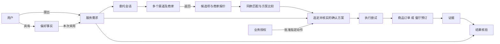

# EIGOS 共用业务对象：买咖啡与订餐厅

日期：2026-10-15。状态：业务模型草案，供确认职责与接入契约；本轮不修改代码、不调用下单接口、不自动付款。

后续规格：2026-10-18 的 [Ontology v0.2 落地细化](ontology-spec-v0.2-2026-10-18.md) 统一三领域的共用对象与规则；Offer 扩展为服务报价，分别承载商品、配送和预订内容。本文保留咖啡／餐厅讨论的历史目标与示例，当前术语以 [CONTEXT.md](../CONTEXT.md) 为准。

本文件描述 EIGOS 为用户协调真实服务需要掌握的最小业务信息。它不要求每种商品建立新本体，也不要求 EIGOS 重建支付宝阿宝等渠道已有的商品、商家或服务系统。阿宝不是唯一候选入口；同一需求可向多个已接入渠道和商家询价，比较后再选择。规范术语见 [CONTEXT.md](../CONTEXT.md)。

## 1. 建模边界与本次交付目标

用两个目标作对照：

- 咖啡：补齐需求、取得真实可执行方案；用户确认后创建供应商待付款订单，并把订单交给用户。自动支付不在本轮目标内。若供应商不支持“创建待付款单”，需说明实际可交付的是结算页面或订单草稿，不改名为已创建订单。
- 餐厅：补齐需求、取得可订方案；用户确认后取得餐厅／授权渠道确认的预订。若需要订金，进入用户支付流程，未满足订金条件前只报告真实的待确认／保留状态。

以上是两个流程的设计终点，不表示当前阿宝接口或 EIGOS 已能完成。订单创建、预订确认、支付和实际履约各有自己的状态，不能共用一个模糊的“成功”。

ServiceRequest 是业务需求，不等同于 A2A Task：一个需求可以关联多个提供者任务。远端 Task 的完成、商品订单的创建和餐厅预订的确认需要分别解释。

Object Type 定义可复用的实体／事件类别；Object 是一次具体实例。关系类型和 Action 也是可复用定义。例如“订单包含订单项”只定义一次，今天两杯拿铁和明天三杯奶茶产生不同对象实例。这里沿用业务本体的术语，参考 [S1][S2]，不限定必须采用 Palantir 或图数据库。

## 2. 共用 Object Type

“维护”分为业务事实的权威来源与 EIGOS 的工作记录。EIGOS 按数据使用许可保留本次决策所需的引用、快照或回执，不因此变成价格、库存或用户偏好的权威来源。禁止缓存的目录结果必须重新查询，不能被“保留证据”的设计覆盖。

| Object Type | 核心含义／最小信息 | 买咖啡的实例 | 订餐厅的实例 | 权威来源与 EIGOS 职责 |
| --- | --- | --- | --- | --- |
| **User 用户** | 用户引用、允许使用的数据范围；不必复制完整个人档案 | 点咖啡的人 | 订座的人／联系人 | 用户／其 PA 提供；EIGOS 维护任务归属与必要引用 |
| **ServiceRequest 服务需求** | 原始目标、所需结果、硬约束、可协商偏好、已知与缺失信息 | 两杯咖啡送公司，生成待付款订单 | 周五 19:00、4 人，取得订座确认 | EIGOS 维护；用户确认目标和变更 |
| **PreferenceFact 偏好事实** | 属性和值、适用领域／人物、来源、确认时间、使用许可 | 常喝冰拿铁 | 偏好粤菜、安静环境 | 用户／PA 为来源；EIGOS 按授权读取并保留任务所需快照，长期存储需另有授权 |
| **ServiceCapability 服务能力** | 能完成什么、限制、验证范围、服务提供者 | 支持咖啡下单、配送或自取 | 支持餐厅订座，而不只是推荐或取号 | 提供者声明与实际验证；EIGOS 维护接入和验证记录，不把声明直接当可执行证据 |
| **Provider 服务提供者** | 主体及角色：聚合入口、商家、履约方；同一需求可同时询问多个渠道 | 阿宝、咖啡店、配送方 | 阿宝、餐厅、预订平台 | 各主体提供事实；EIGOS 区分角色与外部标识，不把聚合入口当成全部履约责任主体 |
| **ServiceEngagement 委托会话** | 本地需求引用、远端会话／任务引用、等待的问题、当前进度 | 与阿宝协商咖啡方案 | 与阿宝协商可订餐厅和时段 | EIGOS 保持本地与远端关联；阿宝维护其服务端会话 |
| **CandidateOption 候选项** | 供应商返回的可选对象、可用性、来源和查询时间 | 某店某规格咖啡 | 某餐厅某时段可订方案 | 阿宝／商家返回；EIGOS 按渠道规则处理本次候选；未查询到的价格和可用性保持未知，禁止缓存的结果不持久保存 |
| **Offer 商家报价** | 商品／规格、商家和渠道、数量、费用组成、交付条件、来源及查询时间 | 同款咖啡不同渠道的价格与配送方案 | 同一餐厅／时段不同预订渠道的费用与条款 | 商家／渠道提供；EIGOS 规范化可比字段，缺失值不推定 |
| **Comparison 比较结果** | 对比目标、候选、同款判定、评价依据、渠道覆盖和未知项 | 比较可送达的总价与时效 | 比较可确认时段、订金及取消条件 | EIGOS 主责；只描述已查询范围内的结论 |
| **Proposal 确认方案** | 具体选择、费用／价格状态、条款、有效性、方案版本 | 两杯指定规格咖啡、地址、费用与时效 | 具体餐厅、日期时间、人数、费用／订金与取消条件 | 业务价格／条款来自供应商；EIGOS 组织为可确认快照并检查用户约束 |
| **Authorization 业务授权** | 谁批准、批准哪个方案和动作、额度／范围、有效条件与撤销情况 | 同意按此方案创建订单；不含付款 | 同意提交此订座；订金支付另行处理 | 用户或有效代理授权；EIGOS 保存范围并执行前复核；阿宝需要自己的有效用户授权 |
| **ExecutionAttempt 执行尝试** | 目标动作、方案版本、请求关联标识、远端引用及已知结果 | 发出创建订单请求 | 发出提交预订请求 | EIGOS 保存尝试记录，供应商返回实际业务结果；超时记未知而非未执行 |
| **Evidence 证据** | 来源、外部标识、观察时间、事实内容、关联需求／方案 | 供应商订单号及待付款详情 | 餐厅预订号、确认状态和预订详情 | 供应商业务系统或用户确认是具体来源；EIGOS 保留可追溯记录 |
| **OutcomeAssessment 结果核验** | 对照哪一版交付要求、已满足／未满足项及证据 | 待付款订单的商品、数量和地址与批准方案一致 | 预订的店、日期时间与人数符合方案且已确认 | EIGOS 负责核对和如实汇报，不超出证据强度 |

不把每个简单字段都做成独立 Object Type：Money（数值＋币种＋计价单位）、Quantity、时间与时区、地址快照、偏好值通常可以先作为组合属性使用。只有需要独立身份、共享引用或生命周期时，再提升为对象。例如用户地址簿条目可以有独立身份，本次配送地址只是它的确认快照。

用户过敏、无障碍要求等若被明确提出，应作为本次硬约束处理，不能因被存放在“偏好”来源中就降为可忽略项。本模型不要求主动收集这些资料。

## 3. 两个流程真正不同的对象

| 领域对象 | 咖啡购买 | 餐厅预订 | 复用判断 |
| --- | --- | --- | --- |
| 供给对象 | **ProductVariant**：门店、商品标识、规格选项 | **Venue／ReservationSlot**：餐厅、可订日期时间、适用人数或席位条件 | 不强行共用所有字段；都可提供 CandidateOption 所需的最小信息 |
| 请求明细 | **OrderLine**：商品／规格、数量 | **BookingDetails**：日期时间、人数、联系人、特殊要求 | 数量不是人数的简单同义词，校验规则不同 |
| 服务位置 | **DeliveryDetails**：配送方式和地址；自取时为取餐点 | **VenueLocation**：到店地点；通常不需要用户收货地址 | 共用地点值的表达，保留业务角色 |
| 已形成的业务承诺 | **Order**：已创建、待付款、已付款、制作／配送、交付等事实 | **Reservation**：申请、保留、待订金、已确认、拒绝、取消等事实 | 可共用外部引用、确认详情和证据接口，但保留不同对象类型与状态 |
| 完成证据 | 本轮要求为供应商待付款订单；若后续目标扩大到送达，还需配送证据 | 本轮要求为符合条件的已确认预订；排队号或团购券不满足 | 按目标分别验收，不设“一份订单号等于全部完成” |

“冰”“少糖”“燕麦奶”优先是供应商商品可选规格的数据，不为每种口味创建 Object Type。未知／无可用选项时询问或说明缺口，不能把任意自然语言值直接当作供应商已支持的规格。

## 4. 共用关系

| 关系 | 含义及边界 |
| --- | --- |
| User **提出** ServiceRequest | 每项需求有明确归属；代他人办理时另记实际服务对象 |
| User **具有** PreferenceFact | 偏好带来源和适用范围；一次临时要求不自动改成永久偏好 |
| ServiceRequest **使用** PreferenceFact | 记录本次采用的值，当前明确指示优先；冲突或失效时重新澄清 |
| Provider **提供** ServiceCapability | 区分能力声明、已接入、已验证与本次可用 |
| ServiceRequest **通过** ServiceEngagement **委托给** Provider | 远端任务只是业务协作记录，不自动等同订单或预订 |
| ServiceEngagement **返回** CandidateOption | 候选不代表锁定或承诺；候选可能过期或被撤回 |
| Offer **由** Merchant **经由** Channel **提供**，**对应** ProductVariant | 商品匹配与报价条件分开；同款不等于同商家／同条款 |
| Comparison **比较** ServiceRequest 的多个 Offer | 保留候选与渠道来源、未返回状态、比较规则；不以聚合消除证据差异 |
| Proposal **落实** ServiceRequest，**引用** CandidateOption | 形成可确认的具体安排；候选变化需形成新的方案版本 |
| Authorization **批准** Proposal 的指定 Action | 授权不能泛化到别的方案、付款、追加商品或其他用户 |
| ExecutionAttempt **依据** Authorization 与 Proposal | 实际请求必须与获准范围一致；是否可免于再次确认取决于已有授权 |
| ExecutionAttempt **产生／查询** Order 或 Reservation | 外部业务标识在提供者范围内唯一；重试先关联原尝试 |
| Evidence **证明** Order／Reservation 的某项事实 | 证据只说明其覆盖的事实；已提交回执不证明商家已确认 |
| OutcomeAssessment **对照** ServiceRequest 与 Evidence | “订单已创建”和“咖啡已送到”采用不同验收目标 |

此图不是强制串行实现：读取偏好、核实供应商能力和澄清需求可以按必要性交替进行。目标是复用业务语义，而不是写死固定问答顺序。

## 5. 共用 Action：含义、前置条件与产出

以下是业务动作名称，不是已经存在的 API 名或阿宝方法名。

| Action | 输入与前置条件 | 产出 | EIGOS 与阿宝的拟分工 |
| --- | --- | --- | --- |
| **CaptureRequest 记录需求** | 用户明确目标及允许分享的背景 | ServiceRequest，明确交付终点 | EIGOS 主责；PA 是用户交互入口 |
| **ResolvePreferences 采用适用偏好** | 用户／PA 提供的偏好及使用许可 | 本次已知值、冲突与缺口 | EIGOS 使用获准信息；不要求阿宝暴露其全部用户记忆 |
| **ClarifyMissingInfo 澄清缺失信息** | 当前需要且未知的业务条件 | 用户回答及更新后的需求 | EIGOS 协调，阿宝可提供具体缺项；同一问题只在必要时问一次 |
| **DiscoverService 发现服务** | 目标、区域等必要条件；已建立可用接入 | 候选能力与适用条件 | 选择符合需求的已接入渠道，可并行查询阿宝等服务池；接口与当前账号资格分别验证 |
| **FindOptions 查候选** | 足够定位商品／餐厅的条件、必要用户授权 | CandidateOption | 由所选渠道及商家查询菜单、门店、可订时段；同一需求可有多个结果来源 |
| **GetProposal 获取可执行方案** | 已选候选、完整关键规格 | Proposal：真实费用、条款与有效性 | 阿宝／商家提供业务事实，EIGOS 规范化并核对约束 |
| **MatchAndCompare 匹配与比较** | 同一需求下多个报价／候选、明确规格及用户条件 | Comparison，保留不确定与查询覆盖 | EIGOS 主责；渠道提供各自业务事实，不让单一渠道决定跨渠道排名 |
| **SelectAndRevalidate 选择并重新核实** | 已选候选、当前价格／库存／时段及已有授权 | 最新 Proposal 或需要重新确认的变更 | EIGOS 选择并校验，最终渠道核实当前可执行性 |
| **ConfirmProposal 核验方案授权** | 用户看见具体方案或已有充分授权；条件未变化 | Authorization／仍缺授权 | EIGOS 维护范围；客户端承接所需确认；阿宝完成其要求的用户授权 |
| **CommitService 提交已确认服务** | 方案仍可用、必要授权有效、未知旧尝试已查清 | Order 或 Reservation 的真实引用与状态 | 阿宝／商家执行；EIGOS 维护本地与远端关联。具体实现分别是 CreateOrder／RequestReservation |
| **ObserveProgress 查询进度** | 已有会话、执行尝试或业务引用 | 新 Evidence 与准确状态 | 阿宝／商家为业务来源；EIGOS 更新任务并转达用户 |
| **AssessOutcome 核验结果** | 明确交付目标、匹配的业务回执 | OutcomeAssessment | EIGOS 主责，可读取阿宝返回的可核查证据 |
| **RequestChange／Cancel 变更或取消** | 用户要求、供应商支持、相关费用／规则明确 | 变更／取消申请及最终确认 | 阿宝／商家办理；EIGOS 核对授权与真实结果，取消任务不自动撤销订单 |

支付只作为独立可观察事实或需用户处理的步骤：本轮没有自动 Pay Action。供应商要求订金且用户尚未支付时，EIGOS 说明阻塞和保留期限，不伪称已订座。

可复用的是这些动作的意图、输入输出关系和校验方式；不同供应商的实际调用仍需一次接入映射。不能由模型凭动作名字猜测端点和参数。

## 6. 两个端到端流程逐步对照

| 阶段 | 买咖啡 | 订餐厅 | 共用部分 |
| --- | --- | --- | --- |
| 用户发起 | “用 EIGOS 给我买两杯咖啡，送公司” | “用 EIGOS 订周五晚上四个人吃饭” | 建立需求；已有“一杯／两杯”“四人”等信息不重复问 |
| 采用偏好 | PA 已提供适用的拿铁、冰、少糖偏好，就使用；没有则问喝什么 | 已有菜系、价位、区域偏好则采用；没有且影响搜索才问 | 偏好来源、适用范围、当前指示优先、只补缺项 |
| 核对关键条件 | 确认“公司”实际指哪处地址；必要时补数量、规格或预算 | 确认具体周五日期、时间／时区与区域；必要时补预算 | 将相对描述落实为业务可用信息，不凭默认值制造事实 |
| 多渠道查服务与候选 | 可配送门店、商品及可选规格 | 可订餐厅与日期时间；区分订座、排队和团购 | 调用已有服务池，保留允许留存的候选来源和查询时间 |
| 形成方案 | 具体两杯商品、总价／配送费、地址、时效 | 具体餐厅、日期时间、四人、订金／取消条件 | 方案版本、费用状态、条款、用户条件检查 |
| 用户确认 | 确认后允许创建此咖啡订单，不含支付 | 确认后提交此订座；需要订金时交给用户支付 | 授权绑定方案；条件变化重新核验 |
| 业务提交 | 取得供应商订单号和待付款状态 | 取得已确认预订号；若只是待确认／保留则如实报告 | 执行尝试、远端引用、防重与未知结果处理 |
| 交付与核验 | 核对商品、数量、地址及费用，交付待付款订单／官方支付入口 | 核对店、日期时间、人数及确认状态，交付预订凭证 | 证据匹配用户目标；不扩大完成含义 |
| 后续 | 用户付款后才追踪制作／配送；取消需看商家确认 | 修改人数／时间或取消时检查规则和订金影响 | 复用查询、变更、取消的协调机制 |

所有示例都是流程说明，没有实际地点、金额或预订资源，也没有生成订单。

## 7. 谁维护什么

| 信息或职责 | EIGOS | 用户／PA | 阿宝／支付宝 | 最终商家／履约方 |
| --- | --- | --- | --- | --- |
| 用户目标与任务交付边界 | 主记录与追踪 | 提出、澄清、改变目标 | 接收必要委托 | 接收业务所需内容 |
| 用户长期偏好 | 默认只取本次获准快照 | 优先权威来源 | 可使用其自身获授权偏好，但对 EIGOS 是否可见未知 | 仅获取必要规格／要求 |
| 服务能力目录 | 维护可用入口、映射与已验证范围 | 选择 EIGOS | 拟负责生态服务发现；调用方接口待核实 | 提供服务事实 |
| 菜单、商品规格、库存、可订时段 | 不维护全量副本；保留本次必要快照 | 选择／约束 | 拟负责聚合查询与沟通 | 权威业务来源 |
| 商品价格、配送费、订金、取消条款 | 规范化、比较约束、展示来源 | 确认或拒绝 | 拟返回可执行方案 | 权威报价／规则来源 |
| 业务操作授权 | 保存范围并逐次核验适用性 | 授权主体或有效代理 | 管理其生态内的登录／业务授权 | 核对执行所需权限 |
| 外部订单／预订的创建与状态 | 保存引用与观察记录 | 接收结果 | 拟协调调用并回传 | 权威业务执行与状态来源 |
| 任务是否达到用户约定结果 | 负责证据核对与如实报告 | 必要时确认收到／接受结果 | 提供可核对回执 | 提供实际履约证据 |

因此，EIGOS 的核心资产是“用户意图和授权的准确上下文、跨服务协调、结果核验”，不是自建一套所有菜单、航班、餐厅库存数据库。

## 8. 供应商字段的正确对应

此处描述语义映射，不伪造阿宝实际字段名：

| 供应商返回内容 | EIGOS 中的对应 | 必须核对 |
| --- | --- | --- |
| 商品／门店标识 | ProductVariant／Provider 的外部引用 | 提供者命名空间、门店与商品规格，不仅是展示名称 |
| 可选规格 | 商品选项数据 | 允许值和相互限制；“少糖”是否确实可选 |
| 报价 | Proposal 的费用事实 | 币种、单位、包含哪些费用、是否估价、有效条件；缺价格不等于免费 |
| 可订时间 | ReservationSlot | 日期、时间、时区、人数、是候选还是已保留 |
| 远端任务完成 | ServiceEngagement 的进度证据 | 完成的是询价、订单创建还是实际履约，不能直接成为用户目标完成 |
| 订单号／预订号 | Order／Reservation 的外部引用 | 真实业务主体和状态；本地任务号不能代替它 |
| 支付页面或链接 | 订单关联的用户操作入口 | 不据此认定已付款、已出票或已订座 |
| 取消受理 | 取消尝试的回执 | 受理不等于取消已生效，退款申请不等于到账 |

只映射足以协调本次目标的内容。若阿宝仅返回可显示的卡片或前台页面，EIGOS 应保留引用并让 PA／用户完成必要交互，而不是宣称后台已经取得全部业务对象。

## 9. 可复用性压力检查

| 情况 | 共用模型应怎样处理 | 是否需要新本体 |
| --- | --- | --- |
| 拿铁改成美式，或换咖啡品牌 | 更换商品／规格实例，重新询价和核验授权 | 不需要；可能更新供应商数据映射 |
| 两杯饮品各有不同偏好 | 两个订单项各自持有规格；用户级偏好不覆盖另一位饮用者 | 不需要 |
| 用户常喝拿铁，这次明确说美式 | 本次指示优先；不自动修改长期偏好 | 不需要 |
| 原店缺货，换店或换规格 | 新候选与方案版本；检查地址、费用、数据去向和既有授权 | 不需要；需处理条件变化 |
| 餐厅只有排队号或团购券 | 不作为已确认预订；说明能力不足或另提用户选择 | 不靠改名字复用，必须保留对象语义差异 |
| 餐厅免费订座／需要订金 | 同一 Reservation 类型，费用条件不同；缺失费用信息标未知 | 不需要两个独立本体 |
| 提交后超时，不知是否产生订单 | 查询原执行尝试；未核实前不重复创建 | 不需要 |
| 阿宝宣布覆盖很多服务，但当前账号无订座调用能力 | ServiceCapability 声明存在，本次可执行性未建立 | 不创建假 ProviderBinding 或模拟成功 |
| 订单已创建，用户目标其实是“送到” | 订单创建只完成一个阶段，继续追踪交付证据 | 不需要；要正确设置需求交付边界 |

## 10. 阿宝能力的证据边界

2026-06-16 蚂蚁官方产品说明展示阿宝理解意图、匹配生活服务并处理点餐等场景；这是产品能力说明，不是 EIGOS 已获得这些调用接口的证明。[S3]

支付宝团队在 W3C 活动的材料展示 AHA 的服务池、查找／发现、多轮意图澄清、结构化卡片以及服务执行交接（第 7–8 页）。这支持上述拟分工，但没有给出足以实现咖啡下单或餐厅订座的完整接口契约。[S4]

项目现有记录显示：AI 应用及资源订阅已取得一定进展，但选定的第三方免费 Agent 调用尚未取得业务回答；它也不是阿宝整体服务入口。当前不能据此把咖啡购买或餐厅预订标成 EIGOS 已接通。[项目核验记录](alipay-ai-resource-live-check-2026-10-15.md)

“约 300 项”或其他覆盖数量不参与本体设计，也不等于这批服务全部对 EIGOS 当前身份开放。本轮没有再次登录控制台或检查权限变化。

## 11. 接口核实前应保持开放的事项

以下是供应商契约待确认项，不需要用户现在凭空回答：

1. EIGOS 的云端调用方身份是否可以直接使用阿宝生活服务，还是必须有终端 SDK／前台卡片承接。
2. 服务发现能返回哪些内容；具体是否有咖啡下单和餐厅订座，而不仅是推荐、团购或取号。
3. 阿宝能否接收 PA 提供的偏好和约束，如何提出缺项、接收用户回答并继续原任务。
4. 方案、报价有效性、创建待付款订单／提交预订、查询和取消的正式契约。
5. 哪些用户授权必须在支付宝端完成，以及如何收到授权、订单、预订和履约回执。

据此再决定 EIGOS 对商品／预订对象要理解到多深。能由阿宝稳定完成并回传证据的领域细节，优先交给阿宝；EIGOS 始终保留需求、约束、授权边界和结果核验。

## 12. 设计结论

可以复用的是一组核心 Object Type、关系和协调 Action。咖啡与餐厅保留各自的交易对象和关键规则；具体商品、门店、时段属于实例与供应商数据。EIGOS 不需要为每次点单、每种口味或每家餐厅新建本体。

本轮产出只有术语与业务模型。真实服务实现继续以拿到阿宝调用契约、取得当前账号可用性证据、跑通真实订单／预订回执为前提，不再用 CSV 试点替代生活服务交付。

## 来源

- [S1：Object Type 与 Object 的区别](https://www.palantir.com/docs/foundry/object-link-types/object-types-overview)
- [S2：Link Type 与 Link](https://www.palantir.com/docs/foundry/object-link-types/link-types-overview)
- [Action Type 的操作性定义](https://www.palantir.com/docs/foundry/action-types/overview)
- [S3：蚂蚁官方阿宝产品介绍，2026-06-16](https://www.antgroup.com/hk/news-media/press-releases/1781596800000)
- [S4：Alipay – Exploration and Practice of Agent Interconnection，W3C 活动材料](https://www.w3.org/2026/04/hangzhou-webevolve-liu-yunxuan.pdf)

对象名称、字段范围、动作划分和职责表是本项目设计建议，非上述厂商的实际接口定义或已签订的责任安排。

## 多渠道扩展

同一需求向多个渠道／商家询价，商品匹配、费用归一化、方案比较与选定后的执行边界见 [多渠道发现与方案比较](multi-channel-discovery-and-comparison.md)。本文件中阿宝的拟分工可分别用于其他符合条件的渠道，不代表只能单路委托。
