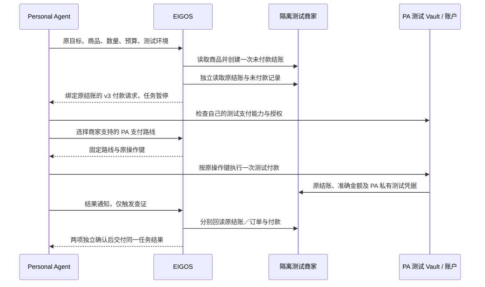

# Shopify 测试结账 → PA 自有支付能力 → EIGOS 独立确认

2026-10-24。能力 `shopify.checkout.pa-payment.sandbox@1`，付款交接协议 v3，新建数据库使用 `eigos.business@19`。现有预约付款协议 v2 及 v15–v18 本体摘要保持不变。运行时复用 Gateway／Worker、持久任务、原操作恢复和验收机制。

用户授权 Personal Agent（PA）使用自己的支付能力。EIGOS 创建待付款结账，传递原结账、最终金额和商家支持的支付入口；PA 使用自己的 Vault 或支付账户执行付款，EIGOS 再独立读取商家付款与订单记录。

**本实现是隔离测试环境。** 商家为本机 Shopify 合约模拟器，复用 Shopify 商品和 UCP 结账响应校验；支付为 PA 独立测试 Vault／测试账户。它不连接官方 Shopify 开发店、真实 Grok Vault、Stripe 或真实资金。现有真实未付款 Shopify 结账能力保持独立。

## 职责与完成条件



- 创建结账使用准确的沙箱 `reserve` 许可，付款花费为 0。EIGOS 没有付款动作，也拿不到 PA 的卡或账户令牌。
- 交接前，模型必须实际读取和评估商品、原结账、未付款状态。总价包含全部测试费用，来源、商品和数量固定。
- PA 的支付授权独立绑定收款方、币种、金额上限、次数和有效期。测试助手只接受本机模拟器及固定测试卡／测试账户。
- 完成必须同时匹配原 checkout ID、条款摘要、收款方、准确金额／币种、付款操作键、路线，以及商家确认的同一个 order ID。
- 付款通知、页面提示、PA 自报、只有付款或只有订单，都不足以完成。结果为 `evidenceLevel: synthetic`、`realPayment: false`，不证明真实商家联调或履约。

## 复用的交接协议

共享协议位于 `packages/capabilities/payment-handoff.ts`，原预约模块保留兼容导出。继续使用同一个 `paPayment` 状态、`select_payment_route`、`report_payment_result`、`reconcile_task` 和 Python A2A 客户端。

v3 请求保留原任务、版本、owner 摘要、配置摘要和不可变请求摘要。`terms.resource` 绑定原 checkout ID 和条款摘要；`checkoutObservation`／`unpaidObservation` 引用独立来源对象；`providerId`／`payeeId`／`amount` 固定来源、收款方与最终金额；`checkout` 保留原继续入口并声明 `testMode: true`；`routes` 列出可用的 `pa_vault`／`pa_payment_account`；`expiresAt` 为原结账期限。

PA 先检查自己的测试连接器，再选择路线：

```json
{
  "action": "select_payment_route",
  "taskId": "<原任务 UUID>",
  "requestId": "<稳定 UUID>",
  "handoffId": "<原 request.id>",
  "handoffDigest": "<原 request.digest>",
  "capability": {
    "route": "pa_vault",
    "status": "available",
    "environment": "sandbox",
    "observedAt": "<刚刚检查的 ISO 时间>"
  }
}
```

`capability` 是可用性观察，不是付款许可或证明。现有 v2 预约继续提交 `wallet` 字段并保留原 Link 双路线策略。一次请求只能提供其中一种观察。

路线和 `selection.operationId` 持久化后不自动切换。PA 派发前重新读取原任务，确认仍在等待同一付款、条款未过期且本人授权覆盖该付款。它先持久记录原操作，再发送一次付款。重启、超时和重复调用只查询原操作；`not_found` 也不自动重付。

付款后仅通知原 `handoffId`、`handoffDigest` 和 `outcome`（`submitted`／`unknown`／`declined`／`canceled`）。通知不含凭据。Worker 读取当前通知序号之后的两份新来源回执；未确认时暂停等待。取消后的迟到结果只作查证和审计，不把取消任务改成完成。

## 完整模型验收

```bash
node --import tsx examples/verify-pa-shopify-payment-sandbox.ts --run --directory data/shopify-pa-payment-acceptance
```

命令建立独立数据库、随机本机端口和不同的 EIGOS／商家／PA 凭据，启动真实 Codex Personal Agent 和真实 EIGOS Worker 模型。PA 自行发现服务、提交唯一任务、批准零付款花费的结账准备、检查测试能力、选择路线、付款、通知并读取最终交付物。观察器仅核验原任务、两种协议与商家原记录，不代替 PA 提交任务或付款。

输出保留在忽略的私有目录：`verification.json`、原任务、PA 工具记录、商家审计以及 MCP／A2A 独立回读。已有验收目录拒绝重建；失败后保留原任务和操作记录查证。结束时关闭本轮服务。

已经完成的原验收可用 `node --import tsx examples/observe-pa-shopify-payment-sandbox.ts --directory <原目录>` 重新核验。此观察器不启动 Worker／PA 模型，不提交任务、不创建结账、不付款；它读取原持久结果并检查当前版本的交接完整性。组合任务从已核验的付款组件读取领域结果，公开任务摘要只用于比对交付物，内部规划证据从本人任务账本读取。

## 手动启动隔离环境

运行 `npm run setup:shopify-payment-sandbox` 创建私有配置。分别启动商家、Gateway 和 Worker：

```bash
npm run dev:shopify-payment-sandbox
```

```bash
node --env-file=data/shopify-payment-sandbox/gateway.env --import tsx apps/gateway/main.ts
```

```bash
node --env-file=data/shopify-payment-sandbox/gateway.env --import tsx apps/worker/main.ts
```

为 PA 验证并保存 EIGOS 连接：

```bash
python3 integrations/grok/eigos-delegate/scripts/eigos_a2a.py --config data/shopify-payment-sandbox/pa-a2a.json configure --card-url http://127.0.0.1:3438/.well-known/agent-card.json --token-file data/shopify-payment-sandbox/gateway-token --allow-loopback-http
```

PA 的独立测试支付助手 `integrations/grok/eigos-delegate/scripts/eigos_test_payment.py` 使用 `--config data/shopify-payment-sandbox/pa-payment.json`，提供 `capabilities`、`pay`、`query`，每个命令均需原 `--task-id`。输出不含凭据；原操作存在时，`pay` 也只执行查询。

默认测试商品为 `merchantId=shopify-sandbox`、`variantId=gid://shopify/ProductVariant/1001`，单件完整测试价为 USD 1。PA 授权默认最多一次付款；重复 setup 不重置次数、不续期，也不清空操作账本。

## 配置和验证边界

新能力默认关闭。启用同时要求 `EIGOS_ACTION_SANDBOX=true`、`EIGOS_SHOPIFY_PAYMENT_SANDBOX_URL` 为明确端口的 `http://127.0.0.1` 原点、`EIGOS_SHOPIFY_PAYMENT_SANDBOX_TOKEN_FILE` 为绝对私有来源凭据路径、本机 development 身份、非 production，以及任务 `executionEnvironment=sandbox`。PA 凭据和测试 Vault 不进入 Gateway／Worker 配置；Gateway 仅登记能力，连接器拒绝在 Gateway 侧执行来源动作。

专项测试覆盖两条路线、原预约兼容、A2A／MCP 一致性、Gateway／Worker 和商家重启、付款／创建响应丢失、重复通知、凭据隔离、跨 owner 拒绝、付款与订单身份／金额不匹配，以及取消后的迟到结果。官方开发店、实际 PA Vault／支付账户和生产结账仍需按同一原操作与独立回读契约单独接入；该模拟器不代表官方 Shopify 支付集成已经完成。
